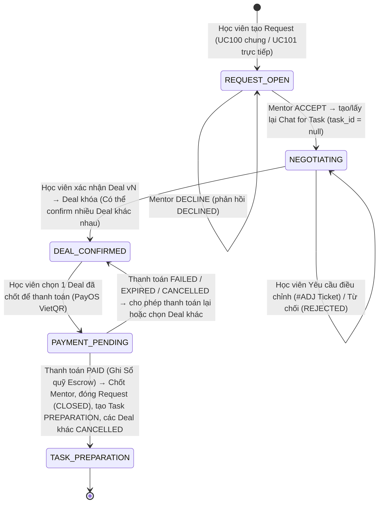
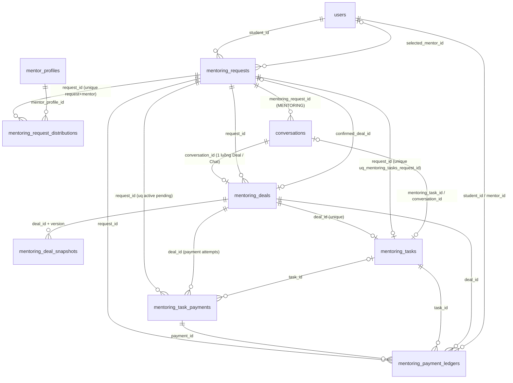

# ĐẶC TẢ YÊU CẦU & THIẾT KẾ CHI TIẾT: UC100 – UC105 - CHUỖI NGHIỆP VỤ MENTORING END-TO-END (REQUEST → RESPONSE → CHAT FOR TASK → DEAL → PAYMENT → TASK)

> Tài liệu được viết theo **mã nguồn thực tế** sau migration `V24__adjust_mentoring_deal_confirmation_and_payment_flow.sql` (kế thừa `V21`).
> Khi có khác biệt với SRS riêng lẻ của UC103 / UC104 / UC105, **tài liệu này là nguồn sự thật** cho phần liên kết giữa các UC.

## PHẦN 1: ĐẶC TẢ NGHIỆP VỤ (REPORT 3)

### 2.2.3 Business Workflow (Luồng nghiệp vụ)



> `NEGOTIATING` là trạng thái suy ra (Request `OPEN` + ít nhất một phản hồi `ACCEPTED`), không lưu thành giá trị riêng.

#### Mô tả chi tiết luồng xử lý bằng chữ (Business Step Description):
* **Bước 1 - Tạo Request**: Học viên tạo `MentoringRequest` (status `OPEN`).
  * UC100 (GENERAL): matching nội bộ tạo N bản ghi `mentoring_request_distributions` (mỗi Mentor phù hợp một bản ghi `PENDING`).
  * UC101 (DIRECT): đúng 1 bản ghi `PENDING` cho Mentor đích (`target_mentor_id`). Hai loại hội tụ về cùng pipeline phía sau.
* **Bước 2 - Mentor phản hồi (UC103)**: ACCEPT chỉ có nghĩa "đồng ý trao đổi". Hệ thống khóa Request + bản ghi phản hồi, chuyển `PENDING → ACCEPTED`, tạo hoặc lấy lại **Chat for Task** (Conversation `MENTORING`, duy nhất cho `(request_id, student_id, mentor_id)`, `mentoring_task_id = null`) và gửi tin nhắn hệ thống *"[Tên Mentor] đã đồng ý trao đổi về Request của bạn."*. Gọi ACCEPT lặp lại trả về đúng Chat cũ. DECLINE chuyển `PENDING → REJECTED` (hiển thị DECLINED).
* **Bước 3 - Thương lượng trong Chat for Task (UC104)**: Mentor gửi Deal Ticket:
  * *Chấp nhận Deal theo Request* (`REQUEST_ACCEPTANCE`): điều khoản lấy từ Request — giá = `budget_max` (nếu trống dùng `budget_min`), deadline = `expected_deadline`, cùng hình thức/loại nhiệm vụ.
  * *Deal lại / Tạo Deal Ticket* (`RENEGOTIATION`): Mentor nhập phạm vi, giá, deadline, hình thức, loại nhiệm vụ, kết quả kỳ vọng, ghi chú.
  * Mỗi lần gửi tạo phiên bản mới (`mentoring_deal_snapshots (deal_id, version)`), Mentor được tính là đã xác nhận; Học viên cần xác nhận lại.
* **Bước 4 - Học viên phản hồi Deal**: 
  * *Xác nhận*: chuyển Deal sang `DEAL_CONFIRMED`, khóa Deal (`isLocked = true`).
  * *Yêu cầu điều chỉnh*: sinh Ticket nhúng `#ADJ-xxx` (`MentoringAdjustmentTicketEmbed`) vào dòng thời gian chat, chuyển snapshot cũ sang `SUPERSEDED`.
  * *Từ chối* (`REJECTED`). Mọi hành động chỉ áp dụng cho phiên bản mới nhất (backend kiểm tra `version`).
* **Bước 5 - Trạng thái sau xác nhận Deal (Sau V24)**: Cho phép **nhiều Deal cùng đạt `DEAL_CONFIRMED`** cho 1 Request (đã xóa unique index `uq_mentoring_deals_request_confirmed`). Học viên có quyền thỏa thuận và so sánh giải pháp với nhiều Mentor khác nhau. Tại bước này, Request **vẫn ở trạng thái `OPEN`, chưa chốt Mentor** (`selected_mentor_id = null`).
* **Bước 6 - Thanh toán Ký quỹ Escrow (UC105)**: Học viên chọn 1 trong các Deal đã chốt để thanh toán.
  * Hệ thống áp dụng khóa bi quan trên Request (`findByIdForUpdate`).
  * Ràng buộc `uq_mentoring_task_payments_request_pending` đảm bảo tối đa 1 phiên checkout `PENDING` còn hiệu lực trên mỗi Request. Nếu phiên cũ của cùng Deal còn hạn (< 15 phút), hệ thống **tái sử dụng** thông tin VietQR ngay. Nếu phiên cũ đã hết hạn hoặc đổi Deal, hệ thống cập nhật sang `EXPIRED`/`CANCELLED` và gọi `saveAndFlush` trước khi tạo đơn mới trên PayOS.
  * Thất bại / hết hạn / hủy thanh toán không tạo Task, không đóng Request, Học viên có thể thanh toán lại hoặc chọn Deal khác để thanh toán.
* **Bước 7 - Kích hoạt Task, Ghi Sổ quỹ & Chốt Mentor**: Khi thanh toán `PAID` (webhook `code = 00` hoặc polling):
  * **Ghi Sổ quỹ Mentoring (`mentoring_payment_ledgers`)**: Ghi nhận một bút toán loại `ESCROW_COLLECTION` với trạng thái `SUCCEEDED`. Kinh phí được tạm giữ an toàn trong Escrow trung gian của hệ thống.
  * Tạo đúng 1 `MentoringTask` (`PREPARATION`) liên kết Request, Deal, Conversation, Student, Mentor (tuân thủ `uq_mentoring_tasks_request_id`).
  * **Chính thức chốt Mentor**: Request cập nhật `selected_mentor_id = mentor.id`, `confirmed_deal_id = deal.id`, chuyển trạng thái sang `CLOSED`.
  * Toàn bộ Deal của các Mentor khác cùng Request tự động bị hủy (`CANCELLED`).
  * Toàn bộ phản hồi còn `PENDING` tự động chuyển sang `EXPIRED`.
  * Các Chat for Task khác nhận tin *"Request đã chọn Mentor khác."* và chuyển sang chế độ chỉ đọc. Cuộc trò chuyện hiện tại gắn Task và nhận tin nhắn *"Thanh toán thành công, Task đã được kích hoạt."*.

### 3.2 Mentorship - Chuỗi Request → Deal → Payment → Task
Module Mentorship kết nối Học viên với Mentor. Phần này mô tả phần liên kết xuyên suốt UC100–UC105 sao cho có thể truy vết hai chiều:
`Task → Sổ quỹ Escrow → Payment → Deal (phiên bản đã chốt) → Conversation → Request → Student + Mentor` và
`Request → Mentor đã ACCEPT → Conversation → các phiên bản Deal → Học viên thanh toán Escrow → Mentor được chọn → Sổ quỹ Escrow → Task`.

#### 3.2.1 Mentor phản hồi Request & mở Chat for Task (UC103)

**Function trigger**:
*   **Navigation path**: Mentoring → Yêu cầu gửi đến → `/app/mentoring/incoming-requests/:requestId` → "Chấp nhận" / "Từ chối".
*   **Timing Frequency**: On demand.

**Function description**:
*   **Actors/Roles**: Mentor (ALUMNI có hồ sơ Mentor ACTIVE và gói còn hạn).
*   **Purpose**: Mentor đồng ý trao đổi về Request; hệ thống mở Chat for Task gắn đúng Request + Student + Mentor.
*   **Interface**: Nút Chấp nhận / Từ chối (modal nhập lời nhắn). Sau khi chấp nhận, Mentor được chuyển thẳng tới `/app/mentoring/chats/:conversationId`; trang chi tiết có nút "Mở Chat for Task". Nếu Request đã chọn Mentor khác: banner chỉ đọc.

**Data processing**:
*   `POST /api/v1/mentoring/requests/{id}/accept`: kiểm tra tài khoản/hồ sơ/gói Mentor → `SELECT … FOR UPDATE` Request → `SELECT … FOR UPDATE` bản ghi phân phối → nếu đã `ACCEPTED` trả về Chat cũ (idempotent) → kiểm tra Request `OPEN` và chưa có `selected_mentor` → `PENDING → ACCEPTED`, `responded_at` → `MentoringConversationService.getOrCreateConversation` → tin nhắn hệ thống (đẩy WebSocket sau commit).
*   `POST /api/v1/mentoring/requests/{id}/decline`: cùng các kiểm tra, `PENDING → REJECTED`.

**Function details**:
*   **Data**: `request_id`, `mentor_profile_id`, `status`, `responded_at`, `response_note`, `conversationId` (trả về).
*   **Validation**: `responseNote` ≤ 500 ký tự.
*   **Business rules**: BR-FLOW-01, 02, 03, 04, 05.
*   **Error Handling**: 403 Mentor không ACTIVE / gói hết hạn / Request không gửi tới Mentor; 400 Request đã đóng hoặc đã chọn Mentor khác; 409 phản hồi khác trạng thái đã xử lý.
*   **Normal case**: ACCEPT → 200 kèm `conversationId`; gọi lại → 200 cùng `conversationId`.
*   **Abnormal case**: Mentor chưa phản hồi cố ACCEPT sau khi Request đã chọn Mentor → 400 (phản hồi đã `EXPIRED`).

#### 3.2.2 Chat for Task & Deal Ticket (UC104)

**Function trigger**:
*   **Navigation path**: Học viên: My Requests → chi tiết Request → thẻ Mentor `ACCEPTED` → "Mở Chat for Task" → `/app/mentoring/chats/:conversationId`. Mentor: chi tiết Incoming Request → "Mở Chat for Task". Trang Tin nhắn chung tự chuyển hội thoại `MENTORING` sang màn hình này.
*   **Timing Frequency**: On demand; tải lại ngữ cảnh khi có tin nhắn realtime của cuộc hội thoại.

**Function description**:
*   **Actors/Roles**: Học viên chủ Request, Mentor của cuộc hội thoại.
*   **Purpose**: Trao đổi và chốt Deal gắn trực tiếp Request + Conversation.
*   **Interface**:
    *   Header: đối phương, nhãn "Mentor được chọn" (sau khi thanh toán thành công), "Lịch sử phiên bản", "Xem Task" (khi đã có Task).
    *   Thanh ngữ cảnh Request (mở rộng được): trạng thái Request, ngân sách, thời hạn, loại nhiệm vụ, hình thức, phản hồi của Mentor, liên kết tới trang Request.
    *   Banner: chỉ đọc (`readOnlyReason`), Deal đã khóa chờ thanh toán (kèm trạng thái lần thanh toán gần nhất, nút "Thanh toán"/"Thanh toán lại"), Task đã kích hoạt.
    *   Dòng thời gian: tin nhắn + thẻ Deal Ticket theo từng phiên bản (dựng từ `mentoring_deal_snapshots`) và các thẻ yêu cầu điều chỉnh Ticket `#ADJ-xxx`.
    *   Mentor: menu "Giao dịch" → "Chấp nhận Deal theo Request" và "Deal lại / Tạo Deal Ticket".
    *   Học viên trên phiên bản mới nhất: "Từ chối", "Yêu cầu điều chỉnh", "Xác nhận & thanh toán".

**Data processing**:
*   `GET /api/v1/mentoring/conversations/{id}`: xác thực thành viên theo người đăng nhập → trả ngữ cảnh + quyền thao tác tính ở backend.
*   `POST /api/v1/mentoring/deals` (`conversationId`, `proposalSource`, điều khoản khi deal lại): chỉ Mentor của cuộc hội thoại → khóa Request → kiểm tra chỉ đọc, Request `OPEN` chưa chốt, phản hồi `ACCEPTED` → lấy Deal của cuộc hội thoại (hoặc tạo mới) → nếu đã khóa: 409 → `version + 1`, cập nhật điều khoản, `mentor_confirmed = true`, `student_confirmed = false`, `MENTOR_CONFIRMED` → lưu snapshot → tin nhắn hệ thống.
*   `POST /api/v1/mentoring/deals/{id}/confirm` (`{version}`): khóa Request → đọc Deal → kiểm tra thành viên, phiên bản mới nhất, chưa khóa, cuộc hội thoại không chỉ đọc, Request `OPEN`, trạng thái còn hiệu lực → ghi nhận xác nhận → Deal chuyển `DEAL_CONFIRMED` và khóa (`isLocked = true`). **Request vẫn giữ `OPEN`** để Học viên có thể chốt với nhiều Mentor hoặc chuyển sang thanh toán.
*   `POST …/reject?reason&version`, `POST …/request-adjustment?note&version`: chỉ Học viên, chỉ phiên bản đang `MENTOR_CONFIRMED`.

**Function details**:
*   **Data**: `mentoring_deals` (luồng Deal của cuộc hội thoại), `mentoring_deal_snapshots` (phiên bản), `conversations.mentoring_*`.
*   **Validation**: `taskScope` 10–5000 ký tự; `agreedPrice` ≥ 0; `deadline` trong tương lai; `expectedResult` 10–3000; `changeNote` ≤ 255; `version` bắt buộc khi xác nhận.
*   **Business rules**: BR-FLOW-06 → BR-FLOW-14.
*   **Error Handling**: xem 5.3.
*   **Normal case**: Mentor gửi v1 → Học viên xác nhận v1 → Deal khóa (`DEAL_CONFIRMED`), Request vẫn `OPEN` sẵn sàng thanh toán.
*   **Abnormal case**: xác nhận v1 khi đã có v2 → 409; gửi tin trong Chat chỉ đọc → 409.

#### 3.2.3 Thanh toán & kích hoạt Task (UC105)

**Function trigger**:
*   **Navigation path**: Chat for Task → "Xác nhận & thanh toán" (tự mở modal thanh toán sau khi Deal khóa) hoặc banner "Thanh toán / Thanh toán lại" trên Deal `DEAL_CONFIRMED`.
*   **Timing Frequency**: On demand; polling trạng thái mỗi 3 giây trong modal; webhook PayOS bất đồng bộ.

**Function description**:
*   **Actors/Roles**: Học viên của Deal (thanh toán); Mentor (xem trạng thái); PayOS (cổng thanh toán).
*   **Purpose**: Thanh toán Ký quỹ Escrow theo Deal đã chốt, chốt Mentor và kích hoạt Task.
*   **Interface**: Modal VietQR/checkout hiển thị tức thì (cache 5 phút), đếm ngược 15 phút; sau khi thành công: Chat hiển thị banner Task + nút "Xem Task".

**Data processing**:
*   `POST /api/v1/mentoring/task-payments/checkout` (`{dealId}`): 
    - Khóa bi quan Request (`findByIdForUpdate`).
    - Kiểm tra Học viên của Deal, Deal gắn Request + Conversation, `DEAL_CONFIRMED` + khóa, chưa thanh toán (`isPaid = false`).
    - Ràng buộc checkout active: Nếu có giao dịch `PENDING` của cùng Deal còn hạn (< 15 phút), **tái sử dụng** và trả về thông tin VietQR ngay. Nếu giao dịch `PENDING` cũ đã quá hạn hoặc của Deal khác, cập nhật `EXPIRED`/`CANCELLED` và ép flush (`saveAndFlush`) trước khi gọi PayOS tạo đơn mới.
*   Webhook / polling: khóa giao dịch (`FOR UPDATE`) → chỉ xử lý `PENDING` → lệch tiền hoặc `code != 00` → `FAILED` (lưu lại) → thành công:
    - Cập nhật payment `PAID`, deal `is_paid = true`.
    - Ghi nhận Sổ quỹ Mentoring `mentoring_payment_ledgers` (loại `ESCROW_COLLECTION`, `SUCCEEDED`).
    - Tạo đúng 1 Task `PREPARATION` liên kết Request, Deal, Conversation, Student, Mentor.
    - Cập nhật Request: `selected_mentor_id = mentor.id`, `confirmed_deal_id = deal.id`, chuyển sang `CLOSED`.
    - Hủy các Deal của Mentor khác cùng Request (`CANCELLED`), chuyển các phản hồi `PENDING` sang `EXPIRED`.
    - Gắn `task_id` vào Conversation, gửi tin nhắn hệ thống thành công và khóa chỉ đọc các Chat for Task khác.
*   Hủy giao dịch: khóa giao dịch để không ghi đè kết quả `PAID`.

**Function details**:
*   **Business rules**: BR-FLOW-15 → BR-FLOW-21.
*   **Normal case**: webhook `00` → Ghi Sổ quỹ Escrow → 1 Task `PREPARATION` → Chốt Mentor, đóng Request, các Deal khác bị hủy.
*   **Abnormal case**: `FAILED`/`EXPIRED`/`CANCELLED` → không Task, Request vẫn `OPEN`, Deal vẫn `DEAL_CONFIRMED`, Học viên được thanh toán lại hoặc chọn Deal đã chốt khác để thanh toán.

---

### 5. Requirement Appendix (Phụ lục Yêu cầu)

#### 5.1 Business Rules (Quy tắc Nghiệp vụ)

| ID | Định nghĩa Quy tắc (Rule Definition) |
| :--- | :--- |
| BR-FLOW-01 | Request chung (UC100) có N bản ghi phản hồi (Request–Mentor) duy nhất theo `(request_id, mentor_profile_id)`; Request trực tiếp (UC101) có đúng 1 bản ghi cho Mentor đích. Sau khi tạo, hai loại đi cùng một pipeline. |
| BR-FLOW-02 | Trạng thái phản hồi: `PENDING`(WAITING) → `ACCEPTED` hoặc `REJECTED`(DECLINED); `EXPIRED` khi Request đã chọn Mentor khác. Không dùng chung trạng thái với xác nhận Deal. |
| BR-FLOW-03 | ACCEPT không xác nhận Deal, không chọn Mentor, không tạo Task, không bỏ qua thanh toán. |
| BR-FLOW-04 | Mỗi bộ `(request_id, student_id, mentor_id)` có duy nhất một Chat for Task (unique index `uq_conversations_mentoring_context`); ACCEPT idempotent nhờ khóa bi quan Request + phản hồi. |
| BR-FLOW-05 | Chỉ được ACCEPT/DECLINE khi Request `OPEN`, chưa có `selected_mentor`, Mentor ACTIVE và gói còn hạn, Mentor nằm trong danh sách nhận Request. |
| BR-FLOW-06 | Chỉ Học viên chủ Request và đúng Mentor của cuộc hội thoại được đọc/gửi tin/xem Deal của Chat for Task; quyền kiểm tra theo người dùng đăng nhập, không theo ID client gửi. |
| BR-FLOW-07 | Deal Ticket bắt buộc gắn `request_id` + `conversation_id` (`ck_mentoring_deals_request_context`); mỗi Chat for Task có một luồng Deal (`uq_mentoring_deals_conversation`), các phiên bản lưu ở `mentoring_deal_snapshots (deal_id, version)`. |
| BR-FLOW-08 | Chỉ Mentor phát hành phiên bản Deal Ticket; Mentor được tính là đã xác nhận phiên bản vừa gửi. |
| BR-FLOW-09 | "Chấp nhận Deal theo Request" lấy giá = `budget_max` (nếu trống: `budget_min`), deadline = `expected_deadline` (phải ở tương lai), hình thức/loại nhiệm vụ của Request; hình thức tham gia `BOTH` được quy về `INDIVIDUAL`. |
| BR-FLOW-10 | Chỉ phiên bản mới nhất được xác nhận / từ chối / yêu cầu điều chỉnh / thanh toán; backend so sánh `version` client gửi với phiên bản hiện tại. |
| BR-FLOW-11 | Yêu cầu điều chỉnh → sinh Ticket `#ADJ-xxx` nhúng vào Chat, đánh dấu snapshot cũ sang `SUPERSEDED`; Từ chối → `REJECTED`; cả hai không tạo Task/Payment và không xóa Request; Mentor có thể gửi phiên bản tiếp theo. |
| BR-FLOW-12 | Khi hai bên cùng xác nhận một phiên bản: Deal chuyển `DEAL_CONFIRMED` + khóa (`isLocked = true`); không bên nào được sửa nội dung Deal. Tại thời điểm này Request **vẫn giữ `OPEN` và chưa chốt Mentor**. |
| BR-FLOW-13 | **Nhiều Deal cùng xác nhận (Migration V24)**: Cho phép nhiều Deal cùng đạt `DEAL_CONFIRMED` cho 1 Request (đã xóa bỏ ràng buộc unique index `uq_mentoring_deals_request_confirmed`). Học viên có quyền thỏa thuận và so sánh phương án tốt nhất trước khi quyết định chi trả. |
| BR-FLOW-14 | **Chốt Mentor chỉ diễn ra khi thanh toán Ký quỹ thành công (PAID)**: Chỉ sau khi tiền vào Escrow hệ thống, Request mới cập nhật `selected_mentor_id`, `confirmed_deal_id` và chuyển sang `CLOSED`. Đồng thời toàn bộ Deal của các Mentor khác cùng Request chuyển sang `CANCELLED`, các phản hồi `PENDING` chuyển sang `EXPIRED`, và các Chat for Task khác chuyển sang chế độ chỉ đọc. |
| BR-FLOW-15 | Thanh toán chỉ được thực hiện từ Deal đã khóa (`DEAL_CONFIRMED`), thuộc sở hữu của Student; số tiền lấy server-side từ `agreed_price`. |
| BR-FLOW-16 | **Duy nhất một phiên checkout đang chờ**: Mỗi Request chỉ được có tối đa 1 giao dịch thanh toán ở trạng thái `PENDING` còn hiệu lực (`uq_mentoring_task_payments_request_pending`). Giao dịch `PENDING` còn hạn (< 15 phút) của cùng Deal được tái sử dụng; nếu quá hạn hoặc đổi Deal thì hủy phiên cũ bằng `saveAndFlush` trước khi tạo mới. |
| BR-FLOW-17 | `FAILED`/`EXPIRED`/`CANCELLED` không tạo Task, Request vẫn `OPEN`, Deal vẫn giữ `DEAL_CONFIRMED`; Học viên được thanh toán lại hoặc chọn Deal đã chốt khác để thanh toán. |
| BR-FLOW-18 | **Ghi Sổ quỹ Mentoring (Escrow Inflow)**: Ngay khi giao dịch thành công (`PAID`), hệ thống ghi nhận bản ghi Sổ quỹ `mentoring_payment_ledgers` (loại `ESCROW_COLLECTION`, trạng thái `SUCCEEDED`). Đảm bảo mỗi giao dịch thanh toán chỉ sinh tối đa 1 bút toán sổ quỹ (`uq_mentoring_payment_ledgers_payment_type`). |
| BR-FLOW-19 | **Duy nhất 1 Task trên mỗi Request**: Mỗi Request chỉ kích hoạt tối đa đúng 1 Mentoring Task (`uq_mentoring_tasks_request_id`). |
| BR-FLOW-20 | Task truy ngược Request (`request_id`), Deal (`deal_id`), Conversation (`conversation_id`), Student, Mentor; Payment truy ngược Task (`task_id`). Không tạo cuộc hội thoại mới: Chat cũ tiếp tục được gắn Task (`conversations.mentoring_task_id`). |
| BR-FLOW-21 | Tin nhắn hệ thống chỉ để thông báo; trạng thái nghiệp vụ nằm trong các bảng `mentoring_*` và được đẩy realtime sau khi transaction commit. |

#### 5.2 Common Requirements (Yêu cầu Chung)
*   Mọi API trả về `ApiResponse<T>`; tiền tố `/api/v1`.
*   Thứ tự khóa thống nhất: Request (`FOR UPDATE`) → Deal; thanh toán: Payment (`FOR UPDATE`) → Request.
*   Thông điệp lỗi hiển thị nguyên văn từ backend (Axios interceptor).
*   Ngày giờ hiển thị theo múi giờ người dùng; tiền tệ VND.

#### 5.3 Application Messages List (Danh sách Thông điệp Ứng dụng)

| # | Mã thông điệp (Message code) | Loại thông điệp (Message Type) | Ngữ cảnh (Context) | Nội dung hiển thị (Content) |
| :--- | :--- | :--- | :--- | :--- |
| 1 | MSG-FLOW-01 | System message | Mentor ACCEPT | [Tên Mentor] đã đồng ý trao đổi về Request của bạn. |
| 2 | MSG-FLOW-02 | Toast / 400 | ACCEPT khi Request không mở | Yêu cầu cố vấn này đã đóng, đã chọn Mentor khác hoặc không còn tiếp nhận phản hồi mới |
| 3 | MSG-FLOW-03 | Toast / 403 | Không phải thành viên Chat | Bạn không phải thành viên của Chat for Task này. |
| 4 | MSG-FLOW-04 | Toast / 400 | Conversation không phải MENTORING | Cuộc trò chuyện này không phải Chat for Task của một Mentoring Request. |
| 5 | MSG-FLOW-05 | Toast / 403 | Học viên tạo Deal Ticket | Chỉ Mentor của Chat for Task mới được gửi Deal Ticket. Học viên có thể Xác nhận, Yêu cầu điều chỉnh hoặc Từ chối. |
| 6 | MSG-FLOW-06 | Toast / 403 | Mentor chưa ACCEPT | Bạn cần chấp nhận (ACCEPT) Request trước khi gửi Deal Ticket. |
| 7 | MSG-FLOW-07 | Toast / 400 | Accept theo Request thiếu giá | Request chưa có mức ngân sách đề xuất. Vui lòng dùng "Deal lại / Tạo Deal Ticket" để nhập giá. |
| 8 | MSG-FLOW-08 | Toast / 400 | Accept theo Request thiếu deadline | Request không có thời hạn mong muốn hợp lệ trong tương lai. Vui lòng dùng "Deal lại / Tạo Deal Ticket" để đề xuất deadline. |
| 9 | MSG-FLOW-09 | System message | Mentor gửi Deal Ticket | [Tên Mentor] đã gửi Deal Ticket phiên bản N (Chấp nhận Deal theo Request \| Deal lại). Học viên vui lòng xem và phản hồi. |
| 10 | MSG-FLOW-10 | Toast / 409 | Xác nhận phiên bản cũ | Deal Ticket phiên bản X đã bị thay thế bởi phiên bản Y. Vui lòng tải lại để xem điều khoản mới nhất. |
| 11 | MSG-FLOW-11 | Toast / 409 | Deal đã khóa | Thỏa thuận này đã được cả hai bên xác nhận và khóa trước đó. / Deal Ticket đã được hai bên xác nhận và khóa, không thể tạo phiên bản mới. |
| 12 | MSG-FLOW-12 | Toast / 409 | Request đã chốt | Request đã chốt Deal với một Mentor, không thể tạo hoặc xác nhận Deal mới. |
| 13 | MSG-FLOW-13 | Toast / 409 | Chat chỉ đọc | Chat for Task đang ở chế độ chỉ đọc: Request đã chọn Mentor khác. |
| 14 | MSG-FLOW-14 | System message | Chốt Deal | Hai bên đã xác nhận Deal Ticket phiên bản N. Deal đã được khóa, Học viên vui lòng thanh toán để kích hoạt Task. |
| 15 | MSG-FLOW-15 | System message | Chat của Mentor không được chọn | Request đã chọn Mentor khác. |
| 16 | MSG-FLOW-16 | System message | Yêu cầu điều chỉnh | [Tên Học viên] đã yêu cầu điều chỉnh Deal Ticket phiên bản N: "…". Mentor vui lòng gửi phiên bản Deal Ticket mới. |
| 17 | MSG-FLOW-17 | System message | Từ chối | [Tên Học viên] đã từ chối Deal Ticket phiên bản N[ vì lý do: …]. |
| 18 | MSG-FLOW-18 | Toast / 409 | Thanh toán Deal không phải Deal đã chốt | Deal này không phải là Deal đã chốt của Request, không thể thanh toán. |
| 19 | MSG-FLOW-19 | Toast / 409 | Thanh toán Deal chưa chốt | Thỏa thuận Deal chưa được cả hai bên xác nhận hoàn tất (DEAL_CONFIRMED). Không thể thanh toán. |
| 20 | MSG-FLOW-20 | System message | Thanh toán thành công | Thanh toán thành công, Task đã được kích hoạt. (Task #id · giá · giai đoạn PREPARATION) |
| 21 | MSG-FLOW-21 | Toast / 400 | Xóa Chat for Task | Không thể xóa Chat for Task vì đây là lịch sử thỏa thuận của Mentoring Request. |

#### 5.4 Other Requirements (Yêu cầu Khác)
*   **Dữ liệu legacy**: Deal tạo trước V21 (gắn DM chung) được đánh dấu `CANCELLED` nếu chưa thanh toán và tách khỏi DM chung; Deal đã thanh toán giữ nguyên. Các phản hồi `ACCEPTED` trước V21 được backfill Chat for Task.
*   **UC106+**: Task workspace, giai đoạn `IN_PROGRESS`/`SUBMITTED`/`COMPLETED`, gia hạn deadline (Extension Ticket) tiếp tục dùng Chat for Task đã gắn `mentoring_task_id`.

---

## PHẦN 2: THIẾT KẾ CHI TIẾT (REPORT 4)

### 3. Detail Design (Thiết kế chi tiết)

#### 3.1 Quan hệ dữ liệu (Database Relationship)



#### 3.2 Class Diagram (Sơ đồ Lớp)

```mermaid
classDiagram
    class MentoringRequestController {
        +acceptIncomingRequest(id, dto) ResponseEntity
        +declineIncomingRequest(id, dto) ResponseEntity
    }
    class MentoringConversationController {
        +getConversationContext(conversationId) ResponseEntity
        +getConversationsByRequest(requestId) ResponseEntity
    }
    class MentoringDealController {
        +proposeDeal(ProposeDealRequest) ResponseEntity
        +updateDealTerms(id, UpdateDealRequest) ResponseEntity
        +confirmDeal(id, ConfirmDealRequest) ResponseEntity
        +rejectDeal(id, reason, version) ResponseEntity
        +requestAdjustment(id, note, version) ResponseEntity
    }
    class MentoringTaskPaymentController {
        +createPaymentCheckout(CreateTaskPaymentRequest) ResponseEntity
        +checkPaymentStatus(paymentId) ResponseEntity
        +cancelPayment(paymentId, reason) ResponseEntity
        +handlePayOSWebhook(Webhook) ResponseEntity
    }
    class MentoringRequestServiceImpl {
        +acceptIncomingRequest(email, requestId, dto)
        +declineIncomingRequest(email, requestId, dto)
    }
    class MentoringConversationServiceImpl {
        +getOrCreateConversation(request, mentor) Conversation
        +requireParticipantConversation(userId, conversationId) Conversation
        +resolveReadOnlyReason(conversation) String
        +assertWritable(conversation)
        +postSystemMessage(conversation, sender, content)
    }
    class MentoringChatContextServiceImpl {
        +getConversationContext(userId, conversationId) MentoringConversationResponse
        +getConversationsByRequest(userId, requestId) List
    }
    class MentoringDealServiceImpl {
        +proposeDeal(userId, ProposeDealRequest)
        +confirmDeal(userId, dealId, version)
        +rejectDeal(userId, dealId, reason, version)
        +requestAdjustment(userId, dealId, note, version)
        -issueNewVersion(...)
    }
    class MentoringTaskPaymentServiceImpl {
        +createPaymentCheckout(request, currentUserId)
        +checkPaymentStatus(paymentId, currentUserId)
        +cancelPayment(paymentId, reason, currentUserId)
        +handleWebhook(webhook)
        -activateTaskFromPayment(payment)
    }
    class ChatServiceImpl {
        +sendMessage(email, SendMessageRequest)
        +deleteConversation(email, id)
    }
    class MentoringRequest { status; selectedMentor; confirmedDeal }
    class MentoringRequestDistribution { status; respondedAt }
    class Conversation { type=MENTORING; mentoringRequest; mentoringStudent; mentoringMentor; mentoringTask }
    class MentoringDeal { request; conversation; version; status; isLocked; isPaid }
    class MentoringDealSnapshot { deal; version; proposalSource }
    class MentoringTaskPayment { deal; request; task; amount; paymentStatus; version }
    class MentoringPaymentLedger { payment; request; task; deal; student; mentor; amount; transactionType; status }
    class MentoringTask { deal; request; conversation; status }

    MentoringRequestController ..> MentoringRequestServiceImpl
    MentoringConversationController ..> MentoringChatContextServiceImpl
    MentoringDealController ..> MentoringDealServiceImpl
    MentoringTaskPaymentController ..> MentoringTaskPaymentServiceImpl
    MentoringRequestServiceImpl --> MentoringConversationServiceImpl
    MentoringDealServiceImpl --> MentoringConversationServiceImpl
    MentoringTaskPaymentServiceImpl --> MentoringConversationServiceImpl
    MentoringTaskPaymentServiceImpl --> MentoringPaymentLedger : records escrow
    MentoringChatContextServiceImpl --> MentoringDealServiceImpl
    MentoringChatContextServiceImpl --> MentoringConversationServiceImpl
    ChatServiceImpl --> MentoringConversationServiceImpl
    MentoringRequest "1" --> "*" MentoringRequestDistribution
    MentoringRequest "1" --> "*" Conversation
    Conversation "1" --> "0..1" MentoringDeal
    MentoringDeal "1" --> "*" MentoringDealSnapshot
    MentoringDeal "1" --> "*" MentoringTaskPayment
    MentoringRequest "1" --> "*" MentoringTaskPayment
    MentoringTaskPayment "1" --> "0..1" MentoringPaymentLedger
    MentoringDeal "1" --> "0..1" MentoringTask
    MentoringRequest "1" --> "0..1" MentoringTask
```



###### Mô tả chi tiết cấu trúc các lớp (Class Design Description):
* **Lớp Controller**: `MentoringRequestController` (ACCEPT/DECLINE), `MentoringConversationController` (ngữ cảnh Chat for Task), `MentoringDealController` (phát hành Deal Ticket, xác nhận có `version`, yêu cầu điều chỉnh bằng Ticket `#ADJ-xxx`), `MentoringTaskPaymentController` (checkout với cache React Query, polling 3s, webhook PayOS).
* **Lớp DTO**: `ProposeDealRequest`, `ConfirmDealRequest` (`version` bắt buộc), `MentoringConversationResponse` (ngữ cảnh + quyền), `MentoringDealResponse`, `MentoringTaskPaymentCheckoutResponse`, `MentoringTaskResponse`.
* **Lớp Service**: 
  - `MentoringConversationService`: Hạ tầng Chat for Task (get-or-create idempotent, xác thực thành viên, trạng thái chỉ đọc, gửi tin nhắn hệ thống realtime sau commit).
  - `MentoringDealService`: Quản lý các phiên bản Deal Ticket. Khi xác nhận Deal, chỉ khóa Deal (`DEAL_CONFIRMED`) mà không khóa Request.
  - `MentoringTaskPaymentService`: Quản lý phiên checkout active (tái sử dụng nếu còn hạn hoặc hủy phiên cũ bằng `saveAndFlush`), chống race condition bằng `findForUpdateByOrderCode`, kích hoạt Task `PREPARATION`, ghi Sổ quỹ Escrow vào `MentoringPaymentLedger`, chốt Mentor và đóng Request (`CLOSED`), hủy các Deal cạnh tranh và thông báo vào Chat for Task.
* **Lớp Repository & Entity**:
  - `MentoringPaymentLedger` & `MentoringPaymentLedgerRepository`: Quản lý Sổ quỹ dòng tiền Mentoring (Ký quỹ Escrow, Giải ngân Payout, Hoàn tiền Refund).
  - `MentoringTaskPayment`: Bổ sung `request_id`, `version`, bảo đảm ràng buộc `uq_mentoring_task_payments_request_pending`.
  - `MentoringTask`: Ràng buộc duy nhất 1 Task trên mỗi Request (`uq_mentoring_tasks_request_id`).
  - Xóa bỏ index `uq_mentoring_deals_request_confirmed`: Cho phép nhiều Deal cùng đạt `DEAL_CONFIRMED`.

#### 3.3 Sequence Diagram (Sơ đồ Tuần tự)

```mermaid
sequenceDiagram
    autonumber
    actor Mentor
    actor Student as Học viên
    participant ReqSvc as MentoringRequestServiceImpl
    participant ConvSvc as MentoringConversationServiceImpl
    participant DealSvc as MentoringDealServiceImpl
    participant PaySvc as MentoringTaskPaymentServiceImpl
    participant PayOS as Cổng thanh toán PayOS
    participant DB as PostgreSQL

    Mentor->>ReqSvc: POST /mentoring/requests/{id}/accept
    ReqSvc->>DB: SELECT request FOR UPDATE; SELECT distribution FOR UPDATE
    alt Phản hồi đã ACCEPTED (retry)
        ReqSvc->>ConvSvc: getOrCreateConversation (trả Chat cũ)
        ReqSvc-->>Mentor: 200 + conversationId (không tạo mới)
    else Request không OPEN / đã chọn Mentor
        ReqSvc-->>Mentor: 400
    else Hợp lệ
        ReqSvc->>DB: distribution PENDING → ACCEPTED
        ReqSvc->>ConvSvc: getOrCreateConversation + postSystemMessage
        ReqSvc-->>Mentor: 200 + conversationId
    end

    Mentor->>DealSvc: POST /mentoring/deals {conversationId, proposalSource}
    DealSvc->>ConvSvc: requireParticipantConversation (403 nếu không phải Mentor của Chat)
    DealSvc->>DB: SELECT request FOR UPDATE
    alt Chat chỉ đọc / Request đã chốt / Deal đã khóa
        DealSvc-->>Mentor: 409
    else Hợp lệ
        DealSvc->>DB: deal.version+1, MENTOR_CONFIRMED; INSERT snapshot
        DealSvc->>ConvSvc: postSystemMessage
        DealSvc-->>Mentor: 201
    end

    Student->>DealSvc: POST /mentoring/deals/{id}/confirm {version}
    DealSvc->>DB: SELECT request FOR UPDATE; SELECT deal
    alt version cũ
        DealSvc-->>Student: 409 phiên bản đã bị thay thế
    else Request đã chọn Mentor khác (thao tác đồng thời thua)
        DealSvc-->>Student: 409
    else Hợp lệ
        DealSvc->>DB: deal DEAL_CONFIRMED + lock (Request vẫn OPEN, chưa chốt Mentor)
        DealSvc->>ConvSvc: "Hai bên đã xác nhận Deal Ticket vN. Deal đã khóa, Học viên vui lòng thanh toán."
        DealSvc-->>Student: 200 DEAL_CONFIRMED
    end

    %% Giai đoạn 4: Học viên khởi tạo phiên thanh toán PayOS VietQR
    Student->>PaySvc: POST /mentoring/task-payments/checkout {dealId}
    PaySvc->>DB: SELECT request FOR UPDATE; kiểm tra deal DEAL_CONFIRMED & chưa thanh toán
    alt Đã có giao dịch PENDING của cùng Deal còn hạn (< 15 phút)
        PaySvc-->>Student: Tái sử dụng đơn cũ (Trả về VietQR ngay lập tức)
    else Giao dịch PENDING cũ hết hạn hoặc thuộc Deal khác
        PaySvc->>DB: Cập nhật EXPIRED/CANCELLED + saveAndFlush()
        PaySvc->>PayOS: createPaymentLink(amount = agreed_price)
        PayOS-->>PaySvc: Trả về checkoutUrl, qrCodeUrl
        PaySvc->>DB: INSERT mentoring_task_payments (PENDING, request_id)
        PaySvc-->>Student: 201 VietQR / checkoutUrl
    end

    %% Giai đoạn 5: Xác nhận thanh toán & Kích hoạt Task + Chốt Mentor
    PayOS->>PaySvc: Webhook (orderCode, amount, code=00)
    PaySvc->>DB: SELECT payment FOR UPDATE [Pessimistic Lock]
    alt Không PENDING (đã xử lý)
        PaySvc-->>PayOS: 200 (bỏ qua, idempotent)
    else Lệch tiền hoặc code != 00
        PaySvc->>DB: payment FAILED (Request vẫn OPEN, Deal vẫn DEAL_CONFIRMED)
    else Thanh toán thành công (code == 00)
        PaySvc->>DB: payment PAID; deal is_paid = true
        PaySvc->>DB: INSERT mentoring_payment_ledgers (ESCROW_COLLECTION, SUCCEEDED)
        PaySvc->>DB: INSERT mentoring_tasks (status = PREPARATION); conversation.mentoring_task_id = task.id
        PaySvc->>DB: request.selected_mentor_id = mentor.id; request.confirmed_deal_id = deal.id; request.status = CLOSED
        PaySvc->>DB: Deal khác của Request → CANCELLED; phân phối PENDING → EXPIRED
        PaySvc->>ConvSvc: "Request đã chọn Mentor khác." vào Chat của các Mentor khác (chuyển chỉ đọc)
        PaySvc->>ConvSvc: "Thanh toán thành công, Task đã được kích hoạt." vào Chat hiện tại
        PaySvc-->>PayOS: 200 OK
    end
```

###### Mô tả chi tiết luồng xử lý bằng chữ (Sequence Flow Description):
1.  **Luồng 1 - Thành công (Normal Case)**: Mentor ACCEPT → Chat for Task → Mentor gửi Deal Ticket → Học viên xác nhận Deal vN (`DEAL_CONFIRMED`, Request vẫn `OPEN`) → Học viên mở thanh toán Escrow (VietQR hiển thị tức thì) → Webhook xác nhận `00` → Ghi Sổ quỹ Escrow → Kích hoạt Task `PREPARATION` → Chốt Mentor, đóng Request (`CLOSED`), hủy các Deal khác và chuyển các Chat khác sang chỉ đọc.
2.  **Luồng 2 - Ngoại lệ Validation đầu vào**: DTO vi phạm ràng buộc (thiếu `conversationId`/`version`, giá âm, deadline quá khứ...) → 400 với danh sách lỗi.
3.  **Luồng 3 - Ngoại lệ nghiệp vụ**: Phiên bản cũ, Chat chỉ đọc, Deal đã khóa → 409; Không phải thành viên / sai vai trò → 403; Thanh toán thất bại/hết hạn → `FAILED`/`EXPIRED`, Request giữ `OPEN`, Deal giữ `DEAL_CONFIRMED` để Học viên có thể thanh toán lại hoặc chọn Deal khác.
4.  **Luồng 4 - Quản lý phiên checkout đồng thời**: Áp dụng khóa bi quan trên `MentoringRequest`. Nếu đã có phiên `PENDING` của cùng Deal còn hạn 15 phút, hệ thống tái sử dụng đơn cũ. Nếu đổi sang Deal khác hoặc phiên cũ hết hạn, hệ thống cập nhật `CANCELLED`/`EXPIRED` và ép flush trước khi tạo đơn mới trên PayOS.

#### 3.4 Kiểm thử tích hợp (Integration Test)
`MentoringEndToEndFlowIntegrationTest` (PostgreSQL `alumnect_test`, PayOS giả lập) bao phủ toàn diện các kịch bản:
*   **Kịch bản A (Happy Path)**: General Request → Mentor A ACCEPT → Chat → Deal → Student confirm Deal (Deal khóa, Request vẫn OPEN, chưa chốt Mentor) → Thanh toán PayOS thành công → Ghi nhận Sổ quỹ Escrow (`ESCROW_COLLECTION`, `SUCCEEDED`) → Tạo đúng 1 Task `PREPARATION` → Chốt Mentor A và đóng Request (`CLOSED`).
*   **Kịch bản B (Cạnh tranh nhiều Mentor)**: Mentor A và B cùng ACCEPT → 2 Chat riêng biệt → Cả hai cùng gửi Deal → Học viên xác nhận Deal B nhưng chưa thanh toán: Chat A vẫn hoạt động bình thường, Deal A chưa bị hủy. Sau khi thanh toán Deal B thành công: Chat A chuyển sang chỉ đọc, Deal A chuyển sang `CANCELLED`, lịch sử Deal của Mentor A vẫn được lưu trữ nguyên vẹn, Mentor C chưa phản hồi bị chuyển `EXPIRED`.
*   **Kịch bản C (Direct Request)**: Tạo Request trực tiếp đích danh Mentor, kiểm tra hội tụ về cùng pipeline.
*   **Kịch bản D–J (Edge cases & Concurrency)**: ACCEPT idempotent tuần tự & đồng thời; Chặn xác nhận phiên bản cũ; Webhook lặp lại (Idempotency trên Task và Sổ quỹ); Thanh toán thất bại không làm mất Deal hay đóng Request; Chặn truy cập chéo giữa các Mentor (HTTP 403); Bỏ qua số tiền client gửi, luôn lấy `agreedPrice` từ Deal trên server.
