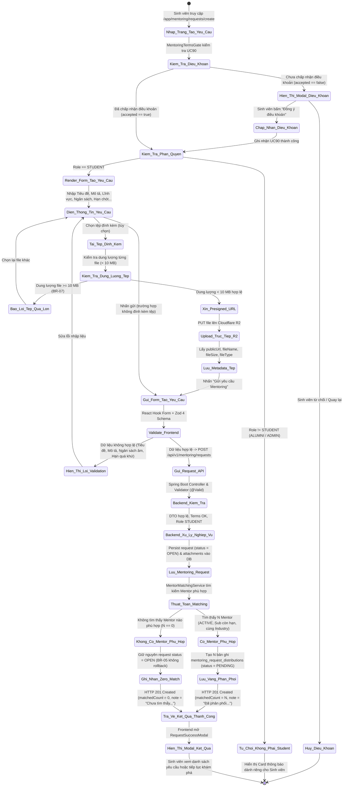
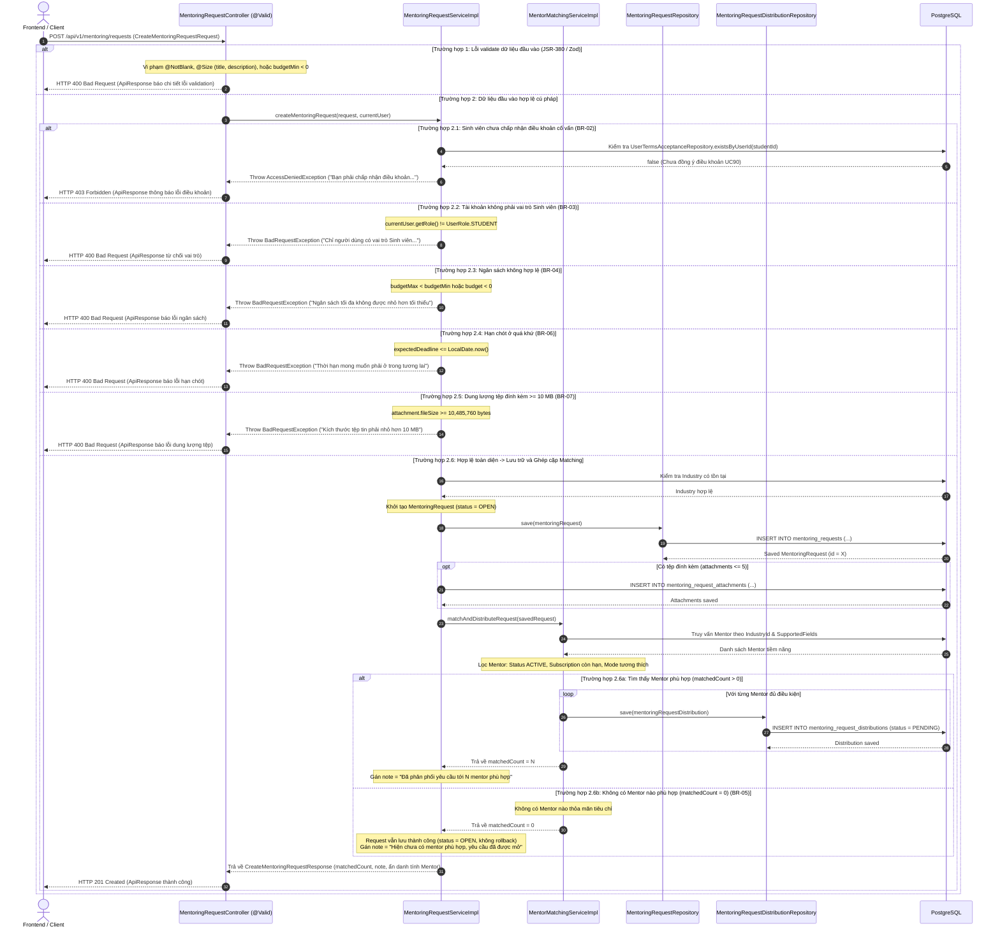

# ĐẶC TẢ YÊU CẦU & THIẾT KẾ CHI TIẾT: UC100 - TẠO YÊU CẦU MENTORING CHUNG (CREATE MENTORING REQUEST)

## PHẦN 1: ĐẶC TẢ NGHIỆP VỤ (REPORT 3)

### 2.2.3 Business Workflow (Luồng nghiệp vụ)

#### Mô tả chi tiết luồng xử lý bằng chữ (Business Step Description):
* **Bước 1 - Khởi đầu (Trigger & Terms Check)**:
  - Sinh viên truy cập tính năng thông qua nút CTA "Tạo yêu cầu Mentoring" tại Trang chủ Hướng dẫn (`/app/mentoring`), liên kết nhanh "Tạo yêu cầu chung" trên thanh tìm kiếm Khám phá Mentor (`/app/mentoring/discover`), hoặc menu điều hướng bên trái (`/app/mentoring/requests/create`).
  - Hệ thống tự động kích hoạt `MentoringTermsGate`. Nếu sinh viên chưa từng chấp nhận Điều khoản Cố vấn (UC90), modal điều khoản sẽ lập tức xuất hiện chặn toàn bộ thao tác cho đến khi sinh viên đọc và nhấn "Tôi đồng ý với điều khoản cố vấn".
  - Sau khi điều khoản đã được chấp thuận, hệ thống kiểm tra vai trò tài khoản (`role`). Nếu người dùng không phải là `STUDENT` (ví dụ tài khoản `ALUMNI`), giao diện hiển thị thông báo thân thiện giải thích rằng tính năng Tạo yêu cầu Mentoring chung dành riêng cho Sinh viên, kèm liên kết dẫn sang Đăng ký Mentor hoặc Khám phá danh bạ.

* **Bước 2 - Các bước chuyển tiếp (Form Input, Validation & Upload)**:
  - Sinh viên nhập thông tin yêu cầu hỗ trợ:
    - Tiêu đề yêu cầu: Tóm tắt nội dung cần hỗ trợ (bắt buộc, 5 – 200 ký tự).
    - Lĩnh vực chuyên môn: Chọn từ danh mục các ngành nghề được hệ thống hỗ trợ (bắt buộc, tải từ `GET /api/v1/industries`).
    - Loại nhiệm vụ cố vấn: Lựa chọn 1 trong 6 danh mục định sẵn (Định hướng nghề nghiệp, Review CV, Phỏng vấn thử, Tư vấn kỹ thuật, Tư vấn đồ án, Khác).
    - Mô tả chi tiết: Trình bày chi tiết mục tiêu, khó khăn hiện tại và kỳ vọng đối với Mentor (bắt buộc, 20 – 3000 ký tự).
    - Ngân sách dự kiến: Khoảng chi phí tối thiểu và tối đa tính bằng VNĐ (tùy chọn, không âm, `budgetMax >= budgetMin`).
    - Hình thức làm việc & Tham gia: Trực tuyến (Online), Trực tiếp (Offline), hoặc Cả hai; Cá nhân (1-1) hoặc Nhóm.
    - Thời hạn mong muốn: Ngày kết thúc hỗ trợ dự kiến (tùy chọn, phải ở thời điểm tương lai).
    - Tệp đính kèm: Cho phép đính kèm tối đa 5 file (CV, đề cương đồ án, mã nguồn mẫu, câu hỏi...).
  - Mỗi khi sinh viên chọn file đính kèm:
    - Frontend kiểm tra dung lượng từng file. Nếu file >= 10 MB (10,485,760 bytes), lập tức chặn và báo lỗi theo quy định BR-07.
    - Với file hợp lệ, Frontend gọi API `GET /api/v1/files/presigned-url` để lấy URL ký trước an toàn của Cloudflare R2.
    - Frontend đẩy trực tiếp binary file lên Cloudflare R2 qua phương thức HTTP `PUT`. Khi upload hoàn tất, lưu metadata gồm tên file, đường dẫn công khai, kích thước và định dạng MIME.
  - Sinh viên nhấn "Gửi yêu cầu Mentoring":
    - Bộ kiểm định Zod 4 trên Frontend kiểm tra toàn diện dữ liệu form. Nếu phát hiện vi phạm, các cảnh báo màu đỏ kèm thông điệp tiếng Việt xuất hiện ngay dưới trường tương ứng.
    - Khi form hợp lệ, Frontend gửi yêu cầu HTTP `POST /api/v1/mentoring/requests` chứa payload JSON (tuyệt đối không chứa `mentorId` theo BR-01).

* **Bước 3 - Xử lý phía Máy chủ & Phân phối Matching (Backend Processing & Internal Distribution)**:
  - `MentoringRequestController` tiếp nhận request và kích hoạt JSR-380 validation (`@Valid`).
  - `MentoringRequestServiceImpl` thực hiện chuỗi kiểm tra nghiệp vụ:
    - Kiểm tra `UserTermsAcceptanceRepository`: Xác minh sinh viên đã ký điều khoản UC90 (BR-02).
    - Kiểm tra vai trò `currentUser.getRole() == UserRole.STUDENT` (BR-03).
    - Kiểm tra logic ngân sách `budgetMax >= budgetMin` và thời hạn `expectedDeadline > now`.
    - Kiểm tra số lượng tệp (<= 5) và dung lượng từng tệp (< 10 MB).
  - Khởi tạo và lưu trữ đối tượng `MentoringRequest` với trạng thái ban đầu `OPEN`, cùng danh sách `MentoringRequestAttachment` vào cơ sở dữ liệu.
  - Kích hoạt `MentorMatchingService.matchAndDistributeRequest(savedRequest)` trong phạm vi cùng giao dịch:
    - Lọc tất cả Mentor thuộc lĩnh vực `industryId` của yêu cầu.
    - Kiểm tra hồ sơ Mentor `status == MentorStatus.ACTIVE`.
    - Kiểm tra tài khoản User của Mentor `accountStatus == AccountStatus.ACTIVE`.
    - Kiểm tra gói dịch vụ `MentorSubscription` còn hiệu lực (`status == ACTIVE` và `endDate > now`).
    - Kiểm tra tính tương thích hình thức làm việc (`workingMode`) và hình thức tham gia (`participationType`).
    - Với mỗi Mentor thỏa mãn, tạo bản ghi `MentoringRequestDistribution` với trạng thái `PENDING`. Ràng buộc `UNIQUE(request_id, mentor_profile_id)` đảm bảo tính idempotent, ngăn chặn gửi trùng lặp (BR-10).
  - Xử lý trường hợp không có Mentor matching (BR-05):
    - Nếu danh sách Mentor phù hợp rỗng (`matchedCount = 0`), yêu cầu của sinh viên **vẫn được lưu thành công vào cơ sở dữ liệu** ở trạng thái `OPEN`.
    - Hệ thống tuyệt đối không rollback giao dịch hay báo lỗi hệ thống, mà trả về phản hồi thành công kèm ghi chú giải thích để tiếp tục phân phối khi có Mentor gia nhập.
  - Bảo vệ quyền riêng tư Mentor (BR-08):
    - Payload phản hồi `CreateMentoringRequestResponse` trả về cho sinh viên chỉ chứa: `id`, `title`, `status`, `matchedCount`, `note`, `createdAt` và danh sách tệp đính kèm.
    - Tuyệt đối ẩn danh toàn bộ thông tin cá nhân (tên, ID, email, số điện thoại) của các Mentor được matching cho đến khi có Mentor chính thức chấp nhận yêu cầu.

* **Bước 4 - Kết thúc & Trải nghiệm giao diện (Completion & UI Feedback)**:
  - Frontend nhận phản hồi HTTP 201 Created và hiển thị modal `RequestSuccessModal` theo chuẩn Pastel Premium:
    - Trường hợp có Mentor matching: Hiển thị badge xanh ngọc tươi sáng, thông báo số lượng Mentor phù hợp nhận được yêu cầu (`matchedCount`), giải thích cơ chế phân phối ẩn danh và hướng dẫn sinh viên chờ phản hồi.
    - Trường hợp chưa có Mentor matching: Hiển thị badge vàng ấm áp, chúc mừng yêu cầu đã được khởi tạo thành công trên hệ thống và giải thích yêu cầu đang mở công khai trong danh sách chờ để các Mentor phù hợp tiếp nhận ngay khi có thể.
  - Modal cung cấp 2 lựa chọn điều hướng: "Xem danh sách yêu cầu của tôi" (`/app/mentoring/requests`) hoặc "Khám phá danh bạ Mentor" (`/app/mentoring/discover`).

---

### 3.2 Module Mentorship (Hướng Dẫn & Cố Vấn)
Module Mentorship là một trong các phân hệ hạt nhân của AlumNect, kết nối mạng lưới Cựu sinh viên FPT (Alumni/Mentor) giàu kinh nghiệm thực chiến với Sinh viên đang theo học (Student/Mentee), nhằm nâng cao chất lượng nguồn nhân lực và gắn kết cộng đồng trường Đại học FPT.

#### 3.2.1 Tạo yêu cầu Mentoring chung (Create Mentoring Request — UC100)

**Function trigger**:
*   **Navigation path**: 
    - `/app/mentoring/requests/create`
    - Hero banner trang chủ: `/app/mentoring` -> Nút "Tạo yêu cầu Mentoring"
    - Thanh điều hướng tìm kiếm: `/app/mentoring/discover` -> Liên kết "Tạo yêu cầu chung"
    - Menu bên trái: `Khám phá` -> `Tạo yêu cầu Mentoring`
*   **Timing Frequency**: On demand (bất cứ khi nào Sinh viên có nhu cầu nhận sự hỗ trợ, định hướng hoặc giải đáp chuyên môn).

**Function description**:
*   **Actors/Roles**: 
    - Sinh viên (`STUDENT`): Tác nhân chính thực hiện khởi tạo yêu cầu.
    - Cựu sinh viên (`ALUMNI` / `MENTOR`): Tác nhân gián tiếp nhận phân phối nội bộ từ thuật toán matching.
*   **Purpose**: Cho phép Sinh viên gửi một yêu cầu hỗ trợ chuyên môn mở mà không cần chỉ định đích danh một Mentor cụ thể; hệ thống sẽ tự động đối sánh (matching) các tiêu chí về ngành nghề, hình thức làm việc, hình thức tham gia và trạng thái hoạt động của Mentor để phân phối nội bộ yêu cầu này một cách công bằng và bảo mật.
*   **Interface**:
    - **Header & Terms Gate**: Thanh tiêu đề trang trí Pastel Premium với biểu tượng hoa cà, tự động khóa nếu chưa đồng ý UC90 Terms.
    - **Input Fields**:
      - `title` (Text input): Tiêu đề yêu cầu hỗ trợ (Placeholder: "Ví dụ: Hướng dẫn định hướng nghề nghiệp và tối ưu CV Software Engineer").
      - `industryId` (Select dropdown): Lĩnh vực chuyên môn cần cố vấn (Lấy từ metadata ngành nghề hệ thống).
      - `taskType` (Select dropdown): Loại nhiệm vụ (6 options: Định hướng nghề nghiệp, Review CV, Phỏng vấn thử, Tư vấn kỹ thuật, Tư vấn đồ án, Khác).
      - `description` (Textarea): Mô tả chi tiết nội dung, mục tiêu và kỳ vọng (Placeholder: "Mô tả chi tiết mục tiêu, khó khăn hiện tại và kỳ vọng của bạn đối với Mentor...").
      - `budgetMin` & `budgetMax` (Number inputs): Ngân sách dự kiến tối thiểu và tối đa (VNĐ).
      - `workingMode` (Radio / Select): Hình thức làm việc (Trực tuyến, Trực tiếp, Cả hai).
      - `participationType` (Radio / Select): Hình thức tham gia (Cá nhân 1-1, Theo nhóm).
      - `expectedDeadline` (Date picker / Text): Thời hạn mong muốn hoàn thành hỗ trợ.
      - `attachments` (File upload zone): Vùng kéo thả tệp tin hoặc chọn file tải lên, thanh tiến trình tải lên và danh sách file đã đính kèm kèm nút xóa (X).
    - **Buttons**:
      - Nút "Gửi yêu cầu Mentoring" (Primary button - màu hoa cà `brand-500` nổi bật kèm biểu tượng gửi `Send` và spinner khi đang xử lý).
      - Nút "Hủy bỏ" (Ghost/Outline button dẫn về trang chủ `/app/mentoring`).
    - **States**:
      - *Initial / Empty state*: Form hiển thị sạch sẽ với các giá trị mặc định trực quan.
      - *Uploading state*: Hiển thị thanh tiến trình và icon `Loader2` khi file đang được tải lên Cloudflare R2.
      - *Submitting state*: Vô hiệu hóa toàn bộ nút bấm, hiển thị con quay loading và dòng chữ "Đang tạo yêu cầu và phân phối tới Mentor...".
      - *Success state*: Hiển thị modal `RequestSuccessModal` phản ánh số lượng Mentor matched hoặc thông điệp hàng chờ.
      - *Error state*: Banner cảnh báo đỏ nhạt ở đầu form và thông điệp lỗi màu đỏ ngay dưới từng trường sai phạm.

**Data processing**:
1. Frontend kiểm tra token xác thực người dùng trong `authStore` và kiểm tra quyền `STUDENT`.
2. Kiểm tra trạng thái chấp nhận điều khoản qua API `GET /api/v1/mentoring/terms/status`. Nếu chưa chấp nhận, kích hoạt modal UC90.
3. Khi người dùng tải file, Frontend gọi `GET /api/v1/files/presigned-url` để xin presigned PUT URL từ máy chủ Spring Boot, sau đó upload binary file trực tiếp lên kho lưu trữ đám mây Cloudflare R2, lưu lại `publicUrl`.
4. Người dùng bấm Gửi, Frontend xác thực dữ liệu qua Zod 4 và đóng gói JSON gửi tới `POST /api/v1/mentoring/requests`.
5. Spring Boot kiểm tra `@Valid`, trích xuất thông tin người dùng từ `SecurityContextHolder`.
6. Kiểm tra bản ghi điều khoản trong `UserTermsAcceptanceRepository`. Nếu thiếu, ném `AccessDeniedException` (HTTP 403).
7. Kiểm tra `user.getRole() == UserRole.STUDENT`. Nếu sai, ném `BadRequestException` (HTTP 400).
8. Kiểm tra tính hợp lệ của ngân sách (`budgetMin >= 0`, `budgetMax >= 0`, `budgetMax >= budgetMin`) và thời hạn (`expectedDeadline > now`).
9. Khởi tạo thực thể `MentoringRequest` với trạng thái `OPEN` và lưu vào bảng `mentoring_requests`.
10. Khởi tạo danh sách thực thể `MentoringRequestAttachment` và lưu vào bảng `mentoring_request_attachments`.
11. Gọi `MentorMatchingService.matchAndDistributeRequest()`:
    - Tìm kiếm Mentor qua `MentorSupportedFieldRepository.findByIndustryId(industryId)`.
    - Lọc các Mentor có `mentorStatus == ACTIVE`, `accountStatus == ACTIVE`, gói `MentorSubscription` có `status == ACTIVE` và `endDate > now`.
    - Lọc theo tương thích `workingMode` và `participationType`.
    - Lưu từng bản ghi `MentoringRequestDistribution` với trạng thái `PENDING`.
12. Đóng gói kết quả trả về vào `CreateMentoringRequestResponse` (ẩn danh tính Mentor) với mã HTTP 201 Created.

**Screen layout**:
*   *Figure 1*: Layout form tạo yêu cầu Mentoring chung trên Desktop (Container rộng 896px, căn giữa, thẻ card Pastel bo góc 24px, 2 cột cho các trường ngân sách và hình thức làm việc).
*   *Figure 2*: Layout form tạo yêu cầu Mentoring chung trên Mobile (Tự động co về 1 cột, vùng upload file mở rộng toàn màn hình, nút Submit cố định ở chân trang).
*   *Figure 3*: Layout Success Modal (Hộp thoại nổi với hiệu ứng mờ nền backdrop blur, icon thành công hoa anh đào/bạc hà, thông số matching và các nút hành động điều hướng tiếp theo).

**Function details**:
*   **Data**:
    - `title` (String, required): Tiêu đề yêu cầu.
    - `description` (String, required): Mô tả chi tiết yêu cầu.
    - `industryId` (Long, required): ID lĩnh vực chuyên môn.
    - `taskType` (Enum, required): Loại nhiệm vụ cố vấn.
    - `budgetMin` (BigDecimal, optional): Ngân sách tối thiểu (VNĐ).
    - `budgetMax` (BigDecimal, optional): Ngân sách tối đa (VNĐ).
    - `workingMode` (Enum, required): `ONLINE`, `OFFLINE`, `BOTH`.
    - `participationType` (Enum, required): `INDIVIDUAL`, `GROUP`, `BOTH`.
    - `expectedDeadline` (LocalDate / Instant, optional): Hạn chót mong muốn.
    - `attachments` (List, optional, max 5 items): Danh sách tệp đính kèm.
*   **Validation**:
    - `title`: Bắt buộc, không chỉ toàn khoảng trắng, độ dài 5 – 200 ký tự.
    - `description`: Bắt buộc, không chỉ toàn khoảng trắng, độ dài 20 – 3000 ký tự.
    - `industryId`: Bắt buộc, số nguyên dương lớn hơn 0, phải tồn tại trong bảng `industries`.
    - `taskType`: Bắt buộc, thuộc danh sách Enum `MentoringTaskType`.
    - `workingMode`: Bắt buộc, thuộc danh sách Enum `MentoringWorkingMode`.
    - `participationType`: Bắt buộc, thuộc danh sách Enum `MentoringType`.
    - `budgetMin`: Tùy chọn; nếu có phải >= 0.
    - `budgetMax`: Tùy chọn; nếu có phải >= 0. Nếu cả hai cùng có thì `budgetMax >= budgetMin`.
    - `expectedDeadline`: Tùy chọn; nếu có phải lớn hơn ngày hiện tại (thời điểm tương lai).
    - `attachments`: Tối đa 5 phần tử. Mỗi phần tử bắt buộc có `fileName` (<= 255 ký tự), `fileUrl` (<= 500 ký tự), `fileSize` (0 < `fileSize` < 10,485,760 bytes).
*   **Business rules**: Áp dụng triệt để BR-01 đến BR-10 (xem chi tiết mục 5.1).
*   **Error Handling**:
    - HTTP 400 Bad Request: Vi phạm validation dữ liệu hoặc vi phạm phân quyền role STUDENT.
    - HTTP 401 Unauthorized: Người dùng chưa đăng nhập hoặc token JWT hết hạn.
    - HTTP 403 Forbidden: Người dùng chưa đồng ý điều khoản Mentorship (UC90).
    - HTTP 404 Not Found: Lĩnh vực `industryId` không tồn tại trong hệ thống.
    - HTTP 500 Internal Server Error: Lỗi kết nối CSDL hoặc lỗi hạ tầng máy chủ.
*   **Normal case**:
    - Sinh viên nhập đủ thông tin hợp lệ, hệ thống tìm thấy 3 Mentor phù hợp -> Lưu request thành công, phân phối 3 bản ghi distribution, trả về `matchedCount = 3` kèm ghi chú phân phối.
    - Sinh viên nhập thông tin ngành hẹp, hệ thống không tìm thấy Mentor nào thỏa mãn -> Lưu request thành công ở trạng thái `OPEN`, trả về `matchedCount = 0` kèm thông báo mở chờ phân phối.
*   **Abnormal case**:
    - Sinh viên chưa đồng ý điều khoản UC90 nhưng cố tình gửi API qua Postman -> Trả về HTTP 403 Forbidden ("Bạn phải chấp nhận điều khoản cố vấn trước khi tạo yêu cầu Mentoring").
    - Tài khoản có vai trò không hợp lệ gửi API -> Trả về HTTP 403 Forbidden ("Tài khoản của bạn không có quyền tạo yêu cầu Mentoring").
    - Đính kèm tệp có dung lượng 12 MB -> Bị chặn ngay từ Frontend và Backend với HTTP 400 ("Kích thước tệp tin phải nhỏ hơn 10 MB").

---

### 5. Requirement Appendix (Phụ lục Yêu cầu)

#### 5.1 Business Rules (Quy tắc Nghiệp vụ)

| ID | Tên Quy tắc (Rule Name) | Định nghĩa Quy tắc Nghiệp vụ (Rule Definition) |
| :--- | :--- | :--- |
| **BR-01** | **General Request Exclusivity (Không chọn Mentor)** | Yêu cầu Mentoring chung (UC100) được thiết kế để phục vụ nhu cầu hỗ trợ mở; sinh viên/người học **tuyệt đối không chỉ định đích danh một Mentor** (`mentorId`). Toàn bộ việc ghép cặp sẽ do thuật toán phân phối nội bộ tự động đảm nhiệm. (Trường hợp chỉ định đích danh thuộc phạm vi UC101). |
| **BR-02** | **Mentoring Terms Gate (Ràng buộc Điều khoản UC90)** | Người dùng bắt buộc phải đồng ý với Điều khoản Cố vấn (UC90 Mentoring Terms) trước khi được phép tạo bất kỳ yêu cầu Mentoring nào. Hệ thống kiểm tra ràng buộc này qua bảng `user_terms_acceptances`. Nếu chưa chấp nhận, mọi thao tác tạo yêu cầu đều bị từ chối với mã HTTP 403 Forbidden. |
| **BR-03** | **Actor Roles & Self-matching Exclusion (Phân quyền Người tạo)** | Người dùng thuộc vai trò Sinh viên (`STUDENT`), Cựu sinh viên (`ALUMNI`) và Mentor đều có quyền tạo yêu cầu Mentoring chung để kết nối với Mentor khác. Thuật toán phân phối tự động loại trừ chính bản thân người tạo (nếu người tạo cũng là một Mentor trong lĩnh vực đó), đảm bảo không gửi yêu cầu cho chính mình. |
| **BR-04** | **Budget Consistency (Tính hợp lệ của Ngân sách)** | Ngân sách dự kiến của yêu cầu không được là số âm (`budgetMin >= 0`, `budgetMax >= 0`). Trong trường hợp cả hai trường cùng được cung cấp, ngân sách tối đa bắt buộc phải lớn hơn hoặc bằng ngân sách tối thiểu (`budgetMax >= budgetMin`). |
| **BR-05** | **Zero Matching Graceful Handling (Xử lý khi không có Mentor)** | Trường hợp không có Mentor nào thỏa mãn các tiêu chí matching nội bộ tại thời điểm tạo, yêu cầu của sinh viên **vẫn phải được lưu thành công vào cơ sở dữ liệu** với trạng thái `OPEN` và trả về phản hồi thành công (`matchedCount = 0`). Hệ thống **tuyệt đối không báo lỗi hoặc rollback giao dịch**. Yêu cầu sẽ tiếp tục được mở để phân phối bổ sung trong tương lai. |
| **BR-06** | **Future Deadline Requirement (Hạn chót trong tương lai)** | Nếu sinh viên thiết lập thời hạn mong muốn hoàn thành (`expectedDeadline`), mốc thời gian này bắt buộc phải lớn hơn ngày hiện tại (nằm ở tương lai). |
| **BR-07** | **Attachment Size & Quantity Limits (Giới hạn Tệp đính kèm)** | Mỗi yêu cầu chỉ được đính kèm tối đa **5 tệp tin**. Mỗi tệp tin bắt buộc phải có dung lượng lớn hơn 0 và **nhỏ hơn 10 MB** (tối đa 10,485,759 bytes). Mọi tệp tin vượt quá dung lượng trên đều bị từ chối lưu trữ. |
| **BR-08** | **Mentor Privacy & Anonymity (Ẩn danh tính Mentor Matching)** | Dữ liệu trả về cho sinh viên sau khi tạo yêu cầu chỉ phản ánh tổng số lượng Mentor được matching (`matchedCount`) và ghi chú phân phối. Hệ thống tuyệt đối ẩn danh, không trả về danh tính, tên, email, số điện thoại hay ID của các Mentor được phân phối cho đến khi Mentor đó chủ động tiếp nhận yêu cầu. |
| **BR-09** | **Eligible Mentor Criteria (Tiêu chí Mentor đủ điều kiện Matching)** | Một Mentor chỉ được coi là đủ điều kiện nhận phân phối khi thỏa mãn đồng thời 5 tiêu chí: (1) Hồ sơ Mentor có trạng thái `ACTIVE`; (2) Tài khoản người dùng có trạng thái `ACTIVE`; (3) Sở hữu gói dịch vụ `MentorSubscription` có trạng thái `ACTIVE`/`PAID` và còn hạn sử dụng (`endDate > now`); (4) Đăng ký hỗ trợ lĩnh vực chuyên môn tương ứng (`mentor_supported_fields`); (5) Tương thích về hình thức làm việc (`workingMode`) và hình thức tham gia (`participationType`). |
| **BR-10** | **Idempotent Distribution (Phòng ngừa Phân phối Trùng lặp)** | Ràng buộc duy nhất `UNIQUE(request_id, mentor_profile_id)` trong cơ sở dữ liệu đảm bảo một yêu cầu chỉ được phân phối tới một Mentor tối đa một lần, ngăn ngừa triệt để hiện tượng trùng lặp dữ liệu khi gửi lại hoặc retry hệ thống. |

#### 5.2 Common Requirements (Yêu cầu Chung)
*   **Hỗ trợ định dạng tệp:** Hệ thống hỗ trợ đính kèm các tài liệu định dạng văn bản (PDF, DOC, DOCX), bảng tính (XLS, XLSX), hình ảnh (PNG, JPG, JPEG), và mã nguồn/nén (ZIP, RAR, TXT) với dung lượng < 10 MB mỗi tệp.
*   **Bảo mật đường truyền:** Toàn bộ giao tiếp giữa Client và Server sử dụng giao thức bảo mật HTTPS/TLS với mã hóa dữ liệu theo tiêu chuẩn hiện đại. Tệp đính kèm được tải trực tiếp lên Cloudflare R2 qua Presigned URL bảo mật có thời hạn giới hạn.
*   **Tính xác thực:** Mọi yêu cầu API bắt buộc truyền kèm Bearer JWT Token hợp lệ trong HTTP Authorization Header.
*   **Trải nghiệm người dùng:** Toàn bộ các tương tác tạo dữ liệu, tải file hoặc xảy ra lỗi phải được thông báo minh bạch tới người dùng qua giao diện tiếng Việt, toast notification, hoặc modal xác nhận theo chuẩn Pastel Premium Design System.
*   **Xử lý ngày giờ:** Mọi dữ liệu thời gian lưu trữ ở định dạng chuẩn UTC (`TIMESTAMPTZ` / `Instant`) và tự động chuyển đổi hiển thị theo múi giờ địa phương của người dùng (`Asia/Ho_Chi_Minh` - GMT+7).

#### 5.3 Application Messages List (Danh sách Thông điệp Ứng dụng)

Bảng kê chi tiết 18 thông điệp phản hồi từ hệ thống tương ứng với các ngữ cảnh xử lý thực tế của UC100:

| # | Mã thông điệp (Message code) | Loại thông điệp (Message Type) | Ngữ cảnh (Context) | Nội dung hiển thị (Content) |
| :--- | :--- | :--- | :--- | :--- |
| 1 | `MSG_REQ_01` | Modal Dialog | Tạo yêu cầu thành công và tìm thấy Mentor phù hợp | "Tạo yêu cầu Mentoring thành công! Hệ thống đã tìm thấy và phân phối yêu cầu của bạn tới các Mentor phù hợp." |
| 2 | `MSG_REQ_02` | Modal Dialog | Tạo yêu cầu thành công nhưng chưa có Mentor matching | "Tạo yêu cầu Mentoring thành công! Hiện chưa có Mentor nào phù hợp trực tiếp, yêu cầu của bạn đã được mở trên hệ thống để các Mentor tiếp nhận." |
| 3 | `MSG_REQ_03` | In red, under field | Tiêu đề bị để trống | "Tiêu đề yêu cầu không được để trống" |
| 4 | `MSG_REQ_04` | In red, under field | Tiêu đề quá ngắn (< 5 ký tự) hoặc quá dài (> 200 ký tự) | "Tiêu đề yêu cầu phải từ 5 đến 200 ký tự" |
| 5 | `MSG_REQ_05` | In red, under field | Mô tả chi tiết bị để trống | "Mô tả chi tiết không được để trống" |
| 6 | `MSG_REQ_06` | In red, under field | Mô tả chi tiết quá ngắn (< 20 ký tự) hoặc quá dài (> 3000 ký tự) | "Mô tả chi tiết phải từ 20 đến 3000 ký tự" |
| 7 | `MSG_REQ_07` | In red, under field | Chưa chọn lĩnh vực chuyên môn | "Lĩnh vực cần hỗ trợ không được để trống" |
| 8 | `MSG_REQ_08` | In red, under field | Ngân sách tối thiểu nhỏ hơn 0 | "Ngân sách tối thiểu không được âm" |
| 9 | `MSG_REQ_09` | In red, under field | Ngân sách tối đa nhỏ hơn 0 | "Ngân sách tối đa không được âm" |
| 10 | `MSG_REQ_10` | In red, under field | Ngân sách tối đa nhỏ hơn ngân sách tối thiểu | "Ngân sách tối đa không được nhỏ hơn ngân sách tối thiểu" |
| 11 | `MSG_REQ_11` | In red, under field | Thời hạn mong muốn nằm ở quá khứ | "Thời hạn mong muốn phải ở trong tương lai" |
| 12 | `MSG_REQ_12` | In red / Toast | Dung lượng tệp đính kèm >= 10 MB (10,485,760 bytes) | "Kích thước tệp tin phải nhỏ hơn 10 MB" |
| 13 | `MSG_REQ_13` | In red / Toast | Vượt quá số lượng tệp đính kèm tối đa (> 5 files) | "Chỉ được đính kèm tối đa 5 tệp tin" |
| 14 | `MSG_REQ_14` | Toast / Banner | Sinh viên chưa chấp nhận Điều khoản Mentoring (UC90) | "Bạn phải chấp nhận điều khoản cố vấn trước khi tạo yêu cầu Mentoring" |
| 15 | `MSG_REQ_15` | Toast / Banner | Người dùng không phải là vai trò Sinh viên (STUDENT) | "Chỉ người dùng có vai trò Sinh viên (STUDENT) mới có thể tạo yêu cầu Mentoring chung" |
| 16 | `MSG_REQ_16` | Toast / Inline | Lĩnh vực chuyên môn không tồn tại trên hệ thống | "Không tìm thấy lĩnh vực chuyên môn với mã: {industryId}" |
| 17 | `MSG_REQ_17` | Toast message | Lỗi trong quá trình upload tệp lên Cloudflare R2 | "Không thể tải lên tệp tin {fileName}. Vui lòng thử lại!" |
| 18 | `MSG_REQ_18` | Toast message | Lỗi mất kết nối mạng hoặc lỗi hệ thống không xác định | "Có lỗi xảy ra khi tạo yêu cầu Mentoring. Vui lòng thử lại sau!" |

#### 5.4 Other Requirements (Yêu cầu Khác)
*   **Tối ưu hóa hiệu năng CSDL:** Bảng `mentoring_requests` được đánh index trên `student_id`, `industry_id`, `status`, `created_at`. Bảng `mentoring_request_distributions` được đánh index trên `(request_id, mentor_profile_id)` và `status` nhằm đảm bảo thời gian matching dưới 50ms cho mỗi yêu cầu.
*   **Tính toàn vẹn dữ liệu:** Toàn bộ quá trình tạo yêu cầu và phân phối matching được bọc trong một `@Transactional` của Spring Data JPA. Nếu xảy ra lỗi CSDL nghiêm trọng, hệ thống tự động hoàn tác (rollback) để tránh rác dữ liệu.

---

## PHẦN 2: THIẾT KẾ CHI TIẾT (REPORT 4)

### 3. Detail Design (Thiết kế chi tiết)

#### 3.1 Tạo yêu cầu Mentoring chung (UC100 - Create Mentoring Request)

##### 3.1.1 Class Diagram (Sơ đồ Lớp)

```mermaid
classDiagram
    %% Controller Layer
    class MentoringRequestController {
        -MentoringRequestService mentoringRequestService
        +createRequest(request, userPrincipal) ResponseEntity~ApiResponse~CreateMentoringRequestResponse~~
        +getMyRequests(page, size, userPrincipal) ResponseEntity~ApiResponse~PageResponse~CreateMentoringRequestResponse~~~
        +getRequestDetail(id, userPrincipal) ResponseEntity~ApiResponse~CreateMentoringRequestResponse~~
    }

    %% Service Interfaces & Implementations
    class MentoringRequestService {
        <<interface>>
        +createMentoringRequest(request, currentUser) CreateMentoringRequestResponse
        +getMyMentoringRequests(currentUser, pageable) PageResponse~CreateMentoringRequestResponse~
        +getMentoringRequestDetail(id, currentUser) CreateMentoringRequestResponse
    }

    class MentoringRequestServiceImpl {
        -MentoringRequestRepository mentoringRequestRepository
        -MentoringRequestAttachmentRepository attachmentRepository
        -IndustryRepository industryRepository
        -UserTermsAcceptanceRepository termsAcceptanceRepository
        -MentorMatchingService mentorMatchingService
        +createMentoringRequest(request, currentUser) CreateMentoringRequestResponse
        +getMyMentoringRequests(currentUser, pageable) PageResponse~CreateMentoringRequestResponse~
        +getMentoringRequestDetail(id, currentUser) CreateMentoringRequestResponse
    }

    class MentorMatchingService {
        <<interface>>
        +matchAndDistributeRequest(request) int
    }

    class MentorMatchingServiceImpl {
        -MentorSupportedFieldRepository mentorSupportedFieldRepository
        -MentorSubscriptionRepository mentorSubscriptionRepository
        -MentoringRequestDistributionRepository distributionRepository
        +matchAndDistributeRequest(request) int
    }

    %% DTO Layer
    class CreateMentoringRequestRequest {
        -String title
        -String description
        -Long industryId
        -BigDecimal budgetMin
        -BigDecimal budgetMax
        -MentoringWorkingMode workingMode
        -MentoringType participationType
        -MentoringTaskType taskType
        -LocalDate expectedDeadline
        -List~MentoringAttachmentRequest~ attachments
    }

    class MentoringAttachmentRequest {
        -String fileName
        -String fileUrl
        -Long fileSize
        -String fileType
    }

    class CreateMentoringRequestResponse {
        -Long id
        -String title
        -String description
        -Long industryId
        -String industryName
        -BigDecimal budgetMin
        -BigDecimal budgetMax
        -MentoringWorkingMode workingMode
        -MentoringType participationType
        -MentoringTaskType taskType
        -LocalDate expectedDeadline
        -MentoringRequestStatus status
        -Integer matchedCount
        -String distributionNote
        -Instant createdAt
        -List~MentoringAttachmentResponse~ attachments
    }

    class MentoringAttachmentResponse {
        -Long id
        -String fileName
        -String fileUrl
        -Long fileSize
        -String fileType
    }

    %% Repository Layer
    class MentoringRequestRepository {
        <<interface>>
        +findByStudentIdOrderByCreatedAtDesc(studentId, pageable) Page~MentoringRequest~
    }

    class MentoringRequestAttachmentRepository {
        <<interface>>
        +findByRequestId(requestId) List~MentoringRequestAttachment~
    }

    class MentoringRequestDistributionRepository {
        <<interface>>
        +existsByRequestIdAndMentorProfileId(requestId, mentorProfileId) boolean
        +findByMentorProfileIdAndStatus(mentorProfileId, status) List~MentoringRequestDistribution~
    }

    class MentorSupportedFieldRepository {
        <<interface>>
        +findByIndustryId(industryId) List~MentorSupportedField~
    }

    %% Entity Layer
    class MentoringRequest {
        -Long id
        -User student
        -Industry industry
        -String title
        -String description
        -BigDecimal budgetMin
        -BigDecimal budgetMax
        -MentoringWorkingMode workingMode
        -MentoringType participationType
        -MentoringTaskType taskType
        -LocalDate expectedDeadline
        -MentoringRequestStatus status
        -Instant createdAt
        -Instant updatedAt
    }

    class MentoringRequestAttachment {
        -Long id
        -MentoringRequest request
        -String fileName
        -String fileUrl
        -Long fileSize
        -String fileType
        -Instant createdAt
    }

    class MentoringRequestDistribution {
        -Long id
        -MentoringRequest request
        -MentorProfile mentorProfile
        -MentoringDistributionStatus status
        -Instant distributedAt
        -Instant respondedAt
    }

    %% Relationships
    MentoringRequestController ..> CreateMentoringRequestRequest : validates & uses
    MentoringRequestController ..> CreateMentoringRequestResponse : returns
    MentoringRequestController ..> MentoringRequestService : calls
    MentoringRequestServiceImpl ..|> MentoringRequestService : implements
    MentoringRequestServiceImpl --> MentoringRequestRepository : uses
    MentoringRequestServiceImpl --> MentoringRequestAttachmentRepository : uses
    MentoringRequestServiceImpl --> MentorMatchingService : delegates matching
    MentorMatchingServiceImpl ..|> MentorMatchingService : implements
    MentorMatchingServiceImpl --> MentorSupportedFieldRepository : uses
    MentorMatchingServiceImpl --> MentoringRequestDistributionRepository : uses
    MentoringRequestServiceImpl --> MentoringRequest : creates & manages
    MentoringRequestServiceImpl --> MentoringRequestAttachment : creates & manages
    MentorMatchingServiceImpl --> MentoringRequestDistribution : creates & distributes
    MentoringRequest "1" --> "*" MentoringRequestAttachment : has
    MentoringRequest "1" --> "*" MentoringRequestDistribution : distributes to
```

###### Mô tả chi tiết cấu trúc các lớp (Class Design Description):
* **Lớp Controller (`MentoringRequestController`)**: Tiếp nhận các yêu cầu HTTP RESTful tại URI `/api/v1/mentoring/requests`. Sử dụng Jakarta Validation (`@Valid`) để tự động kiểm tra cú pháp của `CreateMentoringRequestRequest`. Trích xuất đối tượng định danh `UserPrincipal` từ Spring Security và ủy quyền xử lý nghiệp vụ cho `MentoringRequestService`.
* **Lớp DTO (`CreateMentoringRequestRequest`, `CreateMentoringRequestResponse`, `MentoringAttachmentRequest`, `MentoringAttachmentResponse`)**: 
  - `CreateMentoringRequestRequest`: Chứa các trường dữ liệu đầu vào của yêu cầu Mentoring kèm các annotation validation tiếng Việt (`@NotBlank`, `@Size`, `@PositiveOrZero`). Tuyệt đối không chứa trường `mentorId` để tuân thủ BR-01.
  - `CreateMentoringRequestResponse`: Trả về dữ liệu chi tiết của yêu cầu vừa khởi tạo kèm số lượng Mentor được matching (`matchedCount`) và ghi chú phân phối (`distributionNote`), ẩn giấu hoàn toàn danh tính Mentor (BR-08).
* **Lớp Service Nghiệp vụ (`MentoringRequestService` & `MentoringRequestServiceImpl`)**: Đóng gói quy trình tạo yêu cầu chính: kiểm tra điều khoản UC90 qua `UserTermsAcceptanceRepository`, kiểm tra vai trò `STUDENT`, kiểm tra tính nhất quán của ngân sách và thời hạn, lưu trữ đối tượng `MentoringRequest` và danh sách tệp đính kèm, sau đó gọi `MentorMatchingService` để tiến hành phân phối nội bộ.
* **Lớp Service Ghép cặp Mentor (`MentorMatchingService` & `MentorMatchingServiceImpl`)**: Thực thi thuật toán matching độc lập: tìm kiếm tất cả Mentor hỗ trợ cùng lĩnh vực `industryId`, kiểm tra điều kiện Mentor ACTIVE, User ACTIVE, gói dịch vụ `MentorSubscription` còn hiệu lực, tính tương thích của hình thức làm việc và hình thức tham gia. Tiến hành tạo các bản ghi `MentoringRequestDistribution` với trạng thái `PENDING` và trả về số lượng Mentor được ghép cặp.
* **Lớp Repository (`MentoringRequestRepository`, `MentoringRequestAttachmentRepository`, `MentoringRequestDistributionRepository`, `MentorSupportedFieldRepository`)**: Các interface kế thừa Spring Data `JpaRepository`, thực hiện thao tác truy vấn và lưu bền vững dữ liệu xuống các bảng PostgreSQL tương ứng.
* **Lớp Entity (`MentoringRequest`, `MentoringRequestAttachment`, `MentoringRequestDistribution`)**: Ánh xạ quan hệ cơ sở dữ liệu theo mô hình JPA/Hibernate. `MentoringRequest` quản lý vòng đời yêu cầu với khóa ngoại liên kết tới `User` (sinh viên) và `Industry`. `MentoringRequestAttachment` quản lý tệp đính kèm với ràng buộc dung lượng < 10 MB. `MentoringRequestDistribution` quản lý vết phân phối với ràng buộc `UNIQUE(request_id, mentor_profile_id)`.

---

##### 3.1.2 Sequence Diagram (Sơ đồ Tuần tự)

###### Mô tả chi tiết luồng xử lý bằng chữ (Sequence Flow Description):
1.  **Luồng 1 - Thành công có Mentor Matching (Normal Case with Matched Mentors)**:
    - **Client gửi Request**: Sinh viên gửi payload JSON hợp lệ (tiêu đề, mô tả, lĩnh vực, nhiệm vụ, ngân sách, hình thức, hạn chót, tệp đính kèm) lên `POST /api/v1/mentoring/requests`.
    - **Controller kiểm duyệt**: Bộ lọc Spring `@Valid` kiểm tra tính hợp lệ cú pháp của DTO.
    - **Service kiểm tra nghiệp vụ**: Xác nhận sinh viên đã đồng ý điều khoản UC90, kiểm tra quyền `STUDENT`, xác minh ngân sách và thời hạn hợp lệ.
    - **Lưu trữ CSDL**: Lưu thực thể `MentoringRequest` với trạng thái `OPEN` và lưu các tệp đính kèm vào PostgreSQL.
    - **Ghép cặp & Phân phối Matching**: `MentorMatchingServiceImpl` lọc ra danh sách Mentor thỏa mãn 5 tiêu chí (ACTIVE, Sub còn hạn, cùng Industry, tương thích Mode). Tạo các bản ghi `MentoringRequestDistribution` với trạng thái `PENDING`.
    - **Trả kết quả**: Service trả về `CreateMentoringRequestResponse` chứa `matchedCount = N` và ghi chú phân phối. Controller gửi phản hồi HTTP 201 Created về cho Client.
2.  **Luồng 2 - Thành công không có Mentor Matching (Zero Matching Case - BR-05)**:
    - Các bước gửi và kiểm tra dữ liệu tương tự Luồng 1.
    - Tại bước Ghép cặp, thuật toán không tìm thấy Mentor nào thỏa mãn tiêu chí (ví dụ: lĩnh vực mới chưa có Mentor nào đăng ký, hoặc tất cả Mentor trong ngành đều đã hết hạn gói dịch vụ).
    - **Không rollback giao dịch**: Thực thể `MentoringRequest` **vẫn được lưu bền vững vào CSDL với trạng thái `OPEN`**.
    - Service gán `matchedCount = 0` kèm thông điệp giải thích yêu cầu đã được mở thành công trên hệ thống để các Mentor tiếp nhận sau này. Controller trả về HTTP 201 Created cho Client.
3.  **Luồng 3 - Ngoại lệ Validation đầu vào (Validation Error Case)**:
    - Dữ liệu gửi lên vi phạm các ràng buộc Bean Validation (tiêu đề trống hoặc dưới 5 ký tự, mô tả dưới 20 ký tự, ngân sách âm). Bộ lọc JSR-380 phát hiện lỗi và ném `MethodArgumentNotValidException`. `GlobalExceptionHandler` trả về HTTP 400 Bad Request kèm chi tiết lỗi từng trường.
4.  **Luồng 4 - Ngoại lệ Chưa chấp nhận Điều khoản (Terms Gate Error Case - BR-02)**:
    - Sinh viên chưa hoàn thành ký điều khoản UC90 nhưng thực hiện gọi API. Service kiểm tra `UserTermsAcceptanceRepository` thấy không tồn tại bản ghi, chủ động ném `AccessDeniedException`. Hệ thống trả về HTTP 403 Forbidden.
5.  **Luồng 5 - Ngoại lệ Sai lệch Phân quyền (Role Error Case - BR-03)**:
    - Người dùng có vai trò `ALUMNI` hoặc `ADMIN` cố gắng gọi API tạo yêu cầu. Service kiểm tra vai trò và ném `BadRequestException`. Hệ thống trả về HTTP 400 Bad Request.
6.  **Luồng 6 - Ngoại lệ Ngân sách & Thời hạn (Budget & Deadline Error Case - BR-04 & BR-06)**:
    - `budgetMax < budgetMin` hoặc `expectedDeadline <= today`. Service ném `BadRequestException` và trả về HTTP 400 Bad Request kèm thông điệp tiếng Việt cụ thể.
7.  **Luồng 7 - Ngoại lệ Dung lượng tệp đính kèm (File Size Error Case - BR-07)**:
    - File đính kèm có kích thước >= 10,485,760 bytes. Service ném `BadRequestException` ("Kích thước tệp tin phải nhỏ hơn 10 MB") và trả về HTTP 400 Bad Request.
