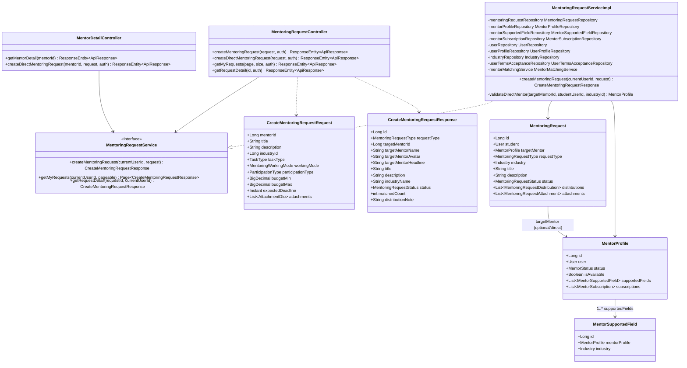
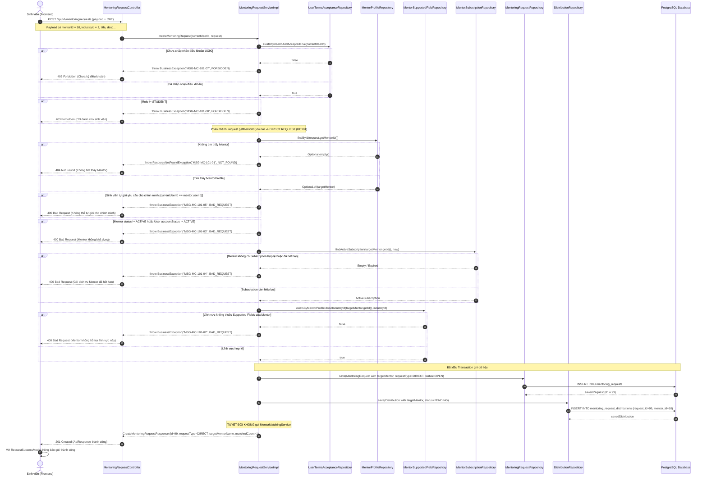

# ĐẶC TẢ YÊU CẦU & THIẾT KẾ CHI TIẾT: UC101 - CHỌN MENTOR & GỬI YÊU CẦU CỐ VẤN TRỰC TIẾP (SELECT MENTOR & SEND DIRECT MENTORING REQUEST)

## PHẦN 1: ĐẶC TẢ NGHIỆP VỤ (REPORT 3)

### 2.2.3 Business Workflow (Luồng nghiệp vụ)

```mermaid
stateDiagram-v2
    [*] --> Chon_Mentor_Tu_Danh_Ba : Sinh viên duyệt Mentor từ UC97, UC98 hoặc Trang chủ
    Chon_Mentor_Tu_Danh_Ba --> Xem_Chi_Tiet_Mentor : Truy cập Mentor Detail (UC99) /app/mentoring/mentors/:id
    
    Xem_Chi_Tiet_Mentor --> Kiem_Tra_Kha_Dung_Mentor : Kiểm tra canReceiveRequest & status == ACTIVE
    
    Kiem_Tra_Kha_Dung_Mentor --> Mentor_Tam_Ngung : canReceiveRequest == false (Hết hạn Sub / Không ACTIVE)
    Mentor_Tam_Ngung --> [*] : Disable nút CTA, hiển thị lý do tạm ngưng
    
    Kiem_Tra_Kha_Dung_Mentor --> Nhan_Nut_Gui_Yeu_Cau : canReceiveRequest == true
    Nhan_Nut_Gui_Yeu_Cau --> Chuyen_Trang_UC101 : Điều hướng sang /app/mentoring/mentors/:mentorId/request
    
    Chuyen_Trang_UC101 --> Kiem_Tra_Dieu_Khoan : MentoringTermsGate kiểm tra UC90
    Kiem_Tra_Dieu_Khoan --> Hien_Thi_Modal_Dieu_Khoan : accepted == false
    Hien_Thi_Modal_Dieu_Khoan --> Chap_Nhan_Dieu_Khoan : Sinh viên bấm "Đồng ý điều khoản"
    Chap_Nhan_Dieu_Khoan --> Tai_Thong_Tin_Mentor : Lưu chấp thuận điều khoản
    Hien_Thi_Modal_Dieu_Khoan --> Huy_Thao_Tac : Sinh viên từ chối điều khoản
    Huy_Thao_Tac --> [*]
    
    Kiem_Tra_Dieu_Khoan --> Tai_Thong_Tin_Mentor : accepted == true
    Tai_Thong_Tin_Mentor --> Kiem_Tra_Ton_Tai_Mentor : Gọi useMentorDetail(mentorId)
    
    Kiem_Tra_Ton_Tai_Mentor --> Mentor_Khong_Ton_Tai : 404 Not Found hoặc lỗi ID
    Mentor_Khong_Ton_Tai --> [*] : Render Card "Không tìm thấy hồ sơ Mentor" & nút Back
    
    Kiem_Tra_Ton_Tai_Mentor --> Kiem_Tra_Availability_Truoc_Form : Mentor tồn tại
    Kiem_Tra_Availability_Truoc_Form --> Bao_Loi_Unavailable : canReceiveRequest == false / Status != ACTIVE
    Bao_Loi_Unavailable --> [*] : Render Card thông báo Mentor tạm ngưng nhận yêu cầu
    
    Kiem_Tra_Availability_Truoc_Form --> Hien_Thi_Giao_Dien_UC101 : Mentor hợp lệ & khả dụng
    Hien_Thi_Giao_Dien_UC101 --> Render_Selected_Mentor_Card : Hiển thị Card tóm tắt Mentor đích (Avatar, Tên, Chức danh, Badge)
    Render_Selected_Mentor_Card --> Render_Form_Direct : Lọc danh mục Lĩnh vực chỉ gồm Supported Fields của Mentor
    
    Render_Form_Direct --> Nhap_Lieu_Yeu_Cau : Sinh viên nhập Tiêu đề, Mô tả, Lĩnh vực, Ngân sách, Hạn chót, Tệp...
    Nhap_Lieu_Yeu_Cau --> Xu_Ly_Tep_Dinh_Kem : Đính kèm file (tùy chọn, tối đa 5 file, mỗi file < 10 MB)
    Xu_Ly_Tep_Dinh_Kem --> Upload_R2 : Lấy Presigned URL và upload trực tiếp lên Cloudflare R2
    
    Upload_R2 --> Nhan_Nut_Submit : Bấm "Gửi yêu cầu tới Mentor"
    Nhap_Lieu_Yeu_Cau --> Nhan_Nut_Submit : Bấm gửi trực tiếp (không đính kèm file)
    
    Nhan_Nut_Submit --> Frontend_Zod_Validation : Kiểm tra hợp lệ dữ liệu form
    Frontend_Zod_Validation --> Bao_Loi_Nhap_Lieu : Lỗi validation (tiêu đề, mô tả, ngân sách, hạn chót)
    Bao_Loi_Nhap_Lieu --> Nhap_Lieu_Yeu_Cau : Sửa lỗi nhập liệu
    
    Frontend_Zod_Validation --> Gui_API_Direct_Request : Hợp lệ -> POST /api/v1/mentoring/requests (hoặc /api/v1/mentors/{mentorId}/requests)
    
    Gui_API_Direct_Request --> Backend_Security_Check : Trích xuất currentUserId từ JWT (Không tin studentId client gửi)
    Backend_Security_Check --> Backend_Role_Check : Kiểm tra Role == STUDENT
    Backend_Role_Check --> Backend_Self_Request_Check : Kiểm tra studentId != mentor.userId
    Backend_Self_Request_Check --> Backend_Mentor_Status_Check : Kiểm tra Mentor Profile ACTIVE & User Account ACTIVE
    Backend_Mentor_Status_Check --> Backend_Subscription_Check : Kiểm tra Gói dịch vụ Mentor còn hạn & ACTIVE
    Backend_Subscription_Check --> Backend_Supported_Field_Check : Kiểm tra industryId ∈ mentorSupportedFields
    
    Backend_Supported_Field_Check --> Backend_Loi_Nghiep_Vu : Một trong các điều kiện trên vi phạm
    Backend_Loi_Nghiep_Vu --> Frontend_Alert_Banner : Trả về mã lỗi 400/403/404/409 kèm thông điệp tiếng Việt
    
    Backend_Supported_Field_Check --> Backend_Luu_Database : Toàn bộ hợp lệ -> Transactional
    Backend_Luu_Database --> Tao_Mentoring_Request : Tạo request với request_type = 'DIRECT', target_mentor_id = mentorId, status = 'OPEN'
    Tao_Mentoring_Request --> Tao_Duy_Nhat_Distribution : Tạo 1 bản ghi distribution duy nhất cho targetMentor (status = 'PENDING')
    Tao_Duy_Nhat_Distribution --> Khong_Chay_Auto_Matching : TUYỆT ĐỐI KHÔNG gọi MentorMatchingService
    
    Khong_Chay_Auto_Matching --> Tra_Ve_Response_201 : Trả về CreateMentoringRequestResponse với targetMentorName, requestType = DIRECT
    Tra_Ve_Response_201 --> Hien_Thi_Success_Modal : Frontend mở RequestSuccessModal (Badge "Gửi trực tiếp", Mentor nhận yêu cầu)
    Hien_Thi_Success_Modal --> [*] : Điều hướng sang hồ sơ Mentor hoặc danh sách yêu cầu
```



#### Mô tả chi tiết luồng xử lý bằng chữ (Business Step Description):
* **Bước 1 - Khởi đầu & Kích hoạt (Trigger & Navigation)**:
  - Sinh viên truy cập vào hồ sơ chi tiết của Mentor (UC99) tại đường dẫn `/app/mentoring/mentors/:id`.
  - Trên màn hình Chi tiết Mentor:
    - Nếu Mentor không khả dụng (`canReceiveRequest === false` hoặc `mentorStatus !== 'ACTIVE'`), nút "Gửi yêu cầu cố vấn" bị vô hiệu hóa (disabled), kèm banner giải thích lý do (ví dụ: gói dịch vụ đã hết hạn hoặc Mentor tạm ngưng nhận học viên).
    - Nếu Mentor khả dụng, nút "Gửi yêu cầu cố vấn" tại Header và nút "Đặt lịch hẹn cố vấn" tại Card Thông tin phiên cố vấn được kích hoạt.
  - Khi sinh viên nhấp vào nút này, hệ thống thực hiện chuyển hướng an toàn đến trang Tạo yêu cầu cố vấn trực tiếp (UC101) tại đường dẫn:
    `/app/mentoring/mentors/:mentorId/request` (hoặc `/app/mentors/:mentorId/request`).
  - Đường dẫn này gắn liền với `mentorId` cụ thể trong URL param.

* **Bước 2 - Kiểm tra Điều khoản Cố vấn (Mentoring Terms Gate - UC90)**:
  - Trang được bao bọc bởi `MentoringTermsGate` với nguồn `source = MENTORING_HOME`.
  - Nếu sinh viên chưa chấp nhận điều khoản cố vấn phiên bản hiện hành, hệ thống hiển thị modal điều khoản UC90 yêu cầu sinh viên đọc và nhấn "Tôi đồng ý với điều khoản cố vấn" trước khi thao tác tiếp.

* **Bước 3 - Tải & Xác minh Trạng thái Mentor (Load & Verify Selected Mentor)**:
  - Frontend gọi hook `useMentorDetail(mentorId)`:
    - Trong thời gian tải: Hiển thị giao diện xương mềm (`DirectRequestSkeleton`).
    - Nếu Mentor không tồn tại (404 Not Found): Hiển thị Card `MentorNotFoundState` với nút quay lại hoặc khám phá Mentor khác.
    - Nếu Mentor không còn khả dụng tại thời điểm mở form (`canReceiveRequest === false` hoặc `mentorStatus !== 'ACTIVE'`): Hiển thị Card `MentorUnavailableState` cảnh báo rõ lý do và ngăn chặn render form nhập liệu (BR-02, BR-03).
    - Nếu Mentor hợp lệ: Hiển thị khối `SelectedMentorCard` chứa ảnh đại diện, họ tên, chức danh, đơn vị công tác, huy hiệu Xác thực FPT, điểm uy tín, số lượt hỗ trợ thành công và danh sách các lĩnh vực hỗ trợ của Mentor.

* **Bước 4 - Điền thông tin & Tối ưu hóa Trải nghiệm Lĩnh vực (Form Input & Supported Fields)**:
  - Form kế thừa và tái sử dụng 100% component `CreateMentoringRequestForm` của UC100, được cấu hình với chế độ `isDirectRequest = true` và truyền đối tượng `targetMentor`:
    - **Lĩnh vực chuyên môn (Industry Selector)**: Thay vì hiển thị toàn bộ ngành nghề của hệ thống như UC100, danh sách chọn lĩnh vực được tự động lọc **chỉ hiển thị các lĩnh vực nằm trong `supportedFields` của Mentor được chọn**. Giá trị mặc định được thiết lập ngay cho lĩnh vực đầu tiên của Mentor.
    - **Tiêu đề & Nội dung**: Sinh viên nhập tiêu đề yêu cầu (5 - 200 ký tự) và mô tả chi tiết vấn đề (20 - 3000 ký tự).
    - **Ngân sách**: Nhập khoảng ngân sách dự kiến (tùy chọn, không âm, `budgetMax >= budgetMin`).
    - **Hình thức làm việc & Tham gia**: Online, Offline, hoặc Hybrid; Cá nhân (1-1) hoặc Nhóm.
    - **Thời hạn mong muốn**: Ngày dự kiến hoàn thành hỗ trợ (tùy chọn, phải ở thời điểm tương lai).
    - **Tệp đính kèm**: Hỗ trợ đính kèm tối đa 5 file, dung lượng mỗi file < 10 MB, tải trực tiếp lên Cloudflare R2 qua Presigned URL (tái sử dụng hoàn toàn hạ tầng lưu trữ của UC100).

* **Bước 5 - Kiểm tra Hợp lệ tại Frontend (Client-side Validation)**:
  - Zod Schema kiểm tra toàn diện dữ liệu:
    - Bắt buộc có tiêu đề, mô tả và lĩnh vực ngành nghề.
    - Ngân sách và thời hạn tuân thủ các quy tắc logic.
    - Không cho phép gửi yêu cầu khi các tệp đính kèm còn đang trong tiến trình tải lên R2 (`uploading === true`).
  - Nút bấm CTA đổi thành "Gửi yêu cầu tới Mentor". Khi đang gửi, nút hiển thị trạng thái loading "Đang gửi yêu cầu trực tiếp..." và bị vô hiệu hóa để chống double-click.

* **Bước 6 - Xác thực & Kiểm tra Nghiệp vụ Đa tầng tại Backend (Backend Multi-layer Validation)**:
  - Client gửi `POST /api/v1/mentoring/requests` kèm trường `mentorId` trong payload JSON (hoặc `POST /api/v1/mentors/{mentorId}/requests`).
  - Backend **tuyệt đối không tin tưởng client** và thực hiện tuần tự các kiểm tra sau:
    1. **Xác thực danh tính**: Trích xuất `currentUserId` từ Spring Security Authentication (JWT Bearer Token), không tin bất kỳ `studentId` nào từ client (BR-11).
    2. **Kiểm tra Điều khoản (UC90)**: Sinh viên phải đã chấp nhận điều khoản cố vấn hợp lệ (BR-01).
    3. **Kiểm tra Phân quyền Role**: Người gửi bắt buộc phải có vai trò `UserRole.STUDENT` (BR-12).
    4. **Chống tự gửi cho chính mình (Self-request)**: Kiểm tra `currentUserId != targetMentor.getUser().getId()`. Người dùng không được phép tạo yêu cầu cố vấn cho chính tài khoản Mentor của mình (BR-09).
    5. **Kiểm tra Mentor Tồn tại & ACTIVE**: `mentorProfile` phải tồn tại trong cơ sở dữ liệu và có `mentorStatus == MentorStatus.ACTIVE` (BR-02).
    6. **Kiểm tra Tài khoản User của Mentor**: `targetMentor.getUser().getAccountStatus() == AccountStatus.ACTIVE` (BR-03).
    7. **Kiểm tra Gói dịch vụ Mentor (Subscription)**: Mentor phải sở hữu ít nhất một gói đăng ký `MentorSubscription` đang ở trạng thái `ACTIVE` và chưa hết hạn (`endDate.isAfter(now)`). Nếu hết hạn hoặc chưa đăng ký, hệ thống từ chối với lỗi 400 (BR-04).
    8. **Kiểm tra Lĩnh vực Hỗ trợ (Supported Field Validation)**: Kiểm tra sự tồn tại của quan hệ `MentorSupportedField` giữa `mentorProfileId` và `industryId` của yêu cầu thông qua `mentorSupportedFieldRepository.existsByMentorProfileIdAndIndustryId(...)`. Nếu lĩnh vực không được Mentor hỗ trợ, hệ thống từ chối ngay lập tức với lỗi 400 `MSG-MC-101-02` (BR-05).
    9. **Kiểm tra Ngân sách & Thời hạn**: `budgetMax >= budgetMin` và `expectedDeadline > now` (BR-06, BR-07).
    10. **Kiểm tra Giới hạn Tệp**: Tối đa 5 file, mỗi file < 10 MB (BR-08).

* **Bước 7 - Lưu trữ Giao dịch & Gửi Trực tiếp (Transaction Persistence & Direct Delivery)**:
  - Toàn bộ thao tác ghi dữ liệu được bọc trong `@Transactional`:
    - Tạo bản ghi `MentoringRequest` với `request_type = 'DIRECT'` và `target_mentor_id = mentorId`, trạng thái ban đầu `OPEN`.
    - Lưu danh sách `MentoringRequestAttachment` nếu có tệp đính kèm.
    - Tạo **duy nhất 1 bản ghi** `MentoringRequestDistribution` liên kết trực tiếp giữa request và `targetMentor` với trạng thái `PENDING`.
    - **TUYỆT ĐỐI KHÔNG gọi `MentorMatchingService` hay bất kỳ thuật toán phân phối tự động nào của UC100**. Yêu cầu chỉ chuyển giao trực tiếp tới Mentor được chọn (BR-10).
  - Trả về đối tượng `CreateMentoringRequestResponse` chứa đầy đủ thông tin: `id`, `title`, `industryName`, `requestType = DIRECT`, `targetMentorId`, `targetMentorName`, `targetMentorAvatar`, `targetMentorHeadline`, `matchedCount = 1`, `distributionNote = 'Yêu cầu đã được gửi trực tiếp tới Mentor ...'`.

* **Bước 8 - Phản hồi Kết quả & Cập nhật Giao diện (Success Feedback & Navigation)**:
  - Frontend tiếp nhận phản hồi thành công và mở `RequestSuccessModal`:
    - Hiển thị huy hiệu "Gửi trực tiếp", ảnh/tên Mentor tiếp nhận và tóm tắt yêu cầu.
    - Nút đóng điều hướng người dùng quay trở lại hồ sơ Mentor hoặc danh sách yêu cầu.

---

### 2.2.4 Function Details (Chi tiết chức năng)

#### 1. Function Trigger
* **Đường dẫn kích hoạt (Navigation Path)**:
  - Từ trang Hồ sơ chi tiết Mentor (UC99): Bấm nút "Gửi yêu cầu cố vấn" tại Header hoặc "Đặt lịch hẹn cố vấn" tại Action Card.
  - URL Route trực tiếp: `/app/mentoring/mentors/:mentorId/request` hoặc `/app/mentors/:mentorId/request`.
* **Tần suất sử dụng (Frequency)**: Thường xuyên khi sinh viên có nhu cầu nhận cố vấn từ một Mentor cụ thể mà mình đã nghiên cứu hồ sơ.

#### 2. Actors & Permissions
* **Actor chính**: Sinh viên (`STUDENT`).
* **Quyền hạn**:
  - Đã đăng nhập hệ thống và sở hữu JWT Token hợp lệ.
  - Tài khoản có trạng thái `ACTIVE`.
  - Đã chấp nhận Điều khoản Cố vấn (UC90).
  - Người dùng có vai trò khác (`ALUMNI`, `ADMIN`, `GUEST`) bị từ chối với mã lỗi 403 Forbidden.

#### 3. Data Processing
* **Dữ liệu đầu vào**:
  - `mentorId` (từ Path Variable URL).
  - `title` (Chuỗi ký tự, 5 - 200 ký tự).
  - `description` (Chuỗi ký tự, 20 - 3000 ký tự).
  - `industryId` (Số nguyên dương, ID ngành nghề bắt buộc thuộc `supportedFields` của Mentor).
  - `taskType` (Enum: `CAREER_ORIENTATION`, `CV_REVIEW`, `MOCK_INTERVIEW`, `TECH_CONSULT`, `PROJECT_MENTOR`, `OTHER`).
  - `workingMode` (Enum: `ONLINE`, `OFFLINE`, `HYBRID`).
  - `participationType` (Enum: `INDIVIDUAL`, `GROUP`).
  - `budgetMin` / `budgetMax` (Số thực >= 0, tùy chọn).
  - `expectedDeadline` (Chuỗi ISO-8601 trong tương lai, tùy chọn).
  - `attachments` (Danh sách tối đa 5 object tệp đính kèm gồm `fileName`, `fileUrl`, `fileSize`, `fileType`).
* **Dữ liệu đầu ra**:
  - `id`: Mã yêu cầu Mentoring vừa tạo.
  - `requestType`: `DIRECT`.
  - `targetMentorId`, `targetMentorName`, `targetMentorAvatar`, `targetMentorHeadline`: Thông tin nhận diện Mentor đích.
  - `status`: `OPEN`.
  - `matchedCount`: `1`.
  - `distributionNote`: Thông báo gửi trực tiếp thành công.

---

### Business Rules (Ràng buộc Nghiệp vụ Cốt lõi)

| Mã BR | Tên Quy tắc Nghiệp vụ | Mô tả Chi tiết |
| :--- | :--- | :--- |
| **BR-01** | **Bắt buộc chấp thuận Điều khoản (UC90)** | Sinh viên bắt buộc phải có bản ghi chấp nhận điều khoản Mentoring hợp lệ trước khi tạo yêu cầu cố vấn trực tiếp. |
| **BR-02** | **Mentor Profile phải ACTIVE** | Hồ sơ Mentor được chỉ định phải tồn tại và có trạng thái `status == 'ACTIVE'`. Không cho phép gửi tới Mentor `INCOMPLETE`, `PAYMENT_PENDING` hay `EXPIRED`. |
| **BR-03** | **Tài khoản User của Mentor phải ACTIVE** | Tài khoản người dùng (`User`) gắn liền với Mentor phải ở trạng thái `ACTIVE`. Nếu bị khóa hoặc xóa tạm thời, yêu cầu bị từ chối. |
| **BR-04** | **Gói dịch vụ Mentor còn hiệu lực (Subscription)** | Mentor phải có ít nhất một gói đăng ký dịch vụ `MentorSubscription` đang ở trạng thái `ACTIVE` và chưa hết hạn (`endDate.isAfter(now)`). |
| **BR-05** | **Ràng buộc Lĩnh vực Hỗ trợ (Supported Field)** | Lĩnh vực ngành nghề (`industryId`) của yêu cầu BẮT BUỘC phải nằm trong danh sách các lĩnh vực mà Mentor đã đăng ký hỗ trợ (`MentorSupportedField`). Vi phạm sẽ bị Backend từ chối ngay lập tức. |
| **BR-06** | **Ràng buộc Ngân sách (Budget Range)** | `budgetMin` và `budgetMax` không được âm. Nếu sinh viên nhập cả hai, bắt buộc `budgetMax >= budgetMin`. |
| **BR-07** | **Thời hạn hoàn thành (Deadline)** | `expectedDeadline` (nếu có) phải là thời điểm trong tương lai so với thời điểm gửi yêu cầu (`expectedDeadline > now`). |
| **BR-08** | **Giới hạn Tệp đính kèm (Attachment Limit)** | Số lượng tệp đính kèm không vượt quá 5 tệp. Dung lượng mỗi tệp không được vượt quá 10 MB (10,485,760 bytes). |
| **BR-09** | **Chống tự gửi yêu cầu cho chính mình (Self-request Prevention)** | Sinh viên không được phép tạo yêu cầu cố vấn gửi tới chính tài khoản Mentor của mình (`studentId != mentorProfile.getUser().getId()`). |
| **BR-10** | **Không chạy thuật toán Auto-matching** | Yêu cầu cố vấn trực tiếp (UC101) TUYỆT ĐỐI KHÔNG kích hoạt bộ máy matching tự động hay phân phối đa Mentor của UC100. Chỉ tạo duy nhất 1 bản ghi distribution trạng thái `PENDING` cho Mentor được chọn. |
| **BR-11** | **Bảo mật Định danh Người gửi (Security)** | Định danh sinh viên tạo yêu cầu bắt buộc phải lấy trực tiếp từ Spring Security Authentication (JWT Token), tuyệt đối không nhận và không tin cậy `studentId` gửi từ client payload. |
| **BR-12** | **Phân quyền Vai trò (Role Authorization)** | Chỉ người dùng có vai trò `STUDENT` mới có quyền sử dụng tính năng tạo yêu cầu Mentoring. Vai trò `ALUMNI`, `ADMIN` bị chặn với lỗi 403 Forbidden. |

---

### Application Messages List (Bảng thông điệp phản hồi hệ thống)

| Mã Thông điệp | Trường / Ngữ cảnh | Nội dung Thông điệp (Tiếng Việt) | HTTP Status |
| :--- | :--- | :--- | :--- |
| `MSG-MC-101-01` | `mentorId` | Không tìm thấy hồ sơ Mentor với định danh đã cung cấp | 404 NOT_FOUND |
| `MSG-MC-101-02` | `industryId` | Mentor được chọn không hỗ trợ lĩnh vực chuyên môn này. Vui lòng chọn lĩnh vực khác phù hợp | 400 BAD_REQUEST |
| `MSG-MC-101-03` | `mentorStatus` | Mentor hiện không ở trạng thái sẵn sàng tiếp nhận yêu cầu | 400 BAD_REQUEST |
| `MSG-MC-101-04` | `subscription` | Gói dịch vụ của Mentor đã hết hạn hoặc chưa được kích hoạt. Không thể tiếp nhận yêu cầu mới | 400 BAD_REQUEST |
| `MSG-MC-101-05` | `selfRequest` | Bạn không thể tự gửi yêu cầu cố vấn cho chính mình | 400 BAD_REQUEST |
| `MSG-MC-101-06` | `userStatus` | Tài khoản của Mentor hiện đang tạm khóa hoặc không hoạt động | 400 BAD_REQUEST |
| `MSG-MC-101-07` | `terms` | Bạn cần chấp nhận điều khoản sử dụng tính năng Mentoring trước khi gửi yêu cầu | 403 FORBIDDEN |
| `MSG-MC-101-08` | `role` | Chỉ sinh viên mới có quyền tạo yêu cầu cố vấn | 403 FORBIDDEN |
| `MSG-MC-101-09` | `budget` | Ngân sách tối đa không được nhỏ hơn ngân sách tối thiểu | 400 BAD_REQUEST |
| `MSG-MC-101-10` | `expectedDeadline` | Thời hạn mong muốn phải ở một thời điểm trong tương lai | 400 BAD_REQUEST |
| `MSG-MC-101-11` | `attachments` | Chỉ được đính kèm tối đa 5 tệp tin và mỗi tệp không vượt quá 10 MB | 400 BAD_REQUEST |
| `MSG-MC-101-12` | `success` | Yêu cầu cố vấn trực tiếp đã được gửi thành công tới Mentor | 201 CREATED |

---

## PHẦN 2: THIẾT KẾ CHI TIẾT (REPORT 4)

### 3.1 Class Diagram (Sơ đồ lớp)



#### Giải thích vai trò các lớp (Class Roles):
* **`MentoringRequestController` & `MentorDetailController`**: Tiếp nhận request tạo yêu cầu từ client, trích xuất thông tin người dùng từ JWT Authentication, ánh xạ URI linh hoạt (`/api/v1/mentoring/requests`, `/api/v1/mentoring/requests/direct`, `/api/v1/mentors/{mentorId}/requests`).
* **`MentoringRequestServiceImpl`**: Lớp xử lý nghiệp vụ trung tâm. Tự động nhận diện loại yêu cầu (`GENERAL` hay `DIRECT`), phân nhánh kiểm tra nghiệp vụ và đảm bảo tính cô lập giao dịch (`@Transactional`).
* **`MentorSupportedFieldRepository`**: Cung cấp hàm `existsByMentorProfileIdAndIndustryId` để kiểm tra tức thì quyền tiếp nhận ngành nghề của Mentor với hiệu năng tối ưu (`O(1)` qua index).
* **`MentoringRequest` (Entity)**: Thực thể lưu trữ yêu cầu hỗ trợ, được bổ sung hai trường cốt lõi `request_type` (`GENERAL` hoặc `DIRECT`) và `target_mentor_id` (khóa ngoại trỏ đến `mentor_profiles`).

---

### 3.2 Sequence Diagram (Sơ đồ tuần tự xử lý toàn diện)



---

### 3.3 Database Interaction & Migration

#### Flyway Migration: `V19__add_direct_mentoring_request_support.sql`
```sql
-- Thêm cột target_mentor_id và request_type vào bảng mentoring_requests
ALTER TABLE mentoring_requests 
ADD COLUMN IF NOT EXISTS target_mentor_id BIGINT;

ALTER TABLE mentoring_requests 
ADD COLUMN IF NOT EXISTS request_type VARCHAR(20) NOT NULL DEFAULT 'GENERAL';

-- Ràng buộc kiểm tra tính hợp lệ của request_type
ALTER TABLE mentoring_requests 
DROP CONSTRAINT IF EXISTS ck_mentoring_requests_type;

ALTER TABLE mentoring_requests 
ADD CONSTRAINT ck_mentoring_requests_type 
CHECK (request_type IN ('GENERAL', 'DIRECT'));

-- Ràng buộc logic: Nếu là DIRECT thì target_mentor_id không được NULL
ALTER TABLE mentoring_requests 
DROP CONSTRAINT IF EXISTS ck_mentoring_requests_direct_target;

ALTER TABLE mentoring_requests 
ADD CONSTRAINT ck_mentoring_requests_direct_target 
CHECK (
    (request_type = 'GENERAL' AND target_mentor_id IS NULL) OR 
    (request_type = 'DIRECT' AND target_mentor_id IS NOT NULL)
);

-- Khóa ngoại liên kết tới mentor_profiles
ALTER TABLE mentoring_requests 
DROP CONSTRAINT IF EXISTS fk_mentoring_requests_target_mentor;

ALTER TABLE mentoring_requests 
ADD CONSTRAINT fk_mentoring_requests_target_mentor 
FOREIGN KEY (target_mentor_id) REFERENCES mentor_profiles(id) ON DELETE SET NULL;

-- Đánh chỉ mục tăng tốc độ truy vấn
CREATE INDEX IF NOT EXISTS idx_mentoring_requests_target_mentor ON mentoring_requests (target_mentor_id);
CREATE INDEX IF NOT EXISTS idx_mentoring_requests_type ON mentoring_requests (request_type);
```

---

### 3.4 Integration & Related Use Cases

* **UC90 (Mentoring Terms Acceptance)**: Cổng bảo vệ tiền điều kiện (`MentoringTermsGate`). Sinh viên chưa ký điều khoản bị chặn và yêu cầu ký trước khi thực hiện UC101.
* **UC97 (Mentor Ranking)** & **UC98 (Mentor Search & Filter)**: Nguồn điều hướng dẫn tới hồ sơ Mentor (UC99) trước khi sinh viên chọn Mentor để gửi yêu cầu trực tiếp.
* **UC99 (Mentor Detail)**: Điểm kích hoạt (Trigger) trực tiếp của UC101. Tích hợp nút CTA "Gửi yêu cầu cố vấn" và "Đặt lịch hẹn cố vấn" để chuyển tiếp sang UC101 với `mentorId` tương ứng.
* **UC100 (Create General Mentoring Request)**: Tái sử dụng tối đa cấu trúc form, Zod schema, R2 attachment upload và Service Layer. Điểm khác biệt mấu chốt là UC101 lưu `target_mentor_id`, `request_type = DIRECT` và không chạy auto-distribution matching.
* **UC102 (Track Mentoring Request Response)**: Sinh viên và Mentor sẽ theo dõi các yêu cầu cố vấn trực tiếp thông qua trạng thái `PENDING` trong bảng `mentoring_request_distributions`.
