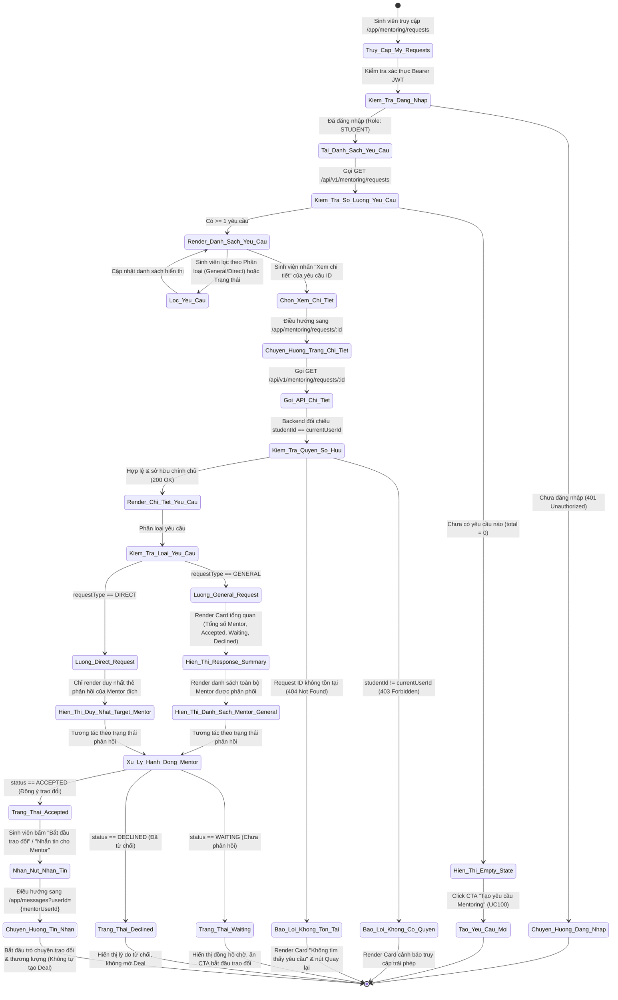
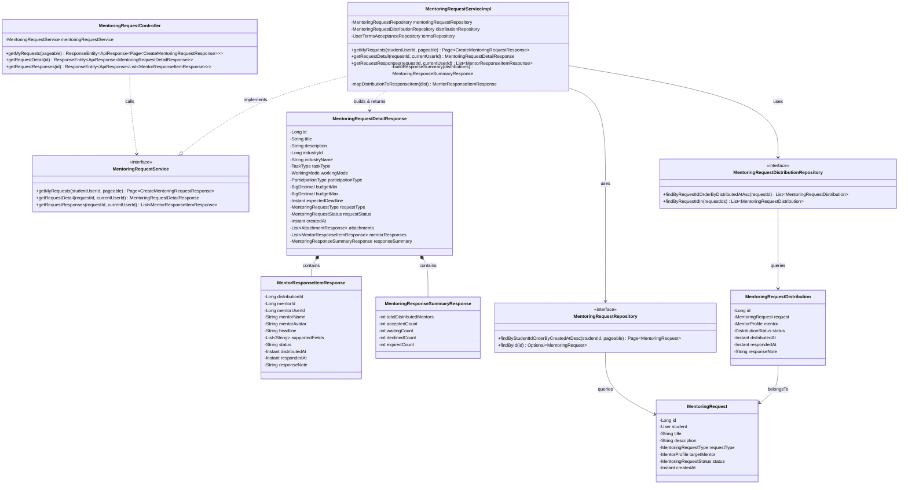
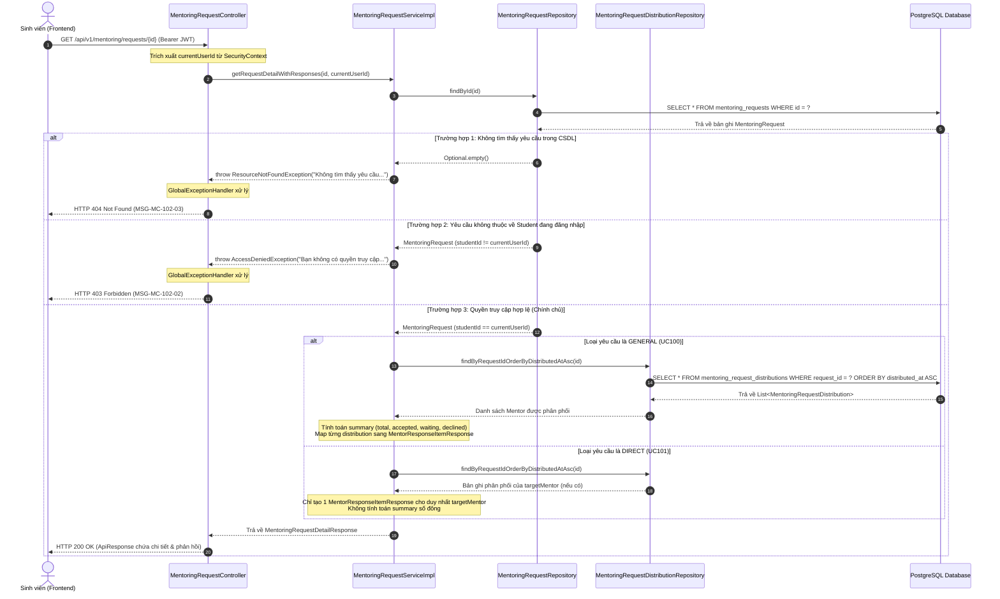

# ĐẶC TẢ YÊU CẦU & THIẾT KẾ CHI TIẾT: UC102 - XEM PHẢN HỒI YÊU CẦU MENTORING (VIEW MENTORING REQUEST RESPONSES)

## PHẦN 1: ĐẶC TẢ NGHIỆP VỤ (REPORT 3)

### 2.2.3 Business Workflow (Luồng nghiệp vụ)

#### Mô tả chi tiết luồng xử lý bằng chữ (Business Step Description):
* **Bước 1 - Khởi đầu (Danh sách yêu cầu)**: Sinh viên điều hướng tới trang `Mentoring -> Yêu cầu của tôi` (`/app/mentoring/requests`). Hệ thống kiểm tra phiên đăng nhập và truy vấn toàn bộ yêu cầu do chính sinh viên đó tạo thông qua endpoint `GET /api/v1/mentoring/requests`.
* **Bước 2 - Xem chi tiết yêu cầu**: Sinh viên bấm nút "Xem chi tiết" tại một yêu cầu cụ thể. Hệ thống điều hướng sang `/app/mentoring/requests/:id` và gửi truy vấn `GET /api/v1/mentoring/requests/{id}`.
* **Bước 3 - Xác thực quyền sở hữu nghiêm ngặt**: Backend kiểm tra định danh `currentUserId` từ JWT Token. Nếu yêu cầu thuộc về sinh viên khác, lập tức từ chối với mã HTTP `403 Forbidden` và không để lộ danh sách Mentor liên quan.
* **Bước 4 - Phân nhánh hiển thị theo phân loại yêu cầu**:
  * **General Request (UC100)**: Hiển thị khối thống kê tổng hợp số lượng phản hồi (`totalDistributedMentors`, `acceptedCount`, `waitingCount`, `declinedCount`) và danh sách tất cả các Mentor đã thực sự được thuật toán phân phối. Tuyệt đối không hiển thị toàn bộ Mentor Directory.
  * **Direct Request (UC101)**: Bỏ qua khối thống kê số đông, chỉ hiển thị duy nhất thẻ phản hồi của Mentor đích mà sinh viên đã chọn.
* **Bước 5 - Thể hiện trạng thái và kích hoạt hành động trao đổi**:
  * `WAITING`: Mentor đang xem xét. Nút trao đổi bị ẩn/vô hiệu hóa.
  * `DECLINED`: Mentor từ chối. Hiển thị ghi chú/lý do từ chối nếu có.
  * `ACCEPTED`: Mentor đồng ý trao đổi. Nút CTA "Bắt đầu trao đổi" / "Nhắn tin cho Mentor" sáng rõ, cho phép chuyển hướng sang module nhắn tin sẵn có `/app/messages?userId={mentorUserId}`.
* **Bước 6 - Bảo toàn ranh giới nghiệp vụ (Business Boundary)**: Thao tác xem phản hồi là thuần túy Read-Only. Trạng thái `ACCEPTED` không tự động sinh bản ghi Deal, không đánh dấu nhiệm vụ hoàn thành và không kích hoạt thanh toán.

---

### 3.2 Mentorship Module (Phân hệ Cố vấn)
Phân hệ Mentorship trong nền tảng AlumNect cung cấp giải pháp kết nối định hướng nghề nghiệp, tư vấn kỹ thuật và cố vấn đồ án giữa Cựu sinh viên (Alumni Mentors) và Sinh viên (Students).

#### 3.2.1 Xem phản hồi yêu cầu Mentoring (UC102)

**Function trigger**:
* **Navigation path**: `Mentorship Sidebar -> "Yêu cầu của tôi" (/app/mentoring/requests)` hoặc trực tiếp `/app/mentoring/requests/:id`.
* **Timing Frequency**: On demand (bất cứ khi nào sinh viên muốn kiểm tra tiến độ phản hồi yêu cầu cố vấn) hoặc On screen mount.

**Function description**:
* **Actors/Roles**: Student (Sinh viên FPT University đã đăng nhập).
* **Purpose**: Cho phép sinh viên theo dõi trạng thái phản hồi của các Mentor đối với từng yêu cầu cố vấn của bản thân; phân biệt rành mạch yêu cầu Chung và yêu cầu Trực tiếp; nhận biết Mentor nào đã đồng ý để chủ động liên hệ trò chuyện qua hệ thống tin nhắn 1-1.
* **Interface**:
  * **Màn hình My Requests (`/app/mentoring/requests`)**:
    * Thanh tiêu đề kèm nút tạo yêu cầu nhanh.
    * Tabs lọc phân loại: Tất cả, Yêu cầu chung (General), Gửi trực tiếp (Direct).
    * Bộ lọc trạng thái: Tất cả, Đang mở (OPEN), Đang thực hiện (IN_PROGRESS), Đã hoàn thành (COMPLETED), Đã hủy (CANCELLED).
    * Ô tìm kiếm tiêu đề yêu cầu cố vấn theo từ khóa.
    * Danh sách các thẻ yêu cầu `MyRequestCard` với huy hiệu loại yêu cầu, trạng thái, ngày tạo, tóm tắt phản hồi và nút "Xem chi tiết".
    * Phân trang danh sách (Pagination).
    * Trạng thái Loading Skeleton kem ấm và Empty State khi chưa có yêu cầu nào.
  * **Màn hình Request Detail (`/app/mentoring/requests/:id`)**:
    * Nút quay lại danh sách "Yêu cầu của tôi" kèm Breadcrumbs.
    * Header hiển thị Tiêu đề, Badge Phân loại (`Yêu cầu chung` / `Gửi trực tiếp`), Badge Trạng thái.
    * Lưới thông số yêu cầu: Lĩnh vực chuyên môn, Ngân sách dự kiến, Hình thức làm việc, Loại hình tham gia, Loại nhiệm vụ, Thời hạn mong muốn, Danh sách tệp đính kèm tải xuống.
    * Khối tóm tắt phản hồi `RequestResponseSummaryCard` (chỉ hiển thị với General Request).
    * Danh sách các thẻ Mentor `MentorResponseCard` (Avatar, Họ tên, Đơn vị/Chức danh, Badge FPT, Huy hiệu trạng thái, Thời gian phản hồi, Ghi chú phản hồi).
    * Nút hành động: "Xem hồ sơ Mentor" và "Bắt đầu trao đổi" (chỉ kích hoạt khi `ACCEPTED`).

**Data processing**:
1. Client gửi yêu cầu kèm Header `Authorization: Bearer <JWT>`.
2. Hệ thống trích xuất `studentId` từ Security Context.
3. Service kiểm tra quyền sở hữu bản ghi `mentoring_requests`.
4. Nếu kiểm tra thất bại: trả về HTTP `403 Forbidden`.
5. Nếu yêu cầu không tồn tại: trả về HTTP `404 Not Found`.
6. Hệ thống truy vấn danh sách `mentoring_request_distributions` tương ứng với `requestId`:
   - Với General Request: truy vấn toàn bộ bản ghi phân phối đã tạo bởi thuật toán matching UC100.
   - Với Direct Request: chỉ truy vấn bản ghi phân phối ứng với `target_mentor_id` từ UC101.
7. Ánh xạ trạng thái phân phối:
   - `PENDING` -> `WAITING`
   - `ACCEPTED` -> `ACCEPTED`
   - `REJECTED` -> `DECLINED`
   - `EXPIRED` -> `EXPIRED`
8. Tính toán các chỉ số thống kê (`totalDistributedMentors`, `acceptedCount`, `waitingCount`, `declinedCount`, `expiredCount`).
9. Đóng gói dữ liệu vào `MentoringRequestDetailResponse` và trả về Client với HTTP `200 OK`.

**Screen layout**:
* Desktop: Layout 2 cột linh hoạt hoặc 1 cột tập trung với phân cấp rõ ràng (Header -> Thông tin chi tiết -> Thống kê phản hồi -> Danh sách thẻ Mentor).
* Tablet & Mobile: Các khối xếp dọc, Card responsive không tràn viền, các nút bấm CTA tối ưu cảm ứng.

**Function details**:
* **Data**:
  * Mã yêu cầu (`id`), Tiêu đề (`title`), Mô tả (`description`), Lĩnh vực (`industryName`).
  * Loại yêu cầu (`requestType`: `GENERAL` hoặc `DIRECT`).
  * Trạng thái yêu cầu (`requestStatus`: `OPEN`, `IN_PROGRESS`, `COMPLETED`, `CANCELLED`).
  * Ngân sách (`budgetMin`, `budgetMax`), Hình thức (`workingMode`), Hạn chót (`expectedDeadline`).
  * Danh sách Mentor phản hồi (`distributionId`, `mentorId`, `mentorUserId`, `mentorName`, `mentorAvatar`, `headline`, `supportedFields`, `status`, `distributedAt`, `respondedAt`, `responseNote`).
  * Bảng thống kê phản hồi (`responseSummary`).
* **Validation**:
  * Định dạng `id` trên URL phải là số nguyên dương hợp lệ.
  * Phiên đăng nhập còn hiệu lực với vai trò `STUDENT`.
* **Business rules**:
  * Sinh viên chỉ được phép xem các yêu cầu do chính mình tạo (BR-01).
  * `ACCEPTED` chỉ biểu thị Mentor đồng ý trao đổi, không tự động sinh Deal (BR-07).
  * Xem yêu cầu là thao tác hoàn toàn Read-Only, không làm biến đổi bất kỳ trường dữ liệu nào trong cơ sở dữ liệu (BR-08).
* **Error Handling**:
  * `401 Unauthorized`: Token hết hạn hoặc không hợp lệ -> Chuyển hướng sang trang đăng nhập.
  * `403 Forbidden`: Yêu cầu thuộc về sinh viên khác -> Hiển thị cảnh báo truy cập trái phép.
  * `404 Not Found`: Không tìm thấy mã yêu cầu -> Hiển thị Empty/Not Found State.
  * `500 Internal Server Error`: Lỗi kết nối máy chủ -> Hiển thị Toast và nút "Thử lại".
* **Normal case**:
  * Sinh viên mở trang chi tiết, xem đầy đủ thông tin yêu cầu và trạng thái các Mentor đã phản hồi. Bấm "Nhắn tin cho Mentor" mở cuộc hội thoại trao đổi.
* **Abnormal case**:
  * Sinh viên truy cập trực tiếp URL của một yêu cầu thuộc về người khác; hệ thống chặn ngay từ Service layer và trả về lỗi 403 an toàn.

---

### 5. Requirement Appendix (Phụ lục Yêu cầu)

#### 5.1 Business Rules (Quy tắc Nghiệp vụ)

| ID | Định nghĩa Quy tắc (Rule Definition) |
| :--- | :--- |
| **BR-01** | **Bảo mật quyền sở hữu (Ownership Security):** Sinh viên chỉ có quyền xem danh sách và chi tiết các yêu cầu do chính tài khoản của mình tạo ra. Mọi nỗ lực truy cập vào yêu cầu của sinh viên khác phải bị từ chối với mã HTTP `403 Forbidden`. |
| **BR-02** | **Xác thực dữ liệu General Request (UC100):** Khi xem chi tiết General Request, hệ thống chỉ hiển thị danh sách các Mentor đã thực sự được thuật toán matching phân phối yêu cầu. Tuyệt đối không truy vấn toàn bộ Mentor Directory rồi lọc tại Client. |
| **BR-03** | **Xác thực dữ liệu Direct Request (UC101):** Khi xem chi tiết Direct Request, hệ thống chỉ hiển thị duy nhất Mentor đích (`targetMentor`) đã được sinh viên chọn gửi yêu cầu. Không hiển thị Mentor khác và không hiển thị card thống kê nhiều Mentor. |
| **BR-04** | **Quy tắc trạng thái WAITING:** Mentor chưa đưa ra phản hồi. Giao diện hiển thị trạng thái "Đang chờ phản hồi". Không cho phép bắt đầu Deal và không giả định Mentor đã đồng ý. |
| **BR-05** | **Quy tắc trạng thái ACCEPTED:** Mentor đồng ý trao đổi hoặc thương lượng. Giao diện hiển thị nút CTA "Bắt đầu trao đổi" / "Nhắn tin cho Mentor" liên kết trực tiếp sang module tin nhắn hiện có. |
| **BR-06** | **Quy tắc trạng thái DECLINED:** Mentor từ chối yêu cầu. Giao diện hiển thị trạng thái "Đã từ chối" kèm ghi chú/lý do từ chối nếu có. Không hiển thị nút bắt đầu trao đổi. |
| **BR-07** | **Ranh giới nghiệp vụ ACCEPTED ≠ Deal:** Trạng thái `ACCEPTED` của Mentor chỉ có ý nghĩa sẵn sàng thảo luận. Hệ thống tuyệt đối không tự động sinh bản ghi Deal, không yêu cầu thanh toán và không đánh dấu nhiệm vụ hoàn thành trong phạm vi UC102. |
| **BR-08** | **Tính bất biến khi đọc (Read-Only Idempotence):** Thao tác xem danh sách hoặc chi tiết yêu cầu phản hồi là thao tác đọc thuần túy (`@Transactional(readOnly = true)`), không làm thay đổi trạng thái của yêu cầu hay trạng thái phân phối. |
| **BR-09** | **Xử lý yêu cầu không tồn tại:** Nếu `requestId` không có trong cơ sở dữ liệu, trả về mã HTTP `404 Not Found` và hiển thị giao diện báo lỗi thân thiện. |
| **BR-10** | **Cô lập bộ nhớ đệm (Cache Isolation):** Dữ liệu phản hồi được cache theo từng người dùng và từng mã yêu cầu. Khi người dùng đăng xuất hoặc chuyển tài khoản, cache phải được dọn dẹp để tránh rò rỉ thông tin. |

#### 5.2 Common Requirements (Yêu cầu Chung)
* Giao diện tuân thủ triệt để ngôn ngữ thiết kế **Pastel Premium Design System** của AlumNect.
* Các trạng thái tải dữ liệu sử dụng **Shimmer Skeleton** màu kem ấm, không sử dụng spinner quay tròn thô ráp.
* Dữ liệu thời gian hiển thị theo định dạng Việt Nam (`dd/MM/yyyy HH:mm`) phù hợp múi giờ `Asia/Ho_Chi_Minh`.
* Tất cả các cuộc gọi API truyền tải qua kênh bảo mật HTTPS/TLS với Header Bearer JWT.

#### 5.3 Application Messages List (Danh sách Thông điệp Ứng dụng)

| # | Mã thông điệp | Loại thông điệp | Ngữ cảnh | Nội dung hiển thị |
| :--- | :--- | :--- | :--- | :--- |
| 1 | `MSG-MC-102-01` | Banner / Card | Sinh viên chưa tạo bất kỳ yêu cầu nào | Bạn chưa có yêu cầu cố vấn nào. Hãy gửi yêu cầu để được kết nối với các Mentor giàu kinh nghiệm! |
| 2 | `MSG-MC-102-02` | Card Cảnh báo | Truy cập yêu cầu thuộc về người khác (403) | Bạn không có quyền truy cập yêu cầu cố vấn này. |
| 3 | `MSG-MC-102-03` | Card Thông báo | Yêu cầu cố vấn không tồn tại trong hệ thống (404) | Không tìm thấy thông tin yêu cầu cố vấn này. |
| 4 | `MSG-MC-102-04` | Toast Lỗi | Lỗi mạng hoặc máy chủ không phản hồi | Không thể tải thông tin phản hồi từ Mentor. Vui lòng thử lại sau. |
| 5 | `MSG-MC-102-05` | Inline Badge | Mentor chưa trả lời yêu cầu | Đang chờ phản hồi |
| 6 | `MSG-MC-102-06` | Inline Badge | Mentor đồng ý trao đổi | Đã đồng ý |
| 7 | `MSG-MC-102-07` | Inline Badge | Mentor từ chối yêu cầu | Đã từ chối |
| 8 | `MSG-MC-102-08` | Tooltip / Text | Giải thích về trạng thái ACCEPTED | Mentor đã đồng ý trao đổi. Nhấn nút để nhắn tin trực tiếp với Mentor. |
| 9 | `MSG-MC-102-09` | Text Ghi chú | Mentor không để lại lời nhắn khi từ chối | Mentor không để lại ghi chú cụ thể. |
| 10 | `MSG-MC-102-10` | Inline Badge | Yêu cầu hết hạn tiếp nhận | Hết hạn phản hồi |

---

## PHẦN 2: THIẾT KẾ CHI TIẾT (REPORT 4)

### 3. Detail Design (Thiết kế chi tiết)

#### 3.1 Xem phản hồi yêu cầu Mentoring (UC102)

##### 3.1.1 Class Diagram (Sơ đồ Lớp)

###### Mô tả chi tiết cấu trúc các lớp (Class Design Description):
* **Lớp Controller (`MentoringRequestController.java`)**: Đón nhận các yêu cầu HTTP GET từ phía Client, trích xuất ID sinh viên từ `SecurityUtils.getCurrentUserId()`, chuyển tiếp sang Service và đóng gói kết quả vào `ResponseEntity<ApiResponse<T>>`.
* **Lớp Service (`MentoringRequestServiceImpl.java`)**: Chịu trách nhiệm thực thi toàn bộ logic nghiệp vụ UC102:
  * Kiểm tra quyền sở hữu bản ghi (`request.getStudent().getId().equals(currentUserId)`).
  * Truy vấn danh sách phân phối Mentor và chuyển đổi sang các DTO phản hồi.
  * Tính toán số liệu thống kê phản hồi (`MentoringResponseSummaryResponse`).
  * Thực thi hoàn toàn trong chế độ Read-Only (`@Transactional(readOnly = true)`).
* **Lớp DTO**:
  * `MentoringRequestDetailResponse`: Chứa thông tin toàn diện về yêu cầu cố vấn kèm danh sách phản hồi chi tiết.
  * `MentorResponseItemResponse`: Đại diện cho phản hồi của một Mentor, bao gồm họ tên, avatar, chức danh, trạng thái phản hồi và ghi chú.
  * `MentoringResponseSummaryResponse`: Đối tượng tóm tắt số lượng phản hồi giúp hiển thị chỉ số trực quan.
* **Lớp Repository & Entity**:
  * `MentoringRequestDistributionRepository`: Bổ sung các phương thức truy vấn tối ưu theo `requestId` và `requestIds` theo lô (IN clause).
  * `MentoringRequestDistribution`: Entity đại diện cho bảng `mentoring_request_distributions`, đã được bổ sung cột `response_note`.

##### 3.1.2 Sequence Diagram (Sơ đồ Tuần tự)

###### Mô tả chi tiết luồng xử lý bằng chữ (Sequence Flow Description):
1. **Luồng thành công (Normal Case)**:
   * Client gửi request `GET /api/v1/mentoring/requests/{id}` kèm Bearer JWT.
   * Controller trích xuất `currentUserId` từ `SecurityUtils` và gọi Service method.
   * Service truy vấn cơ sở dữ liệu qua `MentoringRequestRepository`.
   * Service xác nhận `studentId == currentUserId`.
   * Service truy vấn `MentoringRequestDistributionRepository` để lấy danh sách Mentor đã được phân phối.
   * Service tính toán số liệu thống kê phản hồi và đóng gói `MentoringRequestDetailResponse`.
   * Controller trả về mã HTTP `200 OK` cho Client kèm thông điệp tiếng Việt thành công.
2. **Luồng ngoại lệ 404 Not Found**:
   * Nếu mã yêu cầu không tồn tại, Service ném `ResourceNotFoundException`. Hệ thống trả về HTTP `404 Not Found` kèm thông điệp `MSG-MC-102-03`.
3. **Luồng ngoại lệ 403 Forbidden (Bảo mật quyền sở hữu)**:
   * Nếu sinh viên cố ý truy cập vào ID của sinh viên khác, Service phát hiện sự bất đồng giữa `currentUserId` và `studentId`, lập tức ném `AccessDeniedException`. Controller trả về HTTP `403 Forbidden` và không làm rò rỉ bất kỳ thông tin nào của yêu cầu đó.
