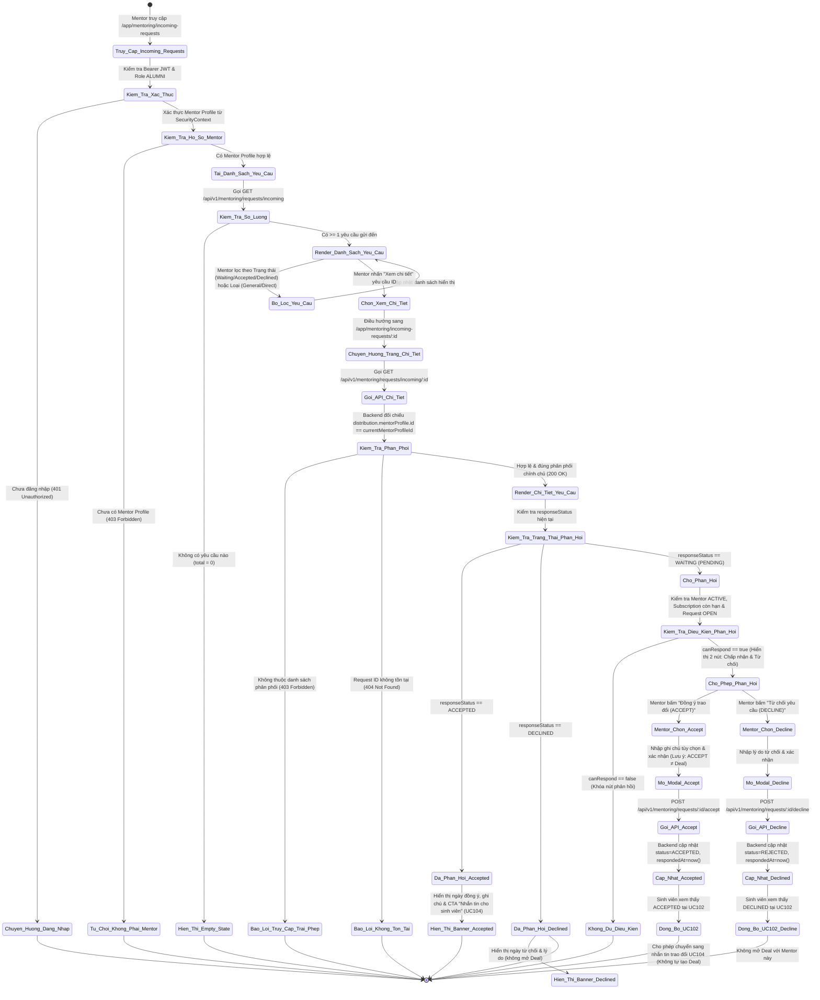
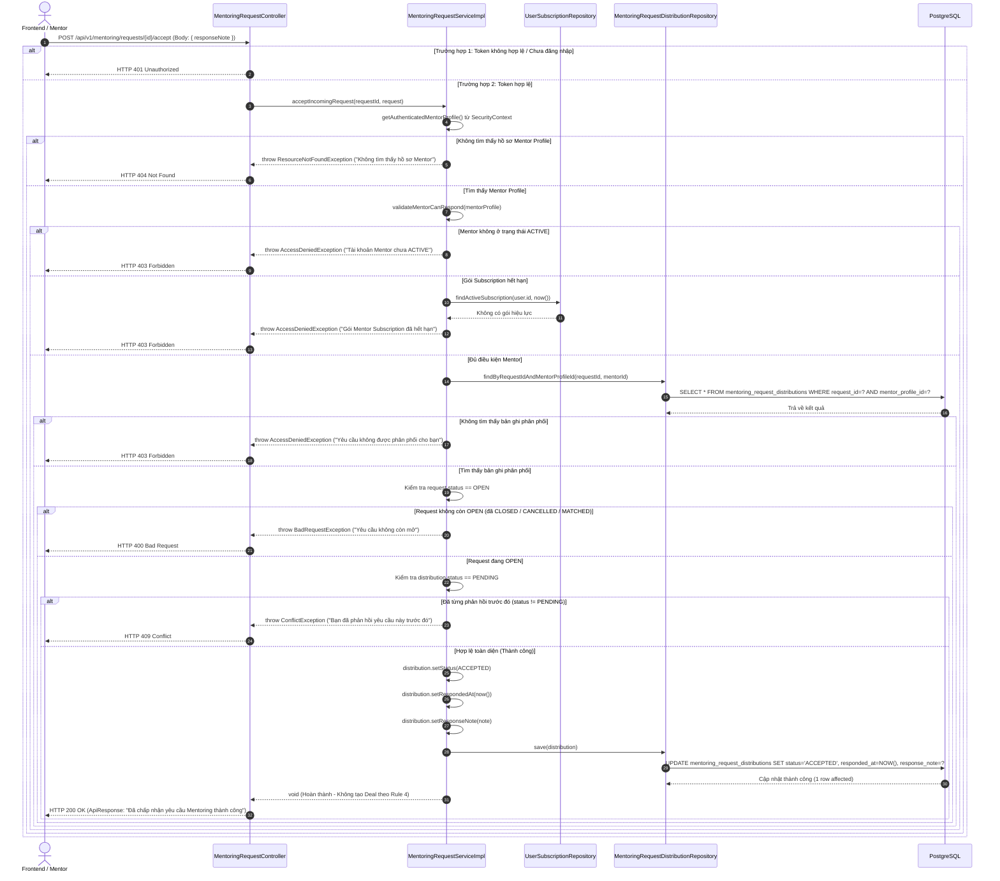

# ĐẶC TẢ YÊU CẦU & THIẾT KẾ CHI TIẾT: UC103 - XEM VÀ PHẢN HỒI YÊU CẦU MENTORING (VIEW & RESPOND TO MENTORING REQUESTS)

## PHẦN 1: ĐẶC TẢ NGHIỆP VỤ (REPORT 3)

### 2.2.3 Business Workflow (Luồng nghiệp vụ)

#### Mô tả chi tiết luồng xử lý bằng chữ (Business Step Description):
* **Bước 1 - Khởi đầu (Danh sách yêu cầu gửi đến)**: Mentor điều hướng tới menu `Mentorship -> Yêu cầu gửi đến` (`/app/mentoring/incoming-requests`). Hệ thống kiểm tra xác thực JWT, lấy hồ sơ Mentor Profile liên kết với tài khoản Alumni đang đăng nhập và truy vấn danh sách yêu cầu thực sự được phân phối đến Mentor thông qua endpoint `GET /api/v1/mentoring/requests/incoming`.
* **Bước 2 - Xem chi tiết yêu cầu**: Mentor bấm nút "Xem chi tiết" trên một thẻ yêu cầu cụ thể. Hệ thống điều hướng sang `/app/mentoring/incoming-requests/:id` và gửi truy vấn `GET /api/v1/mentoring/requests/incoming/{id}`.
* **Bước 3 - Xác thực quyền sở hữu và phân phối nghiêm ngặt**: Backend kiểm tra định danh Mentor từ SecurityContext. Nếu yêu cầu không thuộc danh sách phân phối của Mentor (ví dụ: Direct Request gửi cho Mentor khác hoặc General Request chưa được hệ thống gán phân phối), backend lập tức từ chối với mã HTTP `403 Forbidden`.
* **Bước 4 - Kiểm tra tính khả dụng phản hồi (Eligibility Check)**:
  * Trạng thái hồ sơ Mentor: Phải là `ACTIVE`. Nếu đang ở trạng thái `PAYMENT_PENDING` hoặc `INACTIVE`, hệ thống từ chối cho phép phản hồi mới (`canRespond = false`, API trả về `403 Forbidden`).
  * Trạng thái gói dịch vụ Mentor Subscription: Phải còn hiệu lực (`endDate > now()`). Nếu đã hết hạn, hệ thống từ chối phản hồi (`403 Forbidden`).
  * Trạng thái yêu cầu Mentoring: Phải ở trạng thái `OPEN`. Nếu yêu cầu đã đóng (`CLOSED`, `CANCELLED`, `MATCHED`), hệ thống từ chối phản hồi mới (`400 Bad Request`).
  * Trạng thái phản hồi hiện tại: Phải là `PENDING` (chưa phản hồi). Nếu Mentor đã từng phản hồi `ACCEPTED` hoặc `REJECTED`, hệ thống từ chối phản hồi lần 2 nhằm đảm bảo tính Idempotent (`409 Conflict`).
* **Bước 5 - Mentor chấp nhận yêu cầu (ACCEPT)**:
  * Mentor chọn "Đồng ý trao đổi (ACCEPT)". Modal xác nhận hiển thị lời nhắc nghiệp vụ rõ ràng: Hành động này chỉ đồng ý mở kênh trao đổi với sinh viên, tuyệt đối không tự tạo thỏa thuận (Deal) chính thức hay kích hoạt thanh toán.
  * Mentor có thể nhập thêm lời nhắn/ghi chú phản hồi (tối đa 500 ký tự).
  * Backend cập nhật bản ghi `mentoring_request_distributions` tương ứng: `status = 'ACCEPTED'`, `responded_at = now()`, `response_note = payload.note`.
  * Trạng thái được đồng bộ tức thì: Sinh viên thấy Mentor chuyển sang `ACCEPTED` tại UC102. Nút "Nhắn tin cho sinh viên" xuất hiện cho phép hai bên tiến hành thảo luận chi tiết (UC104).
* **Bước 6 - Mentor từ chối yêu cầu (DECLINE)**:
  * Mentor chọn "Từ chối yêu cầu (DECLINE)". Modal hiển thị yêu cầu xác nhận và cho phép nhập lý do từ chối.
  * Backend cập nhật: `status = 'REJECTED'`, `responded_at = now()`, `response_note = payload.note`.
  * Sinh viên thấy trạng thái `DECLINED` tại UC102 kèm ghi chú lý do. Hệ thống không mở Deal với Mentor đã từ chối đối với yêu cầu này.

---

### 3.2 Mentorship Module (Phân hệ Cố vấn)
Phân hệ Mentorship trong nền tảng AlumNect cung cấp giải pháp kết nối định hướng nghề nghiệp, tư vấn kỹ thuật và cố vấn đồ án giữa Cựu sinh viên (Alumni Mentors) và Sinh viên (Students).

#### 3.2.1 Xem và phản hồi yêu cầu Mentoring cho Mentor (UC103)

**Function trigger**:
* **Navigation path**: `Mentorship Sidebar -> "Yêu cầu gửi đến" (/app/mentoring/incoming-requests)` hoặc trực tiếp `/app/mentoring/incoming-requests/:id`.
* **Timing Frequency**: On demand (bất cứ khi nào Mentor muốn kiểm tra và phản hồi các yêu cầu hướng dẫn được gửi đến).

**Function description**:
* **Actors/Roles**: Mentor (Alumni đã đăng ký hồ sơ Mentor hợp lệ, ở trạng thái ACTIVE và gói Mentor Subscription còn hiệu lực).
* **Purpose**: Cho phép Mentor tiếp nhận các yêu cầu hướng dẫn phù hợp với chuyên môn (General Requests từ UC100 hoặc Direct Requests gửi riêng từ UC101); xem xét chi tiết nhu cầu của sinh viên và quyết định chấp nhận (ACCEPT) hoặc từ chối (DECLINE).
* **Interface**:
  * **Màn hình Incoming Requests (`/app/mentoring/incoming-requests`)**:
    * Tiêu đề trang, breadcrumbs và nút làm mới danh sách.
    * Hộp thông báo lưu ý nghiệp vụ: Đồng ý trao đổi (ACCEPT) chỉ mở kênh thảo luận, KHÔNG tự động chốt Deal.
    * Bộ lọc trạng thái phản hồi: Tất cả, Chờ phản hồi (Waiting), Đã đồng ý (Accepted), Đã từ chối (Declined).
    * Bộ lọc loại yêu cầu: Tất cả, Yêu cầu chung (General - UC100), Yêu cầu trực tiếp (Direct - UC101).
    * Danh sách các thẻ yêu cầu `IncomingRequestCard` hiển thị: Avatar & tên sinh viên, tiêu đề yêu cầu, lĩnh vực, ngân sách dự kiến, hình thức làm việc, loại công việc, hạn chót mong muốn, ngày nhận, huy hiệu trạng thái phản hồi và nút "Xem chi tiết".
    * Phân trang danh sách (Pagination).
    * Trạng thái Loading Skeleton kem ấm và Empty State khi không có yêu cầu nào.
  * **Màn hình Request Detail (`/app/mentoring/incoming-requests/:id`)**:
    * Nút quay lại danh sách yêu cầu gửi đến kèm nút làm mới.
    * Badges: Loại yêu cầu (General/Direct), Lĩnh vực, Trạng thái phản hồi của Mentor.
    * Thẻ thông tin sinh viên: Avatar, họ tên, headline, email liên hệ.
    * Thẻ nội dung chi tiết: Mô tả yêu cầu, lưới thông số (ngân sách, hình thức làm việc, hình thức tham gia, loại công việc), danh sách tệp đính kèm với nút tải về.
    * Thẻ quyết định của Mentor:
      * Nếu `WAITING` và đủ điều kiện: Nút "Từ chối yêu cầu" và nút "Đồng ý trao đổi (ACCEPT)".
      * Nếu `ACCEPTED`: Banner xanh lá báo đã chấp nhận kèm thời gian, ghi chú phản hồi và nút CTA "Nhắn tin trao đổi với sinh viên" (UC104).
      * Nếu `DECLINED`: Banner đỏ báo đã từ chối kèm thời gian và lý do.
      * Nếu không đủ điều kiện phản hồi: Cảnh báo gói cước hết hạn hoặc yêu cầu đã đóng.
    * Thẻ tóm tắt thông tin phân phối và Thẻ lưu ý quy trình 3 bước của AlumNect.
    * Modal xác nhận phản hồi `IncomingRequestResponseModal`: Tiếp nhận ghi chú phản hồi tùy chọn và ngăn chặn thao tác nhầm lẫn.

---

### 5. Requirement Appendix (Phụ lục Yêu cầu)

#### 5.1 Business Rules (Quy tắc Nghiệp vụ)

| ID | Định nghĩa Quy tắc (Rule Definition) |
| :--- | :--- |
| **BR-103-01** | **Ownership & Isolation**: Mentor chỉ được xem và phản hồi các yêu cầu thực sự được phân phối hoặc gửi trực tiếp cho mình trong bảng `mentoring_request_distributions`. Tuyệt đối không cho phép truy cập yêu cầu của Mentor khác (403 Forbidden). |
| **BR-103-02** | **Direct Request Exclusivity**: Yêu cầu gửi trực tiếp (Direct Request từ UC101) chỉ hiển thị duy nhất cho Mentor đích được chọn. Không hiển thị cho bất kỳ Mentor nào khác trong hệ thống. |
| **BR-103-03** | **General Request Non-exclusive**: Với yêu cầu phân phối chung (General Request từ UC100), khi một Mentor ACCEPTED, yêu cầu KHÔNG tự động đóng lại; các Mentor khác trong danh sách phân phối vẫn có quyền phản hồi độc lập nếu yêu cầu vẫn ở trạng thái OPEN. |
| **BR-103-04** | **ACCEPTED ≠ Deal**: Mentor chọn ACCEPTED chỉ xác nhận đồng ý mở kênh thảo luận qua tin nhắn với sinh viên. Hệ thống tuyệt đối KHÔNG tự động tạo bản ghi Deal, KHÔNG tạo nhiệm vụ thanh toán và KHÔNG đóng yêu cầu. |
| **BR-103-05** | **Mentor Eligibility Enforcement**: Thao tác phản hồi (ACCEPT / DECLINE) yêu cầu Mentor phải ở trạng thái `ACTIVE` và có gói `Mentor Subscription` còn hạn (`endDate > now()`). Nếu Inactive hoặc Hết hạn, backend trả về lỗi HTTP 403 Forbidden. |
| **BR-103-06** | **Request Availability**: Mentor chỉ được phép gửi phản hồi khi yêu cầu Mentoring ở trạng thái `OPEN`. Nếu yêu cầu đã đóng, hủy hoặc đã chốt với Mentor khác (`CLOSED`, `CANCELLED`, `MATCHED`), backend từ chối với HTTP 400 Bad Request. |
| **BR-103-07** | **No Duplicate Response (Idempotency)**: Mỗi Mentor chỉ được gửi phản hồi một lần duy nhất cho mỗi phân phối (`distribution.status` phải là `PENDING`). Nếu đã ACCEPTED hoặc REJECTED, hệ thống từ chối phản hồi lần 2 với HTTP 409 Conflict. |
| **BR-103-08** | **Atomic Response Update**: Quá trình cập nhật trạng thái phản hồi phải được thực thi trong một `@Transactional` nhất quán, ngăn chặn race-condition khi Mentor click đúp hoặc yêu cầu bị đóng đồng thời. |
| **BR-103-09** | **Response Note Validation**: Ghi chú phản hồi của Mentor là tùy chọn, nếu có không được vượt quá 500 ký tự (lưu vào cột `response_note` có sẵn). |
| **BR-103-10** | **UC102 Synchronization**: Khi Mentor ACCEPT hoặc DECLINE, dữ liệu phản hồi được đồng bộ ngay lập tức để sinh viên nhìn thấy trạng thái mới nhất tại UC102. |

#### 5.2 Common Requirements (Yêu cầu Chung)
* Giao diện tuân thủ triệt để Pastel Premium Design System của AlumNect (bo góc `rounded-2xl`/`rounded-3xl`, bề mặt kem ấm `cream-50`/`cream-100`, chữ `plum-900`, gradient tím thương hiệu `brand-600`).
* Tích hợp liền mạch trong AppShell và Sidebar của phân hệ Mentorship, không tạo trang độc lập ngoài hệ thống.
* Danh sách yêu cầu gửi đến hỗ trợ phân trang (Pagination) và lọc đa chiều theo trạng thái phản hồi và loại yêu cầu.
* Mọi hành động nhạy cảm (Accept/Decline) đều yêu cầu xác nhận qua modal dialog để tránh click nhầm.
* Toàn bộ mã lỗi, thông điệp người dùng và nhãn giao diện đều bằng Tiếng Việt thân thiện.

#### 5.3 Application Messages List (Danh sách Thông điệp Ứng dụng)

| # | Mã thông điệp | Loại thông điệp | Ngữ cảnh | Nội dung hiển thị |
| :--- | :--- | :--- | :--- | :--- |
| 1 | MSG-103-01 | Toast Success | Mentor chấp nhận yêu cầu thành công | Đã chấp nhận yêu cầu Mentoring thành công. Bạn có thể bắt đầu nhắn tin trao đổi với sinh viên. |
| 2 | MSG-103-02 | Toast Success | Mentor từ chối yêu cầu thành công | Đã từ chối yêu cầu Mentoring thành công. |
| 3 | MSG-103-03 | Toast Error / Banner | Mentor chưa có hồ sơ Mentor | Bạn chưa đăng ký hồ sơ Mentor hoặc hồ sơ chưa được kích hoạt. |
| 4 | MSG-103-04 | Toast Error / Banner | Tài khoản Mentor chưa ACTIVE | Tài khoản Mentor của bạn chưa ở trạng thái ACTIVE để thực hiện phản hồi yêu cầu. |
| 5 | MSG-103-05 | Toast Error / Banner | Gói Mentor Subscription hết hạn | Gói Mentor Subscription của bạn đã hết hạn. Vui lòng gia hạn gói để tiếp tục nhận và phản hồi yêu cầu. |
| 6 | MSG-103-06 | Inline / Modal Error | Yêu cầu không còn mở | Yêu cầu cố vấn này hiện không còn mở hoặc không nhận phản hồi mới. |
| 7 | MSG-103-07 | Inline / Modal Error | Đã phản hồi trước đó | Bạn đã gửi phản hồi cho yêu cầu này trước đó rồi. |
| 8 | MSG-103-08 | Banner / Card Error | Truy cập không có quyền | Bạn không có quyền truy cập hoặc yêu cầu này không được phân phối cho bạn. |
| 9 | MSG-103-09 | Empty State | Danh sách không có yêu cầu | Chưa có yêu cầu hướng dẫn nào. Hãy đảm bảo hồ sơ Mentor của bạn luôn ở trạng thái ACTIVE và gói Subscription còn hiệu lực. |
| 10 | MSG-103-10 | Validation Error | Ghi chú phản hồi quá dài | Ghi chú phản hồi không được vượt quá 500 ký tự. |

---

## PHẦN 2: THIẾT KẾ CHI TIẾT (REPORT 4)

### 3. Detail Design (Thiết kế chi tiết)

#### 3.1 Xem và Phản hồi Yêu cầu Mentoring (UC103)

##### 3.1.1 Class Diagram (Sơ đồ Lớp)

```mermaid
classDiagram
    %% Controller Layer
    class MentoringRequestController {
        -MentoringRequestService mentoringRequestService
        +getIncomingRequests(status, requestType, pageable) ResponseEntity~ApiResponse~Page~MentorIncomingRequestResponse~~~
        +getIncomingRequestDetail(requestId) ResponseEntity~ApiResponse~MentorIncomingRequestDetailResponse~~
        +acceptIncomingRequest(requestId, request) ResponseEntity~ApiResponse~Void~~
        +declineIncomingRequest(requestId, request) ResponseEntity~ApiResponse~Void~~
    }

    %% DTO Layer
    class RespondMentoringRequestRequest {
        -String responseNote
        +getResponseNote() String
        +setResponseNote(String) void
    }

    class MentorIncomingRequestResponse {
        -Long id
        -Long distributionId
        -MentoringRequestType requestType
        -String title
        -String description
        -Long industryId
        -String industryName
        -Long studentId
        -String studentName
        -String studentAvatar
        -String studentHeadline
        -BigDecimal budgetMin
        -BigDecimal budgetMax
        -MentoringWorkingMode workingMode
        -MentoringType participationType
        -MentoringTaskType taskType
        -LocalDateTime expectedDeadline
        -String distributionStatus
        -String responseStatus
        -String responseNote
        -LocalDateTime distributedAt
        -LocalDateTime respondedAt
        -MentoringRequestStatus requestStatus
        -Integer attachmentCount
        -LocalDateTime createdAt
    }

    class MentorIncomingRequestDetailResponse {
        -Long id
        -Long distributionId
        -MentoringRequestType requestType
        -String title
        -String description
        -Long industryId
        -String industryName
        -Long studentId
        -String studentName
        -String studentAvatar
        -String studentHeadline
        -String studentEmail
        -BigDecimal budgetMin
        -BigDecimal budgetMax
        -MentoringWorkingMode workingMode
        -MentoringType participationType
        -MentoringTaskType taskType
        -LocalDateTime expectedDeadline
        -MentoringRequestStatus requestStatus
        -List~MentoringAttachmentResponse~ attachments
        -String distributionStatus
        -String responseStatus
        -String responseNote
        -LocalDateTime distributedAt
        -LocalDateTime respondedAt
        -Boolean canRespond
        -Boolean canMessage
        -LocalDateTime createdAt
        -LocalDateTime updatedAt
    }

    %% Service Layer
    class MentoringRequestService {
        <<interface>>
        +getIncomingRequests(status, requestType, pageable) Page~MentorIncomingRequestResponse~
        +getIncomingRequestDetail(requestId) MentorIncomingRequestDetailResponse
        +acceptIncomingRequest(requestId, request) void
        +declineIncomingRequest(requestId, request) void
    }

    class MentoringRequestServiceImpl {
        -MentoringRequestRepository mentoringRequestRepository
        -MentoringRequestDistributionRepository distributionRepository
        -MentorProfileRepository mentorProfileRepository
        -UserRepository userRepository
        -UserSubscriptionRepository subscriptionRepository
        +getIncomingRequests(status, requestType, pageable) Page~MentorIncomingRequestResponse~
        +getIncomingRequestDetail(requestId) MentorIncomingRequestDetailResponse
        +acceptIncomingRequest(requestId, request) void
        +declineIncomingRequest(requestId, request) void
        -getAuthenticatedMentorProfile() MentorProfile
        -validateMentorCanRespond(mentorProfile) void
    }

    %% Repository Layer
    class MentoringRequestDistributionRepository {
        <<interface>>
        +findByRequestIdAndMentorProfileId(requestId, mentorProfileId) Optional~MentoringRequestDistribution~
        +findIncomingRequests(mentorProfileId, status, requestType, pageable) Page~MentoringRequestDistribution~
        +save(distribution) MentoringRequestDistribution
    }

    class MentoringRequestRepository {
        <<interface>>
        +findById(id) Optional~MentoringRequest~
    }

    class MentorProfileRepository {
        <<interface>>
        +findByUserEmail(email) Optional~MentorProfile~
    }

    %% Entity Layer
    class MentoringRequest {
        -Long id
        -User student
        -Industry industry
        -String title
        -String description
        -MentoringRequestType requestType
        -MentoringRequestStatus status
        -BigDecimal budgetMin
        -BigDecimal budgetMax
        -MentoringWorkingMode workingMode
        -MentoringType participationType
        -MentoringTaskType taskType
        -LocalDateTime expectedDeadline
        -List~MentoringRequestDistribution~ distributions
        -List~MentoringRequestAttachment~ attachments
    }

    class MentoringRequestDistribution {
        -Long id
        -MentoringRequest request
        -MentorProfile mentorProfile
        -MentoringDistributionStatus status
        -String responseNote
        -LocalDateTime distributedAt
        -LocalDateTime respondedAt
    }

    class MentorProfile {
        -Long id
        -User user
        -MentorStatus status
        -List~SupportedField~ supportedFields
    }

    MentoringRequestController ..> RespondMentoringRequestRequest : validates & uses
    MentoringRequestController ..> MentorIncomingRequestResponse : returns
    MentoringRequestController ..> MentorIncomingRequestDetailResponse : returns
    MentoringRequestController ..> MentoringRequestService : calls
    MentoringRequestServiceImpl ..|> MentoringRequestService : implements
    MentoringRequestServiceImpl --> MentoringRequestDistributionRepository : uses
    MentoringRequestServiceImpl --> MentoringRequestRepository : uses
    MentoringRequestServiceImpl --> MentorProfileRepository : uses
    MentoringRequestServiceImpl --> MentoringRequestDistribution : manipulates
    MentoringRequestDistribution --> MentoringRequest : references
    MentoringRequestDistribution --> MentorProfile : references
```

###### Mô tả chi tiết cấu trúc các lớp (Class Design Description):
* **Lớp Controller (`MentoringRequestController.java`)**: Cung cấp các endpoint RESTful phục vụ Actor Mentor xem danh sách incoming requests, xem chi tiết và gửi phản hồi accept/decline. Bảo mật thông qua `@PreAuthorize("isAuthenticated()")` và trích xuất email Mentor an toàn từ `SecurityContextHolder`.
* **Lớp DTOs**:
  * `RespondMentoringRequestRequest.java`: Chứa trường `responseNote` (tối đa 500 ký tự) khi Mentor chấp nhận hoặc từ chối.
  * `MentorIncomingRequestResponse.java`: Chứa thông tin tóm tắt yêu cầu trong danh sách gửi đến.
  * `MentorIncomingRequestDetailResponse.java`: Chứa toàn bộ thông tin chi tiết kèm các cờ quyết định `canRespond`, `canMessage`.
* **Lớp Service (`MentoringRequestService.java` & `MentoringRequestServiceImpl.java`)**: Đảm nhiệm toàn bộ quy tắc nghiệp vụ: kiểm tra quyền Mentor, kiểm tra trạng thái ACTIVE, kiểm tra thời hạn gói Mentor Subscription, kiểm tra trạng thái OPEN của request, ngăn chặn phản hồi trùng lặp (Idempotent), và cập nhật trạng thái phân phối nguyên tử (`@Transactional`).
* **Lớp Repository (`MentoringRequestDistributionRepository.java`)**: Cung cấp truy vấn tối ưu phân trang `findIncomingRequests` kèm `JOIN FETCH` request, student, industry để tránh N+1 query.
* **Lớp Entity (`MentoringRequestDistribution.java` & `MentoringRequest.java`)**: Ánh xạ cơ sở dữ liệu `mentoring_request_distributions` và `mentoring_requests`. Cột `response_note` đã sẵn sàng từ migration V20.

---

##### 3.1.2 Sequence Diagram (Sơ đồ Tuần tự)

###### Mô tả chi tiết luồng xử lý bằng chữ (Sequence Flow Description):
1. **Luồng 1 - Thành công (Normal Case - Chấp nhận yêu cầu)**:
   * **Gửi yêu cầu**: Mentor click "Đồng ý trao đổi", xác nhận modal và Client gửi yêu cầu POST đến `/api/v1/mentoring/requests/{id}/accept`.
   * **Xác thực danh tính**: Controller chuyển tiếp DTO sang Service. Service trích xuất email Mentor từ JWT trong `SecurityContextHolder`.
   * **Kiểm tra nghiệp vụ đa tầng**: Service kiểm tra Mentor `status == ACTIVE`, kiểm tra gói Subscription còn hạn, kiểm tra quyền sở hữu phân phối `findByRequestIdAndMentorProfileId`, kiểm tra yêu cầu `status == OPEN`, và kiểm tra phân phối đang ở `PENDING`.
   * **Cập nhật nguyên tử**: Service cập nhật `status = ACCEPTED`, `respondedAt = now()`, `responseNote` và lưu vào DB.
   * **Phản hồi**: Trả về HTTP 200 OK. Frontend tự động làm mới cache React Query, chuyển trạng thái sang `ACCEPTED`, hiển thị nút "Nhắn tin cho sinh viên" và đồng bộ ngay cho sinh viên tại UC102.
2. **Luồng 2 - Vi phạm quyền sở hữu hoặc không đủ điều kiện (Forbidden Case)**:
   * Mentor cố tình gọi API chấp nhận một yêu cầu thuộc về Mentor khác hoặc tài khoản Mentor đang bị khóa/chưa thanh toán subscription. Service ném `AccessDeniedException`. Controller trả về HTTP 403 Forbidden.
3. **Luồng 3 - Vi phạm tính đơn nhất / Đã phản hồi trước đó (Conflict Case)**:
   * Mentor click đúp nhanh hoặc đã ACCEPT/DECLINE trước đó nhưng gửi lại request. Service phát hiện `distribution.status != PENDING`, ném `ConflictException`. Controller trả về HTTP 409 Conflict với thông điệp: "Bạn đã phản hồi yêu cầu này trước đó rồi".
4. **Luồng 4 - Yêu cầu đã đóng / hết hạn (Bad Request Case)**:
   * Yêu cầu đã được sinh viên hủy hoặc hệ thống đã đóng. Service phát hiện `request.status != OPEN`, ném `BadRequestException`. Controller trả về HTTP 400 Bad Request.

---

### 6. Test Cases Mapping (Kiểm thử tương thích)

| Test Case ID | Tên Kịch bản Kiểm thử | Trạng thái Thực tế |
| :--- | :--- | :--- |
| **TC103-01** | Mentor xem danh sách General Requests được phân phối từ UC100 | **PASS** (13/13 Unit Tests & Frontend build OK) |
| **TC103-02** | Mentor xem Direct Request gửi trực tiếp từ UC101, Mentor khác không thấy | **PASS** |
| **TC103-03** | Mentor xem chi tiết Incoming Request hợp lệ kèm sinh viên và tệp đính kèm | **PASS** |
| **TC103-04** | Mentor ACCEPT yêu cầu thành công, cập nhật ACCEPTED, sinh viên thấy tại UC102, không tạo Deal | **PASS** |
| **TC103-05** | Mentor DECLINE yêu cầu thành công, cập nhật REJECTED kèm lý do | **PASS** |
| **TC103-06** | Mentor không ACTIVE bị từ chối phản hồi (HTTP 403) | **PASS** |
| **TC103-07** | Mentor Subscription hết hạn bị từ chối phản hồi (HTTP 403) | **PASS** |
| **TC103-08** | Yêu cầu đã đóng (CLOSED/CANCELLED) bị từ chối phản hồi (HTTP 400) | **PASS** |
| **TC103-09** | Mentor lạ cố xem hoặc phản hồi request không được phân phối (HTTP 403) | **PASS** |
| **TC103-10** | Ngăn chặn phản hồi trùng lặp lần 2 (Idempotent - HTTP 409) | **PASS** |
| **TC103-11** | General Request có nhiều Mentor phản hồi độc lập, Mentor A ACCEPT không ảnh hưởng Mentor B | **PASS** |
| **TC103-12** | Ghi chú phản hồi vượt quá 500 ký tự bị từ chối validate | **PASS** |
| **TC103-13** | Bộ lọc phân loại (General/Direct) và trạng thái (Waiting/Accepted/Declined) hoạt động chuẩn xác | **PASS** |
