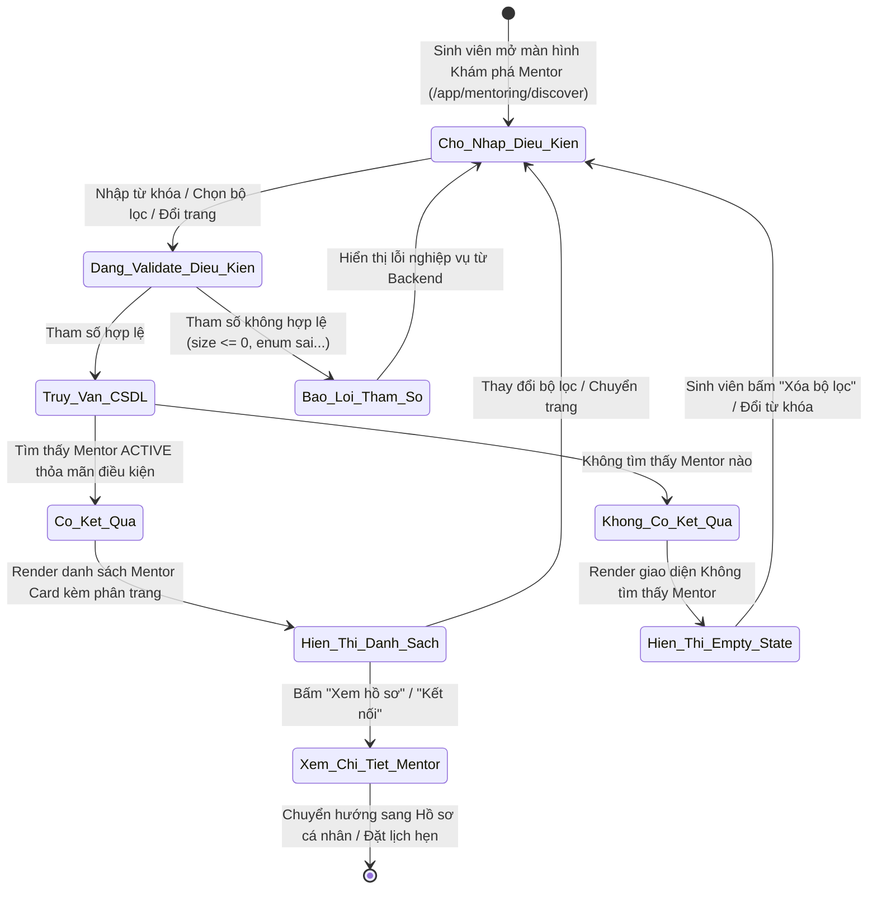
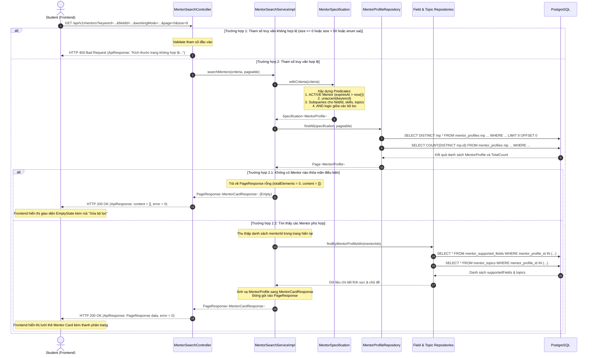

# ĐẶC TẢ YÊU CẦU & THIẾT KẾ CHI TIẾT: UC98 - TÌM KIẾM & LỌC MENTOR

## PHẦN 1: ĐẶC TẢ NGHIỆP VỤ (REPORT 3)

### 2.2.3 Business Workflow (Luồng nghiệp vụ)

#### Mô tả chi tiết luồng xử lý bằng chữ (Business Step Description):
* **Bước 1 - Khởi đầu**: Sinh viên (Student) đã đăng nhập vào hệ thống AlumNect và truy cập vào khu vực Khám phá & Lọc Mentor tại đường dẫn `/app/mentoring/discover`. Hệ thống tải danh mục metadata bộ lọc (lĩnh vực, chuyên ngành, kỹ năng, hình thức làm việc, hình thức hướng dẫn) và danh sách Mentor mặc định ban đầu (phân trang 9 mentor/trang, sắp xếp theo điểm uy tín giảm dần).
* **Bước 2 - Các bước chuyển tiếp**:
  - Sinh viên nhập từ khóa tìm kiếm (tên mentor, công ty, kỹ năng, chuyên môn...) vào ô tìm kiếm hoặc chọn một/nhiều tiêu chí từ bộ lọc (Field/Industry, Major, Skills, Working Mode, Mentoring Type).
  - Giao diện Frontend áp dụng debounce 350ms đối với từ khóa và gửi yêu cầu `GET /api/v1/mentors` cùng các query parameters tương ứng.
  - Backend `MentorSearchController` tiếp nhận request, tiến hành validate tham số (kiểm tra `page >= 0`, `size > 0 && size <= 50`, các giá trị Enum hợp lệ).
  - `MentorSearchService` kết hợp các điều kiện qua `MentorSpecification`:
    - Ràng buộc cứng: Mentor phải có trạng thái `ACTIVE` (đã đăng ký và có gói dịch vụ còn hạn, `expiresAt > now()`).
    - Lọc theo từ khóa (accent-insensitive qua PostgreSQL `unaccent` trên fullName, headline, currentCompany, currentPosition, majorName, skills, topics).
    - Lọc theo Field/Industry (Subquery bảng `mentor_supported_fields`).
    - Lọc theo Specialization/Major (Khớp Major ID hoặc chuỗi chuyên ngành).
    - Lọc theo Skills (Subquery bảng `user_skills`).
    - Lọc theo Working Mode (`ONLINE`, `OFFLINE`, `BOTH`). Mentor có hình thức `BOTH` phù hợp với cả yêu cầu `ONLINE` hoặc `OFFLINE`.
    - Lọc theo Mentoring Type (`INDIVIDUAL`, `GROUP`, `BOTH`). Mentor có hình thức `BOTH` phù hợp với cả yêu cầu `INDIVIDUAL` hoặc `GROUP`.
    - Các nhóm tiêu chí khác nhau được kết hợp theo logic `AND`.
  - Cơ sở dữ liệu thực thi truy vấn phân trang với count query tối ưu, loại trừ trùng lặp bản ghi (Subqueries).
  - Service thực hiện batch-fetching nạp danh sách `supportedFields` và `topics` cho các Mentor trong trang hiện tại để loại bỏ hoàn toàn vấn đề N+1 query.
* **Bước 3 - Kết thúc**:
  - Nếu có kết quả: Hệ thống trả về `PageResponse<MentorCardResponse>`, Frontend hiển thị lưới thẻ Mentor đầy đủ thông tin định danh, kỹ năng, hình thức và chỉ số uy tín.
  - Nếu không có kết quả: Trả về trang rỗng hợp lệ (không phải lỗi), Frontend hiển thị `<EmptyState>` kèm nút "Xóa bộ lọc & Tìm lại".
  - Sinh viên có thể bấm "Xem hồ sơ" hoặc "Kết nối" để chuyển tiếp sang xem chi tiết Mentor hoặc đặt lịch hướng dẫn.

---

### 3.2 Mentorship (Cố Vấn & Hướng Dẫn)
Module Mentorship là phân hệ kết nối học tập và định hướng nghề nghiệp cốt lõi của AlumNect, cho phép sinh viên tìm kiếm sự đồng hành, tư vấn chuyên môn và kỹ năng từ mạng lưới cựu sinh viên (Alumni) đã có kinh nghiệm thực tế.

#### 3.2.1 Tìm kiếm & lọc Mentor (Search & Filter Mentors - UC98)

**Function trigger**:
*   **Navigation path**: `/app/mentoring/discover` (hoặc từ Menu Sidebar "Khám phá Mentor", hoặc nút "Tìm kiếm Mentor" tại Trang chủ Mentorship `/app/mentoring`).
*   **Timing Frequency**: On demand (khi sinh viên truy cập trang, khi nhập từ khóa tìm kiếm, khi thay đổi bất kỳ bộ lọc nào, hoặc khi chuyển trang phân trang).

**Function description**:
*   **Actors/Roles**: `STUDENT` (Actor chính), `ALUMNI` (có thể truy cập để tham khảo mạng lưới đồng nghiệp), `ADMIN` (xem danh bạ).
*   **Purpose**: Cung cấp công cụ tìm kiếm và lọc linh hoạt, đa tiêu chí giúp sinh viên nhanh chóng tìm được Mentor phù hợp nhất với mục tiêu học tập, định hướng chuyên môn và hình thức cố vấn mong muốn. Đảm bảo 100% Mentor xuất hiện trong danh sách đều đang ở trạng thái `ACTIVE` hợp lệ.
*   **Interface**:
    *   **Thanh tìm kiếm & sắp xếp (`MentorSearchHeader`)**: Ô nhập từ khóa có icon Search, nút xóa X tức thì, badge hiển thị tổng số Mentor đang hoạt động, dropdown sắp xếp (Điểm uy tín, Đánh giá sao, Số nhiệm vụ, Tên A-Z).
    *   **Thanh bộ lọc đa tiêu chí (`MentorFilterBar`)**: 5 dropdown độc lập (Lĩnh vực/Industry, Chuyên ngành/Major, Kỹ năng/Skills, Hình thức làm việc/Working Mode, Hình thức hướng dẫn/Mentoring Type), khối Active Filter Chips cho phép hủy từng tiêu chí, nút "Xóa bộ lọc" để reset toàn bộ.
    *   **Lưới danh sách kết quả (`MentorDirectoryList`)**: Grid 3 cột thẻ Mentor chuẩn Pastel Premium, thẻ hiển thị Avatar ring, tên, chức danh, công ty, ngành học, badges hình thức, kỹ năng tiêu biểu, điểm uy tín (ngọn lửa), đánh giá sao, mức chi phí ước tính, nút "Xem hồ sơ" và "Kết nối".
    *   **Thanh phân trang**: Hiển thị `Trang X / Y (Tổng số N Mentor)`, nút Trang trước, Trang sau, các nút số trang kèm dấu chấm lửng.
    *   **Các trạng thái giao diện**:
        *   *Loading State*: 6 khung xương Skeleton dạng lưới Shimmer.
        *   *Empty State*: Component `<EmptyState>` với icon `SearchX`, tiêu đề "Không tìm thấy Mentor phù hợp", thông điệp gợi ý và nút CTA "Xóa bộ lọc & Tìm lại".
        *   *Error State*: Khung thông báo lỗi màu san hô (Coral), hiển thị trực tiếp thông điệp nghiệp vụ từ Backend và nút "Thử lại".

**Data processing**:
1. Client gửi request `GET /api/v1/mentors` kèm các query parameters: `keyword`, `fieldId`, `industryName`, `majorId`, `specialization`, `skill`, `workingMode`, `mentoringType`, `page`, `size`, `sortBy`, `sortDir`.
2. `MentorSearchController` validate các ràng buộc dữ liệu: `page >= 0`, `size` trong khoảng [1, 50], kiểm tra giá trị Enum.
3. `MentorSearchServiceImpl` xây dựng `Specification<MentorProfile>` qua `MentorSpecification`:
   - Enforce điều kiện bắt buộc: Mentor có trạng thái `ACTIVE` và gói dịch vụ còn hạn (`expiresAt > now()`).
   - Xây dựng Predicates cho từ khóa và từng tiêu chí bộ lọc.
   - Sử dụng Subqueries `EXISTS` đối với các quan hệ Many-to-Many (`user_skills`, `mentor_topics`, `mentor_supported_fields`) để đảm bảo không bị nhân bản (duplicate) dòng dữ liệu khi phân trang.
4. `MentorProfileRepository` thực thi truy vấn phân trang qua Spring Data JPA `Pageable` và `Page<MentorProfile>`.
5. Service thu thập danh sách `mentorId` của trang hiện tại, thực hiện 2 truy vấn batch:
   - `mentorSupportedFieldRepository.findByMentorProfileIdIn(mentorIds)`
   - `mentorTopicRepository.findByMentorProfileIdIn(mentorIds)`
   Loại bỏ hoàn toàn vấn đề N+1 query.
6. Mapping dữ liệu thành `MentorCardResponse`, đóng gói vào `PageResponse<MentorCardResponse>` và trả về với cấu trúc chuẩn `ApiResponse<T>`.

**Screen layout**:
*   *Figure 98.1 - Màn hình Khám phá & Lọc Mentor (Web/Desktop)*: Bố cục 2 cột với Mentorship Sidebar bên trái (cố định), nội dung chính bên phải bao gồm Breadcrumb, Thanh tìm kiếm, Thanh bộ lọc 5 tiêu chí, Lưới 3 cột thẻ Mentor và Thanh phân trang.
*   *Figure 98.2 - Trạng thái Không có kết quả (Empty State)*: Khung EmptyState bo góc tròn 3xl màu pastel, icon SearchX, nút bấm "Xóa bộ lọc & Tìm lại".
*   *Figure 98.3 - Giao diện trên thiết bị di động (Mobile Responsive)*: Bộ lọc thu gọn trong nút "Bộ lọc nâng cao", lưới thẻ dàn 1 cột dọc tối ưu cuộn trang.

**Function details**:
*   **Data**:
    *   Input: `keyword` (String, optional), `fieldId` (Long, optional), `industryName` (String, optional), `majorId` (Long, optional), `specialization` (String, optional), `skill` (String, optional), `workingMode` (Enum: ONLINE, OFFLINE, BOTH, optional), `mentoringType` (Enum: INDIVIDUAL, GROUP, BOTH, optional), `page` (Integer, default 0), `size` (Integer, default 9), `sortBy` (String, default "reputationScore"), `sortDir` (String: asc/desc, default "desc").
    *   Output: `PageResponse<MentorCardResponse>` gồm: `content` (List MentorCardResponse), `pageNumber`, `pageSize`, `totalElements`, `totalPages`, `last`.
*   **Validation**:
    *   `page`: Số nguyên >= 0. Nếu < 0 trả lỗi HTTP 400 "Chỉ số trang không hợp lệ (phải >= 0)".
    *   `size`: Số nguyên trong khoảng [1, 50]. Nếu ngoài khoảng trả lỗi HTTP 400 "Kích thước trang không hợp lệ (phải từ 1 đến 50)".
    *   `workingMode`: Phải thuộc tập giá trị {'ONLINE', 'OFFLINE', 'BOTH'}. Nếu sai trả lỗi HTTP 400 "Hình thức làm việc không hợp lệ".
    *   `mentoringType`: Phải thuộc tập giá trị {'INDIVIDUAL', 'GROUP', 'BOTH'}. Nếu sai trả lỗi HTTP 400 "Hình thức hướng dẫn không hợp lệ".
*   **Business rules**:
    *   *BR-01*: Chỉ Mentor có trạng thái `ACTIVE` và thời hạn gói dịch vụ còn hiệu lực (`expiresAt > now()`) mới được phép xuất hiện trong kết quả tìm kiếm/lọc.
    *   *BR-02*: Khi kết hợp nhiều bộ lọc thuộc các nhóm khác nhau, hệ thống bắt buộc áp dụng logic `AND`.
    *   *BR-03*: Mentor có `workingMode = BOTH` thỏa mãn cả điều kiện tìm kiếm `ONLINE` và `OFFLINE`. Tương tự, Mentor có `mentoringType = BOTH` thỏa mãn cả điều kiện tìm kiếm `INDIVIDUAL` và `GROUP`.
    *   *BR-04*: Tìm kiếm theo từ khóa là không phân biệt hoa thường và không phân biệt dấu tiếng Việt (accent-insensitive qua PostgreSQL `unaccent`).
    *   *BR-05*: Thay đổi từ khóa tìm kiếm hoặc bất kỳ bộ lọc nào phải tự động đưa chỉ số trang hiện tại về trang đầu tiên (`page = 0`).
    *   *BR-06*: Phân trang danh sách Mentor phải trả về số lượng bản ghi Mentor duy nhất, không bị duplicate do các liên kết Many-to-Many với kỹ năng, lĩnh vực hoặc chủ đề.
    *   *BR-07*: Dữ liệu phản hồi thẻ Mentor chỉ bao gồm các thông tin tóm tắt công khai; không được để lộ thông tin nhạy cảm như số điện thoại riêng tư, email cá nhân hoặc tài khoản ngân hàng của Mentor.
*   **Error Handling**:
    *   `ERR_INVALID_PAGE`: Mã lỗi HTTP 400 khi `page < 0`.
    *   `ERR_INVALID_PAGE_SIZE`: Mã lỗi HTTP 400 khi `size < 1` hoặc `size > 50`.
    *   `ERR_INVALID_ENUM`: Mã lỗi HTTP 400 khi giá trị Enum không hợp lệ.
    *   `ERR_UNAUTHORIZED`: Mã lỗi HTTP 401 khi Client chưa đăng nhập hoặc token hết hạn.
*   **Normal case**: Sinh viên gửi yêu cầu hợp lệ -> Hệ thống trả về HTTP 200 OK kèm danh sách phân trang các Mentor thỏa mãn điều kiện.
*   **Abnormal case**:
    *   *A1 - Không có Mentor nào thỏa mãn*: Hệ thống trả về HTTP 200 OK với `totalElements = 0`, `content = []`. Frontend hiển thị `<EmptyState>`, không coi là lỗi hệ thống.
    *   *A2 - Client truyền sai tham số*: Hệ thống trả về HTTP 400 Bad Request với thông điệp tiếng Việt từ `GlobalExceptionHandler`. Frontend hiển thị thông báo lỗi trực tiếp.
    *   *A3 - Chưa đăng nhập*: Trả về HTTP 401 Unauthorized; Frontend chuyển hướng về `/login`.

---

### 5. Requirement Appendix (Phụ lục Yêu cầu)

#### 5.1 Business Rules (Quy tắc Nghiệp vụ)

| ID | Định nghĩa Quy tắc (Rule Definition) |
| :--- | :--- |
| BR-01 | Only Mentors with status = 'ACTIVE' and active subscription not expired (expiresAt > now()) are included in search and filter results. |
| BR-02 | Multi-criteria filters across different categories must be evaluated using logical AND. |
| BR-03 | Mentors with workingMode = 'BOTH' match queries for 'ONLINE', 'OFFLINE', or 'BOTH'. Mentors with mentoringType = 'BOTH' match queries for 'INDIVIDUAL', 'GROUP', or 'BOTH'. |
| BR-04 | Keyword search must be case-insensitive, accent-insensitive (unaccent), and trimmed of leading/trailing whitespace. |
| BR-05 | Any update to keyword or filter parameters must reset the pagination index to page 0. |
| BR-06 | Pagination results must contain strictly unique mentor records without duplicates arising from multiple skills, topics, or supported fields. |
| BR-07 | Mentor card summaries must only expose public information; private phone numbers, personal emails, and banking details must not be exposed. |
| BR-08 | Maximum page size permitted by the API is 50 items to protect database resources. |

#### 5.2 Common Requirements (Yêu cầu Chung)
*   Tất cả các API tìm kiếm và lọc danh sách phải trả về dữ liệu phân trang theo chuẩn `PageResponse<T>`.
*   Thời gian phản hồi truy vấn tìm kiếm Mentor phải dưới 500ms đối với 95% số lượng request thông thường.
*   Frontend phải hiển thị Shimmer Skeleton trong lúc đang tải dữ liệu để tránh giật khung hình.
*   Giao diện tuân thủ tuyệt đối Pastel Premium Design System (màu canvas `#faf4ec`, plum `#322c3f`, brand `#7f86ee`, card bo góc 3xl, đổ bóng mềm).
*   Giao diện tương thích hoàn toàn trên Desktop, Tablet và Mobile.

#### 5.3 Application Messages List (Danh sách Thông điệp Ứng dụng)

| # | Mã thông điệp | Loại thông điệp | Ngữ cảnh | Nội dung hiển thị (Tiếng Việt) |
| :--- | :--- | :--- | :--- | :--- |
| 1 | MSG_SEARCH_SUCCESS | In line | Tìm thấy kết quả phù hợp | Tìm kiếm danh sách Mentor thành công. |
| 2 | MSG_EMPTY_RESULT | In line / Empty State | Không có Mentor nào thỏa điều kiện | Không tìm thấy Mentor phù hợp với điều kiện hiện tại. |
| 3 | MSG_INVALID_PAGE | In red / Toast | page < 0 | Chỉ số trang không hợp lệ (phải >= 0). |
| 4 | MSG_INVALID_PAGE_SIZE | In red / Toast | size < 1 hoặc size > 50 | Kích thước trang không hợp lệ (phải từ 1 đến 50). |
| 5 | MSG_INVALID_WORKING_MODE | In red / Toast | workingMode không hợp lệ | Hình thức làm việc không hợp lệ. |
| 6 | MSG_INVALID_MENTORING_TYPE | In red / Toast | mentoringType không hợp lệ | Hình thức hướng dẫn không hợp lệ. |
| 7 | MSG_FILTER_OPTIONS_SUCCESS | In line | Lấy danh mục bộ lọc | Lấy danh mục tùy chọn bộ lọc Mentor thành công. |
| 8 | MSG_UNAUTHORIZED | Toast / Redirect | Chưa xác thực | Yêu cầu đăng nhập để truy cập tài nguyên. |

---

## PHẦN 2: THIẾT KẾ CHI TIẾT (REPORT 4)

### 3. Detail Design (Thiết kế chi tiết)

#### 3.1 Tìm kiếm & lọc Mentor (UC98)

##### 3.1.1 Class Diagram (Sơ đồ Lớp)

```mermaid
classDiagram
    %% Controller Layer
    class MentorSearchController {
        -MentorSearchService mentorSearchService
        +searchMentors(criteria, pageable) ResponseEntity~ApiResponse~PageResponse~MentorCardResponse~~~
        +getFilterOptions() ResponseEntity~ApiResponse~MentorFilterOptionsResponse~~
    }

    %% Service Layer
    class MentorSearchService {
        <<interface>>
        +searchMentors(criteria, pageable) PageResponse~MentorCardResponse~
        +getFilterOptions() MentorFilterOptionsResponse
    }

    class MentorSearchServiceImpl {
        -MentorProfileRepository mentorProfileRepository
        -MentorSupportedFieldRepository mentorSupportedFieldRepository
        -MentorTopicRepository mentorTopicRepository
        -IndustryRepository industryRepository
        -MajorRepository majorRepository
        -UserSkillRepository userSkillRepository
        +searchMentors(criteria, pageable) PageResponse~MentorCardResponse~
        +getFilterOptions() MentorFilterOptionsResponse
    }

    %% Specification Layer
    class MentorSpecification {
        +withCriteria(criteria) Specification~MentorProfile~
        -unaccent(cb, expression) Expression~String~
    }

    %% DTO Layer
    class MentorSearchCriteria {
        -String keyword
        -Long fieldId
        -String industryName
        -Long majorId
        -String specialization
        -String skill
        -MentoringWorkingMode workingMode
        -MentoringType mentoringType
        -Integer page
        -Integer size
        -String sortBy
        -String sortDir
    }

    class MentorCardResponse {
        -Long mentorId
        -Long userId
        -String fullName
        -String avatarUrl
        -String headline
        -String bio
        -String currentCompany
        -String currentPosition
        -Long majorId
        -String majorName
        -String majorCode
        -MentoringWorkingMode workingMode
        -MentoringType mentoringType
        -BigDecimal minHourlyRate
        -BigDecimal maxHourlyRate
        -BigDecimal rating
        -Integer reviewCount
        -Integer reputationScore
        -Integer completedMissions
        -List~String~ supportedFields
        -List~String~ skills
        -List~String~ topics
        -Boolean active
    }

    class MentorFilterOptionsResponse {
        -List~OptionItem~ industries
        -List~OptionItem~ majors
        -List~String~ skills
        -List~EnumOptionItem~ workingModes
        -List~EnumOptionItem~ mentoringTypes
    }

    class PageResponse~T~ {
        -List~T~ content
        -int pageNumber
        -int pageSize
        -long totalElements
        -int totalPages
        -boolean last
    }

    %% Repository Layer
    class MentorProfileRepository {
        <<interface>>
        +findAll(spec, pageable) Page~MentorProfile~
    }

    class MentorSupportedFieldRepository {
        <<interface>>
        +findByMentorProfileIdIn(mentorProfileIds) List~MentorSupportedField~
    }

    class MentorTopicRepository {
        <<interface>>
        +findByMentorProfileIdIn(mentorProfileIds) List~MentorTopic~
    }

    %% Entity Layer
    class MentorProfile {
        -Long id
        -User user
        -String bio
        -MentoringWorkingMode workingMode
        -MentoringType mentoringType
        -BigDecimal minHourlyRate
        -BigDecimal maxHourlyRate
        -MentorStatus status
        -Instant expiresAt
    }

    class User {
        -Long id
        -String fullName
        -String avatarUrl
        -UserProfile userProfile
    }

    class UserProfile {
        -Long id
        -String headline
        -String currentCompany
        -String currentPosition
        -Major major
    }

    class Major {
        -Long id
        -String name
        -String code
    }

    class MentorSupportedField {
        -Long id
        -MentorProfile mentorProfile
        -Industry industry
    }

    class MentorTopic {
        -Long id
        -MentorProfile mentorProfile
        -String topicName
    }

    MentorSearchController ..> MentorSearchCriteria : validates & uses
    MentorSearchController ..> MentorSearchService : calls
    MentorSearchController ..> MentorCardResponse : returns
    MentorSearchController ..> MentorFilterOptionsResponse : returns
    MentorSearchController ..> PageResponse : returns
    MentorSearchServiceImpl ..|> MentorSearchService : implements
    MentorSearchServiceImpl --> MentorSpecification : creates specification
    MentorSearchServiceImpl --> MentorProfileRepository : queries
    MentorSearchServiceImpl --> MentorSupportedFieldRepository : batch queries
    MentorSearchServiceImpl --> MentorTopicRepository : batch queries
    MentorProfileRepository ..> MentorProfile : manages
    MentorProfile --> User : references
    User --> UserProfile : references
    UserProfile --> Major : references
    MentorSupportedField --> MentorProfile : belongs to
    MentorTopic --> MentorProfile : belongs to
```

###### Mô tả chi tiết cấu trúc các lớp (Class Design Description):
* **Lớp Controller (`MentorSearchController.java`)**: Tiếp nhận các yêu cầu HTTP GET từ Frontend tại `/api/v1/mentors` và `/api/v1/mentors/filter-options`, thực hiện validate các tham số đầu vào và gọi `MentorSearchService` xử lý.
* **Lớp Service (`MentorSearchService.java` & `MentorSearchServiceImpl.java`)**: Khai báo và triển khai nghiệp vụ tìm kiếm, chuẩn hóa dữ liệu, áp dụng điều kiện lọc Mentor ACTIVE, phân trang, batch-fetching giải quyết N+1 query và ánh xạ sang DTO response.
* **Lớp Specification (`MentorSpecification.java`)**: Đóng gói các vị từ JPA Criteria API để xây dựng câu lệnh SQL truy vấn động, bao gồm logic accent-insensitive qua PostgreSQL `unaccent` và Subqueries loại trừ duplicate bản ghi.
* **Lớp DTO (`MentorSearchCriteria.java`, `MentorCardResponse.java`, `MentorFilterOptionsResponse.java`, `PageResponse.java`)**: Đóng gói dữ liệu yêu cầu và phản hồi, đảm bảo an toàn thông tin và định dạng dữ liệu chuẩn mực.
* **Lớp Repository & Entity**: Quản lý truy xuất dữ liệu từ các bảng `mentor_profiles`, `users`, `user_profiles`, `majors`, `mentor_supported_fields`, `mentor_topics`, `user_skills`.

---

##### 3.1.2 Sequence Diagram (Sơ đồ Tuần tự)

###### Mô tả chi tiết luồng xử lý bằng chữ (Sequence Flow Description):
1. **Luồng 1 - Tìm kiếm & Lọc thành công (Normal Case)**:
   - Sinh viên gửi yêu cầu `GET /api/v1/mentors` với các tham số tìm kiếm và bộ lọc hợp lệ.
   - Controller tiếp nhận và gọi `MentorSearchService.searchMentors(criteria, pageable)`.
   - Service tạo `Specification` thông qua `MentorSpecification`, ràng buộc điều kiện bắt buộc `Mentor status = ACTIVE` và `expiresAt > now()`, kết hợp các tiêu chí bộ lọc và từ khóa theo logic `AND`.
   - `MentorProfileRepository` thực thi 2 câu lệnh SQL tới PostgreSQL: lấy dữ liệu trang hiện tại (`LIMIT 9 OFFSET 0`) và đếm tổng số bản ghi (`COUNT`).
   - Service gom danh sách ID của các Mentor trong trang, thực hiện batch query lấy `supportedFields` và `topics` từ các repository liên quan, ghép dữ liệu và trả về `PageResponse<MentorCardResponse>`.
   - Controller đóng gói vào `ApiResponse` với mã HTTP 200 OK. Frontend render lưới thẻ Mentor Card sinh động theo chuẩn Pastel Premium.
2. **Luồng 2 - Không có kết quả (Empty Result Case)**:
   - Khi không có Mentor nào khớp với toàn bộ điều kiện lọc, database trả về 0 bản ghi.
   - Service trả về `PageResponse` với `totalElements = 0` và danh sách `content` rỗng.
   - Controller trả về HTTP 200 OK (không phát sinh ngoại lệ). Frontend nhận diện danh sách rỗng và hiển thị component `<EmptyState>` với hành động "Xóa bộ lọc & Tìm lại".
3. **Luồng 3 - Ngoại lệ Tham số không hợp lệ (Validation Error Case)**:
   - Client truyền giá trị `size <= 0`, `size > 50` hoặc giá trị Enum sai định dạng.
   - Controller ném ngoại lệ `ValidationException` hoặc `MethodArgumentTypeMismatchException`.
   - `GlobalExceptionHandler` bắt ngoại lệ và trả về HTTP 400 Bad Request kèm thông điệp tiếng Việt cụ thể. Frontend hiển thị trực tiếp thông điệp lỗi trên UI.
4. **Luồng 4 - Ngoại lệ Chưa đăng nhập (Authentication Error Case)**:
   - Người dùng chưa gửi kèm Bearer JWT Token hoặc Token hết hạn.
   - Spring Security chặn request tại tầng Filter và trả về HTTP 401 Unauthorized. Frontend tự động điều hướng sang trang `/login`.
