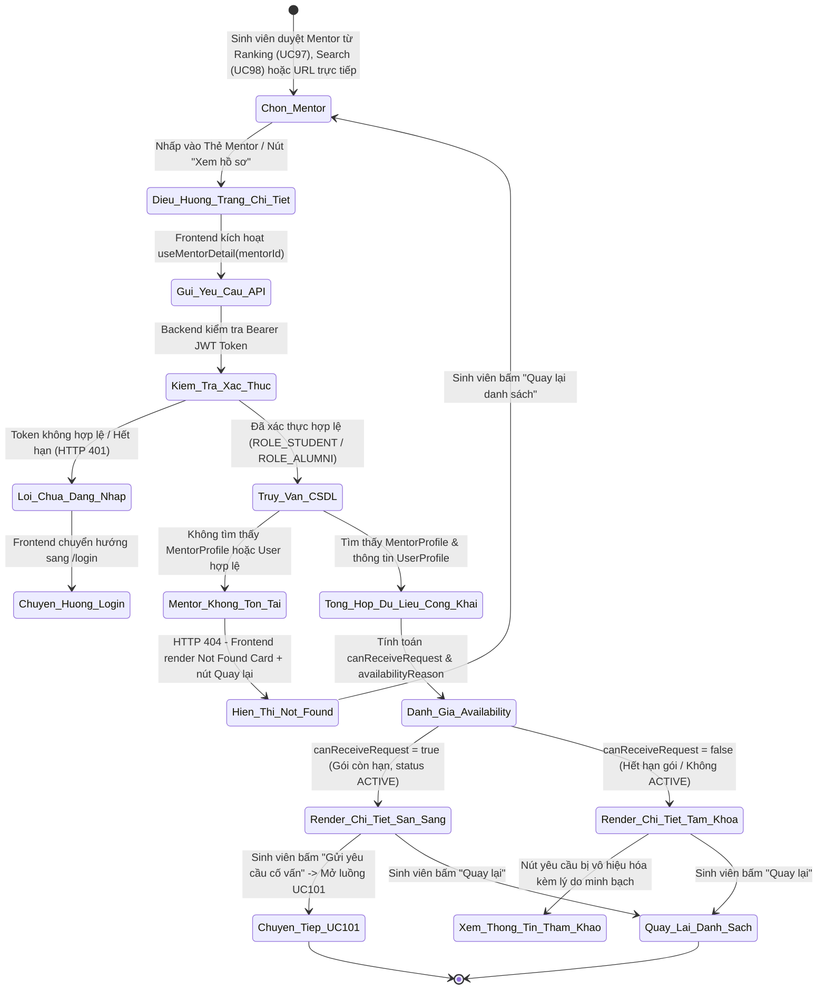
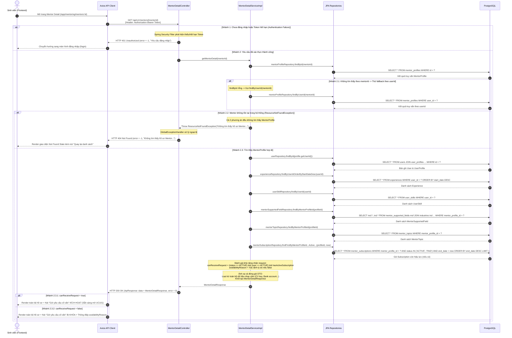

# ĐẶC TẢ YÊU CẦU & THIẾT KẾ CHI TIẾT: UC99 - XEM CHI TIẾT MENTOR (VIEW MENTOR DETAIL)

## PHẦN 1: ĐẶC TẢ NGHIỆP VỤ (REPORT 3)

### 2.2.3 Business Workflow (Luồng nghiệp vụ)

#### Mô tả chi tiết luồng xử lý bằng chữ (Business Step Description):
* **Bước 1 - Khởi đầu (Trigger & Initiation)**: 
  - Sinh viên (`STUDENT`) đã đăng nhập vào hệ thống AlumNect.
  - Từ giao diện Bảng xếp hạng Mentor (UC97 tại `/app/mentoring/ranking`), hoặc giao diện Khám phá & Lọc Mentor (UC98 tại `/app/mentoring/discover`), hoặc qua đường dẫn chia sẻ trực tiếp `/app/mentoring/mentors/:id` (hoặc alias `/app/mentors/:id`), Sinh viên nhấp vào thẻ Mentor hoặc nút "Xem hồ sơ" / "Kết nối".
  - Frontend chuyển hướng người dùng đến trang chi tiết Mentor với `mentorId` hợp lệ.

* **Bước 2 - Các bước chuyển tiếp (Navigation & Processing)**:
  - Khi component `MentorDetailPage` được mount, custom hook `useMentorDetail(mentorId)` được kích hoạt, gửi yêu cầu HTTP `GET /api/v1/mentors/{mentorId}` (hoặc endpoint alias `/api/v1/mentoring/mentors/{mentorId}`) kèm header xác thực `Authorization: Bearer <jwtToken>`.
  - Frontend hiển thị khung xương Shimmer (`MentorDetailSkeleton`) trong suốt quá trình chờ phản hồi từ máy chủ.
  - Backend Spring Boot tiếp nhận yêu cầu qua `MentorDetailController`:
    - Bộ lọc Spring Security kiểm tra tính hợp lệ của JWT Token. Nếu chưa đăng nhập hoặc token không hợp lệ, hệ thống trả về mã lỗi HTTP 401 Unauthorized.
    - `MentorDetailService` tiến hành tìm kiếm bản ghi Mentor trong cơ sở dữ liệu:
      - Ưu tiên tìm theo `mentor_profiles.id`.
      - Nếu không tìm thấy, hệ thống tự động tìm kiếm fallback theo `users.id` để đảm bảo tương thích linh hoạt giữa các module liên kết.
      - Nếu cả hai phương án đều không tìm thấy bản ghi Mentor, ném ngoại lệ `ResourceNotFoundException` trả về HTTP 404 Not Found kèm thông điệp "Không tìm thấy hồ sơ Mentor với định danh: {mentorId}".
    - Khi tìm thấy Mentor hợp lệ, Service tiếp tục truy xuất và tổng hợp thông tin từ các bảng liên quan:
      - Lấy thông tin tài khoản người dùng (`User`, `UserProfile`) và chuyên ngành (`Major`).
      - Lấy danh sách kinh nghiệm nghề nghiệp công khai từ bảng `experiences` qua `ExperienceRepository.findByUserIdOrderByStartDateDesc(...)`.
      - Lấy danh sách kỹ năng chuyên môn từ bảng `user_skills` qua `UserSkillRepository.findByUserId(...)`.
      - Lấy danh mục lĩnh vực hỗ trợ từ bảng `mentor_supported_fields` qua `MentorSupportedFieldRepository.findByMentorProfileId(...)`.
      - Lấy danh sách chủ đề hướng dẫn từ bảng `mentor_topics` qua `MentorTopicRepository.findByMentorProfileId(...)`.
      - Kiểm tra tình trạng gói đăng ký dịch vụ từ bảng `mentor_subscriptions` qua `MentorSubscriptionRepository.findFirstByMentorProfileIdAndStatusInAndEndDateAfterOrderByEndDateDesc(...)`.
    - Service đánh giá khả năng tiếp nhận yêu cầu cố vấn (`canReceiveRequest`):
      - Điều kiện cần và đủ để `canReceiveRequest = true`: Mentor có `status == MentorStatus.ACTIVE`, tài khoản User có `accountStatus == AccountStatus.ACTIVE`, và sở hữu gói dịch vụ subscription có trạng thái `ACTIVE` (hoặc `PAID`) với `endDate > Instant.now()`.
      - Nếu không đủ điều kiện, `canReceiveRequest = false` và hệ thống gán thông điệp giải thích rõ ràng `availabilityReason` (ví dụ: "Mentor hiện chưa kích hoạt trạng thái nhận yêu cầu", "Gói hoạt động của Mentor đã hết hạn", hoặc "Tài khoản Mentor đang tạm khóa").
    - Service đóng gói toàn bộ dữ liệu vào `MentorDetailResponse`, loại trừ hoàn toàn các dữ liệu nhạy cảm (CV file key riêng tư, tài khoản ngân hàng, thông tin thanh toán, mật khẩu, email/phone riêng tư, thông tin cá nhân của các mentee khác).
    - Controller trả về phản hồi chuẩn `ResponseEntity<ApiResponse<MentorDetailResponse>>` với mã HTTP 200 OK (`error = 0`).

* **Bước 3 - Kết thúc (Rendering & Actions)**:
  - Frontend nhận dữ liệu phản hồi và render hoàn chỉnh trang chi tiết Mentor theo Pastel Premium Design System:
    - **Header điều hướng**: Nút quay lại Bảng xếp hạng hoặc Khám phá Mentor.
    - **Hero Profile Card**: Avatar, họ tên, huy hiệu xác thực Cựu sinh viên FPT (Verified Alumni), Headline nghề nghiệp, công ty hiện tại, chuyên ngành đại học, huy hiệu trạng thái Mentor và tóm tắt điểm uy tín.
    - **About Section**: Giới thiệu bản thân và định hướng cố vấn.
    - **Expertise Section**: Huy hiệu kỹ năng chuyên môn, lĩnh vực hỗ trợ (`Supported Fields`), hình thức làm việc (`Working Mode`) và hình thức hướng dẫn (`Mentoring Type`).
    - **Experience Timeline**: Dòng thời gian kinh nghiệm công tác (chức danh, công ty, thời gian, mô tả).
    - **Achievements & Reputation Card**: Điểm uy tín (`reputationScore`), số nhiệm vụ hoàn thành (`completedTasks`), đánh giá trung bình (`rating`).
    - **Action Card**: Trạng thái sẵn sàng tiếp nhận yêu cầu và nút CTA "Gửi yêu cầu cố vấn".
  - Nếu `canReceiveRequest = true`: Sinh viên có thể nhấp vào nút "Gửi yêu cầu cố vấn" để chuyển tiếp sang luồng đăng ký hướng dẫn UC101.
  - Nếu `canReceiveRequest = false`: Nút CTA bị vô hiệu hóa (`disabled`) và hiển thị thông điệp giải thích nguyên nhân rõ ràng từ Backend.
  - Sinh viên có thể nhấn nút "Quay lại" bất kỳ lúc nào để trở về danh sách Mentor trước đó mà không làm mất trạng thái lọc.

---

### 3.2 Mentorship (Cố Vấn & Hướng Dẫn)
Module Mentorship là phân hệ cốt lõi của AlumNect nhằm kết nối sinh viên Đại học FPT với mạng lưới cựu sinh viên giàu kinh nghiệm, hỗ trợ định hướng sự nghiệp, phát triển kỹ năng thực chiến và giải đáp chuyên môn.

#### 3.2.1 Xem chi tiết Mentor (View Mentor Detail - UC99)

**Function trigger**:
* **Navigation path**: 
  - `/app/mentoring/mentors/:id` (Đường dẫn chính thức theo module Mentorship).
  - `/app/mentors/:id` (Route tương thích fallback).
  - Được kích hoạt khi sinh viên nhấp vào thẻ Mentor trên trang Bảng xếp hạng Mentor (UC97 - `/app/mentoring/ranking`), hoặc trang Khám phá & Lọc Mentor (UC98 - `/app/mentoring/discover`), hoặc truy cập qua liên kết trực tiếp.
* **Timing Frequency**: On demand (khi sinh viên chọn xem một Mentor cụ thể) hoặc On screen mount (khi mở trang chi tiết qua URL).

**Function description**:
* **Actors/Roles**:
  - `STUDENT`: Người dùng chính, tra cứu chi tiết thông tin Mentor để đánh giá mức độ phù hợp và quyết định gửi yêu cầu cố vấn.
  - `ALUMNI`: Cựu sinh viên có thể xem hồ sơ công khai của các Mentor khác để kết nối đồng nghiệp hoặc tham khảo tiêu chuẩn hồ sơ.
  - `ADMIN`: Quản trị viên hệ thống có thể truy cập để giám sát thông tin hiển thị công khai.
* **Purpose**:
  - Cung cấp một trang hồ sơ chuyên nghiệp, toàn diện, đáng tin cậy hiển thị đầy đủ thông tin năng lực, lĩnh vực hỗ trợ, kinh nghiệm làm việc thực tế, điểm uy tín và số nhiệm vụ đã hoàn thành của Mentor.
  - Đóng vai trò là cầu nối quyết định (decision-making gateway) giữa việc khám phá Mentor (UC97, UC98) và việc gửi yêu cầu cố vấn (UC101).
* **Interface**:
  - Giao diện được xây dựng nhất quán bên trong khung ứng dụng hiện có (`AppShell` và `MentorshipLayout`), giữ nguyên Sidebar bên trái và Thanh điều hướng toàn cục.
  - **Section A - Back Navigation**: Thanh điều hướng trên cùng gồm nút "Quay lại danh sách Mentor" (lưu vết chuyển trang từ UC97/UC98) và breadcrumb định vị ngữ cảnh.
  - **Section B - Mentor Hero Profile**: Thẻ Card nổi bật với Avatar bo tròn viền gradient, Họ và tên, Huy hiệu "Cựu sinh viên FPT xác thực", Tiêu đề nghề nghiệp (Headline), Công ty & Chức vụ hiện tại, Chuyên ngành đào tạo tại FPT University, Huy hiệu trạng thái Mentor (`ACTIVE`, `INCOMPLETE`, `PAYMENT_PENDING`, `EXPIRED`), Huy hiệu ngọn lửa Điểm uy tín, và nút CTA chính.
  - **Section C - About Mentor**: Khối Card giới thiệu tiểu sử (`bio`), định hướng chia sẻ và thông tin tổng quan về sự nghiệp.
  - **Section D - Expertise & Supported Fields**: 
    - Khối *Lĩnh vực hỗ trợ (Supported Fields)*: Hiển thị các ngành công nghiệp / lĩnh vực Mentor có chuyên môn cố vấn sâu (lấy chính xác từ bảng `mentor_supported_fields`).
    - Khối *Kỹ năng chuyên môn (Professional Skills)*: Danh sách badge kỹ năng từ bảng `user_skills`.
    - Khối *Hình thức cố vấn*: Badges minh bạch cho `Working Mode` (Online/Offline/Cả hai) và `Mentoring Type` (Cá nhân 1-1/Nhóm/Cả hai).
  - **Section E - Professional Experience (Career Timeline)**: Dòng thời gian kinh nghiệm công tác chi tiết, sắp xếp theo thời gian mới nhất (Chức danh, Công ty, Thời gian bắt đầu - kết thúc, Trạng thái đang công tác, Mô tả công việc).
  - **Section F - Mentoring Achievements & Reputation**:
    - Thẻ *Điểm uy tín (Reputation Score)*: Hiển thị điểm tích lũy đồng bộ với công thức và dữ liệu của UC97.
    - Thẻ *Nhiệm vụ hoàn thành (Completed Tasks)*: Số lượng phiên / nhiệm vụ hướng dẫn đã hoàn tất thành công.
    - Thẻ *Đánh giá trung bình (Rating)*: Điểm số trung bình từ mentee kèm số lượt đánh giá thực tế.
  - **Section G - Request Availability Action Card**: Thẻ thông báo trạng thái sẵn sàng tiếp nhận yêu cầu (`canReceiveRequest`), hiển thị thông điệp minh bạch (`availabilityReason`), mức thù lao tham khảo (`hourlyRate`), và nút bấm "Gửi yêu cầu cố vấn".
  - **Các trạng thái giao diện**:
    - *Loading State*: Component `<MentorDetailSkeleton>` với các khối Shimmer màu pastel mô phỏng chính xác cấu trúc trang.
    - *Error State*: Component `<MentorDetailErrorState>` với tone màu coral/rose, hiển thị thông điệp lỗi thực tế từ Backend và nút "Thử lại".
    - *Not Found State*: Khung thông báo lỗi 404 thân thiện khi Mentor không tồn tại, kèm nút "Khám phá Mentor khác" điều hướng về UC98.

**Data processing**:
1. Frontend trích xuất tham số `id` từ URL (ví dụ: `/app/mentoring/mentors/1`).
2. Custom hook `useMentorDetail(id)` kiểm tra điều kiện `enabled: !isNaN(Number(id)) && Number(id) > 0`, ngăn chặn việc gọi API với ID rác.
3. Client gửi request `GET /api/v1/mentors/{id}` kèm header `Authorization: Bearer <jwtToken>`.
4. `MentorDetailController.getMentorDetail(mentorId)` tiếp nhận request và chuyển tiếp cho `MentorDetailService.getMentorDetail(mentorId)`.
5. Service thực thi quy trình truy xuất dữ liệu:
   - Bước 5.1: Tìm kiếm `MentorProfile` theo `mentorId` qua `mentorProfileRepository.findById(mentorId)`.
   - Bước 5.2: Nếu không thấy, fallback tìm theo `userId` qua `mentorProfileRepository.findByUserId(mentorId)`.
   - Bước 5.3: Nếu vẫn không thấy, kiểm tra xem `userId` có tồn tại trong bảng `users` hay không. Nếu người dùng tồn tại nhưng chưa có hồ sơ Mentor, hoặc không tồn tại tài khoản nào, ném `ResourceNotFoundException`.
   - Bước 5.4: Lấy thông tin tài khoản người dùng liên kết (`User`, `UserProfile`, `Major`).
   - Bước 5.5: Truy vấn danh sách kinh nghiệm từ `ExperienceRepository.findByUserIdOrderByStartDateDesc(...)`.
   - Bước 5.6: Truy vấn danh sách kỹ năng từ `UserSkillRepository.findByUserId(...)`.
   - Bước 5.7: Truy vấn các lĩnh vực hỗ trợ từ `MentorSupportedFieldRepository.findByMentorProfileId(...)`.
   - Bước 5.8: Truy vấn các chủ đề hướng dẫn từ `MentorTopicRepository.findByMentorProfileId(...)`.
   - Bước 5.9: Kiểm tra gói đăng ký hoạt động từ `MentorSubscriptionRepository.findFirstByMentorProfileIdAndStatusInAndEndDateAfterOrderByEndDateDesc(...)`.
   - Bước 5.10: Đánh giá logic khả năng nhận request:
     - Biến `hasActiveSubscription = activeSubscriptionOpt.isPresent()`.
     - `canReceiveRequest = (profile.getStatus() == MentorStatus.ACTIVE) && (user.getAccountStatus() == AccountStatus.ACTIVE) && hasActiveSubscription`.
     - Tạo thông điệp `availabilityReason` tương ứng.
   - Bước 5.11: Ánh xạ và đóng gói dữ liệu vào `MentorDetailResponse`. Toàn bộ dữ liệu nhạy cảm bị loại bỏ 100% tại tầng Backend DTO.
6. Controller trả về `ResponseEntity<ApiResponse<MentorDetailResponse>>` với mã HTTP 200 OK và `error = 0`.

**Screen layout**:
* *Figure 99.1 - Giao diện Chi tiết Mentor trên Máy tính (Desktop Layout)*: Bố cục 2 cột bất đối xứng (2/3 bên trái cho Tiểu sử, Kỹ năng, Lĩnh vực hỗ trợ, Kinh nghiệm; 1/3 bên phải cho Điểm uy tín, Thành tích, Tình trạng nhận request, Nút CTA kết nối). Giữ nguyên Sidebar Mentorship cố định bên trái.
* *Figure 99.2 - Giao diện Chi tiết Mentor trên Điện thoại (Mobile Layout)*: Bố cục 1 cột dọc cuộn mượt, thẻ Hero Profile lên đầu, các khối thông tin xếp theo thứ tự ưu tiên trải nghiệm sinh viên, nút CTA nổi bật dễ thao tác.
* *Figure 99.3 - Trạng thái Không tìm thấy (Not Found State)*: Khung thẻ bo góc tròn màu pastel nhẹ với icon `AlertCircle`, thông điệp "Không tìm thấy hồ sơ Mentor" và nút "Quay lại danh sách Mentor".
* *Figure 99.4 - Trạng thái Mentor tạm ngưng nhận yêu cầu*: Nút CTA "Gửi yêu cầu cố vấn" hiển thị mờ (disabled) kèm banner cảnh báo giải thích lý do cụ thể do Backend cung cấp.

**Function details**:
* **Data**:
  - *Input*: `mentorId` (Long, Path Variable, bắt buộc, > 0).
  - *Output*: `MentorDetailResponse` chứa:
    - `mentorId` (Long): Định danh hồ sơ Mentor (`mentor_profiles.id`).
    - `userId` (Long): Định danh người dùng liên kết (`users.id`).
    - `fullName` (String): Họ và tên đầy đủ của Mentor.
    - `avatarUrl` (String): Đường dẫn ảnh đại diện công khai.
    - `verifiedAlumni` (boolean): Cờ xác thực Cựu sinh viên FPT (dựa trên vai trò `ROLE_ALUMNI` và tài khoản `ACTIVE`).
    - `headline` (String): Tiêu đề giới thiệu nghề nghiệp.
    - `bio` (String): Tiểu sử giới thiệu bản thân.
    - `currentCompany` (String): Công ty đang công tác hiện tại.
    - `currentPosition` (String): Vị trí công tác hiện tại.
    - `academicMajor` (String): Chuyên ngành đào tạo tại FPT University.
    - `academicMajorCode` (String): Mã chuyên ngành (ví dụ: `SE`, `IA`, `IB`).
    - `academicFaculty` (String): Khoa / Phân hiệu đào tạo.
    - `mentorStatus` (String): Trạng thái hoạt động của Mentor (`ACTIVE`, `INCOMPLETE`, `PAYMENT_PENDING`, `EXPIRED`).
    - `reputationScore` (Integer): Điểm uy tín của Mentor (đồng bộ nguồn dữ liệu với UC97).
    - `completedTasks` (Integer): Số nhiệm vụ / phiên hướng dẫn đã hoàn thành thành công.
    - `rating` (BigDecimal): Điểm đánh giá trung bình.
    - `reviewCount` (Integer): Số lượt đánh giá.
    - `workingMode` (String): Hình thức làm việc (`ONLINE`, `OFFLINE`, `BOTH`).
    - `mentoringType` (String): Hình thức hướng dẫn (`INDIVIDUAL`, `GROUP`, `BOTH`).
    - `minHourlyRate` (BigDecimal): Mức phí tham khảo tối thiểu (VND).
    - `maxHourlyRate` (BigDecimal): Mức phí tham khảo tối đa (VND).
    - `canReceiveRequest` (boolean): Cờ cho phép gửi yêu cầu cố vấn (được tính toán từ Backend).
    - `availabilityReason` (String): Lý do giải thích chi tiết nếu Mentor chưa thể nhận request.
    - `supportedFields` (List<SupportedFieldItem>): Danh mục lĩnh vực chuyên môn hỗ trợ (id, name, code, description).
    - `skills` (List<SkillItem>): Danh mục kỹ năng (id, skillName, proficiencyLevel, yearsOfExperience).
    - `topics` (List<TopicItem>): Danh mục chủ đề cố vấn (id, topicName, description).
    - `experiences` (List<ExperienceItem>): Danh mục kinh nghiệm công tác (id, companyName, position, startDate, endDate, isCurrent, description).
* **Validation**:
  - `mentorId`: Phải là số nguyên dương hợp lệ (`mentorId > 0`). Nếu là chuỗi ký tự không hợp lệ hoặc số <= 0, hệ thống từ chối hoặc trả về mã lỗi HTTP 400 Bad Request.
* **Business rules**:
  - *BR-01 (Public Information Only)*: Chỉ trả về thông tin công khai hợp lệ. Tuyệt đối không để lộ tệp CV riêng tư (`cv_file_key`), tài khoản ngân hàng (`bank_account_number`, `bank_code`), token xác thực, mật khẩu, email/phone riêng tư hoặc dữ liệu bảo mật của mentee.
  - *BR-02 (Backend Data Protection)*: Bảo vệ dữ liệu tại tầng Backend thông qua Response DTO độc lập (`MentorDetailResponse`). Tuyệt đối không serialize trực tiếp các JPA Entities (`MentorProfile`, `User`, `MentorSubscription`) ra JSON.
  - *BR-03 (Mentor Availability Logic)*: Khả năng tiếp nhận yêu cầu (`canReceiveRequest`) phải được tính toán chính xác tại Backend dựa trên 3 điều kiện đồng thời: MentorStatus == `ACTIVE`, AccountStatus == `ACTIVE`, và có ít nhất một gói `MentorSubscription` trạng thái `ACTIVE`/`PAID` còn hạn (`endDate > now()`). Frontend không tự ý suy diễn quyền gửi request chỉ bằng `mentorStatus`.
  - *BR-04 (Reputation Consistency)*: Điểm uy tín (`reputationScore`) hiển thị trong UC99 phải sử dụng cùng một trường dữ liệu, cùng phương thức tính toán và đồng nhất 100% với Bảng xếp hạng Mentor (UC97).
  - *BR-05 (Reusability & Separation)*: Lĩnh vực hỗ trợ (`Supported Fields`) phải lấy chính xác từ bảng `mentor_supported_fields` liên kết với bảng `industries`. Kỹ năng chuyên môn phải lấy từ `user_skills`. Không gộp hoặc tự ý suy diễn hai khái niệm này.
  - *BR-06 (Read-Only Enforcement)*: UC99 là chức năng xem hồ sơ chỉ đọc, tuyệt đối không cho phép người dùng thay đổi bất kỳ thuộc tính dữ liệu nào của Mentor từ trang này.
  - *BR-07 (Seamless Integration)*: Đảm bảo điều hướng mượt mà hai chiều với UC97 (Bảng xếp hạng), UC98 (Khám phá & Lọc) và liên kết hợp lệ tới UC101 (Gửi yêu cầu cố vấn).
* **Error Handling**:
  - `ERR_MENTOR_NOT_FOUND`: Trả về HTTP 404 khi không tìm thấy Mentor tương ứng với `mentorId`.
  - `ERR_UNAUTHORIZED`: Trả về HTTP 401 khi Client chưa gửi JWT Token hoặc Token hết hạn.
  - `ERR_FORBIDDEN`: Trả về HTTP 403 khi tài khoản bị khóa hoặc không đủ thẩm quyền truy cập.
  - `ERR_INTERNAL_SERVER`: Trả về HTTP 500 khi xảy ra lỗi không mong muốn tại máy chủ cơ sở dữ liệu.
* **Normal case**: Client gửi `GET /api/v1/mentors/{mentorId}` hợp lệ -> Hệ thống trả về HTTP 200 OK kèm đối tượng `MentorDetailResponse` đầy đủ thông tin công khai.
* **Abnormal case**:
  - *A1 - Mentor không tồn tại*: Trả về HTTP 404 Not Found. Frontend hiển thị `<MentorDetailErrorState>` với lựa chọn quay lại danh sách.
  - *A2 - Mentor không ở trạng thái ACTIVE hoặc hết hạn gói*: Vẫn trả về HTTP 200 OK với dữ liệu hồ sơ công khai, nhưng trường `canReceiveRequest = false` kèm thông điệp `availabilityReason`. Nút CTA bị vô hiệu hóa trên Frontend.
  - *A3 - Mentor chưa có kinh nghiệm công tác*: Hệ thống trả về mảng `experiences: []`. Frontend hiển thị giao diện rỗng nhẹ nhàng, không gây vỡ bố cục.
  - *A4 - Mentor chưa có kỹ năng hoặc lĩnh vực hỗ trợ*: Trả về mảng rỗng tương ứng. Frontend hiển thị trạng thái "Chưa cập nhật kỹ năng/lĩnh vực hỗ trợ".
  - *A5 - Chưa đăng nhập*: Trả về HTTP 401 Unauthorized. Frontend tự động điều hướng về màn hình đăng nhập.

---

### 5. Requirement Appendix (Phụ lục Yêu cầu)

#### 5.1 Business Rules (Quy tắc Nghiệp vụ)

| ID | Tên quy tắc | Nội dung quy tắc nghiệp vụ chi tiết |
| :--- | :--- | :--- |
| **BR-01** | Public Information Only | Chỉ hiển thị các thông tin Mentor được phép công khai. Tuyệt đối không trả về: đường dẫn/key CV riêng tư, số tài khoản ngân hàng, tên chủ thẻ, mật khẩu, mã hash, access token, email/số điện thoại riêng tư hoặc thông tin cá nhân của các mentee khác. |
| **BR-02** | Backend Data Protection | Không ẩn dữ liệu nhạy cảm chỉ ở phía Client/UI. Tầng Backend bắt buộc sử dụng Response DTO độc lập (`MentorDetailResponse`), chỉ ánh xạ các trường dữ liệu an toàn được định nghĩa trước và kiểm duyệt chặt chẽ. |
| **BR-03** | Mentor Availability | Phân định rõ ràng giữa: Mentor tồn tại trong hệ thống, Mentor được phép xem hồ sơ công khai, và Mentor đủ điều kiện tiếp nhận yêu cầu cố vấn (`canReceiveRequest`). Logic nhận request chỉ thỏa mãn khi: MentorStatus == ACTIVE, AccountStatus == ACTIVE, và có gói MentorSubscription ACTIVE/PAID còn hiệu lực. |
| **BR-04** | Reputation Consistency | Điểm uy tín (`reputationScore`) trong UC99 phải đồng nhất 100% với điểm uy tín hiển thị trên Bảng xếp hạng Mentor (UC97) về nguồn dữ liệu, quy tắc làm tròn và giá trị biểu thị. |
| **BR-05** | Source Separation & Reusability | Phân định rạch ròi giữa Lĩnh vực hỗ trợ (`Supported Fields` từ bảng `mentor_supported_fields`) và Kỹ năng chuyên môn (`Skills` từ bảng `user_skills`). Không tự ý hợp nhất hoặc suy đoán dữ liệu của nhau. Tái sử dụng kinh nghiệm làm việc từ bảng `experiences`. |
| **BR-06** | Read-Only Operation | Toàn bộ chức năng UC99 chỉ phục vụ việc truy xuất dữ liệu (Read-only), tuyệt đối không thực hiện bất kỳ thao tác thay đổi, cập nhật hoặc xóa dữ liệu nào trong cơ sở dữ liệu. |
| **BR-07** | Integration Flow | Hệ thống hỗ trợ điều hướng từ cả UC97 (Bảng xếp hạng) và UC98 (Khám phá & Lọc) đến UC99 bằng định danh hợp lệ, và cung cấp điểm kích hoạt chuyển tiếp sang UC101 (Gửi yêu cầu cố vấn) khi Mentor đủ điều kiện tiếp nhận. |

#### 5.2 Common Requirements (Yêu cầu Chung)
* Giao diện người dùng tuân thủ tuyệt đối **Pastel Premium Design System** của AlumNect: màu nền canvas `#faf4ec`, màu bề mặt `#ffffff`, màu chữ chủ đạo `#322c3f`, màu chữ phụ `#6a6178`, màu điểm nhấn thương hiệu `#7f86ee`, các thẻ Card bo tròn mềm mại 2xl/3xl kết hợp bóng đổ nhẹ và hiệu ứng tương tác tinh tế.
* Bắt buộc giữ nguyên toàn bộ cấu trúc khung ứng dụng (`AppShell`, `MentorshipLayout`, Main Sidebar bên trái và Global Header). Không phá vỡ bố cục hệ thống.
* Thời gian phản hồi của API chi tiết Mentor phải đạt dưới 300ms trong điều kiện mạng bình thường nhờ việc tối ưu hóa truy vấn cơ sở dữ liệu và ánh xạ DTO hiệu quả.
* Toàn bộ mã hóa truyền thông giữa Client và Server được bảo vệ qua giao thức bảo mật HTTPS/TLS.
* Giao diện tương thích hoàn hảo và tự động co giãn linh hoạt trên mọi kích thước màn hình (Desktop, Tablet, Mobile).

#### 5.3 Application Messages List (Danh sách Thông điệp Ứng dụng)

| # | Mã thông điệp (Message Code) | Loại thông điệp (Message Type) | Ngữ cảnh xuất hiện (Context) | Nội dung hiển thị (Content Tiếng Việt) |
| :--- | :--- | :--- | :--- | :--- |
| 1 | `MSG_MENTOR_DETAIL_SUCCESS` | In line | Truy xuất thông tin Mentor thành công | Lấy thông tin chi tiết Mentor thành công. |
| 2 | `MSG_MENTOR_NOT_FOUND` | Alert Banner / In line | Định danh Mentor không tồn tại trong DB | Không tìm thấy hồ sơ Mentor với định danh: {mentorId}. |
| 3 | `MSG_MENTOR_STATUS_NOT_ACTIVE` | Badge / Text | Mentor đang ở trạng thái không hoạt động | Mentor hiện chưa kích hoạt trạng thái nhận yêu cầu cố vấn. |
| 4 | `MSG_SUBSCRIPTION_EXPIRED` | In line / Notice | Gói hoạt động của Mentor đã hết hạn | Gói hoạt động của Mentor đã hết hạn hoặc chưa được kích hoạt. |
| 5 | `MSG_ACCOUNT_SUSPENDED` | Alert Banner | Tài khoản của Mentor bị tạm khóa | Tài khoản Mentor hiện đang tạm ngưng hoạt động. |
| 6 | `MSG_READY_FOR_REQUEST` | Badge / Button | Mentor đủ điều kiện nhận yêu cầu | Sẵn sàng tiếp nhận yêu cầu cố vấn mới. |
| 7 | `MSG_SEND_REQUEST_CTA` | Button Text | Nút hành động chính | Gửi yêu cầu cố vấn |
| 8 | `MSG_NO_EXPERIENCE` | Empty State | Mentor chưa cập nhật kinh nghiệm làm việc | Mentor chưa cập nhật thông tin kinh nghiệm làm việc. |
| 9 | `MSG_NO_SUPPORTED_FIELDS` | Empty State | Mentor chưa cập nhật lĩnh vực hỗ trợ | Chưa cập nhật lĩnh vực hỗ trợ. |
| 10 | `MSG_NO_SKILLS` | Empty State | Mentor chưa cập nhật danh sách kỹ năng | Chưa cập nhật kỹ năng chuyên môn. |
| 11 | `MSG_UNAUTHORIZED` | Toast / Redirect | Chưa đăng nhập hoặc token hết hạn | Yêu cầu đăng nhập để truy cập thông tin Mentor. |
| 12 | `MSG_SERVER_ERROR` | Alert Banner | Lỗi hệ thống hoặc lỗi kết nối mạng | Không thể tải thông tin Mentor vào lúc này. Vui lòng thử lại sau. |

#### 5.4 Other Requirements (Yêu cầu Khác)
* Frontend sử dụng TanStack Query (React Query) để quản lý bộ nhớ đệm (caching) với `staleTime: 5 phút`, đảm bảo không phát sinh yêu cầu mạng thừa khi người dùng chuyển qua lại giữa các tab hoặc màn hình liên quan.
* Hỗ trợ lưu trữ trạng thái quay lại trang trước thông qua cơ chế `navigate(-1)` kết hợp với fallback an toàn về `/app/mentoring/discover` để tránh trường hợp người dùng truy cập trực tiếp bằng URL bị mất hướng điều hướng.

---

## PHẦN 2: THIẾT KẾ CHI TIẾT (REPORT 4)

### 3. Detail Design (Thiết kế chi tiết)

#### 3.1 Xem chi tiết Mentor (UC99)

##### 3.1.1 Class Diagram (Sơ đồ Lớp)

```mermaid
classDiagram
    %% Controller Layer
    class MentorDetailController {
        -MentorDetailService mentorDetailService
        +getMentorDetail(mentorId: Long) ResponseEntity~ApiResponse~MentorDetailResponse~~
    }

    %% Service Layer
    class MentorDetailService {
        <<interface>>
        +getMentorDetail(mentorId: Long) MentorDetailResponse
    }

    class MentorDetailServiceImpl {
        -MentorProfileRepository mentorProfileRepository
        -UserRepository userRepository
        -ExperienceRepository experienceRepository
        -UserSkillRepository userSkillRepository
        -MentorSupportedFieldRepository mentorSupportedFieldRepository
        -MentorTopicRepository mentorTopicRepository
        -MentorSubscriptionRepository mentorSubscriptionRepository
        +getMentorDetail(mentorId: Long) MentorDetailResponse
        -buildDetailResponse(profile: MentorProfile, user: User) MentorDetailResponse
    }

    %% DTO Layer
    class MentorDetailResponse {
        -Long mentorId
        -Long userId
        -String fullName
        -String avatarUrl
        -boolean verifiedAlumni
        -String headline
        -String bio
        -String currentCompany
        -String currentPosition
        -String academicMajor
        -String academicMajorCode
        -String academicFaculty
        -String mentorStatus
        -Integer reputationScore
        -Integer completedTasks
        -BigDecimal rating
        -Integer reviewCount
        -String workingMode
        -String mentoringType
        -BigDecimal minHourlyRate
        -BigDecimal maxHourlyRate
        -boolean canReceiveRequest
        -String availabilityReason
        -List~SupportedFieldItem~ supportedFields
        -List~SkillItem~ skills
        -List~TopicItem~ topics
        -List~ExperienceItem~ experiences
    }

    class ExperienceItem {
        -Long id
        -String companyName
        -String position
        -LocalDate startDate
        -LocalDate endDate
        -Boolean isCurrent
        -String description
    }

    class SupportedFieldItem {
        -Long id
        -String name
        -String code
        -String description
    }

    class SkillItem {
        -Long id
        -String skillName
        -String proficiencyLevel
        -Integer yearsOfExperience
    }

    class TopicItem {
        -Long id
        -String topicName
        -String description
    }

    %% Repository Layer
    class MentorProfileRepository {
        <<interface>>
        +findById(id: Long) Optional~MentorProfile~
        +findByUserId(userId: Long) Optional~MentorProfile~
    }

    class UserRepository {
        <<interface>>
        +findById(id: Long) Optional~User~
    }

    class ExperienceRepository {
        <<interface>>
        +findByUserIdOrderByStartDateDesc(userId: Long) List~Experience~
    }

    class UserSkillRepository {
        <<interface>>
        +findByUserId(userId: Long) List~UserSkill~
    }

    class MentorSupportedFieldRepository {
        <<interface>>
        +findByMentorProfileId(mentorProfileId: Long) List~MentorSupportedField~
    }

    class MentorTopicRepository {
        <<interface>>
        +findByMentorProfileId(mentorProfileId: Long) List~MentorTopic~
    }

    class MentorSubscriptionRepository {
        <<interface>>
        +findFirstByMentorProfileIdAndStatusInAndEndDateAfterOrderByEndDateDesc(profileId: Long, statuses: Collection, now: Instant) Optional~MentorSubscription~
    }

    %% Entity Layer
    class MentorProfile {
        -Long id
        -User user
        -String bio
        -MentorStatus status
        -MentoringWorkingMode workingMode
        -MentoringType mentoringType
        -BigDecimal minHourlyRate
        -BigDecimal maxHourlyRate
        -Integer reputationScore
        -Integer completedMissions
        -BigDecimal rating
        -Integer reviewCount
    }

    class User {
        -Long id
        -String fullName
        -String avatarUrl
        -AccountStatus accountStatus
        -Role role
        -UserProfile userProfile
    }

    class UserProfile {
        -Long id
        -String headline
        -String currentCompany
        -String currentPosition
        -Major major
    }

    class Experience {
        -Long id
        -User user
        -String companyName
        -String position
        -LocalDate startDate
        -LocalDate endDate
        -Boolean isCurrent
        -String description
    }

    class MentorSupportedField {
        -Long id
        -MentorProfile mentorProfile
        -Industry industry
    }

    class MentorTopic {
        -Long id
        -MentorProfile mentorProfile
        -String topicName
        -String description
    }

    class MentorSubscription {
        -Long id
        -MentorProfile mentorProfile
        -SubscriptionStatus status
        -Instant endDate
    }

    %% Relationships
    MentorDetailController ..> MentorDetailService : calls
    MentorDetailController ..> MentorDetailResponse : returns
    MentorDetailServiceImpl ..|> MentorDetailService : implements
    MentorDetailServiceImpl --> MentorProfileRepository : queries
    MentorDetailServiceImpl --> UserRepository : queries
    MentorDetailServiceImpl --> ExperienceRepository : queries
    MentorDetailServiceImpl --> UserSkillRepository : queries
    MentorDetailServiceImpl --> MentorSupportedFieldRepository : queries
    MentorDetailServiceImpl --> MentorTopicRepository : queries
    MentorDetailServiceImpl --> MentorSubscriptionRepository : queries
    MentorDetailServiceImpl ..> MentorDetailResponse : builds & returns
    MentorDetailResponse *-- ExperienceItem : contains
    MentorDetailResponse *-- SupportedFieldItem : contains
    MentorDetailResponse *-- SkillItem : contains
    MentorDetailResponse *-- TopicItem : contains
    MentorProfileRepository ..> MentorProfile : manages
    UserRepository ..> User : manages
    ExperienceRepository ..> Experience : manages
    MentorSupportedFieldRepository ..> MentorSupportedField : manages
    MentorTopicRepository ..> MentorTopic : manages
    MentorSubscriptionRepository ..> MentorSubscription : manages
    MentorProfile --> User : references
    User --> UserProfile : has
    Experience --> User : belongs to
    MentorSupportedField --> MentorProfile : belongs to
    MentorTopic --> MentorProfile : belongs to
    MentorSubscription --> MentorProfile : belongs to
```

###### Mô tả chi tiết cấu trúc các lớp (Class Design Description):
* **Lớp Controller (`MentorDetailController.java`)**: 
  - Đảm nhiệm việc tiếp nhận và xử lý yêu cầu HTTP GET từ Frontend tại hai đường dẫn: `/api/v1/mentors/{mentorId}` và `/api/v1/mentoring/mentors/{mentorId}`.
  - Sử dụng `@PathVariable("mentorId") Long mentorId` để nhận định danh Mentor.
  - Ủy quyền toàn bộ xử lý nghiệp vụ cho `MentorDetailService` và trả về kết quả chuẩn hóa `ResponseEntity<ApiResponse<MentorDetailResponse>>`.
* **Lớp Service Interface & Implementation (`MentorDetailService.java` & `MentorDetailServiceImpl.java`)**:
  - `MentorDetailService`: Khai báo phương thức hợp đồng nghiệp vụ `MentorDetailResponse getMentorDetail(Long mentorId)`.
  - `MentorDetailServiceImpl`: Cài đặt logic truy xuất và tổng hợp dữ liệu với cấu hình `@Transactional(readOnly = true)`.
  - Thực hiện chiến lược tìm kiếm 2 lớp: tìm theo `mentor_profiles.id`, nếu không có thì fallback tìm theo `users.id` để tối ưu hóa tính tương thích liên kết.
  - Tổng hợp dữ liệu độc lập từ các repository chuyên biệt (`ExperienceRepository`, `UserSkillRepository`, `MentorSupportedFieldRepository`, `MentorTopicRepository`, `MentorSubscriptionRepository`).
  - Đánh giá nghiệp vụ chính xác cho hai trường `canReceiveRequest` và `availabilityReason`.
* **Lớp DTO (`MentorDetailResponse.java`)**:
  - Đối tượng truyền tải dữ liệu công khai, được thiết kế phẳng và phân tách rõ ràng thành các nhóm thông tin: Định danh & Học vấn, Giới thiệu & Trạng thái, Chỉ số uy tín & Đánh giá, Khả năng nhận request, Lĩnh vực hỗ trợ, Kỹ năng, Chủ đề hướng dẫn và Kinh nghiệm công tác.
  - Các lớp dữ liệu lồng nhau tĩnh (`ExperienceItem`, `SupportedFieldItem`, `SkillItem`, `TopicItem`) giúp cấu trúc hóa JSON trả về một cách tường minh, sạch sẽ và an toàn.
* **Lớp Repository & Entity**:
  - `MentorProfileRepository` & `MentorProfile`: Quản lý hồ sơ Mentor, các chỉ số đánh giá, thù lao, hình thức làm việc và trạng thái đăng ký.
  - `UserRepository` & `User`: Quản lý thông tin tài khoản người dùng, họ tên, ảnh đại diện, vai trò và trạng thái tài khoản.
  - `ExperienceRepository` & `Experience`: Quản lý lịch sử công tác và kinh nghiệm thực chiến của Mentor.
  - `UserSkillRepository` & `UserSkill`: Quản lý danh mục kỹ năng của người dùng.
  - `MentorSupportedFieldRepository` & `MentorSupportedField`: Quản lý quan hệ giữa Mentor và các lĩnh vực công nghiệp hỗ trợ (`Industry`).
  - `MentorTopicRepository` & `MentorTopic`: Quản lý các chủ đề chuyên môn mà Mentor cung cấp.
  - `MentorSubscriptionRepository` & `MentorSubscription`: Quản lý tình trạng gói dịch vụ hoạt động của Mentor.

---

##### 3.1.2 Sequence Diagram (Sơ đồ Tuần tự)

###### Mô tả chi tiết luồng xử lý bằng chữ (Sequence Flow Description):
1. **Luồng chính - Truy xuất chi tiết Mentor thành công (Normal Flow)**:
   - Sinh viên truy cập vào màn hình chi tiết Mentor thông qua một liên kết hợp lệ từ Bảng xếp hạng (UC97) hoặc Tìm kiếm (UC98).
   - `Axios API Client` gửi yêu cầu HTTP `GET /api/v1/mentors/{mentorId}` kèm Bearer Token.
   - `MentorDetailController` tiếp nhận yêu cầu và gọi phương thức `getMentorDetail(mentorId)` của `MentorDetailServiceImpl`.
   - `MentorDetailServiceImpl` truy vấn cơ sở dữ liệu để tìm `MentorProfile` (có hỗ trợ tự động tìm theo `userId` nếu định danh truyền vào là User ID).
   - Service lần lượt truy xuất thông tin người dùng, lịch sử công tác từ `ExperienceRepository`, kỹ năng từ `UserSkillRepository`, lĩnh vực hỗ trợ từ `MentorSupportedFieldRepository`, chủ đề cố vấn từ `MentorTopicRepository` và gói dịch vụ hoạt động từ `MentorSubscriptionRepository`.
   - Service tính toán cờ `canReceiveRequest` dựa trên sự kết hợp của trạng thái Mentor, trạng thái người dùng và hiệu lực của gói subscription.
   - Service ánh xạ các thực thể thành `MentorDetailResponse`, loại trừ hoàn toàn các trường nhạy cảm theo quy định bảo mật BR-01.
   - Controller trả về phản hồi HTTP 200 OK bọc trong `ApiResponse<MentorDetailResponse>`.
   - Frontend render toàn bộ thông tin: Hero Profile, Tiểu sử, Kỹ năng, Lĩnh vực hỗ trợ, Timeline kinh nghiệm, Điểm uy tín và Thẻ hành động. Nút CTA "Gửi yêu cầu cố vấn" được hiển thị đúng trạng thái.
2. **Luồng ngoại lệ 1 - Mentor không tồn tại (Mentor Not Found)**:
   - Khi `mentorId` truyền vào không khớp với bất kỳ `mentor_profiles.id` hoặc `users.id` nào trong cơ sở dữ liệu.
   - Service ném `ResourceNotFoundException("Không tìm thấy hồ sơ Mentor với định danh: " + mentorId)`.
   - `GlobalExceptionHandler` bắt ngoại lệ và định dạng thành phản hồi HTTP 404 Not Found (`error = -1`).
   - Frontend nhận mã lỗi 404 và hiển thị component `<MentorDetailErrorState>` với thông báo thân thiện và nút "Quay lại danh sách Mentor".
3. **Luồng ngoại lệ 2 - Chưa xác thực (Unauthorized)**:
   - Khi request gửi lên không có Bearer Token hoặc Token đã hết hạn.
   - Bộ lọc Spring Security từ chối yêu cầu và trả về mã HTTP 401 Unauthorized.
   - Axios Interceptor tại Frontend phát hiện mã 401, xóa bỏ phiên làm việc và chuyển hướng người dùng về trang `/login`.
4. **Luồng thay thế 3 - Mentor không đủ điều kiện nhận yêu cầu (Inactive / Expired)**:
   - Mentor vẫn tồn tại trong hệ thống nhưng đang ở trạng thái `INCOMPLETE`, `PAYMENT_PENDING`, `EXPIRED`, hoặc gói dịch vụ đã quá hạn sử dụng.
   - Hệ thống vẫn trả về HTTP 200 OK với đầy đủ thông tin chuyên môn công khai nhằm phục vụ việc tham khảo hồ sơ.
   - Tuy nhiên, trường `canReceiveRequest` có giá trị `false` và trường `availabilityReason` nêu rõ lý do cụ thể (ví dụ: "Gói hoạt động của Mentor đã hết hạn hoặc chưa được kích hoạt").
   - Frontend hiển thị nút CTA ở trạng thái disabled và trình bày thông điệp giải thích minh bạch tới sinh viên.
5. **Luồng ngoại lệ 4 - Lỗi kết nối máy chủ (Network / Server Error)**:
   - Khi có sự cố mạng hoặc lỗi cơ sở dữ liệu phát sinh (HTTP 500).
   - Frontend hiển thị giao diện báo lỗi kèm thông điệp nghiệp vụ thực tế từ `error.message` và cung cấp nút "Thử lại" để tái kích hoạt truy vấn React Query.
