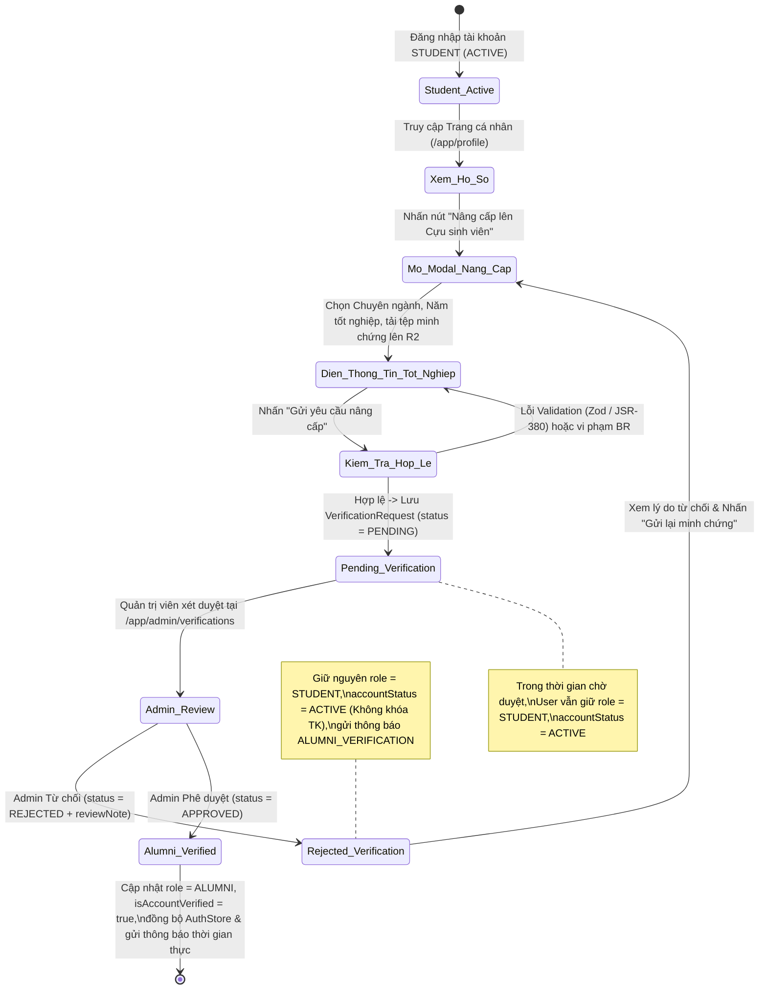
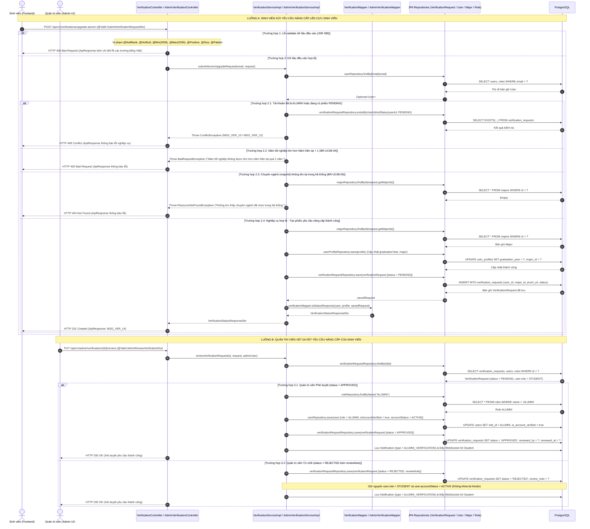

# ĐẶC TẢ YÊU CẦU & THIẾT KẾ CHI TIẾT: UC08 - CHUYỂN ĐỔI TÀI KHOẢN SINH VIÊN LÊN CỰU SINH VIÊN (UPGRADE STUDENT TO ALUMNI)

## PHẦN 1: ĐẶC TẢ NGHIỆP VỤ (REPORT 3)

### 2.2.3 Business Workflow (Luồng nghiệp vụ)

#### Mô tả chi tiết luồng xử lý bằng chữ (Business Step Description):
* **Bước 1 - Khởi đầu (Khởi tạo yêu cầu từ Sinh viên)**:
  * Người dùng đang đăng nhập với vai trò Sinh viên (`role = STUDENT`, `accountStatus = ACTIVE`, `isEmailVerified = true`) truy cập vào **Trang cá nhân** (`/app/profile`) hoặc tab **Chỉnh sửa hồ sơ -> Học tập (FPTU)**.
  * Hệ thống tự động gọi API `GET /api/v1/verifications/me` để kiểm tra trạng thái phiếu yêu cầu xác minh Cựu sinh viên gần nhất của người dùng và hiển thị trên thẻ `AlumniUpgradeBanner`.
  * Nếu chưa từng gửi yêu cầu (`status = "NONE"`, `hasSubmitted = false`) hoặc yêu cầu trước đó bị từ chối (`status = "REJECTED"`), người dùng nhấn nút **"Nâng cấp lên Cựu sinh viên"** (hoặc **"Gửi lại minh chứng"**) để mở cửa sổ `UpgradeAlumniModal`.
* **Bước 2 - Các bước chuyển tiếp (Điền thông tin, Kiểm tra hợp lệ & Tạo phiếu chờ duyệt)**:
  * Trên `UpgradeAlumniModal`, hệ thống tự động điền sẵn (pre-fill) thông tin học tập hiện có từ `UserProfile` (`majorId`, `graduationYear`).
  * Sinh viên chọn **Chuyên ngành tốt nghiệp** (`majorId`), nhập **Năm tốt nghiệp** (`graduationYear`), và tải tệp minh chứng tốt nghiệp (`JPG, PNG, WEBP, PDF, DOCX` tối đa `5MB`) lên Cloudflare R2 thông qua Presigned URL (`/api/v1/auth/presigned-url`) hoặc nhập trực tiếp đường dẫn vào trường **Tài liệu minh chứng** (`proofUrl`).
  * Khi nhấn **"Gửi yêu cầu nâng cấp"**, Frontend kiểm tra dữ liệu bằng `upgradeAlumniSchema` (Zod) và gửi yêu cầu `POST /api/v1/verifications/upgrade-alumni`.
  * Backend kiểm tra JSR-380 Validation và các quy tắc nghiệp vụ (`BR-UC08-01` đến `BR-UC08-05`):
    * Tài khoản phải đang có vai trò `STUDENT` (nếu đã là `ALUMNI` trả về `409 Conflict`, nếu là `ADMIN` trả về `403 Forbidden`).
    * Tài khoản phải đang ở trạng thái `ACTIVE` và đã xác thực email (`403 Forbidden` nếu không thỏa mãn).
    * Tài khoản không được có phiếu yêu cầu nào đang ở trạng thái `PENDING` (`409 Conflict`).
    * Năm tốt nghiệp `graduationYear` phải nằm trong khoảng từ `2006` đến `Năm hiện tại + 1` (`400 Bad Request` nếu vượt quá).
    * Chuyên ngành `majorId` phải tồn tại trong bảng `majors` (`404 Not Found` nếu không tồn tại).
  * Nếu hợp lệ, hệ thống cập nhật `graduationYear` và `major` vào `UserProfile`, đồng thời tạo mới bản ghi `VerificationRequest` với `status = PENDING`. Trong suốt thời gian chờ duyệt, tài khoản vẫn giữ nguyên vai trò `STUDENT` và trạng thái `ACTIVE` để sử dụng hệ thống bình thường.
* **Bước 3 - Kết thúc (Quản trị viên xét duyệt & Chuyển đổi vai trò)**:
  * Quản trị viên (`ADMIN`) truy cập trang **Duyệt Cựu sinh viên** (`/app/admin/verifications`), xem chi tiết phiếu xác minh có gắn nhãn **"Nâng cấp từ Sinh viên"** kèm MSSV và Năm tốt nghiệp, đối chiếu với minh chứng `proofUrl` và gọi API `PUT /api/v1/admin/verifications/{id}/review`.
  * **Trường hợp Phê duyệt (`status = APPROVED`)**: Hệ thống cập nhật phiếu sang `APPROVED`, chuyển vai trò tài khoản (`user.role`) từ `STUDENT` sang `ALUMNI`, đặt `user.isAccountVerified = true`, giữ `user.accountStatus = ACTIVE`, và gửi thông báo thời gian thực (`NotificationType.ALUMNI_VERIFICATION`) qua WebSocket. Phía Frontend nhận thông báo hoặc tải lại hồ sơ sẽ tự động đồng bộ `role = 'ALUMNI'` vào `useAuthStore`, mở khóa ngay lập tức toàn bộ quyền hạn của Cựu sinh viên.
  * **Trường hợp Từ chối (`status = REJECTED`)**: Hệ thống cập nhật phiếu sang `REJECTED` kèm ghi chú `reviewNote`, **giữ nguyên** `user.role = STUDENT` và `user.accountStatus = ACTIVE` (không khóa tài khoản như luồng đăng ký mới từ bên ngoài), gửi thông báo `ALUMNI_VERIFICATION` kèm lý do từ chối để Sinh viên biết và gửi lại minh chứng mới.

---

### 3.2 Module Hồ Sơ Cá Nhân & Xác Minh Cựu Sinh Viên (User Profile & Alumni Verification Management)
Module này quản lý thông tin hồ sơ học tập của người dùng và cung cấp quy trình khép kín để Sinh viên đã tốt nghiệp gửi minh chứng nâng cấp tài khoản lên Cựu sinh viên, cũng như để Quản trị viên thẩm định và phê duyệt chuyển đổi vai trò.

#### 3.2.1 Chuyển đổi tài khoản Sinh viên lên Cựu sinh viên (UC08 - UpgradeStudentToAlumni)

**Function trigger**:
*   **Navigation path**:
    *   **Sinh viên**: Truy cập **Trang cá nhân** (`/app/profile`) -> Thẻ `AlumniUpgradeBanner` -> Nhấn nút **"Nâng cấp lên Cựu sinh viên"** / **"Gửi lại minh chứng"**; hoặc truy cập **Trang cá nhân** -> Nhấn **"Chỉnh sửa hồ sơ"** -> Chọn mục **"Học tập (FPTU)"** -> Nhấn nút **"Nâng cấp lên Cựu sinh viên"**.
    *   **Quản trị viên**: Truy cập **Quản trị hệ thống** -> **Duyệt Cựu sinh viên** (`/app/admin/verifications`) -> Nhấn **"Xem chi tiết"** trên dòng yêu cầu của Sinh viên.
*   **Timing Frequency**: On screen mount (`GET /api/v1/verifications/me` tự động kích hoạt khi người dùng có `role === 'STUDENT'` mở trang cá nhân) và On demand (khi người dùng nhấn nút gửi yêu cầu nâng cấp hoặc khi Admin nhấn phê duyệt/từ chối).

**Function description**:
*   **Actors/Roles**: `STUDENT` (Sinh viên gửi yêu cầu nâng cấp), `ADMIN` (Quản trị viên xét duyệt yêu cầu).
*   **Purpose**: Cho phép Sinh viên FPTU sau khi tốt nghiệp gửi thông tin chuyên ngành, năm tốt nghiệp và tài liệu minh chứng tốt nghiệp (ảnh chụp bằng tốt nghiệp, quyết định tốt nghiệp hoặc bảng điểm cuối khóa) để nâng cấp tài khoản từ `STUDENT` lên `ALUMNI` mà không cần tạo tài khoản mới, bảo toàn toàn bộ lịch sử kết nối, bài viết, sự kiện và tin nhắn trên nền tảng Alumnect.
*   **Interface**:
    *   **Thẻ trạng thái `AlumniUpgradeBanner` (tại `ProfilePage.tsx` và `EditProfileView.tsx`)**:
        *   **State 1 - Chưa gửi yêu cầu (`status === 'NONE'`)**: Hiển thị tiêu đề *"Bạn đã tốt nghiệp Đại học FPT?"*, huy hiệu `Nâng cấp Cựu sinh viên`, mô tả quyền lợi Verified Alumni và nút bấm **"Nâng cấp lên Cựu sinh viên"**.
        *   **State 2 - Đang chờ duyệt (`status === 'PENDING'`)**: Hiển thị tiêu đề *"Yêu cầu nâng cấp Cựu sinh viên đang chờ xét duyệt"*, huy hiệu vàng **"Đang chờ duyệt"**, ngày gửi yêu cầu, Chuyên ngành, Năm tốt nghiệp và liên kết **"Xem minh chứng đã nộp"** (mở tab mới).
        *   **State 3 - Bị từ chối (`status === 'REJECTED'`)**: Hiển thị tiêu đề *"Yêu cầu nâng cấp Cựu sinh viên chưa được phê duyệt"*, huy hiệu đỏ **"Cần bổ sung minh chứng"**, lý do từ Quản trị viên (`reviewNote`), thời gian duyệt (`reviewedAt`) và nút **"Gửi lại minh chứng"**.
        *   **State 4 - Đã được duyệt (`status === 'APPROVED'`)**: Hiển thị thông báo chúc mừng *"Chúc mừng! Yêu cầu nâng cấp Cựu sinh viên đã được phê duyệt"* (trước khi giao diện tự động ẩn banner do `role` đã chuyển sang `ALUMNI`).
    *   **Hộp thoại `UpgradeAlumniModal`**:
        *   **Input Fields**:
            *   `majorId` (SelectDropdown - Bắt buộc): Danh sách chuyên ngành lấy từ API `/api/v1/auth/majors`.
            *   `graduationYear` (Number Input - Bắt buộc): Năm tốt nghiệp (từ `2006` đến `Năm hiện tại + 1`).
            *   `proofUrl` (File Upload Cloudflare R2 + URL Input - Bắt buộc): Khu vực chọn tệp minh chứng (`JPG, PNG, WEBP, PDF, DOCX` tối đa `5MB`) tải trực tiếp lên Cloudflare R2 qua Presigned URL và ô hiển thị/nhập URL minh chứng.
        *   **Buttons**: Nút **"Hủy bỏ"** (đóng modal) và nút **"Gửi yêu cầu nâng cấp"** (hiển thị trạng thái loading khi đang tải tệp hoặc đang gửi form).
    *   **Hộp thoại `AdminVerificationDetailModal` (phía Admin)**:
        *   Hiển thị huy hiệu **"Nâng cấp từ Sinh viên"** khi `currentRole === 'STUDENT'` để phân biệt với **"Đăng ký Cựu SV mới"**, hiển thị thêm trường **Mã số sinh viên** (`studentCode`) và **Năm tốt nghiệp** (`graduationYear`).

**Data processing**:
1.  **Truy vấn trạng thái xác minh (`GET /api/v1/verifications/me`)**:
    *   `VerificationController.getMyVerificationStatus()` trích xuất email người dùng từ `SecurityContextHolder` và gọi `VerificationService.getMyVerificationStatus(email)`.
    *   `VerificationServiceImpl` truy vấn `User` qua `UserRepository.findByEmail(email)` và `UserProfile` qua `UserProfileRepository.findById(user.getId())`.
    *   Truy vấn phiếu xác minh mới nhất qua `VerificationRequestRepository.findFirstByUserIdOrderByCreatedAtDesc(user.getId())`.
    *   Sử dụng `VerificationMapper.toStatusResponse(user, profile, latestRequest)` để trả về `VerificationStatusResponseDto` (`status = "NONE"` nếu chưa từng gửi, hoặc `"PENDING" / "APPROVED" / "REJECTED"` nếu đã có phiếu).
2.  **Gửi yêu cầu nâng cấp (`POST /api/v1/verifications/upgrade-alumni`)**:
    *   `VerificationController.submitAlumniUpgradeRequest()` kiểm tra `@Valid SubmitVerificationRequestDto` và gọi `VerificationService.submitAlumniUpgradeRequest(email, request)`.
    *   `VerificationServiceImpl` kiểm tra các quy tắc nghiệp vụ:
        *   `BR-UC08-01`: Kiểm tra vai trò tài khoản: nếu `ALUMNI` -> ném `ConflictException`; nếu `ADMIN` hoặc khác `STUDENT` -> ném `ForbiddenException`.
        *   `BR-UC08-02`: Kiểm tra trạng thái hoạt động: nếu `accountStatus != ACTIVE` hoặc `!isEmailVerified()` -> ném `ForbiddenException`.
        *   `BR-UC08-03`: Kiểm tra phiếu chờ duyệt: nếu `existsByUserIdAndStatus(user.getId(), PENDING)` là `true` -> ném `ConflictException`.
        *   `BR-UC08-04`: Kiểm tra năm tốt nghiệp: nếu `graduationYear > Year.now().getValue() + 1` -> ném `BadRequestException`.
        *   `BR-UC08-05`: Kiểm tra chuyên ngành tồn tại qua `MajorRepository.findById(request.getMajorId())` -> nếu không có ném `ResourceNotFoundException`.
    *   Đồng bộ `graduationYear` và `major` vào `UserProfile` và lưu qua `UserProfileRepository.save(profile)`.
    *   Khởi tạo thực thể `VerificationRequest` mới với `user`, `major`, `proofUrl = request.getProofUrl().trim()`, `status = VerificationStatus.PENDING` và lưu qua `VerificationRequestRepository.save(verificationRequest)`.
    *   Trả về `HTTP 201 Created` kèm `ApiResponse<VerificationStatusResponseDto>`.
3.  **Quản trị viên xét duyệt yêu cầu (`PUT /api/v1/admin/verifications/{id}/review`)**:
    *   `AdminVerificationServiceImpl.reviewVerificationRequest()` kiểm tra phiếu phải đang ở trạng thái `PENDING`.
    *   Xác định `boolean isStudentUpgrade = user.getRole() != null && "STUDENT".equalsIgnoreCase(user.getRole().getName())`.
    *   **Nếu `APPROVED`**:
        *   Nếu `isStudentUpgrade == true`, truy vấn `RoleRepository.findByName("ALUMNI")` và gán `user.setRole(alumniRole)` (`BR-UC08-06`).
        *   Đặt `user.setAccountVerified(true)` và `user.setAccountStatus(AccountStatus.ACTIVE)`, lưu `User` và `VerificationRequest`.
        *   Gọi `notificationService.sendAlumniVerificationResultNotification(adminUser, user, verificationRequest, true)` để tạo thông báo `ALUMNI_VERIFICATION` và đẩy qua WebSocket.
    *   **Nếu `REJECTED`**:
        *   Nếu `isStudentUpgrade == true`: **giữ nguyên** `user.role = STUDENT`, `user.setAccountStatus(AccountStatus.ACTIVE)`, `user.setAccountVerified(true)` (`BR-UC08-07`) và gọi `notificationService.sendAlumniVerificationResultNotification(adminUser, user, verificationRequest, false)`.

**Screen layout**:
*   Figure 1: `AlumniUpgradeBanner` trên Trang cá nhân (`ProfilePage.tsx`) ở các trạng thái Chưa gửi (`NONE`) / Đang chờ duyệt (`PENDING`) / Bị từ chối (`REJECTED`).
*   Figure 2: Hộp thoại `UpgradeAlumniModal` cho phép chọn Chuyên ngành, nhập Năm tốt nghiệp và tải lên Tài liệu minh chứng tốt nghiệp.
*   Figure 3: Hộp thoại `AdminVerificationDetailModal` hiển thị nhãn *"Nâng cấp từ Sinh viên"*, MSSV và Năm tốt nghiệp cho Quản trị viên.

**Function details**:
*   **Data**:
    *   `SubmitVerificationRequestDto`: `proofUrl` (`String`), `graduationYear` (`Integer`), `majorId` (`Long`).
    *   `VerificationStatusResponseDto`: `id` (`Long`), `userId` (`Long`), `currentRole` (`String`), `isAccountVerified` (`boolean`), `hasSubmitted` (`boolean`), `status` (`String`), `proofUrl` (`String`), `graduationYear` (`Integer`), `majorId` (`Long`), `majorCode` (`String`), `majorName` (`String`), `reviewNote` (`String`), `reviewedAt` (`Instant`), `createdAt` (`Instant`).
*   **Validation**:
    *   `proofUrl`: Bắt buộc (`@NotBlank`), độ dài tối đa `500` ký tự (`@Size(max = 500)`), phải bắt đầu bằng `http://` hoặc `https://` (`@Pattern(regexp = "^https?://.+")`).
    *   `graduationYear`: Bắt buộc (`@NotNull`), số nguyên từ `2006` (`@Min(2006)`) và không lớn hơn `Năm hiện tại + 1` (kiểm tra động theo năm hệ thống).
    *   `majorId`: Bắt buộc (`@NotNull`), phải là số nguyên dương (`@Positive`).
*   **Business rules**: Áp dụng các quy tắc từ `BR-UC08-01` đến `BR-UC08-07` (xem chi tiết tại Mục 5.1).
*   **Error Handling**:
    *   `HTTP 400 Bad Request`: Dữ liệu đầu vào vi phạm JSR-380 (`MethodArgumentNotValidException`) hoặc `graduationYear > currentYear + 1`.
    *   `HTTP 401 Unauthorized`: Chưa đăng nhập hoặc JWT Token hết hạn.
    *   `HTTP 403 Forbidden`: Tài khoản không phải `STUDENT` (ví dụ `ADMIN`) hoặc tài khoản chưa kích hoạt (`!ACTIVE` / `!emailVerified`).
    *   `HTTP 404 Not Found`: Không tìm thấy người dùng, hồ sơ cá nhân hoặc chuyên ngành (`majorId`).
    *   `HTTP 409 Conflict`: Tài khoản đã là `ALUMNI` hoặc đang có một phiếu yêu cầu ở trạng thái `PENDING`.
*   **Normal case**:
    *   Sinh viên điền đầy đủ thông tin hợp lệ và gửi yêu cầu -> Hệ thống lưu phiếu `PENDING`, đồng bộ `UserProfile`, trả về `HTTP 201 Created`, hiển thị toast thành công và chuyển `AlumniUpgradeBanner` sang trạng thái **"Đang chờ duyệt"**.
    *   Quản trị viên phê duyệt (`APPROVED`) -> Hệ thống nâng vai trò tài khoản lên `ALUMNI`, gửi thông báo thời gian thực và đồng bộ ngay lập tức giao diện của người dùng sang vai trò Cựu sinh viên.
*   **Abnormal case**:
    *   Sinh viên đang có phiếu `PENDING` nhưng cố gửi thêm yêu cầu qua API -> Hệ thống chặn và trả về `HTTP 409 Conflict` (`MSG_VER_11`).
    *   Quản trị viên từ chối yêu cầu (`REJECTED`) do ảnh minh chứng mờ -> Hệ thống lưu lý do từ chối vào `reviewNote`, giữ nguyên quyền `STUDENT` (`ACTIVE`), gửi thông báo cho Sinh viên và hiển thị nút **"Gửi lại minh chứng"** kèm lý do từ chối trên Trang cá nhân.

---

### 5. Requirement Appendix (Phụ lục Yêu cầu)

#### 5.1 Business Rules (Quy tắc Nghiệp vụ)

| ID | Định nghĩa Quy tắc (Rule Definition) |
| :--- | :--- |
| **BR-UC08-01** | Chỉ tài khoản đang có vai trò Sinh viên (`role = STUDENT`) mới được phép tạo yêu cầu nâng cấp lên Cựu sinh viên (`POST /api/v1/verifications/upgrade-alumni`). Nếu tài khoản đã có vai trò `ALUMNI` sẽ trả về `409 Conflict`; nếu là `ADMIN` sẽ trả về `403 Forbidden`. |
| **BR-UC08-02** | Tài khoản Sinh viên gửi yêu cầu nâng cấp bắt buộc phải đang ở trạng thái hoạt động (`accountStatus = ACTIVE`) và đã xác thực email (`isEmailVerified = true`). |
| **BR-UC08-03** | Mỗi người dùng chỉ được có tối đa một (01) phiếu yêu cầu xác minh ở trạng thái `PENDING` tại một thời điểm. Nếu đang có phiếu `PENDING`, hệ thống từ chối yêu cầu mới với lỗi `409 Conflict`. Người dùng chỉ được gửi lại khi phiếu trước đó đã chuyển sang trạng thái `REJECTED`. |
| **BR-UC08-04** | Năm tốt nghiệp (`graduationYear`) phải nằm trong khoảng từ năm thành lập Trường Đại học FPT (`2006`) đến tối đa `Năm hiện tại + 1` (kiểm tra động theo năm hiện tại). |
| **BR-UC08-05** | Chuyên ngành tốt nghiệp (`majorId`) phải tồn tại trong bảng `majors`. Khi gửi yêu cầu hợp lệ, hệ thống tự động đồng bộ `major` và `graduationYear` vào bảng `user_profiles` của sinh viên, đồng thời giữ nguyên vai trò `STUDENT` (`ACTIVE`) trong suốt thời gian chờ xét duyệt. |
| **BR-UC08-06** | Khi Quản trị viên phê duyệt (`APPROVED`) phiếu yêu cầu nâng cấp của Sinh viên, hệ thống tự động chuyển đổi vai trò tài khoản (`users.role_id`) từ `STUDENT` sang `ALUMNI`, cập nhật `is_account_verified = true`, giữ `account_status = ACTIVE` và gửi thông báo thời gian thực (`ALUMNI_VERIFICATION`) cho người dùng. |
| **BR-UC08-07** | Khi Quản trị viên từ chối (`REJECTED`) phiếu yêu cầu nâng cấp của Sinh viên, hệ thống lưu lý do từ chối (`reviewNote`), **không khóa tài khoản** (giữ nguyên `role = STUDENT`, `account_status = ACTIVE`, `is_account_verified = true`), và gửi thông báo kèm lý do từ chối để Sinh viên có thể gửi lại minh chứng mới. |

#### 5.2 Common Requirements (Yêu cầu Chung)
*   Hệ thống hỗ trợ tải lên tệp minh chứng tốt nghiệp định dạng hình ảnh (`JPG`, `PNG`, `WEBP`) hoặc tài liệu (`PDF`, `DOCX`) với dung lượng tối đa `5MB` trực tiếp lên Cloudflare R2 thông qua Presigned URL (`/api/v1/auth/presigned-url`).
*   Mọi thao tác gửi yêu cầu nâng cấp và xét duyệt đều phản hồi ngay lập tức cho người dùng thông qua thông báo Toast và cập nhật trạng thái trực tiếp trên giao diện thông qua cơ chế React Query cache invalidation kết hợp WebSocket (`STOMP`).
*   Thời gian gửi yêu cầu (`createdAt`) và thời gian xét duyệt (`reviewedAt`) được lưu trữ theo chuẩn UTC (`Instant`) và hiển thị theo múi giờ địa phương Việt Nam (`vi-VN`).
*   Toàn bộ giao tiếp giữa Client và Server được xác thực qua JWT Bearer Token và mã hóa qua giao thức HTTPS/TLS.

#### 5.3 Application Messages List (Danh sách Thông điệp Ứng dụng)
Bảng kê chi tiết các thông điệp phản hồi từ hệ thống tương ứng với các trường hợp thành công hoặc lỗi dữ liệu (đồng bộ 100% giữa Backend DTO/Service và Frontend Zod Schema/Toast):

| # | Mã thông điệp (Message code) | Loại thông điệp (Message Type) | Ngữ cảnh (Context) | Nội dung hiển thị (Content) |
| :--- | :--- | :--- | :--- | :--- |
| 1 | `MSG_VER_01` | In red, under input box / HTTP 400 | Để trống đường dẫn tài liệu minh chứng (`proofUrl`) | `Vui lòng tải lên tài liệu minh chứng tốt nghiệp` |
| 2 | `MSG_VER_02` | In red, under input box / HTTP 400 | Đường dẫn minh chứng vượt quá 500 ký tự | `Đường dẫn tài liệu minh chứng không được vượt quá 500 ký tự` |
| 3 | `MSG_VER_03` | In red, under input box / HTTP 400 | Đường dẫn minh chứng không bắt đầu bằng `http://` hoặc `https://` | `Đường dẫn tài liệu minh chứng không hợp lệ` |
| 4 | `MSG_VER_04` | In red, under input box / HTTP 400 | Để trống năm tốt nghiệp (`graduationYear`) | `Năm tốt nghiệp không được để trống` |
| 5 | `MSG_VER_05` | In red, under input box / HTTP 400 | Nhập năm tốt nghiệp nhỏ hơn 2006 | `Năm tốt nghiệp phải từ năm 2006 trở đi` |
| 6 | `MSG_VER_06` | In red, under input box / HTTP 400 | Nhập năm tốt nghiệp lớn hơn `Năm hiện tại + 1` (`BR-UC08-04`) | `Năm tốt nghiệp không được lớn hơn năm hiện tại quá 1 năm.` |
| 7 | `MSG_VER_07` | In red, under select box / HTTP 400 | Không chọn chuyên ngành tốt nghiệp (`majorId`) | `Vui lòng chọn chuyên ngành tốt nghiệp` |
| 8 | `MSG_VER_08` | In red, under select box / HTTP 400 | Giá trị `majorId` không phải số dương | `Chuyên ngành tốt nghiệp không hợp lệ` |
| 9 | `MSG_VER_09` | Toast message / HTTP 409 | Tài khoản đã có vai trò `ALUMNI` gửi yêu cầu nâng cấp (`BR-UC08-01`) | `Tài khoản của bạn đã là Cựu sinh viên.` |
| 10 | `MSG_VER_10` | Toast message / HTTP 403 | Tài khoản không phải `STUDENT` gửi yêu cầu nâng cấp (`BR-UC08-01`) | `Chỉ tài khoản Sinh viên mới có thể gửi yêu cầu nâng cấp lên Cựu sinh viên.` |
| 11 | `MSG_VER_11` | Toast message / HTTP 409 | Tài khoản đang có phiếu `PENDING` gửi thêm yêu cầu (`BR-UC08-03`) | `Bạn đang có một yêu cầu nâng cấp Cựu sinh viên chờ xét duyệt. Vui lòng đợi Quản trị viên phản hồi.` |
| 12 | `MSG_VER_12` | Toast message / HTTP 404 | Mã chuyên ngành `majorId` không tồn tại trong DB (`BR-UC08-05`) | `Không tìm thấy chuyên ngành đã chọn trong hệ thống.` |
| 13 | `MSG_VER_13` | Toast message / HTTP 201 | Gửi yêu cầu nâng cấp lên Cựu sinh viên thành công | `Gửi yêu cầu nâng cấp Cựu sinh viên thành công! Hồ sơ của bạn đang chờ Quản trị viên xét duyệt.` |
| 14 | `MSG_VER_14` | API Response / HTTP 200 | Truy vấn trạng thái xác minh cá nhân thành công (`GET /verifications/me`) | `Lấy trạng thái xác minh cựu sinh viên thành công!` |

#### 5.4 Other Requirements (Yêu cầu Khác)
*   **Đồng bộ hóa quyền hạn tức thì (Zero-Relogin Role Upgrade)**: Do hệ thống xác thực (`JwtFilter` + `UserDetailServiceImpl`) nạp vai trò thực tế của người dùng từ cơ sở dữ liệu trên mỗi HTTP Request, ngay khi Quản trị viên phê duyệt yêu cầu (`APPROVED`), người dùng không cần phải đăng xuất và đăng nhập lại. Phía Frontend tự động cập nhật `role: 'ALUMNI'` vào `useAuthStore` ngay khi nhận được sự kiện WebSocket `ALUMNI_VERIFICATION` hoặc khi truy vấn lại `/users/me` và `/verifications/me`.

---

## PHẦN 2: THIẾT KẾ CHI TIẾT (REPORT 4)

### 3. Detail Design (Thiết kế chi tiết)

#### 3.1 Chuyển đổi tài khoản Sinh viên lên Cựu sinh viên (UC08 - UpgradeStudentToAlumni)

##### 3.1.1 Class Diagram (Sơ đồ Lớp)

```mermaid
classDiagram
    class VerificationController {
        -VerificationService verificationService
        +getMyVerificationStatus() ResponseEntity~ApiResponse~VerificationStatusResponseDto~~
        +submitAlumniUpgradeRequest(SubmitVerificationRequestDto request) ResponseEntity~ApiResponse~VerificationStatusResponseDto~~
    }

    class AdminVerificationController {
        -AdminVerificationService adminVerificationService
        +reviewVerificationRequest(Long id, AdminReviewVerificationDto request) ResponseEntity~ApiResponse~Void~~
    }

    class SubmitVerificationRequestDto {
        -String proofUrl
        -Integer graduationYear
        -Long majorId
    }

    class VerificationStatusResponseDto {
        -Long id
        -Long userId
        -String currentRole
        -boolean isAccountVerified
        -boolean hasSubmitted
        -String status
        -String proofUrl
        -Integer graduationYear
        -Long majorId
        -String majorCode
        -String majorName
        -String reviewNote
        -Instant reviewedAt
        -Instant createdAt
    }

    class VerificationService {
        <<interface>>
        +getMyVerificationStatus(String email) VerificationStatusResponseDto
        +submitAlumniUpgradeRequest(String email, SubmitVerificationRequestDto request) VerificationStatusResponseDto
    }

    class VerificationServiceImpl {
        -VerificationRequestRepository verificationRequestRepository
        -UserRepository userRepository
        -UserProfileRepository userProfileRepository
        -MajorRepository majorRepository
        -VerificationMapper verificationMapper
        +getMyVerificationStatus(String email) VerificationStatusResponseDto
        +submitAlumniUpgradeRequest(String email, SubmitVerificationRequestDto request) VerificationStatusResponseDto
    }

    class AdminVerificationServiceImpl {
        -VerificationRequestRepository verificationRequestRepository
        -UserRepository userRepository
        -UserProfileRepository userProfileRepository
        -RoleRepository roleRepository
        -AdminVerificationMapper adminVerificationMapper
        -NotificationService notificationService
        +reviewVerificationRequest(Long id, AdminReviewVerificationDto request, User adminUser) void
    }

    class VerificationMapper {
        <<interface>>
        +toStatusResponse(User user, UserProfile profile, VerificationRequest request) VerificationStatusResponseDto
    }

    class VerificationRequestRepository {
        <<interface>>
        +findFirstByUserIdOrderByCreatedAtDesc(Long userId) Optional~VerificationRequest~
        +existsByUserIdAndStatus(Long userId, VerificationStatus status) boolean
        +save(VerificationRequest entity) VerificationRequest
    }

    class VerificationRequest {
        -Long id
        -User user
        -Major major
        -String proofUrl
        -VerificationStatus status
        -String reviewNote
        -User reviewedBy
        -Instant reviewedAt
    }

    class User {
        -Long id
        -String email
        -Role role
        -UserProfile profile
        -boolean isAccountVerified
        -AccountStatus accountStatus
    }

    class UserProfile {
        -Long userId
        -String fullName
        -String studentCode
        -Integer graduationYear
        -Major major
    }

    VerificationController ..> SubmitVerificationRequestDto : validates & uses
    VerificationController ..> VerificationStatusResponseDto : returns
    VerificationController --> VerificationService : calls
    VerificationServiceImpl ..|> VerificationService : implements
    VerificationServiceImpl --> VerificationRequestRepository : uses
    VerificationServiceImpl --> VerificationMapper : uses
    VerificationServiceImpl --> VerificationRequest : creates
    VerificationServiceImpl --> User : reads
    VerificationServiceImpl --> UserProfile : updates
    AdminVerificationController --> AdminVerificationServiceImpl : calls
    AdminVerificationServiceImpl --> VerificationRequestRepository : uses
    AdminVerificationServiceImpl --> User : upgrades role to ALUMNI
    VerificationMapper ..> VerificationRequest : converts
    VerificationMapper ..> User : converts
    VerificationMapper ..> UserProfile : converts
    VerificationMapper ..> VerificationStatusResponseDto : produces
```

###### Mô tả chi tiết cấu trúc các lớp (Class Design Description):
* **Lớp Controller**:
  * `VerificationController.java`: Tiếp nhận các yêu cầu HTTP từ phía người dùng đã đăng nhập tại đường dẫn cơ sở `/verifications`, bao gồm `GET /verifications/me` (`getMyVerificationStatus`) và `POST /verifications/upgrade-alumni` (`submitAlumniUpgradeRequest`).
  * `AdminVerificationController.java`: Tiếp nhận yêu cầu xét duyệt của Quản trị viên tại `PUT /admin/verifications/{id}/review` (`reviewVerificationRequest`).
* **Lớp DTO**:
  * `SubmitVerificationRequestDto.java`: Chứa dữ liệu đầu vào khi Sinh viên gửi yêu cầu nâng cấp (`proofUrl`, `graduationYear`, `majorId`) cùng các annotation kiểm tra tính hợp lệ JSR-380 (`@NotBlank`, `@NotNull`, `@Min`, `@Max`, `@Positive`, `@Size`, `@Pattern`).
  * `VerificationStatusResponseDto.java`: Chứa thông tin trạng thái phiếu xác minh gần nhất (`id`, `userId`, `currentRole`, `isAccountVerified`, `hasSubmitted`, `status`, `proofUrl`, `graduationYear`, `majorId`, `majorCode`, `majorName`, `reviewNote`, `reviewedAt`, `createdAt`) để hiển thị trên `AlumniUpgradeBanner` và `UpgradeAlumniModal`.
  * `AdminVerificationRequestDto.java`: Bổ sung các trường `currentRole`, `studentCode`, `graduationYear` giúp Quản trị viên nhận biết yêu cầu nâng cấp từ Sinh viên.
* **Lớp Service**:
  * Giao diện `VerificationService.java` và lớp triển khai `VerificationServiceImpl.java`: Thực thi toàn bộ kiểm tra ràng buộc nghiệp vụ (`BR-UC08-01` đến `BR-UC08-05`), đồng bộ thông tin học tập vào `UserProfile` và khởi tạo bản ghi `VerificationRequest` ở trạng thái `PENDING`.
  * Lớp `AdminVerificationServiceImpl.java`: Xử lý phê duyệt/từ chối yêu cầu xác minh; khi phê duyệt yêu cầu của `STUDENT` sẽ tự động chuyển `user.role` sang `ALUMNI` (`BR-UC08-06`), khi từ chối sẽ giữ nguyên `user.role = STUDENT` và `accountStatus = ACTIVE` (`BR-UC08-07`), đồng thời kích hoạt `NotificationService.sendAlumniVerificationResultNotification(...)`.
* **Lớp Mapper**:
  * Giao diện MapStruct `VerificationMapper.java`: Phương thức `toStatusResponse(User user, UserProfile profile, VerificationRequest request)` chuyển đổi thông tin người dùng, hồ sơ cá nhân và phiếu xác minh gần nhất sang `VerificationStatusResponseDto`.
  * Giao diện MapStruct `AdminVerificationMapper.java`: Ánh xạ `VerificationRequest` và `UserProfile` sang `AdminVerificationRequestDto` bao gồm `currentRole`, `studentCode`, `graduationYear`.
* **Lớp Repository & Entity**:
  * `VerificationRequestRepository.java`: Cung cấp các phương thức truy vấn `findFirstByUserIdOrderByCreatedAtDesc(Long userId)` và `existsByUserIdAndStatus(Long userId, VerificationStatus status)` kèm `@EntityGraph` nạp sẵn `user`, `user.profile`, `user.role`, `major`, `reviewedBy`.
  * Các thực thể `VerificationRequest.java`, `User.java`, `UserProfile.java`, `Major.java`, `Role.java` ánh xạ trực tiếp tới các bảng `verification_requests`, `users`, `user_profiles`, `majors`, `roles` trong PostgreSQL.

##### 3.1.2 Sequence Diagram (Sơ đồ Tuần tự)

###### Mô tả chi tiết luồng xử lý bằng chữ (Sequence Flow Description):
1.  **Luồng 1 - Sinh viên gửi yêu cầu nâng cấp thành công (Normal Case)**:
    *   **Gửi yêu cầu**: Sinh viên chọn chuyên ngành (`majorId`), nhập năm tốt nghiệp (`graduationYear`), tải minh chứng lên R2 (`proofUrl`) và gửi `POST /api/v1/verifications/upgrade-alumni`.
    *   **Kiểm tra và đồng bộ dữ liệu**: Sau khi vượt qua bước kiểm tra JSR-380 tại `VerificationController`, `VerificationServiceImpl.submitAlumniUpgradeRequest()` kiểm tra người dùng hiện tại có vai trò `STUDENT`, đang `ACTIVE`, chưa có phiếu `PENDING` nào, năm tốt nghiệp hợp lệ và chuyên ngành tồn tại. Hệ thống cập nhật thông tin học tập vào bảng `user_profiles` và thêm mới bản ghi vào bảng `verification_requests` với `status = PENDING`.
    *   **Trả kết quả**: `VerificationMapper.toStatusResponse()` chuyển đổi thực thể đã lưu sang `VerificationStatusResponseDto` và trả về `HTTP 201 Created` cho Client.
2.  **Luồng 2 - Ngoại lệ Validation đầu vào (Validation Error Case)**:
    *   Nếu dữ liệu gửi lên thiếu trường bắt buộc hoặc sai định dạng (ví dụ: `graduationYear < 2006`, `proofUrl` không bắt đầu bằng `http://` hoặc `https://`, `majorId` trống), bộ kiểm định `@Valid` ném `MethodArgumentNotValidException`. `GlobalExceptionHandler` bắt ngoại lệ và trả về `HTTP 400 Bad Request` kèm thông điệp tiếng Việt khớp 100% với bảng `MSG_VER_01`..`MSG_VER_09`.
3.  **Luồng 3 - Ngoại lệ Logic nghiệp vụ (Business Error Case)**:
    *   Nếu tài khoản đã là `ALUMNI` (`BR-UC08-01`) hoặc đang có phiếu `PENDING` chờ duyệt (`BR-UC08-03`), `VerificationServiceImpl` ném `ConflictException` (`HTTP 409 Conflict`). Nếu `graduationYear > currentYear + 1` (`BR-UC08-04`), hệ thống ném `BadRequestException` (`HTTP 400 Bad Request`). Nếu `majorId` không tồn tại (`BR-UC08-05`), hệ thống ném `ResourceNotFoundException` (`HTTP 404 Not Found`).
4.  **Luồng 4 - Quản trị viên xét duyệt yêu cầu (Admin Review Case)**:
    *   Quản trị viên gửi `PUT /api/v1/admin/verifications/{id}/review`. Nếu `status = APPROVED`, `AdminVerificationServiceImpl` chuyển `user.role` sang `ALUMNI`, đặt `isAccountVerified = true`, lưu lịch sử người duyệt và bắn thông báo thời gian thực `ALUMNI_VERIFICATION`. Nếu `status = REJECTED`, hệ thống cập nhật trạng thái phiếu sang `REJECTED` kèm `reviewNote`, bảo toàn trạng thái `ACTIVE` và vai trò `STUDENT` của người dùng, đồng thời gửi thông báo để sinh viên gửi lại minh chứng.
