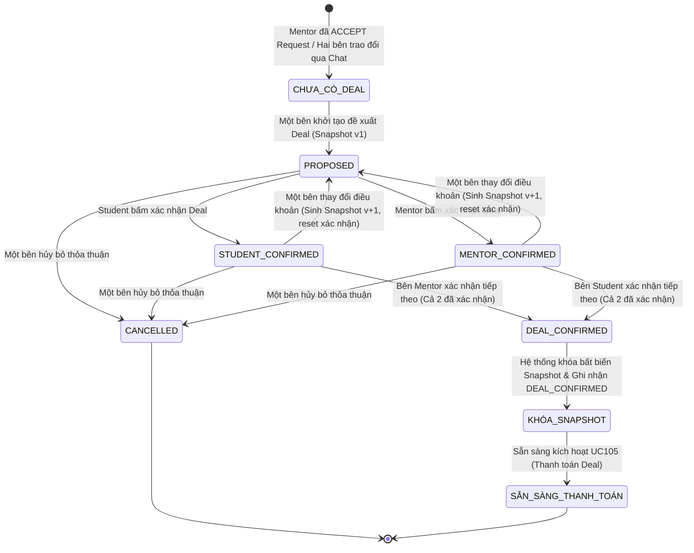

# ĐẶC TẢ YÊU CẦU & THIẾT KẾ CHI TIẾT: UC104 - THỎA THUẬN & XÁC NHẬN MENTORING DEAL

## PHẦN 1: ĐẶC TẢ NGHIỆP VỤ (REPORT 3)

### 2.2.3 Business Workflow (Luồng nghiệp vụ)



#### Mô tả chi tiết luồng xử lý bằng chữ (Business Step Description):
* **Bước 1 - Khởi đầu (Trigger)**: Sau khi Mentor chấp thuận Mentoring Request của Student, hai bên tiến hành trao đổi làm rõ yêu cầu thông qua tính năng Direct Messaging hiện có. Một trong hai bên (Student hoặc Mentor) nhấn "Đề xuất Deal" từ cửa sổ chat hoặc trang Quản lý Deal để mở form khởi tạo các điều khoản.
* **Bước 2 - Đề xuất & Lưu Snapshot v1**: Người đề xuất điền các thông tin: Phạm vi công việc (`task_scope`), Giá thỏa thuận (`agreed_price`), Hạn chót (`deadline`), Hình thức làm việc (`working_mode`), Hình thức tham gia (`participation_type`), Loại nhiệm vụ (`task_type`), Kết quả kỳ vọng (`expected_result`) và Ghi chú. Hệ thống kiểm tra tính hợp lệ dữ liệu, tạo bản ghi `MentoringDeal` ở trạng thái `PROPOSED` (nếu người tạo chưa xác nhận) hoặc tự động đánh dấu xác nhận của bên khởi tạo, đồng thời lưu bản chụp điều khoản đầu tiên `MentoringDealSnapshot` với `version = 1`. Hệ thống tự động đẩy một tin nhắn thông báo (System Message) vào cuộc hội thoại Direct Messaging giữa hai bên.
* **Bước 3 - Trao đổi & Điều chỉnh điều khoản (Negotiation & Re-snapshotting)**: Nếu một trong hai bên cảm thấy các điều khoản chưa phù hợp, họ có thể chỉnh sửa các thông số thỏa thuận. Mỗi lần điều chỉnh:
  - Hệ thống tăng số thứ tự phiên bản (`version = version + 1`).
  - Hệ thống tạo một bản ghi `MentoringDealSnapshot` mới tương ứng với phiên bản mới.
  - Hệ thống xóa bỏ/reset trạng thái xác nhận trước đó của cả hai bên (`student_confirmed = false`, `mentor_confirmed = false`), đưa trạng thái Deal về `PROPOSED`.
  - Hệ thống tự động gửi tin nhắn hệ thống vào chat thông báo phiên bản mới cần được cả hai bên xem xét và xác nhận lại.
* **Bước 4 - Xác nhận thỏa thuận (Confirmation)**:
  - Khi Mentor bấm "Xác nhận Deal": Hệ thống kiểm tra quyền hạn, đánh dấu `mentor_confirmed = true` và lưu thời điểm `mentor_confirmed_at`. Nếu Student chưa xác nhận, Deal chuyển trạng thái `MENTOR_CONFIRMED`.
  - Khi Student bấm "Xác nhận Deal": Hệ thống kiểm tra quyền hạn, đánh dấu `student_confirmed = true` và lưu thời điểm `student_confirmed_at`. Nếu Mentor chưa xác nhận, Deal chuyển trạng thái `STUDENT_CONFIRMED`.
* **Bước 5 - Khóa Snapshot & Kết thúc (Deal Locking & Settlement Readiness)**:
  - Ngay khi cả hai bên đều đã hoàn tất xác nhận (`student_confirmed == true` VÀ `mentor_confirmed == true`), hệ thống tự động:
    1. Chuyển trạng thái Deal thành `DEAL_CONFIRMED`.
    2. Thiết lập cờ `is_locked = true` trên Deal và trên bản chụp `MentoringDealSnapshot` hiện tại.
    3. Lưu thời điểm khóa `locked_at`.
    4. Gửi tin nhắn hệ thống chúc mừng hai bên đã chốt Deal thành công.
  - Sau thời điểm này, không bên nào được phép chỉnh sửa các điều khoản hoặc hủy bỏ Deal qua chức năng thỏa thuận này nữa. Deal chính thức bước vào trạng thái sẵn sàng để thanh toán ở luồng UC105.

---

### 3.2 Phân Hệ Mentorship & Deals (Hướng dẫn & Hỗ trợ)
Module Mentorship là phân hệ cốt lõi kết nối sinh viên/người học (Student) và cựu sinh viên có chuyên môn (Mentor). Chức năng Thỏa thuận & Xác nhận Mentoring Deal (UC104) đóng vai trò bản lề trong Flow 3 (Deal và Thanh toán), kết nối giai đoạn thảo luận sơ bộ (Flow 2) sang giai đoạn ký kết điều khoản ràng buộc và thanh toán ký quỹ (Escrow / PayOS).

#### 3.2.1 Thỏa thuận & xác nhận Mentoring Deal (UC104)

**Function trigger**:
* **Navigation path**:
  - Lối vào 1: Trang Trò chuyện trực tiếp (`/app/messages` -> Chọn cuộc hội thoại 1-1 giữa Student và Mentor -> Nút "Deal #ID" hoặc "Đề xuất Deal" trên Header).
  - Lối vào 2: Trang Danh sách thỏa thuận Mentoring Deals (`/app/mentoring/deals` -> Tab trạng thái hoặc nút "Tạo đề xuất Deal mới").
* **Timing Frequency**: On demand (bất cứ khi nào hai bên có nhu cầu thiết lập, đàm phán hoặc xác nhận điều khoản hướng dẫn).

**Function description**:
* **Actors/Roles**:
  - `Student` (Sinh viên / Người nhận hướng dẫn).
  - `Mentor` (Cựu sinh viên / Chuyên gia hướng dẫn có tài khoản Mentor hợp lệ).
* **Purpose**: Thiết lập một thỏa thuận ràng buộc rõ ràng, minh bạch về phạm vi công việc, chi phí, hạn chót và kết quả nghiệm thu giữa Student và Mentor trước khi tiến hành thanh toán và bàn giao kết quả.
* **Interface**:
  - Danh sách Deal (`MentoringDealsPage`): Bộ lọc trạng thái tab, thanh tìm kiếm, thẻ tóm tắt Deal (`MentoringDealCard`), Skeleton loading, Empty state thân thiện.
  - Modal Form Đề xuất / Điều chỉnh (`MentoringDealFormModal`): Các trường nhập liệu Task Scope, Giá, Hạn chót, Hình thức làm việc, Loại nhiệm vụ, Kết quả kỳ vọng, Ghi chú; kiểm tra lỗi hiển thị ngay dưới trường nhập liệu (inline error).
  - Modal Chi tiết & Thao tác Deal (`MentoringDealActionModal`): Hiển thị Deal Snapshot hiện tại (`MentoringDealSnapshotCard`), trạng thái xác nhận của hai bên, Lịch sử các phiên bản (`MentoringDealHistoryTimeline`), nút tác vụ Xác nhận, Điều chỉnh điều khoản, Hủy thỏa thuận.
  - Header Action trong Chat (`MentoringDealChatHeaderAction`): Nhận diện thỏa thuận gắn liền với cuộc hội thoại và mở xem nhanh chi tiết.

**Data processing**:
1. **Khởi tạo Đề xuất (Propose Deal)**:
   - Hệ thống xác định danh tính người dùng hiện tại từ JWT (`SecurityUtils.getCurrentUserId()`).
   - Kiểm tra `mentorId` và `studentId` hợp lệ, tồn tại trong bảng `users`.
   - Đảm bảo người tạo đề xuất chính là một trong hai bên (`studentId` hoặc `mentorId`).
   - Kiểm tra xem giữa 2 người này đã có Deal nào đang mở (chưa hoàn tất hoặc chưa hủy) hay chưa để tránh trùng lặp.
   - Lưu bản ghi vào bảng `mentoring_deals` với `version = 1`.
   - Lưu bản chụp tương ứng vào bảng `mentoring_deal_snapshots`.
   - Nếu có `conversationId`, tạo tin nhắn hệ thống loại `SYSTEM` vào bảng `messages` để thông báo cho đối tác.
2. **Cập nhật Điều khoản (Update Deal Terms)**:
   - Kiểm tra Deal tồn tại và người dùng là người tham gia (Student hoặc Mentor).
   - Kiểm tra trạng thái Deal: Nếu đã là `DEAL_CONFIRMED` hoặc `is_locked == true` -> ném ngoại lệ `ConflictException` (Bất biến).
   - Tăng `version = version + 1`, cập nhật các điều khoản mới trên `mentoring_deals`.
   - Reset xác nhận: `student_confirmed = false`, `mentor_confirmed = false`, `status = PROPOSED`.
   - Lưu bản chụp phiên bản mới vào `mentoring_deal_snapshots`.
   - Tự động ghi log tin nhắn hệ thống vào cuộc hội thoại.
3. **Xác nhận Deal (Confirm Deal)**:
   - Kiểm tra Deal chưa bị khóa và chưa bị hủy.
   - Nếu người gọi là Student: Kiểm tra nếu đã xác nhận trước đó -> báo lỗi; cập nhật `student_confirmed = true`, `student_confirmed_at = now()`.
   - Nếu người gọi là Mentor: Kiểm tra nếu đã xác nhận trước đó -> báo lỗi; cập nhật `mentor_confirmed = true`, `mentor_confirmed_at = now()`.
   - Nếu sau cập nhật, cả hai bên đều đã xác nhận (`student_confirmed == true` VÀ `mentor_confirmed == true`):
     - Gán `status = DEAL_CONFIRMED`.
     - Gán `is_locked = true`, `locked_at = now()`.
     - Cập nhật bản chụp snapshot hiện tại `is_locked = true`.
   - Gửi tin nhắn hệ thống vào Chat.
4. **Hủy Deal (Cancel Deal)**:
   - Chỉ cho phép hủy khi Deal chưa bị khóa (`DEAL_CONFIRMED`).
   - Gán `status = CANCELLED`, ghi chú lý do hủy.

**Screen layout**:
* *Figure 1: Giao diện Trang danh sách Mentoring Deals (`/app/mentoring/deals`)*
* *Figure 2: Giao diện Modal Đề xuất / Điều chỉnh điều khoản Deal*
* *Figure 3: Giao diện Modal Chi tiết Snapshot, Lịch sử Timeline và Thao tác Xác nhận Deal*
* *Figure 4: Nút tích hợp nhanh Deal trên Header thanh công cụ Trò chuyện Direct Messaging*

**Function details**:
* **Data**:
  - `deal_id` (Long, Khóa chính).
  - `mentor_id`, `student_id` (Long, Khóa ngoại tới `users`).
  - `conversation_id` (Long, Khóa ngoại tới `conversations`, nullable).
  - `task_scope` (Text, 10 - 5000 ký tự).
  - `agreed_price` (BigDecimal, >= 0 VND).
  - `deadline` (Timestamp with time zone, thời điểm tương lai).
  - `working_mode` (Enum: ONLINE, OFFLINE, BOTH).
  - `participation_type` (Enum: INDIVIDUAL, GROUP).
  - `task_type` (Enum: CONSULTATION, ASSIGNMENT_GUIDANCE, PROJECT_MENTORING, RESUME_REVIEW, MOCK_INTERVIEW, SKILL_TRAINING, OTHER).
  - `expected_result` (Text, 10 - 3000 ký tự).
  - `student_confirmed`, `mentor_confirmed` (Boolean, mặc định false).
  - `is_locked` (Boolean, mặc định false).
  - `version` (Integer, bắt đầu từ 1).
* **Validation**:
  - `mentor_id`: Bắt buộc, phải tồn tại.
  - `task_scope`: Bắt buộc, không chỉ chứa khoảng trắng, độ dài từ 10 đến 5000 ký tự.
  - `agreed_price`: Bắt buộc, số dương hoặc bằng 0 VND.
  - `deadline`: Bắt buộc, định dạng ISO-8601 hợp lệ, thời gian phải ở tương lai so với hiện tại.
  - `working_mode`, `participation_type`, `task_type`: Bắt buộc, phải thuộc tập giá trị enum định sẵn.
  - `expected_result`: Bắt buộc, độ dài từ 10 đến 3000 ký tự.
  - `change_note`: Tùy chọn, tối đa 255 ký tự.
* **Business rules**:
  - BR-DEAL-01: Proposal là một bước trong Deal, không tạo Use Case riêng cho "proposal".
  - BR-DEAL-02: Tin nhắn trao đổi giữa Student và Mentor tái sử dụng hoàn toàn hạ tầng Direct Messaging hiện có.
  - BR-DEAL-03: Mỗi khi có sự thay đổi về bất kỳ điều khoản nào (Scope, Price, Deadline, Mode, Result...), hệ thống lập tức tăng số phiên bản và reset toàn bộ trạng thái xác nhận trước đó của hai bên.
  - BR-DEAL-04: Sau khi cả hai bên cùng xác nhận (`DEAL_CONFIRMED`), snapshot được khóa bất biến. Không bên nào được tự ý sửa đổi hoặc hủy Deal.
* **Error Handling**:
  - Vi phạm định dạng/bỏ trống dữ liệu -> Trả về HTTP 400 Bad Request kèm chi tiết lỗi từng trường.
  - Không tìm thấy Deal/User/Hội thoại -> Trả về HTTP 404 Not Found.
  - Không có quyền thao tác trên Deal của người khác -> Trả về HTTP 403 Forbidden.
  - Cố tình sửa hoặc hủy Deal đã khóa -> Trả về HTTP 409 Conflict.
  - Xác nhận lặp lại khi đã xác nhận trước đó -> Trả về HTTP 409 Conflict.
* **Normal case**:
  - Khởi tạo đề xuất Deal thành công, trả về HTTP 201 Created cùng thông tin Deal và Snapshot v1.
  - Cập nhật điều khoản thành công, trả về HTTP 200 OK cùng phiên bản Snapshot v+1.
  - Xác nhận Deal thành công, trả về HTTP 200 OK. Khi đủ 2 bên, Deal tự động khóa và chuyển sang `DEAL_CONFIRMED`.
* **Abnormal case**:
  - Người dùng nhập deadline trong quá khứ -> Bị chặn ngay từ tầng validate DTO/Zod.
  - Người dùng cố tình gọi API sửa đổi sau khi Deal đã `DEAL_CONFIRMED` -> Nhận lỗi HTTP 409 Conflict ("Thỏa thuận đã được cả hai bên xác nhận và khóa snapshot, không thể chỉnh sửa.").

---

### 5. Requirement Appendix (Phụ lục Yêu cầu)

#### 5.1 Business Rules (Quy tắc Nghiệp vụ)

| ID | Định nghĩa Quy tắc (Rule Definition) |
| :--- | :--- |
| BR-DEAL-01 | Đề xuất (Proposal) là một trạng thái ban đầu của Deal, không tách thành một thực thể hoặc Use Case độc lập. |
| BR-DEAL-02 | Giao tiếp giữa Student và Mentor bắt buộc liên kết và tái sử dụng hạ tầng Direct Messaging sẵn có. |
| BR-DEAL-03 | Bất kỳ chỉnh sửa nào trên các điều khoản cốt lõi sau khi một bên đã xác nhận sẽ lập tức sinh Snapshot phiên bản mới và yêu cầu cả hai bên xác nhận lại từ đầu. |
| BR-DEAL-04 | Một khi cả hai bên đã hoàn tất xác nhận (`DEAL_CONFIRMED`), Deal Snapshot sẽ bị khóa bất biến và chuyển sang giai đoạn chờ thanh toán (UC105). Không bên nào được tự ý sửa đổi. |
| BR-DEAL-05 | Giá thỏa thuận (`agreed_price`) phải là số nguyên không âm tính theo đơn vị VND. |
| BR-DEAL-06 | Hạn chót hoàn thành (`deadline`) bắt buộc phải là thời điểm trong tương lai tính tại thời điểm gửi yêu cầu. |

#### 5.2 Common Requirements (Yêu cầu Chung)
* Giao diện tuân thủ bảng thiết kế tông màu FPT/Brand Indigo-Violet sang trọng, hỗ trợ chế độ Tối (Dark mode) và Sáng (Light mode).
* Toàn bộ các thao tác thay đổi dữ liệu (tạo đề xuất, cập nhật điều khoản, xác nhận, hủy) đều hiển thị thông báo phản hồi (Toast notification) trực quan và cập nhật đồng bộ qua React Query cache.
* Tất cả thời gian hiển thị tuân thủ múi giờ của người dùng (`Asia/Ho_Chi_Minh` - GMT+7).
* Định dạng tiền tệ hiển thị theo chuẩn Việt Nam Đồng (`xx.xxx.xxx ₫`).

#### 5.3 Application Messages List (Danh sách Thông điệp Ứng dụng)

| # | Mã thông điệp (Message code) | Loại thông điệp (Message Type) | Ngữ cảnh (Context) | Nội dung hiển thị (Content) |
| :--- | :--- | :--- | :--- | :--- |
| 1 | MSG_DEAL_01 | Toast message (Success) | Khởi tạo đề xuất Deal thành công | Khởi tạo đề xuất Mentoring Deal thành công. Snapshot Phiên bản 1 đã được gửi. |
| 2 | MSG_DEAL_02 | Toast message (Success) | Cập nhật điều khoản Deal thành công | Đã cập nhật điều khoản Deal sang Phiên bản mới. Đang chờ hai bên xác nhận lại. |
| 3 | MSG_DEAL_03 | Toast message (Success) | Xác nhận Deal thành công (1 bên) | Bạn đã xác nhận các điều khoản của Deal thành công. Đang chờ đối tác xác nhận. |
| 4 | MSG_DEAL_04 | Toast message (Success) | Cả hai bên đã xác nhận thành công | Cả hai bên đã xác nhận thỏa thuận! Deal đã được khóa bất biến và sẵn sàng thanh toán. |
| 5 | MSG_DEAL_05 | Toast message (Success) | Hủy bỏ Deal thành công | Đã hủy bỏ thỏa thuận Mentoring Deal. |
| 6 | MSG_DEAL_ERR_01 | In red, under field | Bỏ trống ID Mentor khi đề xuất | ID của Cố vấn (Mentor) không được để trống. |
| 7 | MSG_DEAL_ERR_02 | In red, under field | Bỏ trống hoặc sai độ dài Task Scope | Phạm vi công việc phải từ 10 đến 5000 ký tự. |
| 8 | MSG_DEAL_ERR_03 | In red, under field | Mức giá thỏa thuận âm hoặc rỗng | Mức giá thỏa thuận phải lớn hơn hoặc bằng 0 VND. |
| 9 | MSG_DEAL_ERR_04 | In red, under field | Deadline trong quá khứ hoặc rỗng | Hạn chót hoàn thành (Deadline) phải là một thời điểm trong tương lai. |
| 10 | MSG_DEAL_ERR_05 | In red, under field | Bỏ trống hoặc sai độ dài Expected Result | Kết quả kỳ vọng đầu ra phải từ 10 đến 3000 ký tự. |
| 11 | MSG_DEAL_ERR_06 | Response 404 | Không tìm thấy Deal theo ID | Không tìm thấy thỏa thuận Mentoring Deal với ID: {id}. |
| 12 | MSG_DEAL_ERR_07 | Response 403 | Không phải người tham gia Deal | Bạn không có quyền truy cập hoặc thao tác trên thỏa thuận này. |
| 13 | MSG_DEAL_ERR_08 | Response 409 | Chỉnh sửa Deal khi đã khóa | Thỏa thuận đã được cả hai bên xác nhận và khóa snapshot, không thể chỉnh sửa. |
| 14 | MSG_DEAL_ERR_09 | Response 409 | Xác nhận lặp lại khi đã confirm | Bạn đã xác nhận phiên bản thỏa thuận này trước đó rồi. |
| 15 | MSG_DEAL_ERR_10 | Response 409 | Hủy Deal khi đã khóa | Không thể hủy thỏa thuận đã được cả hai bên xác nhận và khóa snapshot. |

#### 5.4 Other Requirements (Yêu cầu Khác)
* Tự động gửi thông điệp hệ thống (System Message) vào bảng `messages` để người dùng nhận được cập nhật tức thời qua WebSocket STOMP trong giao diện chat.

---

## PHẦN 2: THIẾT KẾ CHI TIẾT (REPORT 4)

### 3. Detail Design (Thiết kế chi tiết)

#### 3.1 Thỏa thuận & xác nhận Mentoring Deal (UC104)

##### 3.1.1 Class Diagram (Sơ đồ Lớp)

```mermaid
classDiagram
    %% Controller
    class MentoringDealController {
        -MentoringDealService dealService
        +proposeDeal(request) ResponseEntity~ApiResponse~MentoringDealDetailResponse~~
        +updateDealTerms(dealId, request) ResponseEntity~ApiResponse~MentoringDealDetailResponse~~
        +confirmDeal(dealId) ResponseEntity~ApiResponse~MentoringDealDetailResponse~~
        +getDealDetail(dealId) ResponseEntity~ApiResponse~MentoringDealDetailResponse~~
        +getDealByConversation(conversationId) ResponseEntity~ApiResponse~MentoringDealDetailResponse~~
        +getMyDeals(status, pageable) ResponseEntity~ApiResponse~PageResponse~MentoringDealResponse~~~
        +cancelDeal(dealId, reason) ResponseEntity~ApiResponse~MentoringDealResponse~~
    }

    %% Request DTOs
    class ProposeDealRequest {
        -Long mentorId
        -Long studentId
        -Long conversationId
        -String taskScope
        -BigDecimal agreedPrice
        -Instant deadline
        -MentoringWorkingMode workingMode
        -MentoringParticipationType participationType
        -MentoringTaskType taskType
        -String expectedResult
        -String changeNote
    }

    class UpdateDealRequest {
        -String taskScope
        -BigDecimal agreedPrice
        -Instant deadline
        -MentoringWorkingMode workingMode
        -MentoringParticipationType participationType
        -MentoringTaskType taskType
        -String expectedResult
        -String changeNote
    }

    %% Response DTOs
    class MentoringDealResponse {
        -Long id
        -Long mentorId
        -String mentorName
        -Long studentId
        -String studentName
        -Long conversationId
        -String taskScope
        -BigDecimal agreedPrice
        -Instant deadline
        -MentoringDealStatus status
        -Boolean studentConfirmed
        -Boolean mentorConfirmed
        -Boolean isLocked
        -Integer version
    }

    class MentoringDealSnapshotResponse {
        -Long id
        -Long dealId
        -Integer version
        -String taskScope
        -BigDecimal agreedPrice
        -Instant deadline
        -String expectedResult
        -String changeNote
        -Long modifiedById
        -String modifiedByName
        -Boolean isLocked
        -Instant createdAt
    }

    class MentoringDealDetailResponse {
        -MentoringDealResponse deal
        -MentoringDealSnapshotResponse currentSnapshot
        -List~MentoringDealSnapshotResponse~ historySnapshots
    }

    %% Service Interface & Impl
    class MentoringDealService {
        <<interface>>
        +proposeDeal(currentUserId, request) MentoringDealDetailResponse
        +updateDealTerms(currentUserId, dealId, request) MentoringDealDetailResponse
        +confirmDeal(currentUserId, dealId) MentoringDealDetailResponse
        +getDealDetail(currentUserId, dealId) MentoringDealDetailResponse
        +getDealByConversation(currentUserId, conversationId) MentoringDealDetailResponse
        +getMyDeals(currentUserId, status, pageable) PageResponse~MentoringDealResponse~
        +cancelDeal(currentUserId, dealId, reason) MentoringDealResponse
    }

    class MentoringDealServiceImpl {
        -MentoringDealRepository dealRepo
        -MentoringDealSnapshotRepository snapshotRepo
        -UserRepository userRepo
        -ConversationRepository convRepo
        -MessageRepository messageRepo
        -MentoringDealMapper dealMapper
        +proposeDeal(currentUserId, request) MentoringDealDetailResponse
        +updateDealTerms(currentUserId, dealId, request) MentoringDealDetailResponse
        +confirmDeal(currentUserId, dealId) MentoringDealDetailResponse
        +getDealDetail(currentUserId, dealId) MentoringDealDetailResponse
        +getDealByConversation(currentUserId, conversationId) MentoringDealDetailResponse
        +getMyDeals(currentUserId, status, pageable) PageResponse~MentoringDealResponse~
        +cancelDeal(currentUserId, dealId, reason) MentoringDealResponse
    }

    %% Mapper
    class MentoringDealMapper {
        <<interface>>
        +toResponse(deal) MentoringDealResponse
        +toSnapshotResponse(snapshot) MentoringDealSnapshotResponse
    }

    %% Repositories
    class MentoringDealRepository {
        <<interface>>
        +findByParticipant(userId, pageable) Page~MentoringDeal~
        +findByParticipantAndStatus(userId, status, pageable) Page~MentoringDeal~
        +findLatestByConversationId(conversationId) Optional~MentoringDeal~
        +findActiveDealBetweenUsers(userId1, userId2) Optional~MentoringDeal~
    }

    class MentoringDealSnapshotRepository {
        <<interface>>
        +findByDealIdOrderByVersionDesc(dealId) List~MentoringDealSnapshot~
        +findByDealIdAndVersion(dealId, version) Optional~MentoringDealSnapshot~
    }

    %% Entities
    class MentoringDeal {
        -Long id
        -User mentor
        -User student
        -Conversation conversation
        -String taskScope
        -BigDecimal agreedPrice
        -Instant deadline
        -MentoringWorkingMode workingMode
        -MentoringParticipationType participationType
        -MentoringTaskType taskType
        -String expectedResult
        -MentoringDealStatus status
        -Boolean studentConfirmed
        -Boolean mentorConfirmed
        -Instant studentConfirmedAt
        -Instant mentorConfirmedAt
        -Boolean isLocked
        -Instant lockedAt
        -Integer version
        -List~MentoringDealSnapshot~ snapshots
    }

    class MentoringDealSnapshot {
        -Long id
        -MentoringDeal deal
        -Integer version
        -String taskScope
        -BigDecimal agreedPrice
        -Instant deadline
        -MentoringWorkingMode workingMode
        -MentoringParticipationType participationType
        -MentoringTaskType taskType
        -String expectedResult
        -String changeNote
        -User modifiedBy
        -Boolean isLocked
        -Instant createdAt
    }

    MentoringDealController ..> ProposeDealRequest : validates & uses
    MentoringDealController ..> UpdateDealRequest : validates & uses
    MentoringDealController ..> MentoringDealDetailResponse : returns
    MentoringDealController ..> MentoringDealService : calls
    MentoringDealServiceImpl ..|> MentoringDealService : implements
    MentoringDealServiceImpl --> MentoringDealRepository : uses
    MentoringDealServiceImpl --> MentoringDealSnapshotRepository : uses
    MentoringDealServiceImpl --> MentoringDealMapper : uses
    MentoringDealServiceImpl --> MentoringDeal : manipulates
    MentoringDealServiceImpl --> MentoringDealSnapshot : manipulates
    MentoringDealMapper ..> MentoringDeal : converts
    MentoringDealMapper ..> MentoringDealSnapshot : converts
    MentoringDeal "1" *-- "many" MentoringDealSnapshot : contains snapshots
```



###### Mô tả chi tiết cấu trúc các lớp (Class Design Description):
* **Lớp Controller (`MentoringDealController.java`)**: Đón nhận và định tuyến các HTTP request tại prefix `/mentoring/deals`, thực thi xác thực dữ liệu đầu vào thông qua annotation `@Valid`, lấy `currentUserId` từ `SecurityUtils` và ủy quyền xử lý nghiệp vụ cho `MentoringDealService`.
* **Lớp DTO**:
  - `ProposeDealRequest.java`: Chứa các trường dữ liệu và ràng buộc JSR-380 cho hành động khởi tạo đề xuất thỏa thuận Deal.
  - `UpdateDealRequest.java`: Chứa các trường dữ liệu và ràng buộc cho hành động điều chỉnh điều khoản thỏa thuận.
  - `MentoringDealResponse.java`, `MentoringDealSnapshotResponse.java`, `MentoringDealDetailResponse.java`: Các đối tượng dữ liệu trả về cấu trúc phẳng, an toàn, đã được làm giàu thông tin tên/avatar của người tham gia.
* **Lớp Service (`MentoringDealService.java` & `MentoringDealServiceImpl.java`)**: Triển khai logic nghiệp vụ then chốt: kiểm tra quyền của người tham gia, sinh snapshot phiên bản mới, reset xác nhận khi có sửa đổi, đánh dấu khóa bất biến khi cả 2 bên cùng hoàn tất xác nhận, và tự động tạo thông điệp hệ thống gửi vào cuộc hội thoại chat.
* **Lớp Mapper (`MentoringDealMapper.java`)**: MapStruct component ánh xạ giữa thực thể `MentoringDeal`, `MentoringDealSnapshot` sang các Response DTO tương ứng với hiệu năng cao.
* **Lớp Repository & Entity**:
  - `MentoringDealRepository.java`: Thực thi truy vấn JPA trên thực thể `MentoringDeal` (bảng `mentoring_deals`).
  - `MentoringDealSnapshotRepository.java`: Thực thi truy vấn lịch sử snapshot trên thực thể `MentoringDealSnapshot` (bảng `mentoring_deal_snapshots`).

---

##### 3.1.2 Sequence Diagram (Sơ đồ Tuần tự)

```mermaid
sequenceDiagram
    autonumber
    actor Client as Frontend / Client
    participant Controller as MentoringDealController (@Valid)
    participant Service as MentoringDealServiceImpl
    participant Mapper as MentoringDealMapper
    participant DealRepo as MentoringDealRepository
    participant SnapRepo as MentoringDealSnapshotRepository
    participant DB as PostgreSQL

    Client->>Controller: POST /mentoring/deals hoặc PUT /mentoring/deals/{id}/terms hoặc POST /mentoring/deals/{id}/confirm
    
    alt Trường hợp 1: Lỗi validate dữ liệu đầu vào (JSR-380 Validation Error)
        Note over Controller: Spring kiểm tra các annotation @NotBlank, @NotNull, @Future, @Min...
        Controller-->>Client: HTTP 400 Bad Request (ApiResponse báo lỗi chi tiết các trường)
        
    else Trường hợp 2: Dữ liệu đầu vào hợp lệ
        Controller->>Service: Gọi Service Method (truyền currentUserId, dealId, DTO)
        
        alt Trường hợp 2.1: Không tìm thấy Deal hoặc Không có quyền truy cập
            Service->>DealRepo: findById(dealId)
            DealRepo->>DB: SELECT * FROM mentoring_deals WHERE id = ?
            DB-->>DealRepo: Trả về rỗng hoặc User không thuộc Deal
            Service-->>Controller: Throw ResourceNotFoundException (404) hoặc ForbiddenException (403)
            Note over Controller: Bị bắt bởi GlobalExceptionHandler
            Controller-->>Client: HTTP 404 Not Found / HTTP 403 Forbidden (ApiResponse thông báo lỗi)
            
        else Trường hợp 2.2: Vi phạm tính bất biến hoặc Xung đột nghiệp vụ
            Service->>DealRepo: Kiểm tra status == DEAL_CONFIRMED hoặc isLocked == true
            Note over Service: Người dùng cố tình sửa điều khoản hoặc hủy Deal đã khóa
            Service-->>Controller: Throw ConflictException ("Thỏa thuận đã được cả hai bên xác nhận và khóa snapshot, không thể chỉnh sửa.")
            Note over Controller: Bị bắt bởi GlobalExceptionHandler
            Controller-->>Client: HTTP 409 Conflict (ApiResponse thông báo lỗi xung đột nghiệp vụ)
            
        else Trường hợp 2.3: Nghiệp vụ hợp lệ (Thành công)
            alt Thao tác là Propose Deal mới
                Service->>DealRepo: save(new Deal with version=1)
                DealRepo->>DB: INSERT INTO mentoring_deals ...
                DB-->>DealRepo: Trả về Deal entity đã lưu
                Service->>SnapRepo: save(new Snapshot with version=1)
                SnapRepo->>DB: INSERT INTO mentoring_deal_snapshots ...
                DB-->>SnapRepo: Trả về Snapshot entity
            else Thao tác là Update Deal Terms
                Note over Service: version = version + 1; studentConfirmed = false; mentorConfirmed = false
                Service->>DealRepo: save(updated Deal)
                DealRepo->>DB: UPDATE mentoring_deals SET version = version + 1 ...
                DB-->>DealRepo: Trả về Deal entity cập nhật
                Service->>SnapRepo: save(new Snapshot with version = version)
                SnapRepo->>DB: INSERT INTO mentoring_deal_snapshots ...
                DB-->>SnapRepo: Trả về Snapshot phiên bản mới
            else Thao tác là Confirm Deal
                Note over Service: Đánh dấu confirm của người gọi (studentConfirmed = true hoặc mentorConfirmed = true)
                alt Cả hai bên đều đã hoàn tất xác nhận
                    Note over Service: status = DEAL_CONFIRMED; isLocked = true; lockedAt = now()
                end
                Service->>DealRepo: save(confirmed Deal)
                DealRepo->>DB: UPDATE mentoring_deals SET student_confirmed, mentor_confirmed, status, is_locked ...
                DB-->>DealRepo: Kết quả thành công
            end

            Note over Service: Tự động ghi System Message vào bảng messages nếu có conversationId
            Service->>DB: INSERT INTO messages (conversation_id, type='SYSTEM', content=...)
            
            Service->>Mapper: toResponse(deal) & toSnapshotResponse(snapshot)
            Mapper-->>Service: Trả về MentoringDealDetailResponse
            Service-->>Controller: Trả về MentoringDealDetailResponse
            Controller-->>Client: HTTP 200 OK / 201 Created (ApiResponse Thành công kèm dữ liệu Deal Snapshot mới nhất)
        end
    end
```

###### Mô tả chi tiết luồng xử lý bằng chữ (Sequence Flow Description):
1. **Luồng 1 - Thành công (Normal Case)**:
   - **Gửi yêu cầu**: Client gửi request hợp lệ (POST tạo đề xuất, PUT chỉnh sửa điều khoản, hoặc POST xác nhận Deal) kèm JWT Token.
   - **Kích hoạt Service**: Controller kiểm tra annotation JSR-380 thành công, chuyển DTO và `currentUserId` xuống Service.
   - **Xử lý nghiệp vụ & Lưu cơ sở dữ liệu**:
     - Khi đề xuất: Service lưu Deal mới và lưu bản chụp Snapshot v1.
     - Khi cập nhật điều khoản: Service tăng version lên v+1, reset các cờ xác nhận về `false` và lưu Snapshot mới.
     - Khi xác nhận: Service cập nhật cờ xác nhận của bên tương ứng. Nếu cả hai bên đều đã xác nhận, chuyển trạng thái sang `DEAL_CONFIRMED` và khóa vĩnh viễn Snapshot hiện tại (`is_locked = true`).
     - Tự động ghi nhận một tin nhắn hệ thống loại `SYSTEM` vào bảng `messages` để người dùng theo dõi trong Chat.
   - **Trả kết quả**: Mapper chuyển đổi các thực thể thành `MentoringDealDetailResponse`, Controller đóng gói vào `ApiResponse.success()` và trả về HTTP 200 OK (hoặc 201 Created) cho Client.
2. **Luồng 2 - Ngoại lệ Validation đầu vào (Validation Error Case)**:
   - Client gửi dữ liệu thiếu hoặc sai ràng buộc (ví dụ: `taskScope` dưới 10 ký tự, `agreedPrice` âm, `deadline` trong quá khứ). Bộ kiểm tra JSR-380 phát hiện lỗi và ném `MethodArgumentNotValidException`. `GlobalExceptionHandler` bắt ngoại lệ này và định dạng thành HTTP 400 Bad Request kèm danh sách chi tiết lỗi các trường dữ liệu cho Client.
3. **Luồng 3 - Ngoại lệ Logic nghiệp vụ (Business Error Case)**:
   - Khi phát hiện vi phạm nghiệp vụ (như người dùng không thuộc Deal, Deal không tồn tại, người dùng xác nhận lặp lại, hoặc cố tình sửa/hủy Deal đã bị khóa `DEAL_CONFIRMED`), Service chủ động ném ngoại lệ tương ứng (`ResourceNotFoundException`, `ForbiddenException`, hoặc `ConflictException`). `GlobalExceptionHandler` bắt ngoại lệ và trả về mã HTTP 404, 403 hoặc 409 Conflict với thông điệp lỗi tiếng Việt rõ ràng cho Client.
