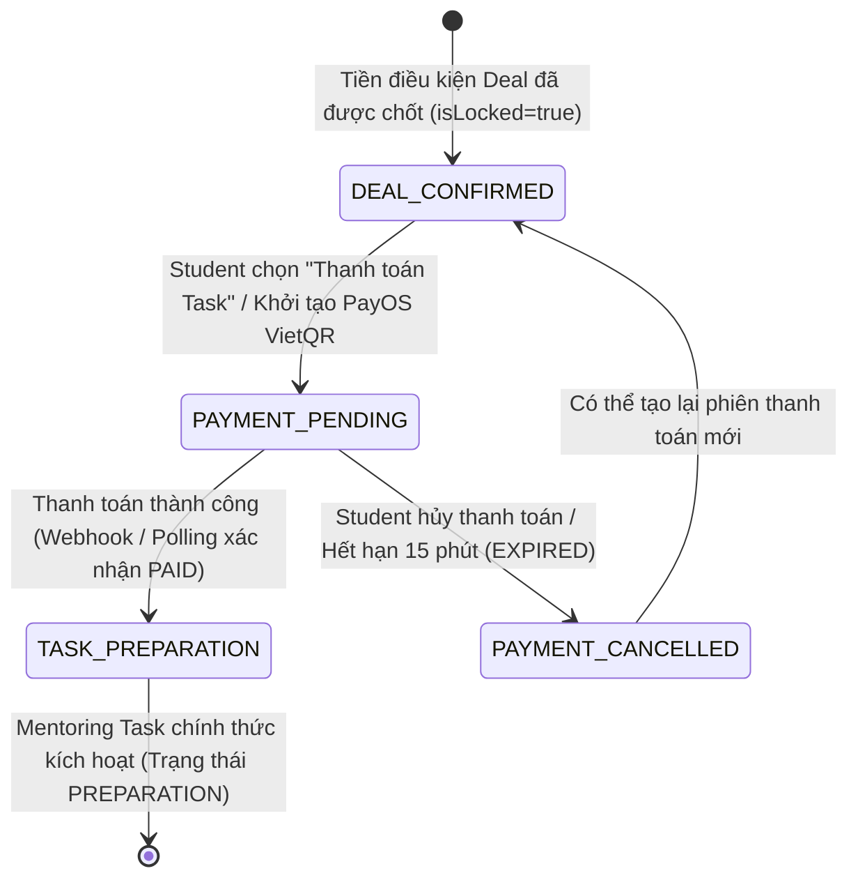
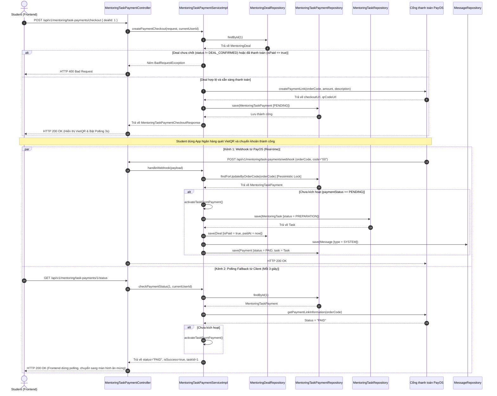

# ĐẶC TẢ YÊU CẦU & THIẾT KẾ CHI TIẾT: UC105 - THANH TOÁN MENTORING TASK

## PHẦN 1: ĐẶC TẢ NGHIỆP VỤ (REPORT 3)

### 2.2.3 Business Workflow (Luồng nghiệp vụ)

#### Mô tả chi tiết luồng xử lý bằng chữ (Business Step Description):
* **Bước 1 - Khởi đầu (Trigger)**:
  - Học viên (Student) truy cập thỏa thuận Mentoring Deal đã được cả 2 bên xác nhận (`status = DEAL_CONFIRMED`, `isLocked = true`) từ màn hình Chat 1-1 hoặc trang Quản lý Deal.
  - Học viên nhấn nút **"Thanh toán Task (UC105)"**.
* **Bước 2 - Tạo giao dịch & Hiển thị thông tin thanh toán**:
  - Hệ thống kiểm tra tiền điều kiện: Deal tồn tại, thuộc quyền sở hữu của Student, trạng thái `DEAL_CONFIRMED` và chưa từng được thanh toán (`isPaid = false`).
  - Hệ thống gọi PayOS API để tạo phiên giao dịch thanh toán kèm `orderCode` duy nhất, số tiền bằng `agreedPrice`, đường dẫn `checkoutUrl` và mã VietQR.
  - Bản ghi `MentoringTaskPayment` được tạo ở trạng thái `PENDING`.
  - Frontend hiển thị Modal thanh toán gồm mã VietQR, số tài khoản, số tiền, nội dung chuyển khoản, đồng hồ đếm ngược 15 phút và kích hoạt polling định kỳ 3 giây.
* **Bước 3 - Thanh toán & Xác nhận kết quả**:
  - Học viên mở ứng dụng ngân hàng di động quét mã VietQR và thực hiện chuyển khoản.
  - **Kênh Webhook**: PayOS gửi webhook bất đồng bộ `POST /api/v1/mentoring/task-payments/webhook` về hệ thống. Hệ thống sử dụng khóa bi quan (`findForUpdateByOrderCode`) để bảo vệ dữ liệu chống race condition.
  - **Kênh Polling Fallback**: Nếu Webhook bị trễ hoặc mạng gián đoạn, Frontend gọi định kỳ `GET /api/v1/mentoring/task-payments/{paymentId}/status`. Backend chủ động tra cứu trạng thái thanh toán từ PayOS Gateway.
* **Bước 4 - Kích hoạt Mentoring Task**:
  - Khi xác nhận thanh toán thành công (`PAID`), hệ thống kiểm tra Idempotency để chống kích hoạt trùng lặp.
  - Cập nhật `MentoringTaskPayment` thành `PAID` kèm mã tham chiếu và thời điểm thanh toán.
  - Cập nhật `MentoringDeal` thành `isPaid = true` và lưu `paidAt`.
  - Tạo mới thực thể `MentoringTask` ở trạng thái ban đầu **`PREPARATION`** (Chuẩn bị), liên kết trực tiếp với Deal và gắn `taskId` vào giao dịch.
  - Tự động đăng tin nhắn hệ thống (`MessageType.SYSTEM`) vào cuộc trò chuyện Direct Messaging giữa Student và Mentor.
* **Bước 5 - Kết thúc**:
  - Giao diện Frontend chuyển sang màn hình ăn mừng (Celebration) thông báo Task đã bắt đầu.
  - Mentoring Task chính thức xuất hiện trong khu vực Quản lý Task của cả Student và Mentor.

---

### 3.2 Module Mentoring & Hướng nghiệp

Module Mentoring kết nối sinh viên và cựu sinh viên, cung cấp quy trình từ tìm kiếm mentor, đăng ký, thỏa thuận Deal, thanh toán ký quỹ đến quản lý thực thi Task theo mốc.

#### 3.2.1 Thanh toán Mentoring Task (UC105)

**Function trigger**:
*   **Navigation path**: 
    - `/app/mentoring/deals` -> Chọn Deal đã chốt -> Nút "Thanh toán Task (UC105)"
    - `/app/messages?conversationId={id}` -> Nút "Thỏa thuận Deal" trên Header -> Nút "Thanh toán Task (UC105)"
*   **Timing Frequency**: Theo nhu cầu của Student (On-demand) sau khi Deal đã chốt.

**Function description**:
*   **Actors/Roles**: Student (Người chi trả). Mentor (Người theo dõi nhận thông báo).
*   **Purpose**: Cho phép Student thanh toán kinh phí theo Deal đã xác nhận để chính thức kích hoạt Mentoring Task bắt đầu ở giai đoạn Chuẩn bị (`PREPARATION`).
*   **Interface**:
    - Nút bấm `Thanh toán Task (UC105)` nổi bật trên Modal chi tiết Deal.
    - Modal `MentoringTaskPaymentModal`:
      - Phần tóm tắt: Tên Mentor, phạm vi Task, số tiền thanh toán (`vnd`), hạn hoàn thành.
      - Phần VietQR: Ảnh mã QR sắc nét quét được bằng mọi ứng dụng ngân hàng di động.
      - Đồng hồ đếm ngược 15 phút.
      - Chấm xanh hiệu ứng nhấp nháy (pulsing) báo hiệu hệ thống đang tự động lắng nghe giao dịch.
      - Bảng sao chép 1 chạm: Số tiền và Nội dung chuyển khoản/Mã đơn.
      - Nút phụ: "Mở trang PayOS" và "Hủy giao dịch".
      - Màn hình kết quả thành công: Biểu tượng vinh danh, thông tin Task #[id] đã chuyển sang `PREPARATION`.

**Data processing**:
1. Tiếp nhận request `CreateTaskPaymentRequest(dealId)`.
2. Kiểm tra quyền hạn người dùng đăng nhập (`user.id == deal.student.id`).
3. Xác minh Deal: `status == DEAL_CONFIRMED` và `isPaid == false`.
4. Gọi `PayOSGateway.createPaymentLink(...)` sinh `orderCode` ngẫu nhiên 8 chữ số và link checkout.
5. Tạo bản ghi `MentoringTaskPayment` (`status = PENDING`).
6. Xử lý webhook / polling: Khóa bi quan bản ghi thanh toán theo `orderCode`. Nếu PayOS xác nhận `PAID`, tiến hành kích hoạt Task:
   - Tạo `MentoringTask` với `status = PREPARATION`, `startedAt = null` (chỉ khi Mentor chuyển sang `IN_PROGRESS` mới tính startedAt).
   - Đánh dấu `deal.isPaid = true` và `deal.paidAt = Instant.now()`.
   - Lưu tin nhắn hệ thống vào cuộc trò chuyện Direct Messaging.

**Screen layout**:
*   *Figure UC105-1*: Nút "Thanh toán Task" trên Deal Action Modal (`DEAL_CONFIRMED`).
*   *Figure UC105-2*: Modal hiển thị VietQR PayOS, đếm ngược thời gian và sao chép thông tin.
*   *Figure UC105-3*: Màn hình hoàn tất thanh toán thành công và kích hoạt Task `PREPARATION`.

**Function details**:
*   **Data**: `dealId`, `orderCode`, `amount`, `paymentStatus`, `qrCodeUrl`, `checkoutUrl`, `taskId`, `paidAt`.
*   **Validation**:
    - `dealId`: Bắt buộc, phải tồn tại trong cơ sở dữ liệu.
    - Người thực hiện: Phải là Student của Deal.
    - Trạng thái Deal: Bắt buộc là `DEAL_CONFIRMED` và `isLocked == true`.
    - Trạng thái thanh toán: Chưa được thanh toán (`isPaid == false`).
*   **Business rules**:
    - BR-PAY-01: Giao dịch thanh toán Task độc lập hoàn toàn với Gói đăng ký Mentor (Mentor Subscription).
    - BR-PAY-02: Task chỉ bắt đầu khi thanh toán thành công (chuyển sang `PREPARATION`).
    - BR-PAY-03: Một Deal chỉ được kích hoạt duy nhất một Mentoring Task (1-to-1 relationship, Idempotency).
    - BR-PAY-04: Thời hạn hiệu lực của phiên thanh toán VietQR là 15 phút. Sau 15 phút giao dịch chuyển sang `EXPIRED`.
*   **Error Handling**:
    - Deal chưa chốt: Trả về HTTP 400 Bad Request kèm thông điệp `"Thỏa thuận Deal chưa được cả hai bên xác nhận hoặc đã bị hủy"`.
    - Deal đã thanh toán: Trả về HTTP 400 Bad Request kèm thông điệp `"Thỏa thuận Deal này đã được thanh toán trước đó"`.
    - Không phải Student: Trả về HTTP 403 Forbidden `"Chỉ Học viên của Deal mới có quyền thực hiện thanh toán Task"`.
*   **Normal case**: Student thanh toán qua VietQR -> Hệ thống nhận kết quả -> Kích hoạt Task ở giai đoạn `PREPARATION` -> Thông báo hiển thị thành công.
*   **Abnormal case**: Thanh toán thất bại hoặc người dùng hủy -> Giao dịch chuyển sang `CANCELLED` -> Task không được kích hoạt -> Cho phép thử lại phiên mới.

---

### 5. Requirement Appendix (Phụ lục Yêu cầu)

#### 5.1 Business Rules (Quy tắc Nghiệp vụ)

| ID | Định nghĩa Quy tắc (Rule Definition) |
| :--- | :--- |
| BR-PAY-01 | **Tính độc lập của Task Payment**: Thanh toán Mentoring Task là thanh toán dịch vụ thực hiện công việc cụ thể giữa Student và Mentor, hoàn toàn tách biệt với phí duy trì gói hồ sơ Mentor. |
| BR-PAY-02 | **Điều kiện kích hoạt**: Mentoring Task không bao giờ được kích hoạt nếu trạng thái giao dịch chưa chuyển thành `PAID`. |
| BR-PAY-03 | **Tính bất biến và duy nhất (Idempotency)**: Mỗi Deal chỉ tương ứng với tối đa 1 Task hoạt động. Hệ thống phải dùng Khóa bi quan để chặn kích hoạt trùng lặp khi nhận đồng thời Webhook và Polling. |
| BR-PAY-04 | **Thời hạn phiên thanh toán**: Phiên thanh toán PayOS VietQR có thời hạn tối đa 15 phút kể từ thời điểm khởi tạo. |
| BR-PAY-05 | **Quyền sở hữu người thanh toán**: Chỉ tài khoản sinh viên được chỉ định trong Deal mới có quyền tạo liên kết thanh toán. |
| BR-PAY-06 | **Thông báo tự động**: Ngay khi thanh toán thành công, hệ thống phải tự động đăng tin nhắn hệ thống vào cuộc trò chuyện 1-1 để thông báo cho cả Mentor và Student. |

#### 5.2 Common Requirements (Yêu cầu Chung)
*   Toàn bộ mã QR tuân thủ tiêu chuẩn VietQR Napas 247 được sinh bởi cổng PayOS.
*   Hệ thống hỗ trợ cơ chế phục hồi kép: Webhook thời gian thực kết hợp Polling Fallback 3s từ Client.
*   Giao diện phản hồi chuẩn xác trên cả màn hình di động và máy tính bảng/máy tính để bàn.
*   Tất cả giá trị tiền tệ hiển thị định dạng Việt Nam Đồng (VND).

#### 5.3 Application Messages List (Danh sách Thông điệp Ứng dụng)

| # | Mã thông điệp | Loại thông điệp | Ngữ cảnh | Nội dung hiển thị (Tiếng Việt) |
| :--- | :--- | :--- | :--- | :--- |
| 1 | MSG-PAY-01 | Toast Success | Tạo phiên thanh toán VietQR thành công | Tạo phiên thanh toán PayOS thành công. Vui lòng quét mã QR để hoàn tất. |
| 2 | MSG-PAY-02 | Toast Error | Deal chưa chốt mà ấn thanh toán | Thỏa thuận Deal chưa được cả hai bên xác nhận hoặc đã bị hủy. |
| 3 | MSG-PAY-03 | Toast Error | Deal đã thanh toán trước đó | Thỏa thuận Deal này đã được thanh toán và kích hoạt Task trước đó. |
| 4 | MSG-PAY-04 | Toast Error | Không có quyền thanh toán | Chỉ Học viên của Deal mới có quyền thực hiện thanh toán Task. |
| 5 | MSG-PAY-05 | Toast Success | Thanh toán thành công | Thanh toán thành công! Mentoring Task đã chính thức được kích hoạt sang giai đoạn Chuẩn bị. |
| 6 | MSG-PAY-06 | Toast Info | Hủy giao dịch thanh toán | Đã hủy giao dịch thanh toán. |
| 7 | MSG-PAY-07 | Toast Success | Sao chép thông tin | Đã sao chép {field_name}! |

---

## PHẦN 2: THIẾT KẾ CHI TIẾT (REPORT 4)

### 3. Detail Design (Thiết kế chi tiết)

#### 3.1 Thanh toán Mentoring Task (UC105)

##### 3.1.1 Class Diagram (Sơ đồ Lớp)

```mermaid
classDiagram
    %% Controller Layer
    class MentoringTaskPaymentController {
        +createPaymentCheckout(request, auth) ResponseEntity~ApiResponse~
        +checkPaymentStatus(paymentId, auth) ResponseEntity~ApiResponse~
        +cancelPayment(paymentId, reason, auth) ResponseEntity~ApiResponse~
        +handlePayOSWebhook(webhookData) ResponseEntity~ApiResponse~
    }

    class MentoringTaskController {
        +getTaskDetail(taskId, auth) ResponseEntity~ApiResponse~
        +getMyTasks(status, pageable, auth) ResponseEntity~ApiResponse~
    }

    %% DTO Layer
    class CreateTaskPaymentRequest {
        -Long dealId
    }

    class MentoringTaskPaymentCheckoutResponse {
        -Long paymentId
        -Long dealId
        -Long orderCode
        -BigDecimal amount
        -String checkoutUrl
        -String qrCodeUrl
        -String status
        -String message
    }

    class MentoringTaskPaymentStatusResponse {
        -Long paymentId
        -Long dealId
        -Long orderCode
        -String status
        -BigDecimal amount
        -boolean isSuccess
        -Long taskId
        -String message
    }

    class MentoringTaskResponse {
        -Long id
        -Long dealId
        -Long studentId
        -String studentName
        -Long mentorId
        -String mentorName
        -String title
        -String taskScope
        -BigDecimal agreedPrice
        -Instant deadline
        -MentoringWorkingMode workingMode
        -MentoringParticipationType participationType
        -MentoringTaskType taskType
        -String expectedResult
        -MentoringTaskStatus status
    }

    %% Service Layer
    class MentoringTaskPaymentService {
        <<interface>>
        +createPaymentCheckout(request, currentUserId) MentoringTaskPaymentCheckoutResponse
        +checkPaymentStatus(paymentId, currentUserId) MentoringTaskPaymentStatusResponse
        +cancelPayment(paymentId, reason, currentUserId) MentoringTaskPaymentStatusResponse
        +handleWebhook(webhookData) void
    }

    class MentoringTaskPaymentServiceImpl {
        -MentoringTaskPaymentRepository paymentRepository
        -MentoringDealRepository dealRepository
        -MentoringTaskRepository taskRepository
        -MessageRepository messageRepository
        -UserRepository userRepository
        -PayOSGateway payOSGateway
        +createPaymentCheckout(request, currentUserId) MentoringTaskPaymentCheckoutResponse
        +checkPaymentStatus(paymentId, currentUserId) MentoringTaskPaymentStatusResponse
        +cancelPayment(paymentId, reason, currentUserId) MentoringTaskPaymentStatusResponse
        +handleWebhook(webhookData) void
        -activateTaskFromPayment(payment) MentoringTask
    }

    class MentoringTaskService {
        <<interface>>
        +getTaskById(taskId, currentUserId) MentoringTaskResponse
        +getMyTasks(currentUserId, status, pageable) PageResponse~MentoringTaskResponse~
    }

    class MentoringTaskServiceImpl {
        -MentoringTaskRepository taskRepository
        -UserRepository userRepository
        -MentoringTaskMapper taskMapper
        +getTaskById(taskId, currentUserId) MentoringTaskResponse
        +getMyTasks(currentUserId, status, pageable) PageResponse~MentoringTaskResponse~
    }

    %% Entity Layer
    class MentoringTaskPayment {
        -Long id
        -MentoringDeal deal
        -MentoringTask task
        -User student
        -Long orderCode
        -BigDecimal amount
        -PaymentStatus paymentStatus
        -String checkoutUrl
        -String qrCodeUrl
        -Instant paidAt
    }

    class MentoringTask {
        -Long id
        -MentoringDeal deal
        -User student
        -MentorProfile mentor
        -String title
        -String taskScope
        -BigDecimal agreedPrice
        -Instant deadline
        -MentoringTaskStatus status
        -Instant startedAt
        -Instant completedAt
    }

    class MentoringDeal {
        -Long id
        -MentoringDealStatus status
        -boolean isLocked
        -boolean isPaid
        -Instant paidAt
    }

    MentoringTaskPaymentController ..> CreateTaskPaymentRequest : validates
    MentoringTaskPaymentController ..> MentoringTaskPaymentService : calls
    MentoringTaskPaymentServiceImpl ..|> MentoringTaskPaymentService : implements
    MentoringTaskPaymentServiceImpl --> MentoringTaskPayment : manages
    MentoringTaskPaymentServiceImpl --> MentoringTask : activates
    MentoringTaskPaymentServiceImpl --> MentoringDeal : updates
    MentoringTaskController ..> MentoringTaskService : calls
    MentoringTaskServiceImpl ..|> MentoringTaskService : implements
    MentoringTaskServiceImpl --> MentoringTask : queries
```

###### Mô tả chi tiết cấu trúc các lớp (Class Design Description):
* **Lớp Controller**:
  - `MentoringTaskPaymentController`: Tiếp nhận các request tạo link thanh toán, polling tra cứu trạng thái, hủy thanh toán và nhận webhook từ PayOS.
  - `MentoringTaskController`: Tiếp nhận truy vấn chi tiết Task và danh sách Task của người dùng.
* **Lớp DTO**:
  - `CreateTaskPaymentRequest`: Bọc tham số `dealId` với validation `@NotNull`.
  - `MentoringTaskPaymentCheckoutResponse`: Chứa thông tin QR code và đường dẫn checkout của PayOS.
  - `MentoringTaskPaymentStatusResponse`: Chứa trạng thái thanh toán và `taskId` sau khi kích hoạt.
  - `MentoringTaskResponse`: Biểu diễn chi tiết thực thể Task trả về cho client.
* **Lớp Service**:
  - `MentoringTaskPaymentServiceImpl`: Chịu trách nhiệm toàn bộ vòng đời thanh toán Task, chống race condition bằng `findForUpdateByOrderCode`, kích hoạt Task chuyển sang `PREPARATION` và gửi tin nhắn hệ thống vào cuộc hội thoại Direct Messaging.
  - `MentoringTaskServiceImpl`: Quản lý truy vấn chi tiết và phân trang danh sách Task của Student/Mentor.
* **Lớp Entity & Repository**:
  - `MentoringTaskPayment` & `MentoringTaskPaymentRepository`: Quản lý giao dịch PayOS.
  - `MentoringTask` & `MentoringTaskRepository`: Quản lý trạng thái và dữ liệu Task.
  - `MentoringDeal` & `MentoringDealRepository`: Cập nhật trạng thái thanh toán của Deal.

---

##### 3.1.2 Sequence Diagram (Sơ đồ Tuần tự)

###### Mô tả chi tiết luồng xử lý bằng chữ (Sequence Flow Description):
1.  **Luồng tạo phiên thanh toán (Checkout Phase)**:
    - Client gửi request `POST /api/v1/mentoring/task-payments/checkout` kèm `dealId`.
    - Controller kiểm tra xác thực JWT và chuyển dữ liệu sang Service.
    - Service kiểm tra quyền sở hữu và trạng thái Deal (`status == DEAL_CONFIRMED && !isPaid`).
    - Service gọi PayOS Gateway tạo liên kết thanh toán VietQR và lưu bản ghi `MentoringTaskPayment` ở trạng thái `PENDING`.
    - Trả về thông tin thanh toán cho Client để hiển thị mã VietQR và bắt đầu đếm ngược 15 phút.
2.  **Luồng xác nhận thanh toán & kích hoạt Task (Activation Phase)**:
    - Khi giao dịch chuyển khoản thành công, PayOS gửi Webhook đồng thời Client thực hiện polling định kỳ 3 giây.
    - Cơ chế **Khóa bi quan** (`Pessimistic Write Lock`) trên bản ghi thanh toán đảm bảo chỉ có duy nhất một luồng thực hiện logic kích hoạt Task.
    - Hệ thống tạo thực thể `MentoringTask` ở giai đoạn khởi tạo **`PREPARATION`**.
    - Cập nhật Deal `isPaid = true` và lưu thời điểm thanh toán `paidAt`.
    - Gửi tin nhắn thông báo tự động `SYSTEM` vào cuộc trò chuyện Direct Messaging giữa hai bên.
    - Trả về mã Task cho Frontend. Giao diện dừng polling và hiển thị thông báo kích hoạt thành công.
