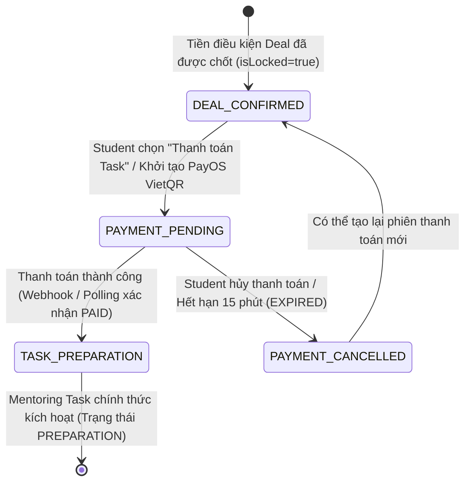
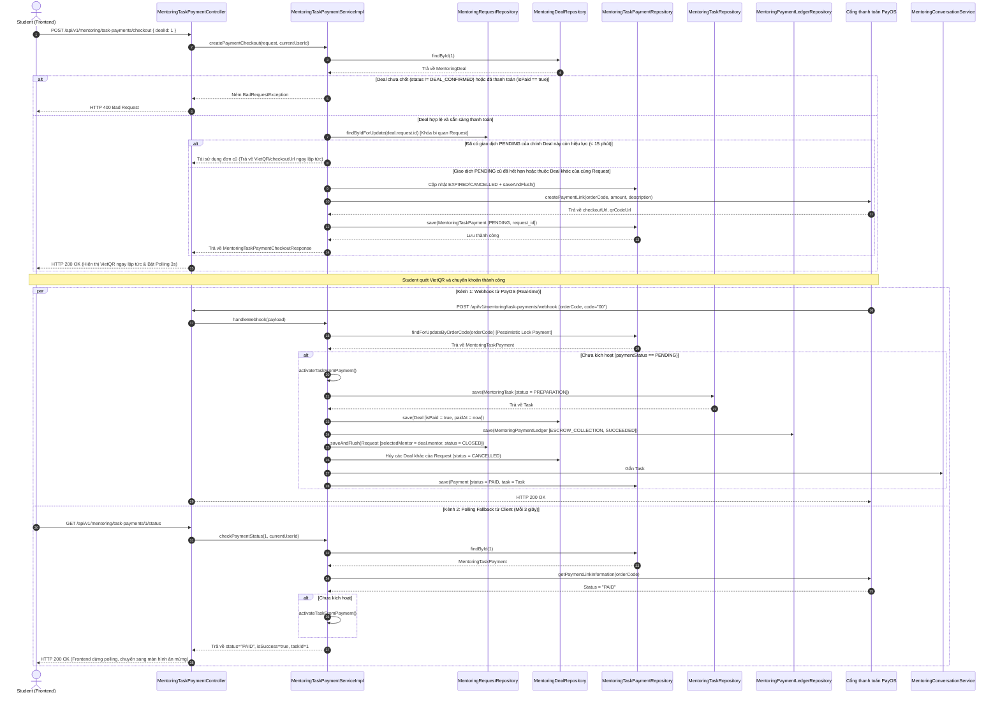

# ĐẶC TẢ YÊU CẦU & THIẾT KẾ CHI TIẾT: UC105 - THANH TOÁN MENTORING TASK

## PHẦN 1: ĐẶC TẢ NGHIỆP VỤ (REPORT 3)

### 2.2.3 Business Workflow (Luồng nghiệp vụ)

#### Mô tả chi tiết luồng xử lý bằng chữ (Business Step Description):
* **Bước 1 - Khởi đầu (Trigger)**:
  - Học viên (Student) truy cập thỏa thuận Mentoring Deal đã được cả 2 bên xác nhận (`status = DEAL_CONFIRMED`, `isLocked = true`) từ màn hình Chat 1-1 hoặc trang Quản lý Deal.
  - Học viên nhấn nút **"Thanh toán Task (UC105)"**.
* **Bước 2 - Tạo giao dịch & Hiển thị thông tin thanh toán**:
  - Hệ thống kiểm tra tiền điều kiện: Deal tồn tại, thuộc quyền sở hữu của Student, trạng thái `DEAL_CONFIRMED` và chưa từng được thanh toán (`isPaid = false`).
  - Hệ thống áp dụng **Khóa bi quan** (`findByIdForUpdate`) trên Mentoring Request để tuần tự hóa các yêu cầu thanh toán đồng thời.
  - **Bảo vệ ràng buộc duy nhất 1 checkout active (`uq_mentoring_task_payments_request_pending`)**:
    - Nếu đã có đơn `PENDING` của cùng Deal còn hạn (15 phút), hệ thống **tái sử dụng** đơn cũ và trả về ngay thông tin VietQR/PayOS mà không sinh thêm đơn rác.
    - Nếu đơn cũ đã hết hạn hoặc thuộc Deal khác của cùng Request: hệ thống đánh dấu `EXPIRED` hoặc `CANCELLED`, gọi `saveAndFlush` để đẩy cập nhật xuống DB ngay lập tức trước khi tạo đơn mới.
  - Trường hợp tạo mới: Hệ thống gọi PayOS API để tạo phiên giao dịch thanh toán kèm `orderCode` duy nhất, số tiền bằng `agreedPrice`, đường dẫn `checkoutUrl` và mã VietQR.
  - Bản ghi `MentoringTaskPayment` được lưu ở trạng thái `PENDING` kèm `request_id`.
  - **Trải nghiệm Frontend tối ưu**: Frontend sử dụng hook `useTaskPaymentCheckoutSession` với React Query cache 5 phút. Khi mở modal, mã VietQR hiển thị ngay tức thì (0ms), không bị treo loading spinner; đồng hồ đếm ngược được tính toán chính xác theo `paymentExpiresAt` của backend; tự động kích hoạt polling định kỳ 3 giây (`useTaskPaymentPolling`).
* **Bước 3 - Thanh toán & Xác nhận kết quả**:
  - Học viên mở ứng dụng ngân hàng di động quét mã VietQR và thực hiện chuyển khoản.
  - **Kênh Webhook**: PayOS gửi webhook bất đồng bộ `POST /api/v1/mentoring/task-payments/webhook` về hệ thống. Hệ thống sử dụng khóa bi quan (`findForUpdateByOrderCode`) để bảo vệ dữ liệu chống race condition.
  - **Kênh Polling Fallback**: Nếu Webhook bị trễ hoặc mạng gián đoạn, Frontend gọi định kỳ `GET /api/v1/mentoring/task-payments/{orderCode}/status`. Backend chủ động tra cứu trạng thái thanh toán từ PayOS Gateway.
* **Bước 4 - Kích hoạt Mentoring Task & Ghi sổ quỹ Escrow**:
  - Khi xác nhận thanh toán thành công (`PAID`), hệ thống kiểm tra Idempotency để chống kích hoạt trùng lặp.
  - Cập nhật `MentoringTaskPayment` thành `PAID` kèm mã tham chiếu và thời điểm thanh toán.
  - **Ghi sổ quỹ dòng tiền Mentoring (`mentoring_payment_ledgers`)**: Tạo bản ghi sổ quỹ giao dịch loại **`ESCROW_DEPOSIT`** với trạng thái `SUCCESS`. Kinh phí được tạm giữ an toàn trong tài khoản trung gian của hệ thống (chưa giải ngân payout cho Mentor).
  - Cập nhật `MentoringDeal` thành `isPaid = true` và lưu `paidAt`.
  - **Chính thức chốt Mentor**: Request cập nhật `selected_mentor_id = mentor.id`, `confirmed_deal_id = deal.id`, trạng thái chuyển sang `MATCHED`. Các Deal khác của cùng Request tự động hủy (`CANCELLED`), các Chat for Task khác chuyển sang chế độ chỉ đọc.
  - Tạo mới thực thể `MentoringTask` ở trạng thái ban đầu **`PREPARATION`** (Chuẩn bị), liên kết trực tiếp với Deal và gắn `taskId` vào giao dịch.
  - Tự động đăng tin nhắn hệ thống (`MessageType.SYSTEM`) vào cuộc trò chuyện Chat for Task giữa Student và Mentor.
* **Bước 5 - Kết thúc**:
  - Giao diện Frontend chuyển sang màn hình ăn mừng (Celebration) thông báo Task đã bắt đầu.
  - Mentoring Task chính thức xuất hiện trong khu vực Quản lý Task của cả Student và Mentor.

---

### 3.2 Module Mentoring & Hướng nghiệp

Module Mentoring kết nối sinh viên và cựu sinh viên, cung cấp quy trình từ tìm kiếm mentor, đăng ký, thỏa thuận Deal, thanh toán ký quỹ đến quản lý thực thi Task theo mốc.

#### 3.2.1 Thanh toán Mentoring Task (UC105)

**Function trigger**:
*   **Navigation path**: 
    - `/app/mentoring/deals` -> Chọn Deal đã chốt -> Nút "Thanh toán Task (UC105)"
    - `/app/messages?conversationId={id}` -> Nút "Thỏa thuận Deal" trên Header -> Nút "Thanh toán Task (UC105)"
*   **Timing Frequency**: Theo nhu cầu của Student (On-demand) sau khi Deal đã chốt.

**Function description**:
*   **Actors/Roles**: Student (Người chi trả). Mentor (Người theo dõi nhận thông báo).
*   **Purpose**: Cho phép Student thanh toán kinh phí theo Deal đã xác nhận để chính thức kích hoạt Mentoring Task bắt đầu ở giai đoạn Chuẩn bị (`PREPARATION`).
*   **Interface**:
    - Nút bấm `Thanh toán Task (UC105)` nổi bật trên Modal chi tiết Deal.
    - Modal `MentoringTaskPaymentModal`:
      - Phần tóm tắt: Tên Mentor, phạm vi Task, số tiền thanh toán (`vnd`), hạn hoàn thành.
      - Phần VietQR: Ảnh mã QR sắc nét quét được bằng mọi ứng dụng ngân hàng di động.
      - Đồng hồ đếm ngược 15 phút.
      - Chấm xanh hiệu ứng nhấp nháy (pulsing) báo hiệu hệ thống đang tự động lắng nghe giao dịch.
      - Bảng sao chép 1 chạm: Số tiền và Nội dung chuyển khoản/Mã đơn.
      - Nút phụ: "Mở trang PayOS" và "Hủy giao dịch".
      - Màn hình kết quả thành công: Biểu tượng vinh danh, thông tin Task #[id] đã chuyển sang `PREPARATION`.

**Data processing**:
1. Tiếp nhận request `CreateTaskPaymentRequest(dealId)`.
2. Kiểm tra quyền hạn người dùng đăng nhập (`user.id == deal.student.id`).
3. Xác minh Deal: `status == DEAL_CONFIRMED` và `isPaid == false`.
4. Áp dụng **Khóa bi quan** (`findByIdForUpdate`) trên Mentoring Request tương ứng để chống xung đột luồng song song.
5. Kiểm tra các phiên thanh toán hiện hữu của Request (`uq_mentoring_task_payments_request_pending`):
   - Nếu đã có giao dịch `PENDING` của chính Deal này và chưa quá 15 phút: Tái sử dụng phiên thanh toán cũ, trả về ngay kết quả PayOS VietQR đã lưu.
   - Nếu giao dịch `PENDING` đã quá 15 phút hoặc thuộc Deal khác của cùng Request: Cập nhật sang `EXPIRED` / `CANCELLED` và gọi `saveAndFlush` trước khi chèn giao dịch mới.
6. Gọi `PayOSGateway.createPaymentLink(...)` sinh `orderCode` ngẫu nhiên và link checkout PayOS VietQR.
7. Tạo bản ghi `MentoringTaskPayment` (`status = PENDING`, liên kết `requestId`).
8. Xử lý webhook / polling: Khóa bi quan bản ghi thanh toán theo `orderCode` (`findForUpdateByOrderCode`). Nếu PayOS xác nhận `PAID`:
   - Tạo `MentoringTask` với `status = PREPARATION`, `startedAt = now()`.
   - Đánh dấu `deal.isPaid = true` và `deal.paidAt = Instant.now()`.
   - **Ghi Sổ quỹ Mentoring (`mentoring_payment_ledgers`)**: Ghi nhận bản ghi ký quỹ trung gian `ESCROW_COLLECTION` với trạng thái `SUCCEEDED` (tiền được tạm giữ ở hệ thống, chưa giải ngân payout cho Mentor).
   - **Chốt Mentor & Request**: Gán `mentoringRequest.selectedMentor = deal.mentor`, `mentoringRequest.confirmedDeal = deal`, chuyển `mentoringRequest.status = CLOSED`.
   - **Hủy các Deal khác**: Tự động chuyển các Deal khác của cùng Request sang `CANCELLED`.
   - **Hết hạn phản hồi đang chờ**: Chuyển các `MentoringRequestDistribution` ở trạng thái `PENDING` sang `EXPIRED`.
   - **Thông báo & chuyển chế độ Chat**: Các Chat for Task khác gửi tin nhắn hệ thống báo chuyển chế độ chỉ đọc. Cuộc trò chuyện của Deal hiện tại được gắn `task_id` và gửi tin nhắn hệ thống thông báo kích hoạt Task thành công.

**Screen layout**:
*   *Figure UC105-1*: Nút "Thanh toán Task" trên Deal Action Modal (`DEAL_CONFIRMED`).
*   *Figure UC105-2*: Modal hiển thị VietQR PayOS, đếm ngược thời gian và sao chép thông tin (hiển thị tức thì 0ms nhờ cache React Query).
*   *Figure UC105-3*: Màn hình hoàn tất thanh toán thành công và kích hoạt Task `PREPARATION`.

**Function details**:
*   **Data**: `dealId`, `orderCode`, `amount`, `paymentStatus`, `qrCodeUrl`, `checkoutUrl`, `taskId`, `paidAt`, `requestId`.
*   **Validation**:
    - `dealId`: Bắt buộc, phải tồn tại trong cơ sở dữ liệu.
    - Người thực hiện: Phải là Student của Deal.
    - Trạng thái Deal: Bắt buộc là `DEAL_CONFIRMED` và `isLocked == true`.
    - Trạng thái thanh toán: Chưa được thanh toán (`isPaid == false`).
*   **Business rules**:
    - BR-PAY-01: Giao dịch thanh toán Task độc lập hoàn toàn với Gói đăng ký Mentor (Mentor Subscription).
    - BR-PAY-02: Task chỉ bắt đầu khi thanh toán thành công (chuyển sang `PREPARATION`).
    - BR-PAY-03: Một Deal/Request chỉ được kích hoạt duy nhất một Mentoring Task (`uq_mentoring_tasks_request_id`, Idempotency).
    - BR-PAY-04: Mỗi Request chỉ có tối đa 1 phiên thanh toán ở trạng thái `PENDING` còn hiệu lực tại một thời điểm (`uq_mentoring_task_payments_request_pending`).
    - BR-PAY-05: Thời hạn hiệu lực của phiên thanh toán VietQR là 15 phút. Sau 15 phút giao dịch chuyển sang `EXPIRED`.
    - BR-PAY-06: Toàn bộ tiền thanh toán được đưa vào tài khoản Escrow trung gian của hệ thống và ghi vào sổ quỹ `mentoring_payment_ledgers` (loại `ESCROW_COLLECTION`). Chỉ khi hoàn thành nghiệm thu (UC118), hệ thống mới giải ngân Payout cho Mentor.
    - BR-PAY-07: Khi thanh toán thành công, Request chính thức chốt Mentor (`selectedMentor`), chuyển sang `CLOSED`. Mọi Deal cạnh tranh khác cùng Request tự động bị hủy (`CANCELLED`).
*   **Error Handling**:
    - Deal chưa chốt: Trả về HTTP 400 Bad Request kèm thông điệp `"Thỏa thuận Deal chưa được cả hai bên xác nhận hoặc đã bị hủy"`.
    - Deal đã thanh toán: Trả về HTTP 400 Bad Request kèm thông điệp `"Thỏa thuận Deal này đã được thanh toán trước đó"`.
    - Không phải Student: Trả về HTTP 403 Forbidden `"Chỉ Học viên của Deal mới có quyền thực hiện thanh toán Task"`.
*   **Normal case**: Student thanh toán qua VietQR -> Hệ thống nhận kết quả -> Ký quỹ Escrow thành công -> Kích hoạt Task ở giai đoạn `PREPARATION`, chốt Mentor và hủy các Deal khác -> Thông báo hiển thị thành công.
*   **Abnormal case**: Thanh toán thất bại hoặc người dùng hủy -> Giao dịch chuyển sang `CANCELLED` -> Task không được kích hoạt -> Cho phép thử lại phiên mới.

---

### 5. Requirement Appendix (Phụ lục Yêu cầu)

#### 5.1 Business Rules (Quy tắc Nghiệp vụ)

| ID | Định nghĩa Quy tắc (Rule Definition) |
| :--- | :--- |
| BR-PAY-01 | **Tính độc lập của Task Payment**: Thanh toán Mentoring Task là thanh toán dịch vụ thực hiện công việc cụ thể giữa Student và Mentor, hoàn toàn tách biệt với phí duy trì gói hồ sơ Mentor. |
| BR-PAY-02 | **Điều kiện kích hoạt**: Mentoring Task không bao giờ được kích hoạt nếu trạng thái giao dịch chưa chuyển thành `PAID`. |
| BR-PAY-03 | **Tính bất biến và duy nhất (Idempotency)**: Mỗi Deal/Request chỉ tương ứng với tối đa 1 Task hoạt động (`uq_mentoring_tasks_request_id`). Hệ thống dùng Khóa bi quan (`findForUpdateByOrderCode`) để chặn kích hoạt trùng lặp khi nhận đồng thời Webhook và Polling. |
| BR-PAY-04 | **Duy nhất một phiên checkout đang chờ**: Mỗi Mentoring Request chỉ được có tối đa 1 giao dịch `PENDING` tại một thời điểm (`uq_mentoring_task_payments_request_pending`). Nếu phiên cũ còn hạn thì tái sử dụng; nếu hết hạn hoặc đổi Deal thì hủy/hết hạn phiên cũ trước khi tạo mới. |
| BR-PAY-05 | **Thời hạn phiên thanh toán**: Phiên thanh toán PayOS VietQR có thời hạn tối đa 15 phút kể từ thời điểm khởi tạo. Quá thời gian này, trạng thái chuyển thành `EXPIRED`. |
| BR-PAY-06 | **Quyền sở hữu người thanh toán**: Chỉ tài khoản sinh viên được chỉ định trong Deal mới có quyền tạo liên kết thanh toán. |
| BR-PAY-07 | **Cơ chế Ký quỹ Escrow (Sổ quỹ Mentoring)**: Tiền thanh toán của Học viên được giữ tại tài khoản trung gian của hệ thống và ghi vào bảng `mentoring_payment_ledgers` với loại `ESCROW_COLLECTION` và trạng thái `SUCCEEDED`. Hệ thống bảo vệ dòng tiền và chỉ giải ngân cho Mentor khi Task hoàn thành đạt yêu cầu. |
| BR-PAY-08 | **Chốt kết quả lựa chọn Mentor**: Ngay khi thanh toán thành công, Request chốt `selectedMentor`, `confirmedDeal` và chuyển trạng thái đóng tuyển (`CLOSED`). Toàn bộ Deal của Mentor khác cùng Request tự động bị hủy (`CANCELLED`), cuộc trò chuyện chuyển sang chế độ chỉ đọc. |
| BR-PAY-09 | **Thông báo tự động**: Ngay khi thanh toán thành công, hệ thống phải tự động đăng tin nhắn hệ thống vào cuộc trò chuyện 1-1 để thông báo cho cả Mentor và Student, đồng thời liên kết Task vào cuộc hội thoại. |

#### 5.2 Common Requirements (Yêu cầu Chung)
*   Toàn bộ mã QR tuân thủ tiêu chuẩn VietQR Napas 247 được sinh bởi cổng PayOS.
*   Hệ thống hỗ trợ cơ chế phục hồi kép: Webhook thời gian thực kết hợp Polling Fallback 3s từ Client.
*   Giao diện phản hồi chuẩn xác trên cả màn hình di động và máy tính bảng/máy tính để bàn.
*   Tất cả giá trị tiền tệ hiển thị định dạng Việt Nam Đồng (VND).

#### 5.3 Application Messages List (Danh sách Thông điệp Ứng dụng)

| # | Mã thông điệp | Loại thông điệp | Ngữ cảnh | Nội dung hiển thị (Tiếng Việt) |
| :--- | :--- | :--- | :--- | :--- |
| 1 | MSG-PAY-01 | Toast Success | Tạo phiên thanh toán VietQR thành công | Tạo phiên thanh toán PayOS thành công. Vui lòng quét mã QR để hoàn tất. |
| 2 | MSG-PAY-02 | Toast Error | Deal chưa chốt mà ấn thanh toán | Thỏa thuận Deal chưa được cả hai bên xác nhận hoặc đã bị hủy. |
| 3 | MSG-PAY-03 | Toast Error | Deal đã thanh toán trước đó | Thỏa thuận Deal này đã được thanh toán và kích hoạt Task trước đó. |
| 4 | MSG-PAY-04 | Toast Error | Không có quyền thanh toán | Chỉ Học viên của Deal mới có quyền thực hiện thanh toán Task. |
| 5 | MSG-PAY-05 | Toast Success | Thanh toán thành công | Thanh toán thành công! Mentoring Task đã chính thức được kích hoạt sang giai đoạn Chuẩn bị. |
| 6 | MSG-PAY-06 | Toast Info | Hủy giao dịch thanh toán | Đã hủy giao dịch thanh toán. |
| 7 | MSG-PAY-07 | Toast Success | Sao chép thông tin | Đã sao chép {field_name}! |

---

## PHẦN 2: THIẾT KẾ CHI TIẾT (REPORT 4)

### 3. Detail Design (Thiết kế chi tiết)

#### 3.1 Thanh toán Mentoring Task (UC105)

##### 3.1.1 Class Diagram (Sơ đồ Lớp)

```mermaid
classDiagram
    %% Controller Layer
    class MentoringTaskPaymentController {
        +createPaymentCheckout(request, auth) ResponseEntity~ApiResponse~
        +checkPaymentStatus(paymentId, auth) ResponseEntity~ApiResponse~
        +cancelPayment(paymentId, reason, auth) ResponseEntity~ApiResponse~
        +handlePayOSWebhook(webhookData) ResponseEntity~ApiResponse~
    }

    class MentoringTaskController {
        +getTaskDetail(taskId, auth) ResponseEntity~ApiResponse~
        +getMyTasks(status, pageable, auth) ResponseEntity~ApiResponse~
    }

    %% DTO Layer
    class CreateTaskPaymentRequest {
        -Long dealId
    }

    class MentoringTaskPaymentCheckoutResponse {
        -Long paymentId
        -Long dealId
        -Long orderCode
        -BigDecimal amount
        -String checkoutUrl
        -String qrCodeUrl
        -String status
        -String message
    }

    class MentoringTaskPaymentStatusResponse {
        -Long paymentId
        -Long dealId
        -Long orderCode
        -String status
        -BigDecimal amount
        -boolean isSuccess
        -Long taskId
        -String message
    }

    class MentoringTaskResponse {
        -Long id
        -Long dealId
        -Long studentId
        -String studentName
        -Long mentorId
        -String mentorName
        -String title
        -String taskScope
        -BigDecimal agreedPrice
        -Instant deadline
        -MentoringWorkingMode workingMode
        -MentoringParticipationType participationType
        -MentoringTaskType taskType
        -String expectedResult
        -MentoringTaskStatus status
    }

    %% Service Layer
    class MentoringTaskPaymentService {
        <<interface>>
        +createPaymentCheckout(request, currentUserId) MentoringTaskPaymentCheckoutResponse
        +checkPaymentStatus(paymentId, currentUserId) MentoringTaskPaymentStatusResponse
        +cancelPayment(paymentId, reason, currentUserId) MentoringTaskPaymentStatusResponse
        +handleWebhook(webhookData) void
    }

    class MentoringTaskPaymentServiceImpl {
        -MentoringTaskPaymentRepository paymentRepository
        -MentoringDealRepository dealRepository
        -MentoringTaskRepository taskRepository
        -MentoringRequestRepository requestRepository
        -MentoringPaymentLedgerRepository ledgerRepository
        -MentoringRequestDistributionRepository distributionRepository
        -ConversationRepository conversationRepository
        -MentoringConversationService conversationService
        -PayOSGateway payOSGateway
        +createPaymentCheckout(request, currentUserId) MentoringTaskPaymentCheckoutResponse
        +checkPaymentStatus(paymentId, currentUserId) MentoringTaskPaymentStatusResponse
        +cancelPayment(paymentId, reason, currentUserId) MentoringTaskPaymentStatusResponse
        +handleWebhook(webhookData) void
        -activateTaskFromPayment(payment) MentoringTask
    }

    class MentoringTaskService {
        <<interface>>
        +getTaskById(taskId, currentUserId) MentoringTaskResponse
        +getMyTasks(currentUserId, status, pageable) PageResponse~MentoringTaskResponse~
    }

    class MentoringTaskServiceImpl {
        -MentoringTaskRepository taskRepository
        -UserRepository userRepository
        -MentoringTaskMapper taskMapper
        +getTaskById(taskId, currentUserId) MentoringTaskResponse
        +getMyTasks(currentUserId, status, pageable) PageResponse~MentoringTaskResponse~
    }

    %% Entity Layer
    class MentoringTaskPayment {
        -Long id
        -MentoringDeal deal
        -MentoringRequest request
        -MentoringTask task
        -User student
        -Long orderCode
        -BigDecimal amount
        -PaymentStatus paymentStatus
        -String checkoutUrl
        -String qrCodeUrl
        -Instant paidAt
        -int version
    }

    class MentoringPaymentLedger {
        -Long id
        -MentoringTaskPayment payment
        -MentoringRequest request
        -MentoringTask task
        -MentoringDeal deal
        -User student
        -User mentor
        -BigDecimal amount
        -MentoringLedgerTransactionType transactionType
        -MentoringLedgerStatus status
        -String providerReference
        -Instant deadlineSnapshot
        -String note
        -Instant createdAt
        -Instant updatedAt
    }

    class MentoringTask {
        -Long id
        -MentoringDeal deal
        -MentoringRequest request
        -User student
        -MentorProfile mentor
        -String title
        -String taskScope
        -BigDecimal agreedPrice
        -Instant deadline
        -MentoringTaskStatus status
        -Instant startedAt
        -Instant completedAt
    }

    class MentoringDeal {
        -Long id
        -MentoringRequest request
        -MentoringDealStatus status
        -boolean isLocked
        -boolean isPaid
        -Instant paidAt
    }

    class MentoringRequest {
        -Long id
        -User student
        -MentorProfile selectedMentor
        -MentoringDeal confirmedDeal
        -MentoringRequestStatus status
    }

    MentoringTaskPaymentController ..> CreateTaskPaymentRequest : validates
    MentoringTaskPaymentController ..> MentoringTaskPaymentService : calls
    MentoringTaskPaymentServiceImpl ..|> MentoringTaskPaymentService : implements
    MentoringTaskPaymentServiceImpl --> MentoringTaskPayment : manages
    MentoringTaskPaymentServiceImpl --> MentoringPaymentLedger : records escrow
    MentoringTaskPaymentServiceImpl --> MentoringTask : activates
    MentoringTaskPaymentServiceImpl --> MentoringDeal : updates
    MentoringTaskPaymentServiceImpl --> MentoringRequest : locks & finalizes
    MentoringTaskController ..> MentoringTaskService : calls
    MentoringTaskServiceImpl ..|> MentoringTaskService : implements
    MentoringTaskServiceImpl --> MentoringTask : queries
```

###### Mô tả chi tiết cấu trúc các lớp (Class Design Description):
* **Lớp Controller**:
  - `MentoringTaskPaymentController`: Tiếp nhận các request tạo link thanh toán, polling tra cứu trạng thái, hủy thanh toán và nhận webhook từ PayOS.
  - `MentoringTaskController`: Tiếp nhận truy vấn chi tiết Task và danh sách Task của người dùng.
* **Lớp DTO**:
  - `CreateTaskPaymentRequest`: Bọc tham số `dealId` với validation `@NotNull`.
  - `MentoringTaskPaymentCheckoutResponse`: Chứa thông tin QR code và đường dẫn checkout của PayOS.
  - `MentoringTaskPaymentStatusResponse`: Chứa trạng thái thanh toán và `taskId` sau khi kích hoạt.
  - `MentoringTaskResponse`: Biểu diễn chi tiết thực thể Task trả về cho client.
* **Lớp Service**:
  - `MentoringTaskPaymentServiceImpl`: Chịu trách nhiệm toàn bộ vòng đời thanh toán Task, quản lý phiên checkout active (tái sử dụng hoặc hủy phiên cũ bằng `saveAndFlush`), chống race condition bằng `findForUpdateByOrderCode`, kích hoạt Task chuyển sang `PREPARATION`, ghi Sổ quỹ Escrow vào `MentoringPaymentLedger`, chốt Mentor cho Request, hủy các Deal cạnh tranh và thông báo vào Chat for Task.
  - `MentoringTaskServiceImpl`: Quản lý truy vấn chi tiết và phân trang danh sách Task của Student/Mentor.
* **Lớp Entity & Repository**:
  - `MentoringTaskPayment` & `MentoringTaskPaymentRepository`: Quản lý giao dịch PayOS, liên kết `request_id`, bảo đảm duy nhất 1 checkout PENDING bằng `uq_mentoring_task_payments_request_pending`.
  - `MentoringPaymentLedger` & `MentoringPaymentLedgerRepository`: Quản lý Sổ quỹ dòng tiền Mentoring (Ký quỹ Escrow, Giải ngân Payout, Hoàn tiền Refund), lưu snapshot hạn chót và mã tham chiếu nhà cung cấp.
  - `MentoringTask` & `MentoringTaskRepository`: Quản lý trạng thái và dữ liệu Task với ràng buộc duy nhất 1 Task trên mỗi Request (`uq_mentoring_tasks_request_id`).
  - `MentoringDeal` & `MentoringDealRepository`: Quản lý Deal và trạng thái thanh toán.
  - `MentoringRequest` & `MentoringRequestRepository`: Khóa bi quan phục vụ tuần tự hóa thanh toán và chốt `selectedMentor` sau thanh toán.

---

##### 3.1.2 Sequence Diagram (Sơ đồ Tuần tự)

###### Mô tả chi tiết luồng xử lý bằng chữ (Sequence Flow Description):
1.  **Luồng tạo phiên thanh toán (Checkout Phase)**:
    - Client gửi request `POST /api/v1/mentoring/task-payments/checkout` kèm `dealId`.
    - Controller kiểm tra xác thực JWT và chuyển dữ liệu sang Service.
    - Service kiểm tra quyền sở hữu và trạng thái Deal (`status == DEAL_CONFIRMED && !isPaid`).
    - Service áp dụng **Khóa bi quan** (`findByIdForUpdate`) trên `MentoringRequest` để ngăn chặn race condition khi nhiều yêu cầu checkout đến đồng thời.
    - **Quản lý phiên active**: Nếu đã có giao dịch `PENDING` của cùng Deal còn hạn (< 15 phút), hệ thống **tái sử dụng ngay** đơn này mà không tạo mới trên PayOS. Nếu giao dịch `PENDING` cũ đã quá hạn hoặc của Deal khác, hệ thống cập nhật `EXPIRED` hoặc `CANCELLED`, ép flush (`saveAndFlush`) để giải phóng ràng buộc `uq_mentoring_task_payments_request_pending` trước khi gọi PayOS Gateway tạo đơn mới.
    - Lưu bản ghi `MentoringTaskPayment` ở trạng thái `PENDING` kèm `request_id`.
    - Trả về thông tin thanh toán cho Client. Frontend hiển thị mã VietQR tức thì (0ms) và kích hoạt polling định kỳ 3 giây.
2.  **Luồng xác nhận thanh toán & kích hoạt Task (Activation Phase)**:
    - Khi giao dịch chuyển khoản thành công, PayOS gửi Webhook đồng thời Client thực hiện polling định kỳ 3 giây.
    - Cơ chế **Khóa bi quan** (`findForUpdateByOrderCode`) trên bản ghi thanh toán đảm bảo tính Idempotent tuyệt đối, chỉ có duy nhất một luồng thực hiện logic kích hoạt Task.
    - Hệ thống tạo thực thể `MentoringTask` ở giai đoạn khởi tạo **`PREPARATION`** (gắn `request_id`, tuân thủ ràng buộc `uq_mentoring_tasks_request_id`).
    - Cập nhật Deal `isPaid = true` và lưu thời điểm thanh toán `paidAt`.
    - **Ghi Sổ quỹ Mentoring (`mentoring_payment_ledgers`)**: Ghi nhận một bản ghi ký quỹ loại **`ESCROW_COLLECTION`**, trạng thái **`SUCCEEDED`**, lưu giữ mã đối soát nhà cung cấp và snapshot hạn chót của Deal. Kinh phí được khóa an toàn trong Escrow hệ thống.
    - **Chốt Mentor & Request**: Cập nhật `selectedMentor`, `confirmedDeal`, chuyển `MentoringRequest` sang **`CLOSED`**.
    - **Hủy các Deal khác**: Tự động chuyển toàn bộ Deal của Mentor khác cùng Request sang `CANCELLED`.
    - **Đồng bộ Hội thoại**: Gắn `task_id` vào cuộc trò chuyện Chat for Task hiện tại và đăng tin nhắn hệ thống (`MessageType.SYSTEM`). Các cuộc trò chuyện của Mentor khác chuyển sang chế độ chỉ đọc.
    - Trả về mã Task cho Frontend. Giao diện dừng polling và chuyển sang màn hình thông báo kích hoạt thành công.

---

##### 3.1.3 Physical Data Model (Thiết kế Cơ sở Dữ liệu)

Theo Migration **`V24__adjust_mentoring_deal_confirmation_and_payment_flow.sql`**, cấu trúc bảng liên quan gồm:

###### 1. Bảng `mentoring_task_payments` (Giao dịch Thanh toán Task)
| Tên cột | Kiểu dữ liệu | Ràng buộc | Mô tả |
| :--- | :--- | :--- | :--- |
| `id` | `BIGINT` | PRIMARY KEY | Khóa chính tự tăng |
| `deal_id` | `BIGINT` | NOT NULL, FK `mentoring_deals(id)` | Khóa ngoại tham chiếu đến Deal |
| `request_id` | `BIGINT` | FK `mentoring_requests(id)` | Khóa ngoại tham chiếu đến Request |
| `student_id` | `BIGINT` | NOT NULL, FK `users(id)` | Khóa ngoại tham chiếu đến Student chi trả |
| `task_id` | `BIGINT` | FK `mentoring_tasks(id)` | Khóa ngoại tham chiếu đến Task kích hoạt (nullable khi pending) |
| `order_code` | `BIGINT` | NOT NULL, UNIQUE | Mã đơn hàng số nguyên duy nhất gửi PayOS |
| `amount` | `NUMERIC(12, 2)` | NOT NULL | Số tiền thanh toán (VND) |
| `payment_status` | `VARCHAR(30)` | NOT NULL | Trạng thái: `PENDING`, `PAID`, `CANCELLED`, `EXPIRED`, `FAILED` |
| `checkout_url` | `TEXT` | NULLABLE | Đường dẫn trang thanh toán PayOS |
| `qr_code_url` | `TEXT` | NULLABLE | Chuỗi dữ liệu / URL mã VietQR |
| `payment_reference`| `VARCHAR(150)` | NULLABLE | Mã tham chiếu giao dịch cổng thanh toán |
| `paid_at` | `TIMESTAMPTZ` | NULLABLE | Thời điểm thanh toán thành công |
| `version` | `INT` | NOT NULL DEFAULT 0 | Trường khóa lạc quan (Optimistic Locking) |
| `created_at` | `TIMESTAMPTZ` | NOT NULL DEFAULT now() | Thời điểm tạo |
| `updated_at` | `TIMESTAMPTZ` | NOT NULL DEFAULT now() | Thời điểm cập nhật |

*   **Ràng buộc chỉ mục đặc biệt**:
    - `uq_mentoring_task_payments_request_pending`: `UNIQUE INDEX (request_id) WHERE payment_status = 'PENDING' AND request_id IS NOT NULL` — Đảm bảo mỗi Request chỉ tồn tại tối đa một phiên thanh toán đang chờ xử lý.

###### 2. Bảng `mentoring_payment_ledgers` (Sổ quỹ Giao dịch Ký quỹ & Dòng tiền)
| Tên cột | Kiểu dữ liệu | Ràng buộc | Mô tả |
| :--- | :--- | :--- | :--- |
| `id` | `BIGINT` | PRIMARY KEY | Khóa chính tự tăng |
| `payment_id` | `BIGINT` | FK `mentoring_task_payments(id)` ON DELETE SET NULL | Giao dịch thanh toán liên kết |
| `request_id` | `BIGINT` | NOT NULL, FK `mentoring_requests(id)` | Yêu cầu Mentoring gốc |
| `task_id` | `BIGINT` | FK `mentoring_tasks(id)` ON DELETE SET NULL | Task được kích hoạt |
| `deal_id` | `BIGINT` | NOT NULL, FK `mentoring_deals(id)` | Thỏa thuận Deal tương ứng |
| `student_id` | `BIGINT` | NOT NULL, FK `users(id)` | Học viên liên quan |
| `mentor_id` | `BIGINT` | NOT NULL, FK `users(id)` | Cố vấn liên quan |
| `amount` | `NUMERIC(12, 2)` | NOT NULL, CHECK (`amount >= 0`) | Số tiền giao dịch (VND) |
| `transaction_type` | `VARCHAR(30)` | NOT NULL, CHECK (`ESCROW_COLLECTION`, `PAYOUT`, `REFUND`) | Loại bút toán sổ quỹ |
| `status` | `VARCHAR(30)` | NOT NULL, CHECK (`PENDING`, `SUCCEEDED`, `FAILED`) | Trạng thái bút toán |
| `provider_reference` | `VARCHAR(150)` | NULLABLE | Mã tham chiếu PayOS / Ngân hàng |
| `deadline_snapshot` | `TIMESTAMPTZ` | NULLABLE | Snapshot hạn chót Task tại thời điểm ghi sổ |
| `note` | `TEXT` | NULLABLE | Diễn giải chi tiết giao dịch |
| `created_at` | `TIMESTAMPTZ` | NOT NULL DEFAULT now() | Thời điểm ghi sổ quỹ |
| `updated_at` | `TIMESTAMPTZ` | NOT NULL DEFAULT now() | Thời điểm cập nhật |

*   **Ràng buộc chỉ mục đặc biệt**:
    - `uq_mentoring_payment_ledgers_payment_type`: `UNIQUE INDEX (payment_id, transaction_type) WHERE payment_id IS NOT NULL` — Đảm bảo tính Idempotency: Mỗi giao dịch thanh toán chỉ sinh tối đa 1 bút toán sổ quỹ cho 1 loại nghiệp vụ.
    - `uq_mentoring_tasks_request_id`: `UNIQUE INDEX (request_id) ON mentoring_tasks WHERE request_id IS NOT NULL` — Đảm bảo mỗi Request chỉ kích hoạt tối đa duy nhất 1 Task.
    - Xóa bỏ `uq_mentoring_deals_request_confirmed`: Cho phép nhiều Deal cùng đạt `DEAL_CONFIRMED` cho 1 Request để Học viên có quyền lựa chọn trước khi chốt thanh toán.
