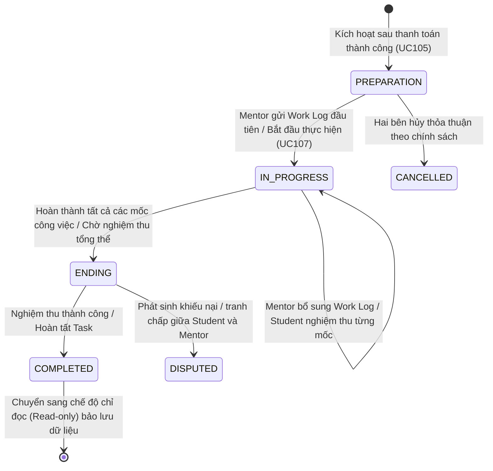
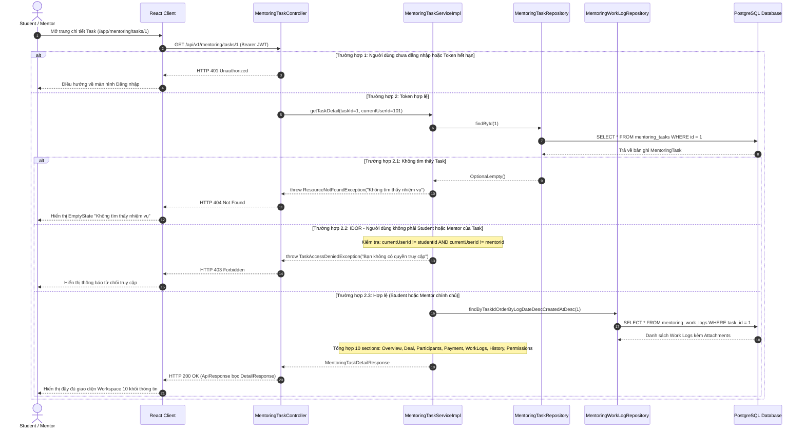

# ĐẶC TẢ YÊU CẦU & THIẾT KẾ CHI TIẾT: UC106 - XEM & QUẢN LÝ MENTORING TASK

## PHẦN 1: ĐẶC TẢ NGHIỆP VỤ (REPORT 3)

### 2.2.3 Business Workflow (Luồng nghiệp vụ)

#### Mô tả chi tiết luồng xử lý bằng chữ (Business Step Description):
* **Bước 1 - Khởi đầu (Trigger)**:
  - Sinh viên (Student) hoặc Cố vấn (Mentor) truy cập vào mục **"Nhiệm vụ Mentoring"** (`/app/mentoring/tasks`) hoặc nhấn xem Task từ thanh điều hướng, thông báo hệ thống, hoặc modal Chat for Task.
* **Bước 2 - Lấy danh sách nhiệm vụ của người dùng (My Mentoring Tasks)**:
  - Hệ thống tự động phân giải định danh người dùng từ JWT Security Context.
  - Áp dụng bộ lọc phân quyền chặt chẽ:
    - Nếu người dùng là **Student**: Hệ thống chỉ truy vấn các Task có `task.studentId = currentUser.id`.
    - Nếu người dùng là **Mentor**: Hệ thống chỉ truy vấn các Task có `task.mentorId = currentUser.id`.
  - Hỗ trợ lọc theo UI Stage cấp cao: `ALL` (Tất cả), `PREPARATION` (Chuẩn bị), `IN_PROGRESS` (Đang thực hiện), `ENDING` (Kết thúc / Nghiệm thu).
  - Trả về danh sách Task kèm các chỉ số: tiêu đề, phạm vi, người tham gia, deadline, tiến độ thực tế (derived progress), số lượng Work Logs, trạng thái thanh toán.
* **Bước 3 - Xem chi tiết toàn diện Mentoring Task (Task Detail)**:
  - Người dùng bấm chọn một Task bất kỳ để mở trang chi tiết (`/app/mentoring/tasks/{taskId}`).
  - Hệ thống kiểm tra quyền truy cập (Authorization Check): Nếu `currentUser.id != task.studentId` VÀ `currentUser.id != task.mentorId`, hệ thống lập tức từ chối với lỗi **403 Forbidden** (ngăn chặn triệt để tấn công IDOR).
  - Hệ thống tổng hợp 10 khối thông tin nghiệp vụ cốt lõi:
    1. **Task Overview**: Mã nhiệm vụ, tiêu đề, phạm vi, trạng thái backend, UI stage, ngày bắt đầu, deadline, tiến độ %, số ngày còn lại.
    2. **Deal Information**: Mã Deal, giá thỏa thuận, hình thức làm việc, kiểu tham gia, kết quả kỳ vọng, liên kết truy vết Deal gốc.
    3. **Participants**: Hồ sơ đối tác tham gia (Student & Mentor: họ tên, email, avatar, chức danh/bio công khai).
    4. **Timeline & Deadline**: Hạn chót hoàn thành, đồng hồ cảnh báo quá hạn.
    5. **Progress & Stage**: Thanh tiến trình trực quan phản ánh đúng 3 giai đoạn: Chuẩn bị → Đang thực hiện → Kết thúc.
    6. **Work Logs**: Danh sách nhật ký công việc đã thực hiện, trạng thái xác nhận và tài liệu bằng chứng đính kèm (liên kết UC107 & UC108).
    7. **Attachments / Deliverables**: Tệp đính kèm, sản phẩm bàn giao minh chứng cho công việc.
    8. **Payment Information**: Tóm tắt thanh toán Escrow qua PayOS (mã đơn hàng, số tiền, trạng thái `PAID`).
    9. **Task History (Audit Trail)**: Dòng thời gian lịch sử ghi nhận toàn bộ sự kiện: Kích hoạt Task, Nộp Work Log, Cập nhật Work Log, Xác nhận Work Log...
    10. **Available Actions & Permissions**: Các cờ thao tác phân quyền dựa trên vai trò và trạng thái Task (`canAddWorkLog`, `canEditWorkLog`, `isReadOnly`, `isDisputed`).
* **Bước 4 - Kết thúc**:
  - Nếu Task đang ở trạng thái `COMPLETED` hoặc `DISPUTED`, hệ thống tự động khóa các thao tác chỉnh sửa và hiển thị banner cảnh báo tương ứng.

---

### 3.2 Module Mentoring & Hướng nghiệp

#### 3.2.1 Xem & Quản lý Mentoring Task (UC106)

**Function trigger**:
*   **Navigation path**: 
    - `/app/mentoring/tasks`: Trang danh sách nhiệm vụ Mentoring của tôi.
    - `/app/mentoring/tasks/{taskId}`: Trang chi tiết nhiệm vụ Mentoring.
    - Click từ thông báo `MENTORING_TASK` hoặc `MENTORING_WORK_LOG` trên Notifications Page (`/app/notifications`).
    - Nút "Mở trang chi tiết & Quản lý Work Log" từ Modal "Xem Task" trong Chat for Task.
*   **Timing Frequency**: Bất kỳ khi nào người dùng có nhu cầu kiểm tra tiến độ, theo dõi nhiệm vụ hoặc mở màn hình làm việc (On-demand).

**Function description**:
*   **Actors/Roles**: 
    - **Student**: Xem danh sách nhiệm vụ mình tham gia học tập, kiểm tra tiến độ, xem Work Logs của Mentor và lịch sử nhiệm vụ.
    - **Mentor**: Xem danh sách nhiệm vụ mình hướng dẫn, theo dõi tiến độ, thực hiện cập nhật Work Log theo UC107.
*   **Purpose**: Cung cấp trung tâm điều khiển (Workspace Hub) để cả hai bên theo dõi toàn diện quá trình thực hiện một Mentoring Task đã được kích hoạt sau thanh toán, đảm bảo tính minh bạch, đúng cam kết và lưu trữ bằng chứng kiểm toán (Audit Trail) phục vụ đối soát/khiếu nại.
*   **Interface**:
    - **Trang danh sách (`MyMentoringTasksPage`)**:
      - Banner chào mừng với nút "Làm mới" và "Xem thỏa thuận Deal".
      - Tabs lọc theo UI Stage: Tất cả, Chuẩn bị (`PREPARATION`), Đang thực hiện (`IN_PROGRESS`), Kết thúc (`ENDING`).
      - Ô tìm kiếm từ khóa theo tên nhiệm vụ, nội dung thỏa thuận hoặc tên người tham gia.
      - Grid hiển thị các thẻ `MentoringTaskCard`: Tiêu đề, Badge trạng thái & Stage, thông tin đối tác, số ngày còn lại đến hạn chót, tiến độ thực tế, nút điều hướng Chat for Task và Chi tiết Task.
      - Phân trang chuẩn và trạng thái trống (Empty State) thân thiện.
    - **Trang chi tiết (`MentoringTaskDetailPage`)**:
      - Thanh điều hướng quay lại danh sách kèm nút cập nhật và nút mở Chat for Task.
      - Header Task với tiêu đề lớn, mã định danh, Badge trạng thái, Badge Stage.
      - Thanh tiến trình giai đoạn `MentoringTaskStageProgressBar` (Chuẩn bị → Đang thực hiện → Kết thúc).
      - Banner cảnh báo chế độ chỉ đọc khi Task đã `COMPLETED` hoặc đang `DISPUTED`.
      - Cột trái: Thẻ Tổng quan nhiệm vụ (`MentoringTaskOverviewCard`), Danh sách Work Logs (`MentoringWorkLogList`), Lịch sử tiến trình (`MentoringTaskHistoryTimeline`).
      - Cột phải: Thẻ thành viên tham gia (`MentoringTaskParticipantsCard`), Thẻ thỏa thuận Deal (`MentoringTaskDealSection`), Thẻ thanh toán (`MentoringTaskPaymentCard`).

**Data processing**:
*   Nhận yêu cầu `GET /api/v1/mentoring/tasks` hoặc `GET /api/v1/mentoring/tasks/{id}`.
*   Trích xuất `userId` từ token xác thực JWT (Security Context).
*   Kiểm tra sự tồn tại của Task trong cơ sở dữ liệu `mentoring_tasks`.
*   Kiểm tra tính hợp lệ về quyền sở hữu (Ownership Verification): Người dùng phải là Student hoặc Mentor của Task.
*   Tính toán UI Stage (`PREPARATION`, `IN_PROGRESS`, `ENDING`) và tiến độ % thực tế dựa trên số lượng Work Logs đã được xác nhận.
*   Tổng hợp các bảng liên kết `mentoring_deals`, `mentoring_task_payments`, `mentoring_work_logs`, `users`, `user_profiles` để xây dựng DTO phản hồi.

**Function details**:
*   **Data**: `MentoringTaskDetailResponse`, `MentoringTaskListResponse`, `MentoringTaskOverviewResponse`, `MentoringDealSummaryResponse`, `MentoringParticipantResponse`, `MentoringPaymentSummaryResponse`, `MentoringTaskHistoryEventResponse`, `MentoringTaskActionPermissionsResponse`.
*   **Validation**:
    - `taskId` phải là số nguyên dương hợp lệ.
    - Người gọi API phải đăng nhập và có token JWT còn hiệu lực.
    - Ngăn chặn triệt để IDOR: Cấm truy xuất dữ liệu Task nếu `userId != studentId` và `userId != mentorId`.
*   **Business rules**:
    - **BR-106.1**: Task chỉ được tạo và kích hoạt tự động sau khi thanh toán qua PayOS thành công (UC105); không có API tạo Task thủ công từ giao diện.
    - **BR-106.2**: Một Task bắt buộc phải liên kết hợp lệ với 1 Deal, 1 Student, 1 Mentor và 1 bản ghi Mentoring Task Payment.
    - **BR-106.3**: UI Stage được ánh xạ chuẩn từ backend status:
      - `PREPARATION` → Giai đoạn Chuẩn bị (Preparation).
      - `IN_PROGRESS` → Giai đoạn Đang thực hiện (In Progress).
      - `SUBMITTED`, `COMPLETED`, `CANCELLED`, `DISPUTED` → Giai đoạn Kết thúc (Ending).
    - **BR-106.4**: Khi Task ở trạng thái `COMPLETED`, giao diện chuyển sang chế độ chỉ đọc (Read-only); không cho phép tạo hoặc chỉnh sửa Work Log mới.
    - **BR-106.5**: Khi Task ở trạng thái `DISPUTED`, các thao tác chỉnh sửa Work Log bị khóa nhằm bảo vệ tính toàn vẹn của bằng chứng tranh chấp.
*   **Error Handling**:
    - `401 Unauthorized`: Người dùng chưa đăng nhập.
    - `403 Forbidden`: Người dùng không phải là Student hoặc Mentor của Task (`TaskAccessDeniedException`).
    - `404 Not Found`: Task không tồn tại trong hệ thống (`ResourceNotFoundException`).
*   **Normal case**: Trả về dữ liệu chi tiết Task với mã HTTP 200 OK, hiển thị đầy đủ 10 khối thông tin và cho phép điều hướng mượt mà.
*   **Abnormal case**: Cố tình truy cập Task của người khác bằng cách thay đổi ID trên URL sẽ bị chặn lại ngay tại tầng Controller/Service với mã HTTP 403 Forbidden và thông báo tiếng Việt rõ ràng.

---

### 5. Requirement Appendix (Phụ lục Yêu cầu)

#### 5.1 Business Rules (Quy tắc Nghiệp vụ)

| ID | Định nghĩa Quy tắc (Rule Definition) |
| :--- | :--- |
| BR-106.1 | Mentoring Task không thể được tạo độc lập mà bắt buộc phải sinh ra từ thỏa thuận Mentoring Deal đã được xác nhận và thanh toán Escrow thành công. |
| BR-106.2 | Dữ liệu danh sách nhiệm vụ "My Mentoring Tasks" luôn được lọc dựa theo User ID trong JWT Context; tuyệt đối không chấp nhận tham số `userId` do Client truyền lên để tránh giả mạo danh tính. |
| BR-106.3 | Sinh viên chỉ được phép xem các Task mà mình là người học (`task.studentId = currentUser.id`). Mentor chỉ được phép xem các Task mà mình là người hướng dẫn (`task.mentorId = currentUser.id`). Mọi vi phạm đều bị từ chối với lỗi 403 Forbidden. |
| BR-106.4 | Tiến độ phần trăm của Task được tính toán dựa trên dữ liệu thực tế (số Work Log đã xác nhận so với tổng số mốc hoặc trạng thái vòng đời), không sử dụng giá trị hardcode giả lập. |
| BR-106.5 | Task đã kết thúc (`COMPLETED`) hoặc bị hủy (`CANCELLED`) phải được bảo lưu toàn vẹn ở chế độ chỉ đọc (Read-only) để phục vụ tra cứu lịch sử và báo cáo kiểm toán. |

#### 5.2 Common Requirements (Yêu cầu Chung)
* Giao diện tuân thủ quy chuẩn thiết kế AlumNect Pastel Premium: nền màu be ấm, thẻ bo góc lớn (`rounded-3xl`), typography màu mận chín (`plum-900`), điểm nhấn tông màu xanh mòng két (`teal-600`) đại diện cho Mentoring Workspace.
* Phân trang danh sách Task với kích thước mặc định 9-10 phần tử trên một trang.
* Tích hợp thanh tiến trình giai đoạn và bộ huy hiệu (Badge) phản ánh đúng trạng thái thực tế.
* Đồng bộ hóa trạng thái tức thì thông qua TanStack Query cache invalidation khi có thao tác phát sinh.

#### 5.3 Application Messages List (Danh sách Thông điệp Ứng dụng)

| # | Mã thông điệp | Loại | Ngữ cảnh | Nội dung hiển thị |
| :--- | :--- | :--- | :--- | :--- |
| 1 | MSG-106-01 | Inline | Không tìm thấy nhiệm vụ nào trong bộ lọc | Không tìm thấy nhiệm vụ nào ở giai đoạn này. |
| 2 | MSG-106-02 | Inline | Danh sách nhiệm vụ trống | Chưa có nhiệm vụ Mentoring nào. Nhiệm vụ chỉ được kích hoạt sau khi Deal được thanh toán thành công. |
| 3 | MSG-106-03 | Banner | Nhiệm vụ đã hoàn thành | Nhiệm vụ này đã được hoàn thành thành công. Toàn bộ hồ sơ công việc được bảo lưu ở chế độ chỉ đọc. |
| 4 | MSG-106-04 | Banner | Nhiệm vụ có tranh chấp | Nhiệm vụ đang ở trạng thái Khiếu nại / Tranh chấp (Disputed). Mọi thao tác ghi nhận Work Log bị khóa. |
| 5 | MSG-106-05 | Toast | Lỗi phân quyền truy cập Task | Bạn không có quyền truy cập vào thông tin nhiệm vụ Mentoring này. |

---

## PHẦN 2: THIẾT KẾ CHI TIẾT (REPORT 4)

### 3. Detail Design (Thiết kế chi tiết)

#### 3.1 UC106 - Xem & Quản lý Mentoring Task

##### 3.1.1 Class Diagram (Sơ đồ Lớp)

```mermaid
classDiagram
    class MentoringTaskController {
        -MentoringTaskService taskService
        -MentoringWorkLogService workLogService
        +getMyTasks(stage, status, pageable, userDetails) ResponseEntity~ApiResponse~
        +getTaskDetail(taskId, userDetails) ResponseEntity~ApiResponse~
        +getTaskByDealId(dealId, userDetails) ResponseEntity~ApiResponse~
    }

    class MentoringTaskService {
        <<interface>>
        +getMyTasks(userId, stage, status, pageable) Page~MentoringTaskResponse~
        +getTaskDetail(taskId, userId) MentoringTaskDetailResponse
        +getTaskByDealId(dealId, userId) MentoringTaskResponse
    }

    class MentoringTaskServiceImpl {
        -MentoringTaskRepository taskRepository
        -MentoringDealRepository dealRepository
        -MentoringTaskPaymentRepository paymentRepository
        -MentoringWorkLogRepository workLogRepository
        -MentoringWorkLogMapper workLogMapper
        +getMyTasks(userId, stage, status, pageable) Page~MentoringTaskResponse~
        +getTaskDetail(taskId, userId) MentoringTaskDetailResponse
        +getTaskByDealId(dealId, userId) MentoringTaskResponse
    }

    class MentoringTaskRepository {
        <<interface>>
        +findByParticipantAndStatusIn(userId, statuses, pageable) Page~MentoringTask~
        +findByStudentIdOrMentorId(studentId, mentorId, pageable) Page~MentoringTask~
        +findByDealId(dealId) Optional~MentoringTask~
    }

    class MentoringTask {
        -Long id
        -MentoringDeal deal
        -User student
        -User mentor
        -MentoringTaskStatus status
        -Instant startedAt
        -Instant deadline
        -Instant completedAt
        -List~MentoringWorkLog~ workLogs
    }

    class MentoringDeal {
        -Long id
        -MentoringRequest request
        -BigDecimal agreedPrice
        -String taskScope
        -String expectedResult
        -Boolean isPaid
    }

    class MentoringTaskPayment {
        -Long id
        -Long orderCode
        -BigDecimal amount
        -TaskPaymentStatus status
        -Instant paidAt
    }

    class MentoringWorkLog {
        -Long id
        -MentoringTask task
        -User mentor
        -LocalDate logDate
        -String description
        -String workCompleted
        -String result
        -WorkLogStatus status
    }

    class MentoringTaskDetailResponse {
        -MentoringTaskOverviewResponse overview
        -MentoringDealSummaryResponse deal
        -MentoringParticipantResponse student
        -MentoringParticipantResponse mentor
        -MentoringPaymentSummaryResponse payment
        -List~MentoringWorkLogResponse~ workLogs
        -List~MentoringTaskHistoryEventResponse~ history
        -MentoringTaskActionPermissionsResponse permissions
    }

    MentoringTaskController ..> MentoringTaskService : calls
    MentoringTaskServiceImpl ..|> MentoringTaskService : implements
    MentoringTaskServiceImpl --> MentoringTaskRepository : uses
    MentoringTaskServiceImpl --> MentoringTask : queries
    MentoringTaskServiceImpl --> MentoringDeal : aggregates
    MentoringTaskServiceImpl --> MentoringTaskPayment : aggregates
    MentoringTaskServiceImpl --> MentoringWorkLog : aggregates
    MentoringTaskServiceImpl ..> MentoringTaskDetailResponse : constructs
```

###### Mô tả chi tiết cấu trúc các lớp (Class Design Description):
* **Lớp Controller (`MentoringTaskController.java`)**: Tiếp nhận các yêu cầu HTTP GET từ Frontend, phân giải đối tượng `UserDetails` từ Spring Security để lấy `userId` an toàn, chuyển giao dữ liệu xuống `MentoringTaskService`.
* **Lớp Service (`MentoringTaskServiceImpl.java`)**: Thực hiện toàn bộ logic nghiệp vụ kiểm tra quyền sở hữu đối với Task, phân tách và ánh xạ trạng thái thành UI Stage, tổng hợp thông tin từ 4 bảng thực thể (`MentoringTask`, `MentoringDeal`, `MentoringTaskPayment`, `MentoringWorkLog`) và xuất xưởng `MentoringTaskDetailResponse`.
* **Lớp Repository (`MentoringTaskRepository.java`)**: Cung cấp các câu truy vấn tối ưu `@Query` để lọc danh sách nhiệm vụ của người dùng theo danh sách trạng thái thuộc từng UI Stage, tránh N+1 query.
* **Lớp Thực thể Entity (`MentoringTask.java`, `MentoringDeal.java`, `MentoringWorkLog.java`)**: Ánh xạ đầy đủ quan hệ JPA giữa Task, Deal, Payment, Student, Mentor và Work Logs.
* **Lớp DTO (`MentoringTaskDetailResponse.java`)**: Đóng gói cấu trúc 10 khối thông tin nghiệp vụ, ngăn chặn rò rỉ dữ liệu nhạy cảm của các Entity ra ngoài tầng Client.

##### 3.1.2 Sequence Diagram (Sơ đồ Tuần tự)

###### Mô tả chi tiết luồng xử lý bằng chữ (Sequence Flow Description):
1. **Luồng thành công (Normal Case)**:
   - Người dùng đăng nhập truy cập vào đường dẫn Task Detail. Frontend kích hoạt hook `useTaskDetail(taskId)`.
   - Controller tiếp nhận request, lấy `currentUserId` từ Spring Security context và gọi `taskService.getTaskDetail(taskId, currentUserId)`.
   - Service tìm nạp Task từ Database. Xác thực `currentUserId` khớp với `task.studentId` hoặc `task.mentorId`.
   - Service nạp bổ sung các Work Logs liên quan, tóm tắt giao dịch thanh toán và dòng lịch sử sự kiện.
   - Trả về mã HTTP 200 OK kèm toàn bộ DTO chi tiết để Frontend dựng giao diện hoàn chỉnh.
2. **Luồng vi phạm bảo mật IDOR (Access Denied Case)**:
   - Người dùng cố tình thay đổi `taskId` trên URL sang ID của một Task thuộc cặp Student/Mentor khác.
   - Service phát hiện quyền sở hữu không hợp lệ, ném ngoại lệ `TaskAccessDeniedException`.
   - Hệ thống phản hồi HTTP 403 Forbidden, bảo vệ an toàn 100% dữ liệu riêng tư của người dùng.
