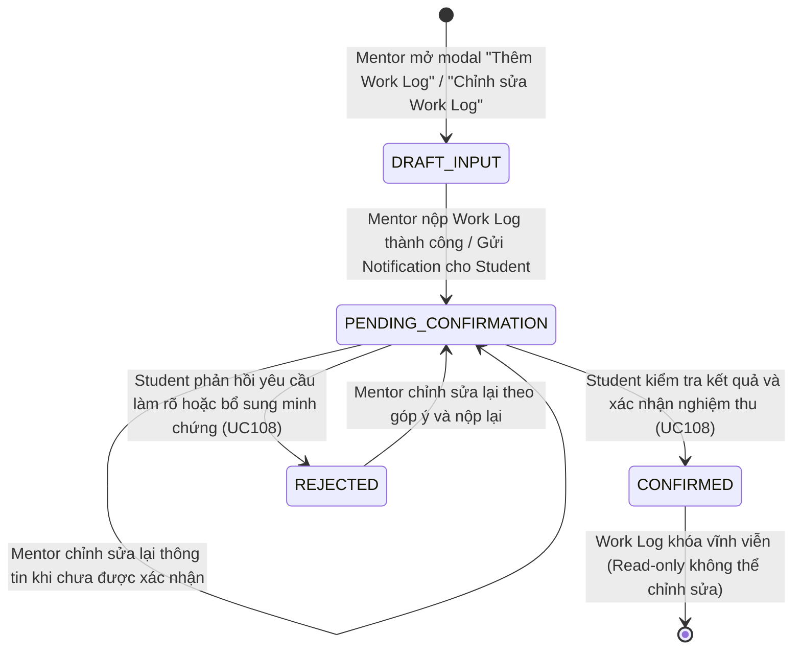
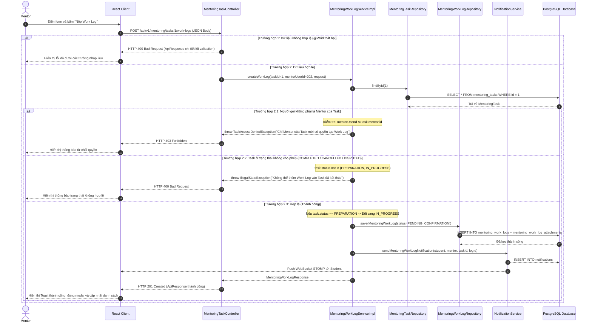

# ĐẶC TẢ YÊU CẦU & THIẾT KẾ CHI TIẾT: UC107 - CẬP NHẬT WORK LOG

## PHẦN 1: ĐẶC TẢ NGHIỆP VỤ (REPORT 3)

### 2.2.3 Business Workflow (Luồng nghiệp vụ)

#### Mô tả chi tiết luồng xử lý bằng chữ (Business Step Description):
* **Bước 1 - Khởi đầu (Trigger)**:
  - Cố vấn (Mentor) mở trang chi tiết Mentoring Task (`/app/mentoring/tasks/{taskId}`) và nhấn nút **"Thêm Work Log"** hoặc nút biểu tượng **"Chỉnh sửa"** trên một Work Log cụ thể đang ở trạng thái chờ xác nhận.
* **Bước 2 - Nhập liệu & Tải lên tệp minh chứng**:
  - Mentor điền các trường thông tin bắt buộc: Ngày thực hiện (`logDate`), Mô tả công việc (`description`), Nội dung công việc hoàn thành (`workCompleted`), Kết quả đạt được (`result`), và Hành động tiếp theo (`nextAction`).
  - Mentor có thể đính kèm tài liệu, ảnh chụp màn hình hoặc sản phẩm bàn giao (Deliverables) thông qua Cloudflare R2 / S3 storage.
  - Form thực hiện validate client-side bằng React Hook Form kết hợp Zod schema.
* **Bước 3 - Xử lý nghiệp vụ & Kiểm tra phân quyền tại Backend**:
  - Backend giải mã JWT token để xác định chính xác danh tính người gọi API.
  - **Kiểm tra quyền Mentor**: Hệ thống đối soát bắt buộc `currentUser.id == task.mentorId`. Nếu sinh viên hoặc mentor khác gọi API, hệ thống lập tức từ chối với lỗi **403 Forbidden**.
  - **Kiểm tra vòng đời Task**: Task phải ở trạng thái cho phép cập nhật công việc (`PREPARATION` hoặc `IN_PROGRESS`). Nếu Task đã hoàn thành (`COMPLETED`), bị hủy (`CANCELLED`) hoặc đang tranh chấp (`DISPUTED`), hệ thống chặn giao dịch với lỗi nghiệp vụ.
  - **Kiểm tra tính bất biến (Immutability Check)**: Trường hợp cập nhật (PUT), nếu Work Log đã được Student xác nhận (`CONFIRMED`), Mentor tuyệt đối không được phép chỉnh sửa; hệ thống trả về mã lỗi **409 Conflict**.
* **Bước 4 - Lưu trữ dữ liệu & Chuyển dịch trạng thái**:
  - Nếu Task đang ở giai đoạn `PREPARATION`, hệ thống tự động chuyển trạng thái Task sang **`IN_PROGRESS`** ngay khi Mentor nộp Work Log đầu tiên.
  - Bản ghi Work Log được lưu vào bảng `mentoring_work_logs` với trạng thái mặc định: **`PENDING_CONFIRMATION`** (Chờ học viên xác nhận).
  - Các tệp đính kèm được lưu vào bảng `mentoring_work_log_attachments`.
* **Bước 5 - Phát thông báo thời gian thực (Real-time Notification)**:
  - Hệ thống tạo một bản ghi thông báo trong cơ sở dữ liệu cho Student của Task với loại `MENTORING_WORK_LOG`.
  - Đồng thời đẩy gói tin thông báo qua kênh WebSocket `/user/{studentId}/queue/notifications` để hiển thị popup thông báo thời gian thực trên màn hình của Student.
* **Bước 6 - Kết thúc**:
  - Giao diện Frontend hiển thị Toast thông báo thành công, đóng modal và kích hoạt cập nhật lại cache (React Query invalidation).
  - Student lập tức nhìn thấy Work Log mới xuất hiện với huy hiệu **"Chờ học viên xác nhận"** kèm các bằng chứng để sẵn sàng xử lý tại UC108.

---

### 3.2 Module Mentoring & Hướng nghiệp

#### 3.2.1 Cập nhật Work Log (UC107)

**Function trigger**:
*   **Navigation path**: 
    - `/app/mentoring/tasks/{taskId}` -> Thẻ Danh sách Work Logs -> Nút "Thêm Work Log".
    - `/app/mentoring/tasks/{taskId}` -> Thẻ Work Log chi tiết -> Nút biểu tượng "Chỉnh sửa".
*   **Timing Frequency**: Bất kỳ khi nào Mentor hoàn thành một buổi hướng dẫn hoặc mốc công việc trong thỏa thuận (On-demand).

**Function description**:
*   **Actors/Roles**: Mentor của chính Mentoring Task đó (Actor duy nhất có quyền tạo và sửa Work Log).
*   **Purpose**: Cho phép Mentor ghi lại nhật ký công việc đã thực hiện, kèm bằng chứng và kết quả đạt được, sau đó gửi yêu cầu xác nhận tới Student, phục vụ minh bạch hóa tiến độ và giải ngân ký quỹ.
*   **Interface**:
    - **Modal Thêm / Cập nhật Work Log (`MentoringWorkLogModal`)**:
      - Tiêu đề modal: "Ghi nhận tiến độ công việc mới (Work Log)" hoặc "Cập nhật Work Log #ID".
      - Ô chọn ngày làm việc (`logDate`): Mặc định ngày hiện tại.
      - Ô nhập văn bản đa dòng (Textarea): Mô tả ngắn gọn (`description`), Nội dung công việc hoàn thành (`workCompleted`), Kết quả đạt được (`result`), Kế hoạch tiếp theo (`nextAction`).
      - Khu vực tải tệp minh chứng: Hỗ trợ tệp tài liệu PDF, DOCX, ZIP và ảnh PNG, JPG (tối đa 25MB/tệp).
      - Nút "Hủy bỏ" và nút "Nộp Work Log" (có trạng thái loading chống spam submit).
    - **Huy hiệu trạng thái trên giao diện (`MentoringWorkLogList`)**:
      - `PENDING_CONFIRMATION`: Huy hiệu màu hổ phách "Chờ học viên xác nhận".
      - `CONFIRMED`: Huy hiệu màu xanh lá "Đã nghiệm thu".
      - `REJECTED`: Huy hiệu màu đỏ cam "Cần bổ sung".

**Data processing**:
*   Nhận yêu cầu `POST /api/v1/mentoring/tasks/{taskId}/work-logs` hoặc `PUT /api/v1/mentoring/tasks/{taskId}/work-logs/{workLogId}`.
*   Kiểm tra tính hợp lệ dữ liệu đầu vào (JSR-380 `@Valid`).
*   Xác thực quyền hạn: `userId` từ SecurityContext phải trùng với `task.mentor.id`.
*   Kiểm tra trạng thái Task: Phải là `PREPARATION` hoặc `IN_PROGRESS`.
*   Đối với thao tác PUT: Kiểm tra Work Log thuộc đúng `taskId`, trạng thái khác `CONFIRMED`.
*   Lưu thực thể `MentoringWorkLog` và danh sách `MentoringWorkLogAttachment`.
*   Ghi nhận sự kiện vào lịch sử Task (Audit Trail: `WORK_LOG_SUBMITTED` hoặc `WORK_LOG_UPDATED`).
*   Tạo thông báo `Notification` cho Student và gửi qua WebSocket STOMP.

**Function details**:
*   **Data**:
    - Request: `CreateMentoringWorkLogRequest`, `UpdateMentoringWorkLogRequest`, `WorkLogAttachmentRequest`.
    - Response: `MentoringWorkLogResponse`, `MentoringWorkLogAttachmentResponse`.
*   **Validation**:
    - `logDate`: Bắt buộc, không để trống, định dạng YYYY-MM-DD.
    - `description`: Bắt buộc, độ dài từ 5 đến 5000 ký tự.
    - `workCompleted`: Bắt buộc, độ dài từ 5 đến 5000 ký tự.
    - `result`: Bắt buộc, độ dài từ 5 đến 5000 ký tự.
    - `nextAction`: Tùy chọn, tối đa 2000 ký tự.
    - `attachments`: Danh sách tệp đính kèm với định dạng tệp hợp lệ, dung lượng ≤ 25MB.
*   **Business rules**:
    - **BR-107.1**: Sinh viên (Student) tuyệt đối không có quyền tạo hoặc chỉnh sửa Work Log. Mọi nỗ lực gọi API sẽ bị từ chối với lỗi 403 Forbidden.
    - **BR-107.2**: Mentor khác (không thuộc Task) không thể nộp hoặc sửa Work Log của Task người khác.
    - **BR-107.3**: Work Log sau khi nộp luôn bắt đầu ở trạng thái `PENDING_CONFIRMATION`. Việc nộp Work Log không đồng nghĩa với việc đã hoàn thành hoặc được xác nhận.
    - **BR-107.4**: Mentor chỉ được phép chỉnh sửa Work Log khi đang ở trạng thái `PENDING_CONFIRMATION` hoặc `REJECTED`. Một khi đã được Student bấm xác nhận (`CONFIRMED`), Work Log bị khóa vĩnh viễn nhằm chống gian lận thay đổi bằng chứng.
    - **BR-107.5**: Không thể thêm Work Log vào một Task đã hoàn tất (`COMPLETED`), đã hủy (`CANCELLED`) hoặc đang khiếu nại (`DISPUTED`).
*   **Error Handling**:
    - `400 Bad Request`: Thiếu trường bắt buộc hoặc độ dài ký tự không hợp lệ.
    - `403 Forbidden`: Người gọi không phải là Mentor của Task (`TaskAccessDeniedException`).
    - `404 Not Found`: Task hoặc Work Log không tồn tại (`ResourceNotFoundException`).
    - `409 Conflict`: Cố tình chỉnh sửa Work Log đã được xác nhận (`WorkLogModificationNotAllowedException`).
*   **Normal case**: Work Log được tạo thành công với mã HTTP 201 Created (hoặc 200 OK khi sửa), trạng thái `PENDING_CONFIRMATION`, Student nhận thông báo ngay lập tức.
*   **Abnormal case**: Sinh viên gửi request giả mạo hoặc Mentor gửi dữ liệu sai cấu trúc sẽ bị hệ thống phát hiện và phản hồi mã lỗi tương ứng, bảo toàn toàn vẹn dữ liệu cơ sở dữ liệu.

---

### 5. Requirement Appendix (Phụ lục Yêu cầu)

#### 5.1 Business Rules (Quy tắc Nghiệp vụ)

| ID | Định nghĩa Quy tắc (Rule Definition) |
| :--- | :--- |
| BR-107.1 | Chỉ có duy nhất Mentor được chỉ định trong thỏa thuận Mentoring Task mới có quyền tạo và chỉnh sửa Work Log. |
| BR-107.2 | Học viên (Student) của Task là đối tượng thụ hưởng, chỉ có quyền xem và phản hồi ở UC108, tuyệt đối không có quyền tạo Work Log. |
| BR-107.3 | Work Log mới tạo luôn có trạng thái ban đầu là `PENDING_CONFIRMATION`. |
| BR-107.4 | Work Log đã ở trạng thái `CONFIRMED` không được phép chỉnh sửa dưới bất kỳ hình thức nào. |
| BR-107.5 | Tệp đính kèm trong Work Log phải được lưu trữ trên hạ tầng lưu trữ đám mây (Cloudflare R2/S3), cơ sở dữ liệu chỉ lưu trữ URL và metadata. |
| BR-107.6 | Mọi thao tác nộp hoặc cập nhật Work Log đều phải gửi thông báo đích danh tới tài khoản của Student liên quan. |

#### 5.2 Common Requirements (Yêu cầu Chung)
* Giao diện nhập liệu có hỗ trợ đính kèm nhiều tệp cùng lúc với thanh tiến trình tải lên.
* Cơ chế khóa chống nộp lặp (Double Submission Prevention) khi người dùng bấm nút nhiều lần trong thời gian mạng trễ.
* Tích hợp cơ chế kiểm soát ngoại lệ toàn cục `GlobalExceptionHandler` với thông điệp tiếng Việt thân thiện.
* Cơ sở dữ liệu thiết lập chỉ mục (Indexes) trên các cột `task_id`, `mentor_id`, `status` để tối ưu hóa hiệu năng truy vấn.

#### 5.3 Application Messages List (Danh sách Thông điệp Ứng dụng)

| # | Mã thông điệp | Loại | Ngữ cảnh | Nội dung hiển thị |
| :--- | :--- | :--- | :--- | :--- |
| 1 | MSG-107-01 | Toast | Nộp Work Log thành công | Đã ghi nhận Work Log thành công! Đang chờ học viên xác nhận. |
| 2 | MSG-107-02 | Toast | Cập nhật Work Log thành công | Đã cập nhật nội dung Work Log thành công. |
| 3 | MSG-107-03 | Inline | Báo lỗi trường bắt buộc | Vui lòng nhập đầy đủ các trường thông tin bắt buộc (*). |
| 4 | MSG-107-04 | Toast | Lỗi không có quyền Mentor | Chỉ Mentor phụ trách nhiệm vụ này mới có quyền ghi nhận hoặc sửa Work Log. |
| 5 | MSG-107-05 | Toast | Lỗi sửa Work Log đã xác nhận | Work Log này đã được học viên xác nhận nghiệm thu, không thể chỉnh sửa. |
| 6 | MSG-107-06 | Notification | Thông báo gửi tới Student | Mentor đã cập nhật Work Log cho nhiệm vụ #{taskId} và đang chờ bạn xác nhận. |

---

## PHẦN 2: THIẾT KẾ CHI TIẾT (REPORT 4)

### 3. Detail Design (Thiết kế chi tiết)

#### 3.1 UC107 - Cập nhật Work Log

##### 3.1.1 Class Diagram (Sơ đồ Lớp)

```mermaid
classDiagram
    class MentoringTaskController {
        -MentoringWorkLogService workLogService
        +createWorkLog(taskId, request, userDetails) ResponseEntity~ApiResponse~
        +updateWorkLog(taskId, workLogId, request, userDetails) ResponseEntity~ApiResponse~
        +getWorkLogs(taskId, userDetails) ResponseEntity~ApiResponse~
        +getWorkLogDetail(taskId, workLogId, userDetails) ResponseEntity~ApiResponse~
    }

    class MentoringWorkLogService {
        <<interface>>
        +createWorkLog(taskId, mentorUserId, request) MentoringWorkLogResponse
        +updateWorkLog(taskId, workLogId, mentorUserId, request) MentoringWorkLogResponse
        +getWorkLogsByTaskId(taskId, currentUserId) List~MentoringWorkLogResponse~
        +getWorkLogDetail(taskId, workLogId, currentUserId) MentoringWorkLogResponse
    }

    class MentoringWorkLogServiceImpl {
        -MentoringWorkLogRepository workLogRepository
        -MentoringTaskRepository taskRepository
        -UserRepository userRepository
        -MentoringWorkLogMapper workLogMapper
        -NotificationService notificationService
        +createWorkLog(taskId, mentorUserId, request) MentoringWorkLogResponse
        +updateWorkLog(taskId, workLogId, mentorUserId, request) MentoringWorkLogResponse
    }

    class CreateMentoringWorkLogRequest {
        -LocalDate logDate
        -String description
        -String workCompleted
        -String result
        -String nextAction
        -List~WorkLogAttachmentRequest~ attachments
    }

    class UpdateMentoringWorkLogRequest {
        -LocalDate logDate
        -String description
        -String workCompleted
        -String result
        -String nextAction
        -List~WorkLogAttachmentRequest~ attachments
    }

    class MentoringWorkLogMapper {
        <<interface>>
        +toEntity(request, task, mentor) MentoringWorkLog
        +toDto(entity) MentoringWorkLogResponse
        +toAttachmentEntity(dto) MentoringWorkLogAttachment
    }

    class MentoringWorkLogRepository {
        <<interface>>
        +findByTaskIdOrderByLogDateDescCreatedAtDesc(taskId) List~MentoringWorkLog~
        +countByTaskIdAndStatus(taskId, status) long
    }

    class NotificationService {
        <<interface>>
        +sendMentoringWorkLogNotification(recipient, sender, taskId, workLogId) void
    }

    MentoringTaskController ..> CreateMentoringWorkLogRequest : validates
    MentoringTaskController ..> MentoringWorkLogService : calls
    MentoringWorkLogServiceImpl ..|> MentoringWorkLogService : implements
    MentoringWorkLogServiceImpl --> MentoringWorkLogRepository : saves
    MentoringWorkLogServiceImpl --> MentoringWorkLogMapper : uses
    MentoringWorkLogServiceImpl --> NotificationService : notifies
```

###### Mô tả chi tiết cấu trúc các lớp (Class Design Description):
* **Lớp Controller (`MentoringTaskController.java`)**: Cung cấp các endpoint RESTful `POST` và `PUT` để tiếp nhận dữ liệu Work Log, kiểm tra ràng buộc `@Valid` JSR-380.
* **Lớp Service (`MentoringWorkLogServiceImpl.java`)**: Đảm nhiệm toàn bộ quy tắc nghiệp vụ về phân quyền Mentor, kiểm tra vòng đời Task, xử lý tự động chuyển trạng thái Task từ `PREPARATION` sang `IN_PROGRESS`, lưu trữ tệp đính kèm và gửi thông báo qua `NotificationService`.
* **Lớp DTO (`CreateMentoringWorkLogRequest.java`, `UpdateMentoringWorkLogRequest.java`)**: Định nghĩa cấu trúc dữ liệu đầu vào với đầy đủ các annotation kiểm tra dữ liệu (`@NotNull`, `@NotBlank`, `@Size`).
* **Lớp Mapper (`MentoringWorkLogMapper.java`)**: Chuyển đổi chính xác giữa Request DTO, Entity JPA và Response DTO.
* **Lớp Repository (`MentoringWorkLogRepository.java`)**: Truy vấn và thao tác trên bảng cơ sở dữ liệu `mentoring_work_logs` và `mentoring_work_log_attachments`.
* **Lớp Thông báo (`NotificationService.java`)**: Đảm bảo tích hợp kép: vừa lưu thông báo vào cơ sở dữ liệu vừa bắn tin nhắn tức thời qua WebSocket STOMP.

##### 3.1.2 Sequence Diagram (Sơ đồ Tuần tự)

###### Mô tả chi tiết luồng xử lý bằng chữ (Sequence Flow Description):
1. **Luồng tạo Work Log thành công (Normal Creation Case)**:
   - Mentor hoàn thành việc nhập thông tin và nhấn "Nộp Work Log".
   - Client gửi HTTP POST tới Controller kèm JWT Bearer Token.
   - Controller thẩm định định dạng dữ liệu và chuyển cho Service xử lý.
   - Service kiểm tra: Task tồn tại, người dùng chính là Mentor của Task, Task đang mở.
   - Nếu Task đang ở `PREPARATION`, hệ thống kích hoạt chuyển sang `IN_PROGRESS`.
   - Work Log được lưu với trạng thái `PENDING_CONFIRMATION`.
   - Notification Service lưu thông báo vào DB và phát sóng WebSocket tới Student.
   - Trả về HTTP 201 Created. Frontend đóng modal và làm mới giao diện.
2. **Luồng cập nhật Work Log thành công (Update Case)**:
   - Mentor nhấn sửa trên Work Log chưa được xác nhận.
   - Service xác minh Work Log thuộc đúng `taskId`, người gọi là Mentor và trạng thái khác `CONFIRMED`.
   - Cập nhật các trường thông tin và danh sách attachments, lưu lại với `updatedAt` mới nhất.
   - Trả về HTTP 200 OK.
3. **Luồng từ chối cập nhật khi đã xác nhận (Conflict Case)**:
   - Nếu Work Log đã ở trạng thái `CONFIRMED`, Service phát hiện và ném ngoại lệ `WorkLogModificationNotAllowedException`.
   - Hệ thống trả về HTTP 409 Conflict với thông báo tiếng Việt "Work Log đã được học viên xác nhận nghiệm thu, không thể chỉnh sửa".
