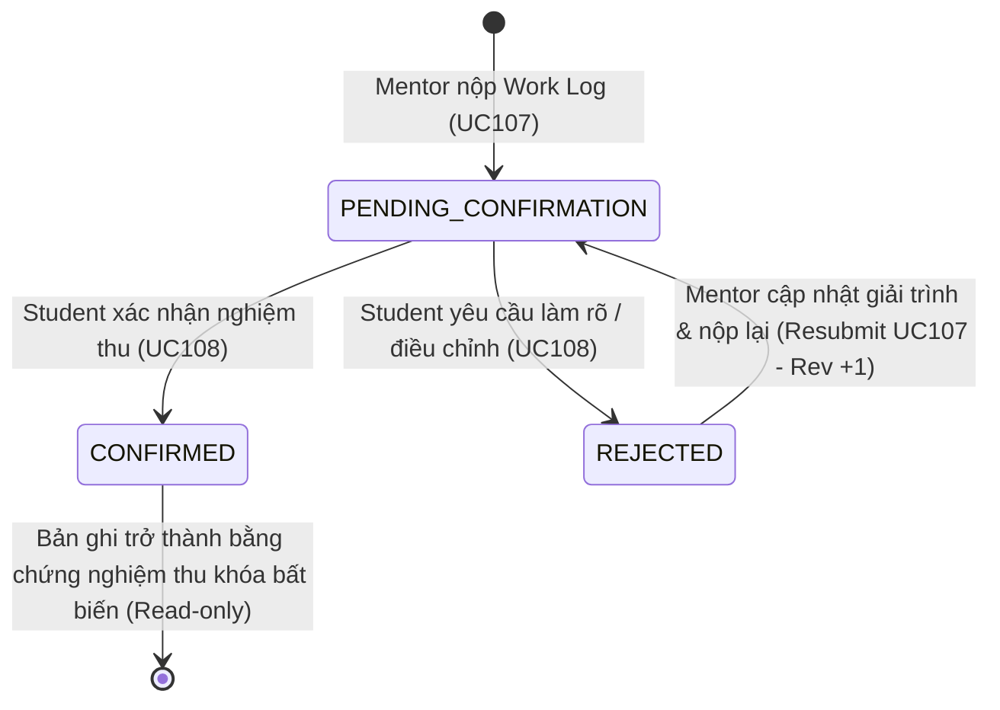

# ĐẶC TẢ YÊU CẦU & THIẾT KẾ CHI TIẾT: UC108 - XEM & XÁC NHẬN WORK LOG

## PHẦN 1: ĐẶC TẢ NGHIỆP VỤ (REPORT 3)

### 2.2.3 Business Workflow (Luồng nghiệp vụ)



#### Mô tả chi tiết luồng xử lý bằng chữ (Business Step Description):
* **Bước 1 - Khởi đầu (Trigger)**:
  - Học viên (Student) nhận được thông báo thời gian thực về việc Mentor vừa gửi một Work Log mới, hoặc truy cập trực tiếp trang chi tiết Mentoring Task (`/app/mentoring/tasks/{taskId}`).
  - Tại thẻ **"Nhật ký công việc (Work Logs)"**, các bản ghi đang ở trạng thái `PENDING_CONFIRMATION` hiển thị thanh hành động riêng biệt dành cho Học viên gồm 2 nút: **"Xác nhận nghiệm thu"** và **"Yêu cầu điều chỉnh"**.
* **Bước 2 - Xem & Kiểm tra kết quả công việc**:
  - Học viên xem chi tiết: Ngày thực hiện (`logDate`), Mô tả tóm tắt (`description`), Nội dung công việc hoàn thành (`workCompleted`), Kết quả & sản phẩm đạt được (`result`), Kế hoạch tiếp theo (`nextAction`), và mở các tài liệu/ảnh minh chứng đính kèm (`attachments`).
* **Bước 3 - Rẽ nhánh hành động**:
  - **Nhánh A (Xác nhận nghiệm thu - CONFIRM)**:
    1. Học viên nhấn **"Xác nhận nghiệm thu"**. Hệ thống hiển thị hộp thoại xác nhận với cảnh báo rõ ràng: *"Bạn xác nhận nội dung công việc Mentor đã ghi nhận là chính xác. Thao tác này không đồng nghĩa với việc xác nhận hoàn thành toàn bộ Mentoring Task."*
    2. Học viên có thể điền nhận xét, đánh giá cho Mentor (tùy chọn) và nhấn xác nhận.
    3. Backend kiểm tra quyền Student, trạng thái Task và trạng thái Work Log.
    4. Trạng thái Work Log chuyển sang **`CONFIRMED`**, cập nhật `confirmedAt`, `confirmedBy`, lưu bản ghi kiểm toán `mentoring_work_log_feedbacks` với hành động `CONFIRMED`.
    5. Gửi thông báo đến Mentor: *"Học viên đã nghiệm thu Work Log của Mentoring Task [Task Title]"*.
    6. Bản ghi Work Log trở thành bằng chứng nghiệm thu được bảo vệ vĩnh viễn (khóa sửa đổi và xóa).
  - **Nhánh B (Yêu cầu làm rõ / điều chỉnh - REQUEST_CLARIFICATION)**:
    1. Học viên nhấn **"Yêu cầu điều chỉnh"**. Hệ thống hiển thị modal yêu cầu nhập lý do.
    2. Học viên bắt buộc nhập lý do cụ thể (tối thiểu 5 ký tự) giải thích rõ những điểm cần bổ sung/chỉnh sửa.
    3. Backend kiểm tra quyền Student và hợp lệ của Work Log.
    4. Trạng thái Work Log chuyển sang **`REJECTED`** (nghiệp vụ: Clarification Requested), cập nhật `studentFeedback`, lưu bản ghi kiểm toán `mentoring_work_log_feedbacks` với hành động `CLARIFICATION_REQUESTED`.
    5. Gửi thông báo đến Mentor: *"Học viên yêu cầu điều chỉnh nhật ký công việc ngày [Log Date] cho nhiệm vụ [Task Title]"*.
    6. Bản ghi hiển thị cảnh báo: *"Đang chờ Mentor bổ sung & gửi lại"*.
* **Bước 4 - Mentor tiếp thu & Nộp lại (Clarification Handling - Resubmit)**:
  - Mentor mở Work Log bị yêu cầu điều chỉnh, xem lý do phản hồi của học viên.
  - Mentor chỉnh sửa nội dung/tài liệu và nộp lại.
  - Hệ thống tự động tăng số phiên bản `revision_number` (ví dụ từ v1 lên v2), lưu snapshot vào bảng `mentoring_work_log_revisions` để bảo toàn lịch sử bằng chứng, chuyển trạng thái Work Log quay về **`PENDING_CONFIRMATION`**, và gửi thông báo cho Student review lại.

---

### 3.2 Module Mentoring & Hướng nghiệp

#### 3.2.2 Xem & Xác nhận Work Log (UC108)

**Function trigger**:
*   **Navigation path**: 
    - `/app/mentoring/tasks/{taskId}` -> Thẻ Nhật ký công việc -> Nút "Xác nhận nghiệm thu" hoặc "Yêu cầu điều chỉnh".
*   **Timing Frequency**: On-demand (bất kỳ khi nào Mentor gửi Work Log chờ xác nhận).

**Function description**:
*   **Actors/Roles**: Học viên (Student) của chính Mentoring Task (Actor duy nhất có quyền xác nhận hoặc yêu cầu điều chỉnh).
*   **Purpose**: Cho phép Học viên kiểm tra thực tế kết quả buổi làm việc của Mentor, nghiệm thu phần việc đã đạt chuẩn hoặc yêu cầu làm rõ các nội dung chưa thỏa đáng, bảo đảm tính minh bạch trước khi giải ngân nhiệm vụ.
*   **Interface**:
    *   **Thanh hành động Học viên (Student Action Bar)** trên từng thẻ Work Log pending:
        - Biểu tượng đồng hồ / kiểm tra kèm tiêu đề *"Học viên xác nhận nghiệm thu phần công việc này"*.
        - Nút outline đỏ: *"Yêu cầu điều chỉnh"* (`RotateCcw`).
        - Nút xanh lá: *"Xác nhận nghiệm thu"* (`CheckCircle2`).
    *   **Modal Xác nhận nghiệm thu**:
        - Tiêu đề: "Xác nhận nghiệm thu công việc".
        - Thông điệp cảnh báo tính chất nghiệm thu từng phần (không hoàn thành Task).
        - Trích dẫn mô tả công việc đang nghiệm thu.
        - Textarea nhập nhận xét phản hồi (tùy chọn, tối đa 2000 ký tự).
    *   **Modal Yêu cầu điều chỉnh**:
        - Tiêu đề: "Yêu cầu Mentor điều chỉnh Work Log".
        - Khung hướng dẫn giải thích rõ ràng.
        - Textarea nhập lý do điều chỉnh bắt buộc (5 - 2000 ký tự).
    *   **Thẻ lịch sử phản hồi & các phiên bản (Audit Trail)**:
        - Nút xem lịch sử phản hồi (`History`).
        - Danh sách các phản hồi và mốc thời gian của từng revision.

**Data processing**:
*   Giải mã JWT xác định `currentUserId`.
*   Truy vấn `MentoringTask` và đối soát: `currentUserId == task.student.id`.
*   Truy vấn `MentoringWorkLog` theo `taskId` và `workLogId`.
*   Kiểm tra tính bất biến: nếu Work Log đã `CONFIRMED`, từ chối thao tác sửa đổi.
*   Cập nhật trạng thái `CONFIRMED` hoặc `REJECTED`, ghi nhận thời gian `confirmedAt` và `confirmedBy`.
*   Lưu lịch sử phản hồi vào `mentoring_work_log_feedbacks`.
*   Gửi thông báo thời gian thực qua WebSocket STOMP tới Mentor.
*   Cập nhật tiến độ động và lịch sử tiến trình Task Timeline (`WORK_LOG_CONFIRMED`, `WORK_LOG_CLARIFICATION_REQUESTED`, `WORK_LOG_RESUBMITTED`).

---

### 5. Requirement Appendix (Phụ lục Yêu cầu)

#### 5.1 Business Rules (Quy tắc Nghiệp vụ)

| ID | Định nghĩa Quy tắc (Rule Definition) |
| :--- | :--- |
| **BR-01** | Chỉ Học viên (Student) sở hữu Mentoring Task mới có quyền thực hiện CONFIRM hoặc REQUEST_CLARIFICATION đối với Work Log. |
| **BR-02** | Chỉ Work Log đang ở trạng thái `PENDING_CONFIRMATION` mới được phép nhận phản hồi nghiệm thu hoặc yêu cầu làm rõ mới từ Student. |
| **BR-03** | Trạng thái `CONFIRMED` là xác nhận nghiệm thu nội dung công việc cụ thể của Work Log đó, tuyệt đối **không tự động chuyển Task sang COMPLETED**. |
| **BR-04** | Yêu cầu làm rõ (`REQUEST_CLARIFICATION`) chuyển Work Log sang `REJECTED` (chờ làm rõ) và tuyệt đối **không chuyển trạng thái thành CONFIRMED**. |
| **BR-05** | Lý do yêu cầu làm rõ (`reason`) là trường thông tin bắt buộc, không được chỉ chứa khoảng trắng, và phải có độ dài từ 5 đến 2000 ký tự. |
| **BR-06** | Mentor chỉ được chỉnh sửa Work Log khi đang ở trạng thái `PENDING_CONFIRMATION` hoặc `REJECTED`. Khi Mentor nộp lại (Resubmit), hệ thống tự động tăng `revision_number` và chuyển về `PENDING_CONFIRMATION`. |
| **BR-07** | Work Log đã ở trạng thái `CONFIRMED` được bảo vệ bất biến: Mentor không thể chỉnh sửa (`canEdit = false`) hoặc xóa bỏ làm mất bằng chứng nghiệm thu. |
| **BR-08** | Nghiệm thu Work Log có tính lũy thừa (Idempotent): Các yêu cầu xác nhận trùng lặp do mạng hoặc nhấn đúp chuột không tạo ra nhiều bản ghi kiểm toán hoặc thông báo trùng lặp. |
| **BR-09** | Việc xác nhận Work Log tuyệt đối không tự động giải ngân ký quỹ, không tạo giao dịch thanh toán mới, và không thay đổi giá trị hay điều khoản thỏa thuận Mentoring Deal. |
| **BR-10** | Khi Task đang ở trạng thái hủy (`CANCELLED`) hoặc tranh chấp (`DISPUTED`), toàn bộ các thao tác xác nhận hoặc yêu cầu làm rõ trên Work Log đều bị khóa. |

---

## PHẦN 2: THIẾT KẾ KỸ THUẬT & KIẾN TRÚC CHI TIẾT

### 4.1 Database Design & Migrations

Phiên bản migration: `V23__create_mentoring_work_log_feedback_and_revisions.sql`.

#### Bảng `mentoring_work_logs` (Bổ sung):
- `confirmed_by`: `BIGINT REFERENCES users(id)` (Khóa ngoại trỏ đến học viên xác nhận).
- `revision_number`: `INT NOT NULL DEFAULT 1` (Số thứ tự phiên bản cập nhật).

#### Bảng `mentoring_work_log_feedbacks` (Mới):
```sql
CREATE TABLE mentoring_work_log_feedbacks (
    id                  BIGINT GENERATED ALWAYS AS IDENTITY PRIMARY KEY,
    work_log_id         BIGINT NOT NULL REFERENCES mentoring_work_logs(id) ON DELETE CASCADE,
    student_id          BIGINT NOT NULL REFERENCES users(id) ON DELETE RESTRICT,
    action              VARCHAR(50) NOT NULL, -- 'CONFIRMED', 'CLARIFICATION_REQUESTED'
    reason              TEXT,
    revision_number     INT NOT NULL DEFAULT 1,
    created_at          TIMESTAMPTZ NOT NULL DEFAULT now()
);
```

#### Bảng `mentoring_work_log_revisions` (Mới):
```sql
CREATE TABLE mentoring_work_log_revisions (
    id                  BIGINT GENERATED ALWAYS AS IDENTITY PRIMARY KEY,
    work_log_id         BIGINT NOT NULL REFERENCES mentoring_work_logs(id) ON DELETE CASCADE,
    revision_number     INT NOT NULL DEFAULT 1,
    mentor_id           BIGINT NOT NULL REFERENCES users(id) ON DELETE RESTRICT,
    log_date            DATE NOT NULL,
    description         TEXT NOT NULL,
    work_completed      TEXT NOT NULL,
    result              TEXT NOT NULL,
    next_action         TEXT,
    attachments_summary TEXT,
    student_feedback    TEXT,
    created_at          TIMESTAMPTZ NOT NULL DEFAULT now()
);
```

### 4.2 REST API Specification

| HTTP Method | Endpoint | Actor | Mô tả |
| :--- | :--- | :--- | :--- |
| `GET` | `/api/v1/mentoring/tasks/{taskId}/work-logs/{workLogId}` | Student / Mentor | Xem chi tiết Work Log kèm danh sách phản hồi, tệp đính kèm và cờ phân quyền |
| `POST` | `/api/v1/mentoring/tasks/{taskId}/work-logs/{workLogId}/confirm` | Student của Task | Học viên xác nhận nghiệm thu Work Log (Idempotent) |
| `POST` | `/api/v1/mentoring/tasks/{taskId}/work-logs/{workLogId}/request-clarification` | Student của Task | Học viên yêu cầu Mentor làm rõ / điều chỉnh Work Log (Kèm lý do) |
| `POST` | `/api/v1/mentoring/tasks/{taskId}/work-logs/{workLogId}/reject` | Student của Task | Endpoint alias tương thích ngược với request clarification |

#### DTO Request / Response:
- **`ConfirmMentoringWorkLogRequest`**: `{ "feedback": "string (optional)" }`
- **`RejectMentoringWorkLogRequest`**: `{ "reason": "string (min 5, max 2000)", "feedback": "string (optional)" }`
- **`MentoringWorkLogResponse`**: Bổ sung `canConfirm`, `canReject`, `confirmedBy`, `confirmedByName`, `revisionNumber`, `feedbacks`, `revisions`.

### 4.3 Task History & Audit Trail Events

Trong `MentoringTaskServiceImpl.buildTaskHistory`:
- `WORK_LOG_SUBMITTED`: Mentor nộp bản ghi công việc ban đầu.
- `WORK_LOG_CONFIRMED`: Học viên xác nhận nghiệm thu bản ghi công việc.
- `WORK_LOG_CLARIFICATION_REQUESTED`: Học viên gửi phản hồi yêu cầu làm rõ/bổ sung.
- `WORK_LOG_RESUBMITTED`: Mentor nộp lại bản ghi mới (phiên bản v2, v3...).

### 4.4 Danh mục Test Cases Kiểm thử Tự động (Automated Test Cases)

| Mã Test Case | Tên Kịch bản Kiểm thử | Trạng thái |
| :--- | :--- | :--- |
| **TC108-01** | Student xem Work Log thuộc Task của mình thành công | PASS |
| **TC108-02** | Student xem chi tiết Work Log kèm tệp minh chứng đính kèm | PASS |
| **TC108-03** | Student lạ không có quyền xem Work Log của Task khác (403 Forbidden) | PASS |
| **TC108-04** | Work Log pending hiển thị đúng action (`canConfirm = true`, `canReject = true`) | PASS |
| **TC108-05** | Work Log confirmed không còn action confirm (`canConfirm = false`) | PASS |
| **TC108-06** | Student confirm pending Work Log thành công | PASS |
| **TC108-07** | Confirm cập nhật chính xác trạng thái `CONFIRMED` | PASS |
| **TC108-08** | Confirm lưu trữ chính xác `confirmedAt` và `confirmedBy` | PASS |
| **TC108-09** | Mentor không thể gọi Confirm API (403 Forbidden) | PASS |
| **TC108-10** | Student khác không thể confirm Work Log (403 Forbidden) | PASS |
| **TC108-11** | Không thể confirm Work Log không thuộc Task trên URL (404 Not Found) | PASS |
| **TC108-12** | Tính lũy thừa (Idempotency): Retry xác nhận không tạo duplicate feedback hay lỗi | PASS |
| **TC108-13** | Student gửi yêu cầu điều chỉnh thành công | PASS |
| **TC108-14** | Yêu cầu điều chỉnh lưu trữ chính xác lý do và bản ghi kiểm toán | PASS |
| **TC108-15** | Yêu cầu điều chỉnh chuyển trạng thái sang `REJECTED`, không chuyển thành `CONFIRMED` | PASS |
| **TC108-16** | Lý do điều chỉnh rỗng bị từ chối với lỗi 400 Bad Request | PASS |
| **TC108-17** | Mentor nhận được thông báo thời gian thực khi Student yêu cầu điều chỉnh | PASS |
| **TC108-18** | Mentor xem được góp ý phản hồi của Student trên giao diện | PASS |
| **TC108-19** | Mentor cập nhật lại Work Log sau khi nhận phản hồi điều chỉnh thành công | PASS |
| **TC108-20** | Resubmit chuyển trạng thái về `PENDING_CONFIRMATION` và tăng số phiên bản `revision_number` | PASS |
| **TC108-21** | Student nhận được thông báo và có thể review phiên bản mới | PASS |
| **TC108-22** | Confirmed Work Log không thể bị Mentor chỉnh sửa (409 Conflict) | PASS |
| **TC108-23** | Confirm Work Log không làm thay đổi trạng thái Task (Task vẫn giữ `IN_PROGRESS`) | PASS |
| **TC108-24** | Confirm Work Log không làm thay đổi trạng thái Payment | PASS |
| **TC108-25** | Confirm Work Log không làm thay đổi thông tin hay trạng thái Deal | PASS |
| **TC108-26** | Task History hiển thị đầy đủ chuỗi sự kiện confirmation và clarification | PASS |
| **TC108-27** | Phiên bản cũ được lưu trữ an toàn trong bảng `mentoring_work_log_revisions` | PASS |
| **TC108-28** | Xử lý an toàn tương tranh và bất biến dữ liệu | PASS |
