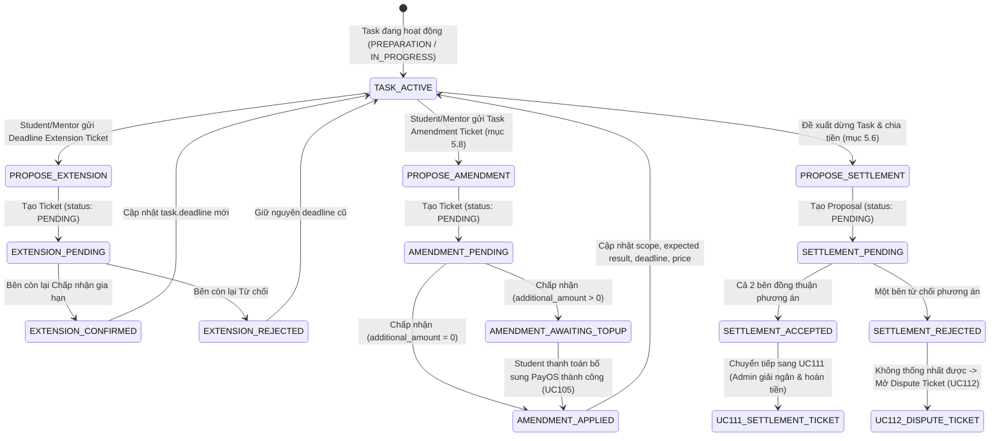
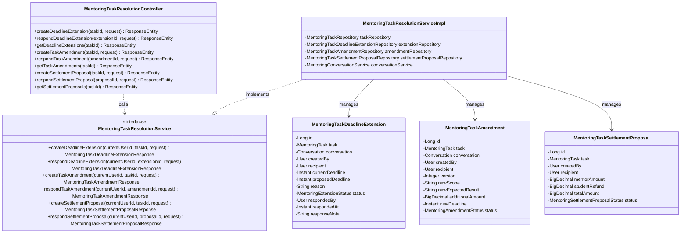
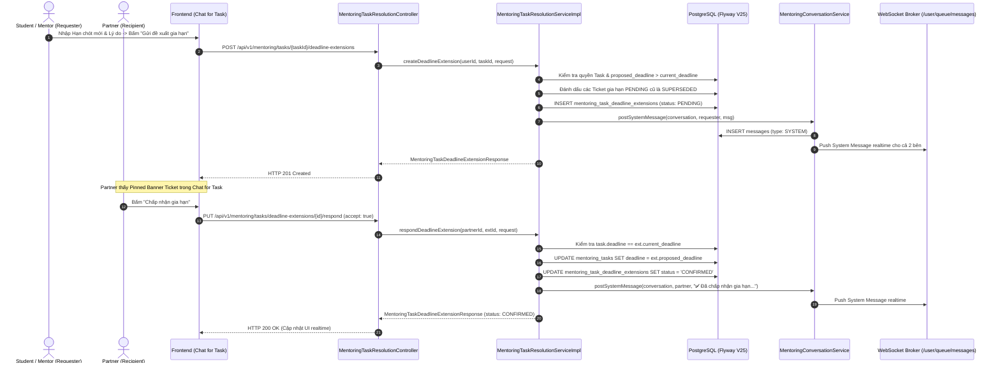

# ĐẶC TẢ YÊU CẦU & THIẾT KẾ CHI TIẾT: UC109 - THỎA THUẬN GIA HẠN HOẶC XỬ LÝ TASK CHƯA HOÀN THÀNH

## PHẦN 1: ĐẶC TẢ NGHIỆP VỤ (REPORT 3)

### 2.2.3 Business Workflow (Luồng nghiệp vụ)



#### Mô tả chi tiết luồng xử lý bằng chữ (Business Step Description):
* **Bước 1 - Khởi đầu (Task Active)**: Mentoring Task đang trong giai đoạn `PREPARATION` hoặc `IN_PROGRESS` sau khi Student hoàn tất thanh toán (UC105). Khi phát sinh khó khăn, chậm tiến độ hoặc yêu cầu phát sinh thêm công việc ngoài thỏa thuận ban đầu, một trong hai bên (Student hoặc Mentor) chủ động mở chức năng xử lý trong Chat for Task.
* **Bước 2 - Nhánh Gia hạn Deadline (Deadline Extension Ticket)**:
  * Một bên tạo Ticket gồm: Task, deadline hiện tại, deadline đề xuất (`proposed_deadline > current_deadline` và ở trong tương lai), lý do gia hạn.
  * Việc tạo Ticket đồng nghĩa người gửi đã xác nhận. Ticket được nhúng realtime vào Chat for Task, các Ticket gia hạn `PENDING` cũ chuyển sang `SUPERSEDED`.
  * Bên còn lại xem thẻ Ticket và chọn **Chấp nhận** hoặc **Từ chối**:
    * **Chấp nhận**: Hệ thống kiểm tra `task.deadline == current_deadline` (tránh ghi đè nếu đã bị thay đổi), cập nhật `task.deadline = proposed_deadline`, lưu audit `responded_by`, `responded_at`, chuyển status Ticket sang `CONFIRMED` và gửi tin nhắn hệ thống realtime vào Chat for Task.
    * **Từ chối**: Status Ticket chuyển sang `REJECTED`, deadline cũ của Task giữ nguyên.
* **Bước 3 - Nhánh Điều chỉnh Task & Bổ sung tiền (Task Amendment Ticket - mục 5.8)**:
  * Khi Student cần Mentor làm thêm việc ngoài thỏa thuận ban đầu hoặc cần điều chỉnh yêu cầu: Hệ thống không cho sửa trực tiếp Task đang chạy mà tạo Ticket điều chỉnh Task gồm: Phạm vi công việc mới, Kết quả kỳ vọng mới, Số tiền bổ sung cụ thể (`additional_amount >= 0`), Thời hạn mới (nếu có) và Lý do.
  * Bên còn lại xem và phản hồi:
    * Nếu `additional_amount == 0`: Khi bên kia chấp nhận, Ticket chuyển sang `APPLIED` và cập nhật trực tiếp vào Task.
    * Nếu `additional_amount > 0`: Khi hai bên đồng thuận, Ticket chuyển sang `AWAITING_TOPUP`. Học viên phải thanh toán khoản tiền bổ sung (UC105 top-up) mới kích hoạt áp dụng (`APPLIED`).
* **Bước 4 - Nhánh Thỏa thuận dừng Task & Phân chia tiền (Settlement Proposal - mục 5.6 & 5.7)**:
  * Nếu không thể gia hạn hoặc không thể tiếp tục thực hiện: Hai bên thương lượng phương án dừng Task theo tỷ lệ công việc đã hoàn thành: `mentor_amount` (số tiền Mentor được nhận) và `student_refund` (số tiền hoàn lại cho Student). Tổng `mentor_amount + student_refund` phải bằng đúng ngân sách khả dụng của Task (`total_amount`).
  * Bên còn lại xem và phản hồi:
    * **Đồng thuận (`ACCEPTED`)**: Task dừng thực hiện, phương án thỏa thuận sẵn sàng chuyển sang UC111 (Settlement Ticket) gửi Admin tiến hành thanh toán & hoàn tiền.
    * **Không đồng thuận (`REJECTED`)**: Một trong hai bên có quyền tạo Dispute Ticket chuyển sang UC112 để Admin can thiệp giải quyết.

---

### 3.2 Mentoring Tasks & Resolution Management

#### 3.2.1 Thỏa thuận gia hạn hoặc xử lý Task chưa hoàn thành (UC109)

**Function trigger**:
* **Navigation path**: Chat for Task (`/app/mentoring/chats/:conversationId`) -> Menu "Xử lý Task (UC109)" -> Chọn "Gia hạn Deadline", "Điều chỉnh & Tăng tiền" hoặc "Thỏa thuận dừng Task".
* **Timing Frequency**: On demand khi Student hoặc Mentor muốn giải quyết tiến độ hoặc điều chỉnh nội dung Task.

**Function description**:
* **Actors/Roles**: Student, Mentor (Người tham gia trực tiếp của Task).
* **Purpose**: Xử lý linh hoạt và minh bạch các tình huống chậm hạn chót, phát sinh yêu cầu bổ sung hoặc bất khả kháng cần dừng nhiệm vụ mà không cần Admin can thiệp ở các trường hợp đồng thuận bình thường.
* **Interface**:
  * Action Dropdown Menu "Xử lý Task (UC109)" trên thanh tiêu đề Chat for Task.
  * Modal "Đề xuất gia hạn Deadline" (`MentoringDeadlineExtensionModal`).
  * Modal "Điều chỉnh Task & Bổ sung tiền" (`MentoringTaskAmendmentModal`).
  * Modal "Thỏa thuận dừng Task & Phân chia tiền" (`MentoringSettlementProposalModal`).
  * Pinned Banner realtime (`MentoringTaskResolutionBanner`) hiển thị trạng thái Ticket đang chờ và nút thao tác nhanh (Chấp nhận / Từ chối / Thanh toán top-up).
  * System Message cards thông báo tự động trong luồng tin nhắn hội thoại.

**Data processing**:
* Kiểm tra quyền sở hữu: Người dùng đăng nhập phải là Student hoặc Mentor của Task.
* Kiểm tra trạng thái Task: Task phải ở trạng thái hợp lệ (`PREPARATION`, `IN_PROGRESS`), không bị khóa bởi tranh chấp (`DISPUTED`) hoặc đã hoàn thành/hủy (`COMPLETED`, `CANCELLED`).
* Ghi nhận bất biến: Mọi yêu cầu đều lưu vết `created_by`, `recipient_id`, `current_deadline`, `proposed_deadline`, `responded_by`, `responded_at` và `response_note`.
* Đánh dấu `SUPERSEDED` các Ticket cùng loại đang `PENDING` khi có Ticket mới được khởi tạo.

**Function details**:
* **Data**: `taskId`, `currentDeadline`, `proposedDeadline`, `reason`, `additionalAmount`, `newScope`, `newExpectedResult`, `mentorAmount`, `studentRefund`.
* **Validation**:
  * Gia hạn deadline: `proposedDeadline > currentDeadline` và `proposedDeadline > now()`. `reason` từ 10 đến 1000 ký tự.
  * Điều chỉnh Task: `additionalAmount >= 0`, `newDeadline > now()` (nếu có).
  * Dừng Task: `mentorAmount >= 0`, `studentRefund >= 0`, `mentorAmount + studentRefund == task.agreedPrice`.
* **Business rules**:
  * BR-EXT-01: Mentor hoặc Student không được tự ý đổi deadline mà phải thông qua Ticket hai bên cùng xác nhận.
  * BR-EXT-02: Khi Ticket gia hạn được chấp nhận, hệ thống kiểm tra deadline hiện tại còn khớp với thời điểm gửi ticket mới áp dụng để tránh race condition.
  * BR-EXT-03: Nếu đề xuất gia hạn bị từ chối, deadline cũ giữ nguyên.
  * BR-EXT-04: Phân chia tiền dừng Task không vượt quá tổng quỹ Task.
  * BR-EXT-05: Khi hai bên không thống nhất được phân chia tiền, không bên nào được tự quyết định mà phải mở Dispute Ticket (UC112).
* **Error Handling**:
  * HTTP 400 Bad Request: Dữ liệu thời hạn/tiền không hợp lệ hoặc tổng phân chia không bằng ngân sách Task.
  * HTTP 403 Forbidden: Người dùng không phải người tham gia của Task hoặc người không có quyền phản hồi Ticket.
  * HTTP 409 Conflict: Ticket đã được xử lý trước đó hoặc deadline hiện tại đã bị thay đổi trước khi chấp nhận.

---

### 5. Requirement Appendix (Phụ lục Yêu cầu)

#### 5.1 Business Rules (Quy tắc Nghiệp vụ)

| ID | Định nghĩa Quy tắc (Rule Definition) |
| :--- | :--- |
| BR-UC109-01 | Deadline Extension Ticket gắn trực tiếp với Task và Conversation tương ứng, chỉ có hiệu lực khi đối phương bấm Chấp nhận. |
| BR-UC109-02 | Khi Ticket mới được tạo, tất cả Ticket cùng loại đang ở trạng thái `PENDING` của Task đó sẽ tự động chuyển sang `SUPERSEDED`. |
| BR-UC109-03 | Quá trình cập nhật deadline Task chỉ được thực thi một lần duy nhất tại thời điểm đối phương xác nhận `CONFIRMED`. |
| BR-UC109-04 | Điều chỉnh công việc có phát sinh thêm tiền (`additional_amount > 0`) bắt buộc Student phải thanh toán bổ sung qua PayOS (UC105) mới chuyển sang `APPLIED`. |
| BR-UC109-05 | Thỏa thuận dừng Task bắt buộc tổng `mentor_amount + student_refund` bằng đúng tổng tiền thỏa thuận ban đầu của Task (`task.agreed_price`). |

#### 5.3 Application Messages List (Danh sách Thông điệp Ứng dụng)

| # | Mã thông điệp | Loại thông điệp | Ngữ cảnh | Nội dung hiển thị |
| :--- | :--- | :--- | :--- | :--- |
| 1 | MSG_EXT_01 | System Message / Toast | Tạo đề xuất gia hạn thành công | Tạo đề xuất gia hạn Deadline thành công. |
| 2 | MSG_EXT_02 | System Message | Bên còn lại chấp nhận gia hạn | ✅ [{Role}] đã CHẤP NHẬN đề xuất gia hạn Deadline. Thời hạn hoàn thành mới của Task: {new_deadline}. |
| 3 | MSG_EXT_03 | System Message | Bên còn lại từ chối gia hạn | ❌ [{Role}] đã TỪ CHỐI đề xuất gia hạn Deadline. Hạn chót vẫn giữ nguyên: {current_deadline}. |
| 4 | MSG_AMD_01 | System Message | Tạo ticket điều chỉnh thành công | 📝 [{Role}] đã gửi Ticket điều chỉnh Task (Phiên bản v{version}). |
| 5 | MSG_SET_01 | System Message | Hai bên đồng thuận dừng Task | 🤝 Cả hai bên đã ĐỒNG THUẬN dừng Task và phân chia số tiền: Mentor nhận {mentor_amt}, Học viên hoàn lại {student_refund}. |
| 6 | MSG_ERR_01 | Error inline / 400 | Hạn chót đề xuất không hợp lệ | Hạn chót đề xuất phải sau hạn chót hiện tại. |
| 7 | MSG_ERR_02 | Error inline / 400 | Tổng tiền phân chia sai lệch | Tổng số tiền phân chia phải bằng đúng ngân sách của Task. |

---

## PHẦN 2: THIẾT KẾ CHI TIẾT (REPORT 4)

### 3. Detail Design (Thiết kế chi tiết)

#### 3.1 Thiết kế Module Xử lý Task (UC109)

##### 3.1.1 Class Diagram (Sơ đồ Lớp)



##### 3.1.2 Sequence Diagram (Sơ đồ Tuần tự Gia hạn Deadline)



##### 3.1.3 Database Schema (Flyway V25)

```sql
-- 1. Thẻ Ticket gia hạn deadline
CREATE TABLE mentoring_task_deadline_extensions (
    id                  BIGINT GENERATED ALWAYS AS IDENTITY PRIMARY KEY,
    task_id             BIGINT NOT NULL REFERENCES mentoring_tasks(id) ON DELETE CASCADE,
    conversation_id     BIGINT REFERENCES conversations(id) ON DELETE SET NULL,
    created_by          BIGINT NOT NULL REFERENCES users(id),
    recipient_id        BIGINT NOT NULL REFERENCES users(id),
    current_deadline    TIMESTAMPTZ NOT NULL,
    proposed_deadline   TIMESTAMPTZ NOT NULL,
    reason              TEXT NOT NULL,
    status              VARCHAR(30) NOT NULL CHECK (status IN ('PENDING', 'CONFIRMED', 'REJECTED', 'SUPERSEDED')),
    responded_by        BIGINT REFERENCES users(id),
    responded_at        TIMESTAMPTZ,
    response_note       VARCHAR(500),
    created_at          TIMESTAMPTZ NOT NULL DEFAULT now(),
    updated_at          TIMESTAMPTZ NOT NULL DEFAULT now(),
    CONSTRAINT ck_task_deadline_extensions_deadline CHECK (proposed_deadline > current_deadline)
);

-- 2. Thẻ Ticket điều chỉnh Task (mục 5.8)
CREATE TABLE mentoring_task_amendments (
    id                      BIGINT GENERATED ALWAYS AS IDENTITY PRIMARY KEY,
    task_id                 BIGINT NOT NULL REFERENCES mentoring_tasks(id) ON DELETE CASCADE,
    conversation_id         BIGINT REFERENCES conversations(id) ON DELETE SET NULL,
    created_by              BIGINT NOT NULL REFERENCES users(id),
    recipient_id            BIGINT NOT NULL REFERENCES users(id),
    version                 INT NOT NULL DEFAULT 1,
    previous_scope          TEXT,
    new_scope               TEXT,
    previous_expected_result TEXT,
    new_expected_result     TEXT,
    additional_amount       NUMERIC(12, 2) NOT NULL DEFAULT 0 CHECK (additional_amount >= 0),
    previous_deadline       TIMESTAMPTZ,
    new_deadline            TIMESTAMPTZ,
    reason                  TEXT NOT NULL,
    status                  VARCHAR(30) NOT NULL CHECK (status IN ('PENDING', 'AWAITING_TOPUP', 'APPLIED', 'REJECTED', 'SUPERSEDED', 'CANCELLED')),
    responded_by            BIGINT REFERENCES users(id),
    responded_at            TIMESTAMPTZ,
    created_at              TIMESTAMPTZ NOT NULL DEFAULT now(),
    updated_at              TIMESTAMPTZ NOT NULL DEFAULT now()
);

-- 3. Thỏa thuận dừng Task và phân chia tiền (mục 5.6 & 5.7)
CREATE TABLE mentoring_task_settlement_proposals (
    id                  BIGINT GENERATED ALWAYS AS IDENTITY PRIMARY KEY,
    task_id             BIGINT NOT NULL REFERENCES mentoring_tasks(id) ON DELETE CASCADE,
    conversation_id     BIGINT REFERENCES conversations(id) ON DELETE SET NULL,
    created_by          BIGINT NOT NULL REFERENCES users(id),
    recipient_id        BIGINT NOT NULL REFERENCES users(id),
    mentor_amount       NUMERIC(12, 2) NOT NULL CHECK (mentor_amount >= 0),
    student_refund      NUMERIC(12, 2) NOT NULL CHECK (student_refund >= 0),
    total_amount        NUMERIC(12, 2) NOT NULL,
    reason              TEXT NOT NULL,
    status              VARCHAR(30) NOT NULL CHECK (status IN ('PENDING', 'ACCEPTED', 'REJECTED', 'SUPERSEDED')),
    responded_by        BIGINT REFERENCES users(id),
    responded_at        TIMESTAMPTZ,
    created_at          TIMESTAMPTZ NOT NULL DEFAULT now(),
    updated_at          TIMESTAMPTZ NOT NULL DEFAULT now(),
    CONSTRAINT ck_task_settlement_proposals_total CHECK (mentor_amount + student_refund = total_amount)
);
```
