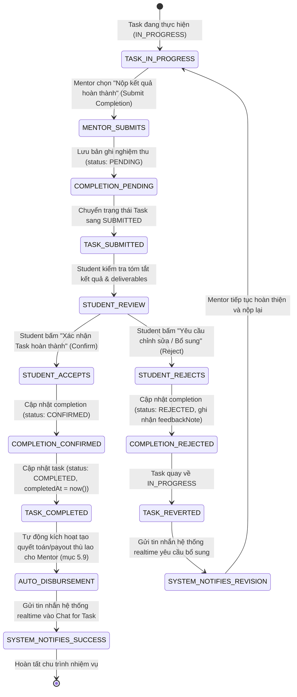
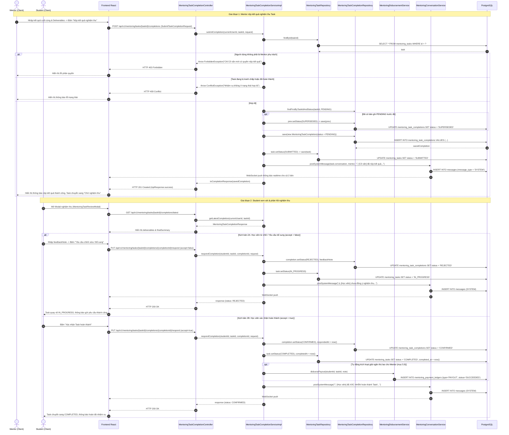

# ĐẶC TẢ YÊU CẦU & THIẾT KẾ CHI TIẾT: UC110 - GỬI & XÁC NHẬN HOÀN THÀNH TASK

## PHẦN 1: ĐẶC TẢ NGHIỆP VỤ (REPORT 3)

### 2.2.3 Business Workflow (Luồng nghiệp vụ)

#### Mô tả chi tiết luồng xử lý bằng chữ (Business Step Description):
* **Bước 1 - Tiền điều kiện & Kích hoạt (Task Active)**: Nhiệm vụ Mentoring Task đang ở trạng thái có thể hoàn thành (`IN_PROGRESS` hoặc `PREPARATION`), không bị khóa bởi bất kỳ khiếu nại hay tranh chấp nào (`DISPUTED`). Mentor hoàn tất các buổi hướng dẫn hoặc hoàn thiện các sản phẩm bàn giao cam kết trong Deal và chọn chức năng **"Nộp kết quả hoàn thành" (Submit Completion)**.
* **Bước 2 - Mentor nộp kết quả nghiệm thu (Submit Completion)**:
  * Mentor nhập **Mô tả kết quả cuối cùng** (`finalSummary`, tối thiểu 10 ký tự, tối đa 3000 ký tự), liệt kê các sản phẩm bàn giao (`deliverables`, tối đa 2000 ký tự) và đính kèm danh sách đường dẫn liên kết/minh chứng (`attachmentUrls`).
  * Hệ thống lưu biên bản nghiệm thu mới vào bảng `mentoring_task_completions` với trạng thái `PENDING`. Nếu trước đó có biên bản `PENDING` chưa phản hồi, hệ thống đánh dấu chuyển sang `SUPERSEDED`.
  * Trạng thái nhiệm vụ của `MentoringTask` được chuyển sang `SUBMITTED` (hiển thị trên giao diện là **Chờ nghiệm thu**).
  * Hệ thống tự động gửi tin nhắn hệ thống (SYSTEM message) và phát WebSocket realtime vào Chat for Task để thông báo cho Học viên.
* **Bước 3 - Học viên xem xét và nghiệm thu kết quả (Review & Verify)**:
  * Học viên nhận thông báo và thấy Pinned Banner nghiệm thu nổi bật trên Chat for Task cũng như nút thao tác **"Nghiệm thu Task"**.
  * Học viên mở Modal nghiệm thu (`MentoringTaskReviewModal`), kiểm tra chi tiết tóm tắt kết quả, deliverables và các liên kết đính kèm.
* **Bước 4 - Phân nhánh phản hồi của Học viên (Confirm hoặc Reject)**:
  * **Nhánh 4A - Xác nhận hoàn thành (Confirm Completion - Luồng chính thành công)**:
    * Học viên chọn **Xác nhận Task hoàn thành** (có thể kèm lời nhận xét, đánh giá `feedbackNote`).
    * Biên bản nghiệm thu được cập nhật: `status = CONFIRMED`, `responded_by = student_id`, `responded_at = now()`.
    * Trạng thái `MentoringTask` chuyển sang `COMPLETED`, ghi nhận thời điểm hoàn tất `completed_at = now()`.
    * **Tự động tạo lệnh quyết toán (Auto Disbursement)**: Hệ thống tự động gọi dịch vụ chi tiền (`MentoringDisbursementService.disbursePayout`) để giải ngân thù lao từ tổng quỹ khả dụng (gồm thanh toán ban đầu và mọi khoản top-up thành công) cho Mentor theo mục 5.9. Nhánh bình thường hoàn toàn không cần Admin duyệt thủ công.
    * *Lưu ý quy tắc nghiệp vụ*: Nhiệm vụ hoàn thành không đồng nghĩa lệnh payout ngân hàng đã hoàn tất; trạng thái quyết toán được theo dõi riêng tại Sổ quỹ (UC114). Nếu Mentor chưa cấu hình tài khoản thụ hưởng, việc nghiệm thu của Task vẫn thành công và hệ thống ghi nhận cảnh báo để đối soát sau.
    * Hệ thống gửi tin nhắn hệ thống thông báo chúc mừng hoàn thành vào Chat for Task.
  * **Nhánh 4B - Yêu cầu chỉnh sửa / Bổ sung (Reject / Request Revision - Luồng thay thế)**:
    * Học viên không đồng ý kết quả hoặc thấy còn thiếu sót, chọn **Yêu cầu chỉnh sửa / Bổ sung** và bắt buộc nhập lý do/yêu cầu cụ thể vào ô `feedbackNote`.
    * Biên bản nghiệm thu được cập nhật: `status = REJECTED`, `feedback_note = lý do`, `responded_by = student_id`, `responded_at = now()`.
    * Trạng thái Task quay trở lại `IN_PROGRESS` để Mentor tiếp tục chỉnh sửa, bổ sung công việc.
    * Hệ thống gửi tin nhắn hệ thống thông báo yêu cầu chỉnh sửa vào Chat for Task.
    * Sau khi hoàn thiện, Mentor có quyền nộp lại kết quả mới (quay lại Bước 2).

---

### 3.2 Mentoring Tasks & Completion Management

#### 3.2.1 Gửi & xác nhận hoàn thành Task (UC110)

**Function trigger**:
* **Navigation path**: Chat for Task (`/app/mentoring/chats/:conversationId`) -> Menu hành động Task hoặc nút thao tác nhanh trên header:
  * Mentor: Nút **"Nộp hoàn thành"** mở `MentoringTaskCompletionModal`.
  * Student: Nút **"Nghiệm thu Task"** hoặc click nút **"Xem & Nghiệm thu"** trên Pinned Banner mở `MentoringTaskReviewModal`.
* **Timing Frequency**: On demand khi Mentor hoàn tất công việc bàn giao hoặc Student kiểm tra kết quả.

**Function description**:
* **Actors/Roles**: Student, Mentor (Người tham gia trực tiếp của Task).
* **Purpose**: Hoàn tất chu trình nhiệm vụ Mentoring, bàn giao sản phẩm minh bạch và tự động giải ngân thù lao cho Mentor sau khi học viên xác nhận nghiệm thu.
* **Interface**:
  * Nút "Nộp hoàn thành" (dành riêng cho Mentor khi Task đang `IN_PROGRESS` hoặc `PREPARATION`).
  * Modal nộp kết quả (`MentoringTaskCompletionModal`) hỗ trợ nhập kết quả cuối cùng, sản phẩm bàn giao, đường dẫn minh chứng.
  * Pinned Banner nghiệm thu (`MentoringTaskResolutionBanner`) hiển thị trạng thái Chờ nghiệm thu và nút thao tác nhanh.
  * Modal nghiệm thu (`MentoringTaskReviewModal`) dành cho Student để xem deliverables, duyệt hoàn thành hoặc yêu cầu sửa đổi.
  * System Message cards thông báo tự động trong luồng tin nhắn hội thoại.

**Data processing**:
* **Quyền hạn (Authorization)**:
  * Chỉ Mentor của Task mới có quyền gọi API `POST /mentoring/tasks/{taskId}/completions`.
  * Chỉ Student của Task mới có quyền gọi API `PUT /mentoring/tasks/{taskId}/completions/{completionId}/respond`.
* **Trạng thái nhiệm vụ**:
  * Khi nộp kết quả: Chuyển sang `SUBMITTED` (Chờ nghiệm thu).
  * Khi chấp nhận: Chuyển sang `COMPLETED`, lưu `completed_at`.
  * Khi từ chối: Chuyển lại về `IN_PROGRESS`.
* **Tự động giải ngân**:
  * Gọi `MentoringDisbursementService.disbursePayout` với ngân sách tổng quỹ của Task.
  * Ghi nhận giao dịch `PAYOUT` vào Sổ quỹ `mentoring_payment_ledgers`.

**Validation rules**:
* `finalSummary`: Bắt buộc, không để trống, tối thiểu 10 ký tự, tối đa 3000 ký tự.
* `deliverables`: Tối đa 2000 ký tự.
* `accept`: Bắt buộc (`true` hoặc `false`).
* `feedbackNote`: Bắt buộc khi `accept = false`, tối đa 1000 ký tự.
* Task không được nộp khi đã `COMPLETED`, `CANCELLED` hoặc `DISPUTED`.
* Biên bản nghiệm thu phải ở trạng thái `PENDING` mới được phép phản hồi.

**Output/Response format**:
* JSON format chuẩn `ResponseEntity<ApiResponse<MentoringTaskCompletionResponse>>` (với `error = 0` khi thành công, `error = -1` hoặc mã HTTP lỗi khi thất bại).

---

## PHẦN 2: THIẾT KẾ KỸ THUẬT (TECHNICAL DESIGN)

### 4.1 Class Diagram

```mermaid
classDiagram
    direction TB

    class MentoringTaskCompletionController {
        -MentoringTaskCompletionService completionService
        -UserRepository userRepository
        +submitCompletion(Long taskId, SubmitTaskCompletionRequest request) ResponseEntity
        +respondCompletion(Long taskId, Long completionId, RespondTaskCompletionRequest request) ResponseEntity
        +getLatestCompletion(Long taskId) ResponseEntity
        +getCompletionHistory(Long taskId) ResponseEntity
    }

    class MentoringTaskCompletionService {
        <<interface>>
        +submitCompletion(Long currentUserId, Long taskId, SubmitTaskCompletionRequest request) MentoringTaskCompletionResponse
        +respondCompletion(Long currentUserId, Long taskId, Long completionId, RespondTaskCompletionRequest request) MentoringTaskCompletionResponse
        +getLatestCompletion(Long currentUserId, Long taskId) MentoringTaskCompletionResponse
        +getCompletionHistory(Long currentUserId, Long taskId) List~MentoringTaskCompletionResponse~
    }

    class MentoringTaskCompletionServiceImpl {
        -MentoringTaskRepository taskRepository
        -MentoringTaskCompletionRepository completionRepository
        -UserRepository userRepository
        -MentoringConversationService mentoringConversationService
        -MentoringDisbursementService disbursementService
        +submitCompletion(Long currentUserId, Long taskId, SubmitTaskCompletionRequest request) MentoringTaskCompletionResponse
        +respondCompletion(Long currentUserId, Long taskId, Long completionId, RespondTaskCompletionRequest request) MentoringTaskCompletionResponse
        +getLatestCompletion(Long currentUserId, Long taskId) MentoringTaskCompletionResponse
        +getCompletionHistory(Long currentUserId, Long taskId) List~MentoringTaskCompletionResponse~
    }

    class MentoringTaskCompletionRepository {
        <<interface>>
        +findByTaskIdOrderByCreatedAtDesc(Long taskId) List~MentoringTaskCompletion~
        +findFirstByTaskIdOrderByCreatedAtDesc(Long taskId) Optional~MentoringTaskCompletion~
        +findFirstByTaskIdAndStatusOrderByCreatedAtDesc(Long taskId, MentoringCompletionStatus status) Optional~MentoringTaskCompletion~
    }

    class MentoringTaskCompletion {
        -Long id
        -MentoringTask task
        -Conversation conversation
        -User submittedBy
        -String finalSummary
        -String deliverables
        -String attachmentUrls
        -MentoringCompletionStatus status
        -User respondedBy
        -Instant respondedAt
        -String feedbackNote
        -Instant createdAt
        -Instant updatedAt
    }

    class MentoringCompletionStatus {
        <<enumeration>>
        PENDING
        CONFIRMED
        REJECTED
        SUPERSEDED
    }

    class MentoringDisbursementService {
        <<interface>>
        +disbursePayout(Long currentUserId, Long taskId, String note) MentoringPaymentLedger
        +disburseRefund(Long currentUserId, Long requestId, String reason) MentoringPaymentLedger
    }

    MentoringTaskCompletionController --> MentoringTaskCompletionService
    MentoringTaskCompletionServiceImpl ..|> MentoringTaskCompletionService
    MentoringTaskCompletionServiceImpl --> MentoringTaskCompletionRepository
    MentoringTaskCompletionServiceImpl --> MentoringDisbursementService
    MentoringTaskCompletion --> MentoringCompletionStatus
```

---

### 4.2 Sequence Diagram

#### Mô tả chi tiết các bước trong Sequence Diagram bằng chữ:
1. **Mentor kích hoạt nộp kết quả**: Mentor điền tóm tắt công việc `finalSummary`, liệt kê `deliverables` và gửi `POST /mentoring/tasks/{taskId}/completions`.
2. **Kiểm tra nghiệp vụ**: Controller ủy quyền cho `MentoringTaskCompletionServiceImpl`. Service kiểm tra người gọi phải là Mentor của Task, kiểm tra Task đang ở trạng thái cho phép nộp (`IN_PROGRESS`). Nếu vi phạm ném `ForbiddenException` hoặc `ConflictException`.
3. **Lưu biên bản & Chuyển trạng thái**: Bản ghi nghiệm thu mới được lưu với trạng thái `PENDING`. Bản ghi `PENDING` cũ được cập nhật thành `SUPERSEDED`. Task được cập nhật sang trạng thái `SUBMITTED`.
4. **Thông báo realtime**: Service gọi `MentoringConversationService.postSystemMessage` để lưu tin nhắn hệ thống vào database và phát WebSocket realtime tới phòng Chat for Task.
5. **Học viên mở Modal nghiệm thu**: Student truy vấn chi tiết kết quả qua `GET /mentoring/tasks/{taskId}/completions/latest`.
6. **Xử lý rẽ nhánh phản hồi**:
   * **Nhánh từ chối (2A)**: Student gửi `accept = false` kèm `feedbackNote`. Bản ghi nghiệm thu chuyển sang `REJECTED`, Task quay về `IN_PROGRESS` để Mentor tiếp tục làm và nộp lại.
   * **Nhánh chấp nhận (2B)**: Student gửi `accept = true`. Bản ghi chuyển sang `CONFIRMED`, Task chuyển sang `COMPLETED` kèm `completed_at = now()`. Hệ thống tự động kích hoạt `disbursePayout` để tạo lệnh quyết toán thù lao cho Mentor trong Sổ quỹ giao dịch (UC105 & UC114). Tin nhắn hệ thống chúc mừng được phát realtime cho cả hai bên.

---

### 4.3 Database Schema (Migration V26)

* **Bảng `mentoring_task_completions`**:
  * `id`: `BIGINT GENERATED ALWAYS AS IDENTITY PRIMARY KEY`
  * `task_id`: `BIGINT NOT NULL REFERENCES mentoring_tasks(id) ON DELETE CASCADE`
  * `conversation_id`: `BIGINT REFERENCES conversations(id) ON DELETE SET NULL`
  * `submitted_by`: `BIGINT NOT NULL REFERENCES users(id)`
  * `final_summary`: `TEXT NOT NULL`
  * `deliverables`: `TEXT`
  * `attachment_urls`: `TEXT`
  * `status`: `VARCHAR(30) NOT NULL CHECK (status IN ('PENDING', 'CONFIRMED', 'REJECTED', 'SUPERSEDED'))`
  * `responded_by`: `BIGINT REFERENCES users(id)`
  * `responded_at`: `TIMESTAMPTZ`
  * `feedback_note`: `TEXT`
  * `created_at`: `TIMESTAMPTZ NOT NULL DEFAULT now()`
  * `updated_at`: `TIMESTAMPTZ NOT NULL DEFAULT now()`
* **Cập nhật ràng buộc `ck_mentoring_tasks_status`**:
  * `CHECK (status IN ('PREPARATION', 'IN_PROGRESS', 'SUBMITTED', 'COMPLETED', 'CANCELLED', 'DISPUTED'))`.

---

### 4.4 Danh sách REST API Endpoints

| HTTP Method | Endpoint | Quyền truy cập | Mô tả chức năng |
| :--- | :--- | :--- | :--- |
| `POST` | `/mentoring/tasks/{taskId}/completions` | Mentor | Mentor nộp tóm tắt kết quả và deliverables (Task -> `SUBMITTED`) |
| `PUT` | `/mentoring/tasks/{taskId}/completions/{completionId}/respond` | Student | Student xác nhận hoàn thành (Task -> `COMPLETED`, auto Payout) hoặc từ chối (Task -> `IN_PROGRESS`) |
| `GET` | `/mentoring/tasks/{taskId}/completions/latest` | Student, Mentor | Lấy lần nộp kết quả nghiệm thu mới nhất của Task |
| `GET` | `/mentoring/tasks/{taskId}/completions` | Student, Mentor | Lấy lịch sử tất cả các lần nộp nghiệm thu của Task |

---

## PHẦN 3: KIỂM TRA SỰ NHẤT QUÁN (CONSISTENCY CHECK)

* **Khớp mã nguồn Backend**:
  * Entity `MentoringTaskCompletion.java` và Enum `MentoringCompletionStatus.java` khớp 100% với DDL bảng `mentoring_task_completions`.
  * `MentoringTaskCompletionServiceImpl.java` cài đặt đầy đủ các luồng kiểm tra nghiệp vụ, phân nhánh confirm/reject, tự động tạo Payout thù lao qua `MentoringDisbursementService`, và gửi tin nhắn realtime qua `MentoringConversationService`.
  * Endpoint URL và tham số đầu vào/đầu ra trong `MentoringTaskCompletionController.java` hoàn toàn đồng bộ với đặc tả API.
* **Khớp mã nguồn Frontend**:
  * Các types trong `mentoringTaskTypes.ts` và API trong `mentoringTaskApi.ts` khớp chính xác với backend DTOs.
  * Các component UI `MentoringTaskCompletionModal.tsx`, `MentoringTaskReviewModal.tsx`, `MentoringTaskResolutionBanner.tsx` tuân thủ nghiêm ngặt hệ thống thiết kế Pastel Premium và xử lý tương tác mượt mà.
  * Kiểm thử biên dịch Backend (`./mvnw compile -DskipTests`) và Frontend (`npm run build`) đều thành công 100%.
