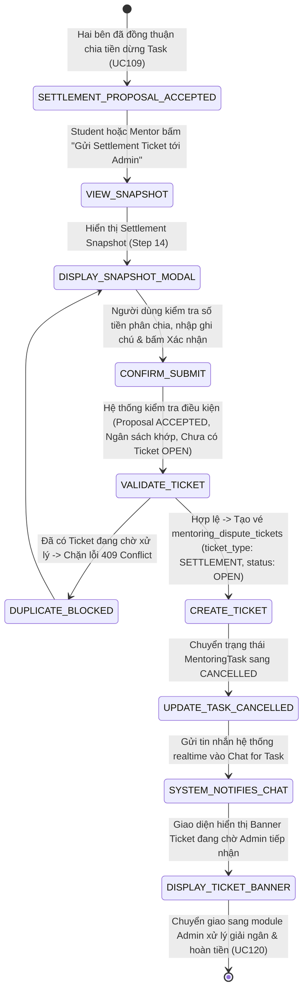

# ĐẶC TẢ YÊU CẦU & THIẾT KẾ CHI TIẾT: UC111 - GỬI SETTLEMENT TICKET ĐÃ THỎA THUẬN

## PHẦN 1: ĐẶC TẢ NGHIỆP VỤ (REPORT 3)

### 2.2.3 Business Workflow (Luồng nghiệp vụ)



#### Mô tả chi tiết luồng xử lý bằng chữ (Business Step Description):
* **Bước 1 - Tiền điều kiện (Settlement Proposal Accepted)**: Trước đó, Student hoặc Mentor đã tạo đề xuất thỏa thuận dừng Task và phân chia tiền (`MentoringTaskSettlementProposal`), và bên còn lại đã bấm đồng ý chấp thuận (trạng thái đề xuất là `ACCEPTED` theo nghiệp vụ UC109).
* **Bước 2 - Kích hoạt gửi Ticket (Trigger Submission)**:
  * Trên giao diện Chat for Task hoặc màn hình chi tiết Task, hệ thống hiển thị Pinned Banner màu tím nổi bật: *"Thỏa thuận dừng Task đã được hai bên đồng thuận! Đề xuất phân chia: Mentor nhận Xđ • Học viên hoàn lại Yđ."* kèm nút hành động **"Gửi Settlement Ticket tới Admin"**.
  * Cả Student hoặc Mentor tham gia Task đều có quyền chủ động bấm nút này.
* **Bước 3 - Xem Settlement Snapshot trước khi gửi (Review Snapshot - Step 14)**:
  * Hệ thống mở Modal `MentoringSubmitSettlementTicketModal`, gọi API `GET /mentoring/tasks/{taskId}/settlement-snapshot`.
  * Snapshot hiển thị đầy đủ và minh bạch:
    * Tiêu đề và tổng ngân sách nhiệm vụ (`totalBudget`).
    * Số tiền Mentor được nhận và tỷ lệ % phân chia trực quan qua thanh tiến độ.
    * Số tiền Học viên được hoàn lại và tỷ lệ % hoàn lại.
    * Lý do dừng Task hai bên đã thống nhất.
    * Thời gian chốt thỏa thuận và người đề xuất ban đầu.
    * Ô nhập **Ghi chú thêm gửi Ban Quản Trị** (Tùy chọn, tối đa 1000 ký tự) để người gửi bổ sung thông tin số tài khoản hoặc lời nhắn cho BQT.
    * Hộp cảnh báo quan trọng: Khi gửi Ticket, Task sẽ chuyển sang trạng thái dừng (`CANCELLED`), dừng mọi hoạt động trao đổi nghiệp vụ để chờ BQT đối soát và chi tiền.
* **Bước 4 - Xác nhận gửi Ticket lên Ban Quản Trị (Submit Ticket)**:
  * Người dùng bấm **"Xác nhận gửi Ticket tới Admin"**.
  * Client gửi request `POST /mentoring/tasks/{taskId}/settlement-tickets` chứa `proposalId` và `note`.
  * Backend kiểm tra tính hợp lệ nghiệp vụ:
    1. Người gửi phải là Student hoặc Mentor của Task (nếu không -> 403 Forbidden).
    2. Đề xuất phân chia tiền tương ứng phải tồn tại và có `status == ACCEPTED` (nếu không -> 400 Bad Request).
    3. Tổng số tiền chia phải khớp 100% với ngân sách (`mentorAmount + studentRefund == totalAmount`).
    4. Task không được phép có bất kỳ Ticket nào đang ở trạng thái chờ tiếp nhận hoặc đang xử lý (`OPEN` hoặc `IN_REVIEW`) nhằm đảm bảo tính toàn vẹn (idempotency, chống gửi trùng lặp -> 409 Conflict).
* **Bước 5 - Lưu trữ và chuyển trạng thái nhiệm vụ (Persist & Stop Task)**:
  * Hệ thống sinh mã vé tự động theo định dạng chuẩn: `ST-YYYYMMDD-XXXX` (ví dụ: `ST-20261013-266328`).
  * Lưu bản ghi mới vào bảng `mentoring_dispute_tickets` với `ticket_type = 'SETTLEMENT'`, `status = 'OPEN'`, ghi nhận đầy đủ `student_id`, `mentor_id`, `mentor_amount`, `student_refund`, `total_amount`, `created_by`.
  * Cập nhật trạng thái `MentoringTask` sang `CANCELLED` (dừng nhiệm vụ).
* **Bước 6 - Thông báo realtime và đồng bộ giao diện**:
  * Hệ thống tự động tạo tin nhắn loại `SYSTEM` và bắn qua kênh WebSocket của cuộc trò chuyện Chat for Task:
    * *"Hệ thống đã ghi nhận Settlement Ticket [Mã vé] gửi tới Ban Quản Trị theo thỏa thuận dừng Task. Nhiệm vụ chuyển sang trạng thái CANCELLED. Ban Quản Trị sẽ tiến hành đối soát và thực hiện giải ngân/hoàn tiền."*
  * Cập nhật giao diện: Pinned Banner chuyển sang hiển thị thẻ thông tin Ticket đang mở (`Ticket #ST-... - Đang chờ Admin tiếp nhận`), ẩn các nút thao tác thỏa thuận/nghiệm thu cũ.

---

### 3.2 Mentoring Tasks & Dispute/Settlement Management

#### 3.2.2 Gửi Settlement Ticket đã thỏa thuận lên Admin (UC111)

**Function trigger**:
* **Navigation path**: Chat for Task (`/app/mentoring/chats/:conversationId`) -> Pinned Banner màu tím hoặc Menu thao tác Task -> Chọn **"Gửi Settlement Ticket (UC111)"**.
* **Timing Frequency**: On demand, chỉ khả dụng khi Task có Settlement Proposal ở trạng thái `ACCEPTED` và chưa có vé Ticket nào đang mở.

**Function description**:
* **Actors/Roles**: Student, Mentor (Người tham gia trực tiếp của Task).
* **Purpose**: Chính thức bàn giao kết quả thỏa thuận dừng Task tự nguyện giữa hai bên lên Ban Quản Trị để Admin tiến hành đối soát số dư và thực hiện lệnh giải ngân/hoàn tiền tương ứng ở UC120.

**Preconditions**:
* Mentoring Task đang tồn tại trong hệ thống.
* Đã có bản ghi `MentoringTaskSettlementProposal` ở trạng thái `ACCEPTED`.
* Nhiệm vụ chưa có Ticket đang ở trạng thái `OPEN` hoặc `IN_REVIEW`.

**Postconditions**:
* Bản ghi `mentoring_dispute_tickets` được khởi tạo thành công với `ticket_type = 'SETTLEMENT'` và `status = 'OPEN'`.
* Nhiệm vụ `MentoringTask` chuyển sang trạng thái `CANCELLED`.
* Cờ `canSubmitSettlementTicket` đổi thành `false`, `activeTicket` chứa thông tin Ticket mới.
* Tin nhắn hệ thống thông báo realtime được gửi vào Chat for Task.

---

## PHẦN 2: THIẾT KẾ KỸ THUẬT & API (REPORT 4)

### 1. Database Schema Migration (Flyway V27)

Tạo bảng `mentoring_dispute_tickets` thống nhất cho cả Settlement Ticket (UC111) và Dispute Ticket (UC112):

```sql
CREATE TABLE IF NOT EXISTS mentoring_dispute_tickets (
    id BIGSERIAL PRIMARY KEY,
    ticket_code VARCHAR(50) NOT NULL UNIQUE,
    ticket_type VARCHAR(30) NOT NULL,              -- SETTLEMENT, DISPUTE
    task_id BIGINT NOT NULL,
    conversation_id BIGINT,
    settlement_proposal_id BIGINT,
    created_by BIGINT NOT NULL,
    student_id BIGINT NOT NULL,
    mentor_id BIGINT NOT NULL,
    title VARCHAR(255) NOT NULL,
    description TEXT,
    mentor_amount NUMERIC(12, 2) DEFAULT 0,
    student_refund NUMERIC(12, 2) DEFAULT 0,
    total_amount NUMERIC(12, 2) DEFAULT 0,
    status VARCHAR(30) NOT NULL DEFAULT 'OPEN',     -- OPEN, IN_REVIEW, RESOLVED, REJECTED, CANCELLED
    handled_by BIGINT,
    accepted_at TIMESTAMP WITH TIME ZONE,
    resolved_at TIMESTAMP WITH TIME ZONE,
    resolution_note TEXT,
    created_at TIMESTAMP WITH TIME ZONE NOT NULL DEFAULT CURRENT_TIMESTAMP,
    updated_at TIMESTAMP WITH TIME ZONE NOT NULL DEFAULT CURRENT_TIMESTAMP,

    CONSTRAINT fk_dispute_tickets_task FOREIGN KEY (task_id) REFERENCES mentoring_tasks(id) ON DELETE CASCADE,
    CONSTRAINT fk_dispute_tickets_proposal FOREIGN KEY (settlement_proposal_id) REFERENCES mentoring_task_settlement_proposals(id) ON DELETE SET NULL,
    CONSTRAINT fk_dispute_tickets_created_by FOREIGN KEY (created_by) REFERENCES users(id) ON DELETE RESTRICT,
    CONSTRAINT fk_dispute_tickets_student FOREIGN KEY (student_id) REFERENCES users(id) ON DELETE RESTRICT,
    CONSTRAINT fk_dispute_tickets_mentor FOREIGN KEY (mentor_id) REFERENCES users(id) ON DELETE RESTRICT,
    CONSTRAINT fk_dispute_tickets_handled_by FOREIGN KEY (handled_by) REFERENCES users(id) ON DELETE SET NULL
);

CREATE INDEX IF NOT EXISTS idx_mentoring_dispute_tickets_task ON mentoring_dispute_tickets(task_id);
CREATE INDEX IF NOT EXISTS idx_mentoring_dispute_tickets_status ON mentoring_dispute_tickets(status);
CREATE INDEX IF NOT EXISTS idx_mentoring_dispute_tickets_type ON mentoring_dispute_tickets(ticket_type);
```

### 2. Danh sách API Endpoints (RESTful)

| Phương thức | Đường dẫn API | Actor | Mô tả | Mã phản hồi |
|---|---|---|---|---|
| `GET` | `/api/v1/mentoring/tasks/{taskId}/settlement-snapshot` | Student, Mentor | Lấy biên bản Settlement Snapshot chốt thỏa thuận (Step 14) | `200 OK`, `400 Bad Request`, `403 Forbidden` |
| `POST` | `/api/v1/mentoring/tasks/{taskId}/settlement-tickets` | Student, Mentor | Gửi Settlement Ticket đã thỏa thuận lên Ban Quản Trị | `201 Created`, `400 Bad Request`, `403 Forbidden`, `409 Conflict` |
| `GET` | `/api/v1/mentoring/tasks/{taskId}/tickets/active` | Student, Mentor, Admin | Lấy Ticket đang mở hoặc đang xử lý của Task | `200 OK` (hoặc data null) |
| `GET` | `/api/v1/mentoring/tasks/{taskId}/tickets` | Student, Mentor, Admin | Lấy danh sách toàn bộ Ticket của Task | `200 OK` |

#### Payload mẫu gửi Ticket (`POST /mentoring/tasks/{taskId}/settlement-tickets`):
```json
{
  "proposalId": 1,
  "note": "Hai bên đã thống nhất dừng Task tại buổi 3, đề nghị Admin giải ngân 12.000đ cho Mentor và hoàn 8.000đ cho Học viên."
}
```

#### Phản hồi thành công mẫu (`201 Created`):
```json
{
  "error": 0,
  "message": "Gửi Settlement Ticket lên Ban Quản Trị thành công",
  "data": {
    "id": 1,
    "ticketCode": "ST-20261013-266328",
    "ticketType": "SETTLEMENT",
    "taskId": 1,
    "taskTitle": "Dự án Capstone Project - Định hướng thiết kế & triển khai",
    "conversationId": 13,
    "settlementProposalId": 1,
    "title": "Thỏa thuận dừng Task #1 - Yêu cầu giải ngân & hoàn tiền",
    "description": "Hai bên đã hoàn thành 60% khối lượng công việc, thống nhất dừng để sang đồ án khác.\n\n[Ghi chú thêm gửi Admin]: Hai bên đã thống nhất tại phòng Chat for Task. Đề nghị BQT giải ngân theo tỷ lệ đã chốt.",
    "mentorAmount": 12000,
    "studentRefund": 8000,
    "totalAmount": 20000,
    "status": "OPEN",
    "handledBy": null,
    "acceptedAt": null,
    "resolvedAt": null,
    "resolutionNote": null,
    "createdAt": "2026-10-13T23:39:15.691408703Z",
    "updatedAt": "2026-10-13T23:39:15.691411079Z"
  }
}
```

---

### 3. Quy tắc kiểm thử tự động (Test Cases & Results)

1. **Snapshot khi chưa có đề xuất accepted**: Trả về lỗi 400 Bad Request thông báo chưa có thỏa thuận nào được đồng thuận.
2. **Snapshot khi đã có đề xuất accepted**: Trả về 200 OK với đầy đủ `mentorAmount`, `studentRefund`, `totalAmount`, `reason`, `agreedAt`.
3. **Phân quyền người gửi**: Tài khoản không thuộc Task bị từ chối ngay với `403 Forbidden`.
4. **Tạo Ticket thành công**: Sinh mã `ST-YYYYMMDD-XXXX`, `ticket_type = 'SETTLEMENT'`, `status = 'OPEN'`.
5. **Chuyển trạng thái Task**: `MentoringTask.status` chuyển thành `CANCELLED`.
6. **Ngăn chặn trùng lặp**: Gửi lại ticket khi đã có vé `OPEN` bị chặn với `409 Conflict`.
7. **Truy vấn Active Ticket**: Trả về chính xác thông tin Ticket vừa tạo.
