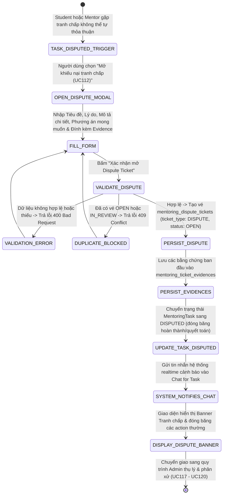

# ĐẶC TẢ YÊU CẦU & THIẾT KẾ CHI TIẾT: UC112 - TẠO DISPUTE TICKET

## PHẦN 1: ĐẶC TẢ NGHIỆP VỤ (REPORT 3)

### 2.2.3 Business Workflow (Luồng nghiệp vụ)



#### Mô tả chi tiết luồng xử lý bằng chữ (Business Step Description):
* **Bước 1 - Tiền điều kiện (Preconditions)**: Nhiệm vụ Mentoring Task đang tồn tại trong hệ thống, chưa ở trạng thái hoàn thành (`COMPLETED`). Student và Mentor phát sinh bất đồng trong quá trình thực hiện (ví dụ: Mentor không bàn giao deliverable, trễ hạn không lý do, sản phẩm không đạt chuẩn, hoặc hai bên không thể tự thống nhất số tiền phân chia ở UC109).
* **Bước 2 - Kích hoạt tạo khiếu nại (Trigger Create Dispute)**:
  * Người dùng (Student hoặc Mentor) mở menu hành động của Task trên Chat for Task (`/app/mentoring/chats/:conversationId`) hoặc màn hình quản lý Task và chọn **"Mở khiếu nại tranh chấp (UC112)"**.
* **Bước 3 - Nhập thông tin khiếu nại & bằng chứng ban đầu (Form Input & Evidence)**:
  * Hệ thống mở Modal `MentoringCreateDisputeModal`.
  * Người khiếu nại điền các thông tin:
    * **Tiêu đề khiếu nại** (`title`, bắt buộc, tối đa 255 ký tự).
    * **Lý do tranh chấp** (`disputeReason`, bắt buộc): Chọn từ danh mục chuẩn (*Sản phẩm không đạt chất lượng / Không đúng cam kết*, *Trễ hạn bàn giao nghiêm trọng*, *Không phản hồi liên lạc kéo dài*, *Bất đồng về phân chia tiền dừng Task*, hoặc lý do khác).
    * **Mô tả chi tiết vấn đề phát sinh** (`description`, bắt buộc, tối thiểu 10 ký tự, tối đa 3000 ký tự): Nêu rõ các mốc thời gian, nội dung thỏa thuận bị vi phạm và tiến trình xử lý đã diễn ra.
    * **Phương án mong muốn Admin phân xử** (`desiredSolution`, bắt buộc, tối đa 255 ký tự): Nêu rõ nguyện vọng cụ thể (ví dụ: *Yêu cầu hoàn trả 80% học phí*, *Yêu cầu thanh toán 100% thù lao do đã giao đủ sản phẩm*, *Yêu cầu bàn giao bản sửa lỗi trong 3 ngày*).
    * **Bằng chứng ban đầu** (`initialEvidences`, tùy chọn): Thêm một hoặc nhiều tệp/liên kết minh chứng (ảnh chụp màn hình lỗi, biên bản làm việc, tài liệu bàn giao, ...).
  * Hộp cảnh báo quan trọng: Khi gửi khiếu nại, nhiệm vụ sẽ chuyển sang trạng thái **DISPUTED**, mọi hoạt động thanh toán và nghiệm thu sẽ bị đóng băng (`ON_HOLD`) để chờ Ban Quản Trị tiếp nhận phân xử.
* **Bước 4 - Kiểm tra tính toàn vẹn và hợp lệ (Validation & Conflict Check)**:
  * Người dùng bấm **"Xác nhận mở Dispute Ticket"**.
  * Client gửi request `POST /mentoring/tasks/{taskId}/dispute-tickets`.
  * Backend kiểm tra:
    1. Người tạo phải là Student hoặc Mentor của Task (nếu không -> `403 Forbidden`).
    2. Task không ở trạng thái `COMPLETED` (nếu đã xong -> `400 Bad Request`).
    3. Task không được phép có bất kỳ Ticket nào đang ở trạng thái `OPEN` hoặc `IN_REVIEW` (chống tạo trùng lặp -> `409 Conflict`).
    4. Các trường dữ liệu bắt buộc không được để trống và tuân thủ giới hạn độ dài.
* **Bước 5 - Lưu trữ vé và bằng chứng (Persistence)**:
  * Hệ thống sinh mã vé tranh chấp duy nhất: `DP-YYYYMMDD-XXXX` (ví dụ: `DP-20261013-330760`).
  * Tạo bản ghi mới trong bảng `mentoring_dispute_tickets` với `ticket_type = 'DISPUTE'`, `status = 'OPEN'`, `total_amount = agreed_price`.
  * Lưu từng tệp bằng chứng đính kèm vào bảng `mentoring_ticket_evidences` liên kết với Ticket.
* **Bước 6 - Đóng băng nhiệm vụ và thông báo realtime**:
  * Trạng thái `MentoringTask` chuyển sang `DISPUTED`.
  * Cờ phân quyền cập nhật: `isDisputed = true`, `canCreateDisputeTicket = false`.
  * Hệ thống tự động tạo tin nhắn loại `SYSTEM` và bắn qua WebSocket vào Chat for Task:
    * *"⚠️ [HỆ THỐNG] Đã khởi tạo Khiếu nại / Tranh chấp [Mã vé] gửi tới Ban Quản Trị do [Vai trò] yêu cầu giải quyết. Lý do: [...]. Phương án mong muốn: [...]. Nhiệm vụ chính thức chuyển sang trạng thái DISPUTED. Mọi thao tác hoàn thành và quyết toán tạm thời đóng băng (ON_HOLD) để BQT tiếp nhận và phân xử."*
  * Giao diện Chat for Task hiển thị Pinned Banner màu đỏ nổi bật: `Khiếu nại tranh chấp #[Mã vé] - Đang chờ Admin tiếp nhận`.

---

### 3.2 Mentoring Tasks & Dispute Management

#### 3.2.3 Tạo Dispute Ticket (UC112)

**Function trigger**:
* **Navigation path**: Chat for Task (`/app/mentoring/chats/:conversationId`) -> Menu hành động Task -> Chọn **"Mở khiếu nại tranh chấp (UC112)"**.
* **Timing Frequency**: On demand khi phát sinh tranh chấp hoặc vi phạm cam kết không thể tự hòa giải.

**Function description**:
* **Actors/Roles**: Student, Mentor (Người tham gia trực tiếp của Task).
* **Purpose**: Chính thức chuyển vụ việc lên Ban Quản Trị (Admin) can thiệp giải quyết, bảo vệ quyền lợi hợp pháp của cả hai bên theo quy chế sàn.

**Preconditions**:
* Nhiệm vụ Mentoring Task tồn tại và chưa hoàn thành (`COMPLETED`).
* Nhiệm vụ chưa có vé Dispute hoặc Settlement nào đang ở trạng thái `OPEN` hoặc `IN_REVIEW`.

**Postconditions**:
* Vé `MentoringDisputeTicket` được tạo thành công với `ticket_type = 'DISPUTE'` và `status = 'OPEN'`.
* Các tệp bằng chứng được lưu trữ trong `mentoring_ticket_evidences`.
* Trạng thái Task chuyển sang `DISPUTED`.
* Tin nhắn cảnh báo hệ thống realtime được gửi vào cuộc trò chuyện.

---

## PHẦN 2: THIẾT KẾ KỸ THUẬT & API (REPORT 4)

### 1. Database Schema Migration (Flyway V28)

Bổ sung các cột thông tin tranh chấp và bảng bằng chứng `mentoring_ticket_evidences`:

```sql
-- 1. Bổ sung các cột thông tin tranh chấp cho mentoring_dispute_tickets
ALTER TABLE mentoring_dispute_tickets
    ADD COLUMN IF NOT EXISTS dispute_reason VARCHAR(255),
    ADD COLUMN IF NOT EXISTS desired_solution VARCHAR(255);

-- 2. Bảng mentoring_ticket_evidences (Bằng chứng tranh chấp)
CREATE TABLE IF NOT EXISTS mentoring_ticket_evidences (
    id                      BIGINT GENERATED ALWAYS AS IDENTITY PRIMARY KEY,
    ticket_id               BIGINT NOT NULL,
    uploaded_by             BIGINT NOT NULL,
    title                   VARCHAR(255),
    description             TEXT,
    file_url                VARCHAR(1000) NOT NULL,
    file_name               VARCHAR(255),
    file_size               BIGINT,
    file_type               VARCHAR(50),
    created_at              TIMESTAMPTZ NOT NULL DEFAULT now(),
    CONSTRAINT fk_ticket_evidences_ticket FOREIGN KEY (ticket_id) REFERENCES mentoring_dispute_tickets(id) ON DELETE CASCADE,
    CONSTRAINT fk_ticket_evidences_user FOREIGN KEY (uploaded_by) REFERENCES users(id) ON DELETE RESTRICT
);

CREATE INDEX IF NOT EXISTS idx_ticket_evidences_ticket_id ON mentoring_ticket_evidences(ticket_id);
CREATE INDEX IF NOT EXISTS idx_ticket_evidences_uploaded_by ON mentoring_ticket_evidences(uploaded_by);
```

### 2. Danh sách API Endpoints (RESTful)

| Phương thức | Đường dẫn API | Actor | Mô tả | Mã phản hồi |
|---|---|---|---|---|
| `POST` | `/api/v1/mentoring/tasks/{taskId}/dispute-tickets` | Student, Mentor | Tạo Dispute Ticket khiếu nại tranh chấp gửi Admin | `201 Created`, `400 Bad Request`, `403 Forbidden`, `409 Conflict` |
| `GET` | `/api/v1/mentoring/tasks/tickets/{ticketId}/evidences` | Student, Mentor, Admin | Lấy danh sách bằng chứng tranh chấp của Ticket | `200 OK`, `403 Forbidden`, `404 Not Found` |

#### Payload mẫu tạo Dispute Ticket (`POST /mentoring/tasks/{taskId}/dispute-tickets`):
```json
{
  "title": "Khiếu nại Mentor không bàn giao source code đúng cam kết Deal",
  "disputeReason": "SUBSTANDARD_DELIVERABLE",
  "description": "Mentor đã trễ hạn 5 ngày và chỉ gửi file nháp chưa chạy được, không đúng theo cam kết ban đầu.",
  "desiredSolution": "Hoàn lại 80% học phí hoặc yêu cầu hoàn thiện bản chạy được trong 3 ngày.",
  "initialEvidences": [
    {
      "title": "Ảnh chụp màn hình lỗi khi chạy code",
      "description": "Lỗi 500 khi khởi động Spring Boot do thiếu cấu hình database",
      "fileUrl": "https://alumnect-storage.s3.amazonaws.com/evidence/error_screenshot.png",
      "fileName": "error_screenshot.png",
      "fileSize": 245000,
      "fileType": "image/png"
    }
  ]
}
```

#### Phản hồi thành công mẫu (`201 Created`):
```json
{
  "error": 0,
  "message": "Tạo Dispute Ticket khiếu nại thành công",
  "data": {
    "id": 2,
    "ticketCode": "DP-20261013-330760",
    "ticketType": "DISPUTE",
    "taskId": 1,
    "taskTitle": "Dự án Capstone Project - Định hướng thiết kế & triển khai",
    "status": "OPEN",
    "disputeReason": "SUBSTANDARD_DELIVERABLE",
    "desiredSolution": "Hoàn lại 80% học phí hoặc yêu cầu hoàn thiện bản chạy được trong 3 ngày.",
    "evidences": [
      {
        "id": 1,
        "ticketId": 2,
        "title": "Ảnh chụp màn hình lỗi khi chạy code",
        "fileUrl": "https://alumnect-storage.s3.amazonaws.com/evidence/error_screenshot.png"
      }
    ],
    "createdAt": "2026-10-13T23:51:57.123Z"
  }
}
```

---

### 3. Quy tắc kiểm thử tự động (Test Cases & Results)

1. **Phân quyền người tạo**: Chỉ Student hoặc Mentor tham gia Task mới có quyền mở Dispute Ticket (người ngoài nhận `403 Forbidden`).
2. **Kiểm tra dữ liệu đầu vào**: Thiếu tiêu đề, lý do hoặc mô tả dưới 10 ký tự bị chặn với `400 Bad Request`.
3. **Tạo Dispute Ticket thành công**: Sinh mã `DP-YYYYMMDD-XXXX`, `ticket_type = 'DISPUTE'`, `status = 'OPEN'`.
4. **Lưu trữ bằng chứng (Evidences)**: Tự động lưu các bằng chứng ban đầu vào bảng `mentoring_ticket_evidences`.
5. **Chuyển trạng thái Task**: `MentoringTask.status` chuyển thành `DISPUTED`.
6. **Chống trùng lặp**: Tạo lại khi đã có vé đang mở nhận `409 Conflict`.
7. **Truy vấn danh sách bằng chứng**: `GET /mentoring/tasks/tickets/{ticketId}/evidences` trả về đầy đủ các file đã đính kèm.
