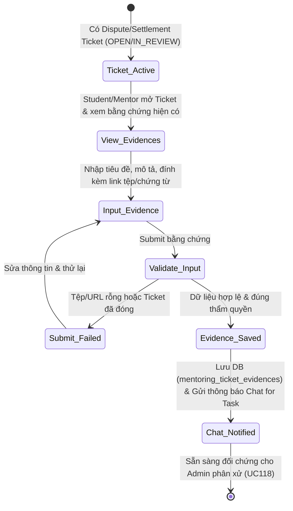
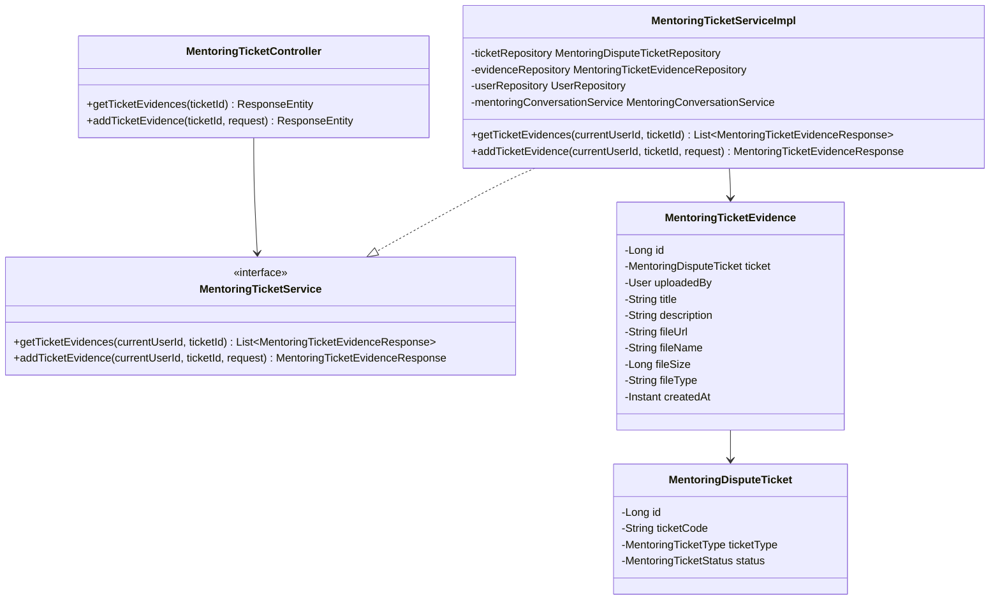

# ĐẶC TẢ YÊU CẦU & THIẾT KẾ CHI TIẾT: UC113 - GỬI BẰNG CHỨNG TRANH CHẤP

## PHẦN 1: ĐẶC TẢ NGHIỆP VỤ (REPORT 3)

### 2.2.3 Business Workflow (Luồng nghiệp vụ)



#### Mô tả chi tiết luồng xử lý bằng chữ (Business Step Description):
* **Bước 1 - Khởi đầu (Trigger & Tiền điều kiện)**: Khi Task đang có vé khiếu nại tranh chấp (Dispute Ticket) hoặc Settlement Ticket ở trạng thái `OPEN` hoặc `IN_REVIEW`. Cả hai bên tham gia (Student và Mentor) đều có quyền mở giao diện Ticket để kiểm tra tình trạng và hồ sơ tài liệu chứng từ.
* **Bước 2 - Xem danh sách bằng chứng hiện có**: Hệ thống hiển thị toàn bộ bằng chứng đã được các bên tải lên trước đó, bao gồm thông tin người gửi (Họ tên, Vai trò), tiêu đề chứng từ, mô tả nội dung, đường link tải/xem tài liệu và thời điểm nộp.
* **Bước 3 - Nhập và nộp bằng chứng mới**: Người dùng nhập tiêu đề chứng từ (bắt buộc), mô tả giải thích ý nghĩa chứng từ, đường dẫn tệp URL (bắt buộc) và tên tệp hiển thị.
* **Bước 4 - Xác thực và lưu trữ**:
  * Hệ thống kiểm tra quyền: Chỉ Student hoặc Mentor của Task mới được nộp (từ chối 403 Forbidden nếu người ngoài).
  * Kiểm tra trạng thái Ticket: Chỉ cho phép bổ sung khi Ticket ở trạng thái `OPEN` hoặc `IN_REVIEW`. Nếu Ticket đã `RESOLVED`, `CLOSED`, hoặc `REJECTED`, từ chối (400 Bad Request).
  * Lưu bản ghi mới vào bảng `mentoring_ticket_evidences` với khóa ngoại trỏ tới Ticket và người tải lên.
* **Bước 5 - Thông báo hệ thống realtime**: Hệ thống phát tin nhắn tự động vào Chat for Task để thông báo cho đối phương và lưu lại biên bản đối chứng cho Ban Quản Trị tiếp nhận (UC118).

---

### 3.2 Module Mentorship (Hướng Dẫn & Cố Vấn)

Module Mentorship quản lý toàn bộ vòng đời hợp đồng hướng dẫn giữa Cựu sinh viên (Mentor) và Sinh viên (Student), bao gồm thỏa thuận Deal, quản lý tiến độ Task, Work Log nghiệm thu và cơ chế trọng tài giải quyết khiếu nại tranh chấp.

#### 3.2.1 Chức năng Gửi bằng chứng tranh chấp (UC113 - Submit Dispute Evidence)

**Function trigger**:
* **Navigation path**: Trang Chi tiết Mentoring Task (`/mentoring/tasks/:taskId`) -> Banner Khiếu nại tranh chấp (DISPUTE / SETTLEMENT Banner) -> Nút **"Bằng chứng tranh chấp"** HOẶC Menu Thao tác Task -> Chọn **"Bằng chứng tranh chấp (UC113)"**.
* **Timing Frequency**: On demand (bất cứ khi nào hai bên có tài liệu, ảnh chụp màn hình, logs hoặc chứng từ cần đối chứng trong thời gian Ticket đang mở).

**Function description**:
* **Actors/Roles**: Student (Học viên tham gia Task), Mentor (Cố vấn phụ trách Task).
* **Purpose**: Cho phép hai bên bổ sung các bằng chứng cụ thể (ảnh chụp màn hình thỏa thuận chat, bản ghi deliverable, logs commit mã nguồn, biên bản họp online...) phục vụ Ban Quản Trị (Admin) đối chiếu và phân xử công bằng, minh bạch.
* **Interface**:
  * **Ticket Information Summary**: Mã Ticket (`ticketCode`), Trạng thái (`status`), Tiêu đề và Lý do tranh chấp (`disputeReason`).
  * **Evidence List**: Danh sách tài liệu/ảnh đã tải lên, kèm người nộp, huy hiệu vai trò (Student / Mentor), thời gian tải lên và nút xem tệp đính kèm.
  * **Add Evidence Form**:
    * Trường Tiêu đề bằng chứng (`title` - bắt buộc).
    * Trường Mô tả nội dung (`description` - tùy chọn).
    * Trường URL tệp tài liệu (`fileUrl` - bắt buộc, hỗ trợ định dạng URL hợp lệ).
    * Trường Tên tệp hiển thị (`fileName` - tùy chọn).
    * Nút **"Nộp bằng chứng"** kèm hiệu ứng tải (`Loader2`).

**Data processing**:
1. Frontend gửi yêu cầu `POST /api/v1/mentoring/tasks/tickets/{ticketId}/evidences` kèm JWT Bearer Token.
2. Backend xác thực người dùng hiện tại qua SecurityContext và trích xuất `currentUserId`.
3. Kiểm tra sự tồn tại của `MentoringDisputeTicket` (`ticketId`):
   - Nếu không tìm thấy: ném `ResourceNotFoundException` (404 Not Found).
4. Kiểm tra quyền truy cập:
   - `currentUserId` phải trùng với `ticket.student.id` HOẶC `ticket.mentor.id` HOẶC `ticket.createdBy.id`. Nếu không, ném `ForbiddenException` (403 Forbidden).
5. Kiểm tra trạng thái Ticket:
   - Nếu `ticket.status` khác `OPEN` và khác `IN_REVIEW`: ném `BadRequestException` (400 Bad Request: "Ticket đã ở trạng thái {status}, không thể bổ sung thêm bằng chứng.").
6. Tạo thực thể `MentoringTicketEvidence` và lưu vào cơ sở dữ liệu (`mentoring_ticket_evidences`).
7. Gửi thông báo hệ thống realtime dạng system message vào Chat for Task (`mentoringConversationService.postSystemMessage`).
8. Trả về `MentoringTicketEvidenceResponse` (201 Created).

---

### 5. Requirement Appendix (Phụ lục Yêu cầu)

#### 5.1 Business Rules (Quy tắc Nghiệp vụ)

| ID | Định nghĩa Quy tắc (Rule Definition) |
| :--- | :--- |
| BR-EVD-01 | Chỉ có Student và Mentor thuộc Task liên quan tới Ticket mới có quyền gửi và xem bằng chứng của Ticket đó. |
| BR-EVD-02 | Bằng chứng chỉ được phép nộp bổ sung khi Ticket đang ở trạng thái `OPEN` hoặc `IN_REVIEW`. Sau khi Ticket đã được phán quyết (`RESOLVED`) hoặc hủy (`REJECTED`, `CANCELLED`), hệ thống khóa tính năng nộp bằng chứng mới. |
| BR-EVD-03 | Tiêu đề bằng chứng (`title`) và đường dẫn tệp (`fileUrl`) là thông tin bắt buộc, không được để trống hoặc chỉ chứa khoảng trắng. |
| BR-EVD-04 | Mọi hành vi nộp bằng chứng mới đều phải được lưu trữ thời gian chính xác (`createdAt` UTC) và người gửi (`uploaded_by`) để đảm bảo tính toàn vẹn và chống chối bỏ. |
| BR-EVD-05 | Khi có bằng chứng mới được nộp, hệ thống tự động ghi nhật ký hệ thống vào cuộc hội thoại Chat for Task để hai bên cùng nắm bắt thông tin. |

#### 5.2 Common Requirements (Yêu cầu Chung)
* Giao diện hỗ trợ Dark mode / Light mode mượt mà, responsive trên máy tính bảng và máy tính để bàn.
* Các liên kết tài liệu bên ngoài mở trong thẻ tab mới với thuộc tính an toàn `target="_blank" rel="noreferrer"`.
* Bắt buộc kiểm tra định dạng URL hợp lệ trước khi gửi request lên máy chủ.

#### 5.3 Application Messages List (Danh sách Thông điệp Ứng dụng)

| # | Mã thông điệp | Loại thông điệp | Ngữ cảnh | Nội dung hiển thị |
| :--- | :--- | :--- | :--- | :--- |
| 1 | MSG_EVD_01 | Toast / Modal Alert | Nộp bằng chứng thành công | Bổ sung bằng chứng tranh chấp thành công. |
| 2 | MSG_EVD_02 | Inline Error | Tiêu đề bằng chứng bị bỏ trống | Vui lòng nhập tiêu đề bằng chứng (ví dụ: Ảnh chụp màn hình trao đổi). |
| 3 | MSG_EVD_03 | Inline Error | Đường dẫn tệp rỗng hoặc sai format | Đường dẫn tệp phải là một URL hợp lệ (ví dụ: https://...). |
| 4 | MSG_EVD_04 | Modal Warning | Ticket đã đóng hoặc đã giải quyết | Ticket này đã kết thúc xử lý. Không thể gửi thêm bằng chứng mới. |
| 5 | MSG_EVD_05 | HTTP Error (403) | Người dùng không phải thành viên Task | Bạn không có quyền nộp bằng chứng cho Ticket này. |
| 6 | MSG_EVD_06 | HTTP Error (404) | Mã Ticket không tồn tại | Không tìm thấy Ticket với ID: {ticketId}. |

---

## PHẦN 2: THIẾT KẾ HỆ THỐNG & KỸ THUẬT (REPORT 4)

### 2.2 System Architecture & Class Diagram

#### Class Diagram (Backend Architecture):



---

### 2.3 API Specifications (Chi tiết API UC113)

#### API 1: Bổ sung bằng chứng tranh chấp
* **Endpoint**: `POST /api/v1/mentoring/tasks/tickets/{ticketId}/evidences`
* **Method**: `POST`
* **Quyền hạn**: Đăng nhập (Student hoặc Mentor của Task)
* **Request Header**: `Authorization: Bearer <JWT>`
* **Request Body**:
```json
{
  "title": "Ảnh chụp màn hình đối thoại qua chat",
  "description": "Chứng minh đã thống nhất gia hạn deadline trước ngày hết hạn.",
  "fileUrl": "https://storage.alumnect.vn/evidences/chat-proof-01.png",
  "fileName": "chat-proof-01.png",
  "fileSize": 1048576,
  "fileType": "image/png"
}
```
* **Response Status**: `201 Created`
* **Response Body**:
```json
{
  "success": true,
  "message": "Bổ sung bằng chứng tranh chấp thành công",
  "data": {
    "id": 5,
    "ticketId": 2,
    "uploadedBy": {
      "id": 1,
      "fullName": "HUY NHẬT",
      "email": "letrannh2000@gmail.com",
      "role": "ALUMNI",
      "avatarUrl": "https://..."
    },
    "title": "Ảnh chụp màn hình đối thoại qua chat",
    "description": "Chứng minh đã thống nhất gia hạn deadline trước ngày hết hạn.",
    "fileUrl": "https://storage.alumnect.vn/evidences/chat-proof-01.png",
    "fileName": "chat-proof-01.png",
    "fileSize": 1048576,
    "fileType": "image/png",
    "createdAt": "2026-10-14T00:11:39.192Z"
  }
}
```

#### API 2: Lấy danh sách bằng chứng của Ticket
* **Endpoint**: `GET /api/v1/mentoring/tasks/tickets/{ticketId}/evidences`
* **Method**: `GET`
* **Quyền hạn**: Đăng nhập (Student, Mentor hoặc Admin)
* **Response Status**: `200 OK`
* **Response Body**:
```json
{
  "success": true,
  "message": "Lấy danh sách bằng chứng thành công",
  "data": [
    {
      "id": 1,
      "ticketId": 2,
      "uploadedBy": { "id": 18, "fullName": "FierZone", "role": "STUDENT" },
      "title": "Ảnh chụp màn hình lỗi khi chạy code",
      "fileUrl": "https://storage.alumnect.vn/evidences/screenshot-error-01.png",
      "createdAt": "2026-10-13T23:51:57.613Z"
    },
    {
      "id": 3,
      "ticketId": 2,
      "uploadedBy": { "id": 1, "fullName": "HUY NHẬT", "role": "ALUMNI" },
      "title": "Mentor: Ảnh chụp màn hình trao đổi yêu cầu qua chat",
      "fileUrl": "https://storage.alumnect.vn/evidences/mentor-chat-screenshot.png",
      "createdAt": "2026-10-14T00:11:39.192Z"
    }
  ]
}
```

---

### 2.4 Database Schema (Cơ sở dữ liệu)

Bảng dữ liệu `mentoring_ticket_evidences` (áp dụng từ Migration Flyway V28):

```sql
CREATE TABLE mentoring_ticket_evidences (
    id BIGSERIAL PRIMARY KEY,
    ticket_id BIGINT NOT NULL,
    uploaded_by BIGINT NOT NULL,
    title VARCHAR(255) NOT NULL,
    description TEXT,
    file_url VARCHAR(1000) NOT NULL,
    file_name VARCHAR(255),
    file_size BIGINT,
    file_type VARCHAR(100),
    created_at TIMESTAMP WITH TIME ZONE NOT NULL DEFAULT CURRENT_TIMESTAMP,
    CONSTRAINT fk_ticket_evidences_ticket FOREIGN KEY (ticket_id) REFERENCES mentoring_dispute_tickets(id) ON DELETE CASCADE,
    CONSTRAINT fk_ticket_evidences_user FOREIGN KEY (uploaded_by) REFERENCES users(id) ON DELETE RESTRICT
);

CREATE INDEX idx_ticket_evidences_ticket_id ON mentoring_ticket_evidences(ticket_id);
CREATE INDEX idx_ticket_evidences_uploaded_by ON mentoring_ticket_evidences(uploaded_by);
```
