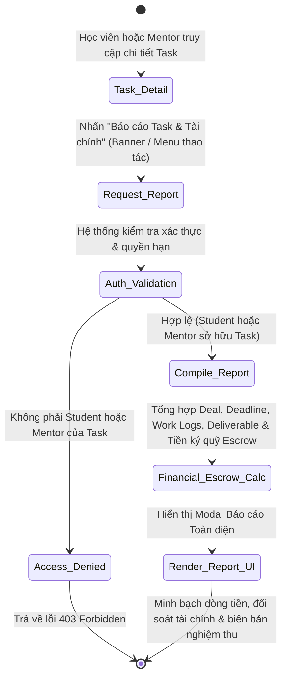
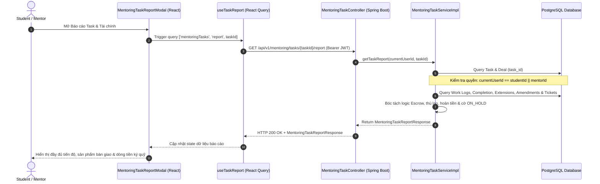

# ĐẶC TẢ YÊU CẦU & THIẾT KẾ CHI TIẾT: UC114 - XEM BÁO CÁO KẾT QUẢ TASK & TRẠNG THÁI THANH TOÁN

## PHẦN 1: ĐẶC TẢ NGHIỆP VỤ (REPORT 3)

### 2.2.3 Business Workflow (Luồng nghiệp vụ)



#### Mô tả chi tiết luồng xử lý bằng chữ (Business Step Description):
* **Bước 1 - Khởi đầu (Trigger)**: Học viên (Student) hoặc Cố vấn (Mentor) tham gia vào Mentoring Task mong muốn xem tổng kết toàn diện về tiến độ, chất lượng bàn giao, các mốc thời gian/gia hạn deadline, cũng như chi tiết dòng tiền thanh toán và ký quỹ Escrow. Thao tác được kích hoạt từ Banner trạng thái Task (hoàn thành, tranh chấp, hòa giải) hoặc Menu Thao tác tác vụ trong Chat for Task.
* **Bước 2 - Xác thực & Kiểm tra quyền hạn**:
  * Người dùng gửi yêu cầu truy xuất báo cáo Task.
  * Hệ thống kiểm tra xem người yêu cầu có đúng là Student hoặc Mentor thuộc Task tương ứng hay không.
  * Nếu là bên thứ ba hoặc người dùng lạ, hệ thống lập tức từ chối và phản hồi lỗi `403 Forbidden` nhằm bảo mật dữ liệu thỏa thuận và tài chính riêng tư.
* **Bước 3 - Tổng hợp & Tính toán dữ liệu báo cáo**:
  * **Thông tin Task & Deal**: Tiêu đề, mô tả, hình thức làm việc (`ONLINE` / `OFFLINE`), loại tác vụ, kết quả kỳ vọng.
  * **Tiến độ & Mốc thời gian**: Deadline gốc, deadline sau gia hạn, số lần gia hạn hợp lệ (`CONFIRMED`), tổng số ngày gia hạn.
  * **Nhật ký & Sản phẩm bàn giao (Deliverables - UC110)**: Tỷ lệ hoàn thành công việc (%), tổng số work logs, nội dung biên bản bàn giao cuối cùng, liên kết repo/tài liệu và phản hồi xác nhận nghiệm thu.
  * **Hồ sơ Tranh chấp / Hòa giải (Dispute / Settlement - UC111/112/113)**: Mã ticket, loại ticket, trạng thái, biên bản phân xử, phương án phân chia tiền nếu có.
  * **Bóc tách dòng tiền tài chính (Financial Breakdown)**:
    - Giá trị thỏa thuận gốc (`originalPrice`), giá trị sau các phụ lục điều chỉnh (`totalAgreedPrice`).
    - Số tiền Học viên đã thanh toán ký quỹ Escrow (`studentTotalPaid`).
    - Số tiền thù lao Mentor thực nhận (`mentorNetPayout`) và trạng thái giải ngân (`mentorPayoutStatus`: `PENDING_ESCROW`, `PROCESSING`, `PAID`, `ON_HOLD`).
    - Số tiền hoàn lại cho Học viên (`studentRefundAmount`) và trạng thái hoàn tiền (`studentRefundStatus`: `NO_REFUND`, `PROCESSING`, `REFUNDED`, `ON_HOLD`).
    - Phí nền tảng (`platformFee`: 0đ theo chính sách hỗ trợ kết nối sinh viên ĐH FPT).
* **Bước 4 - Trực quan hóa giao diện**: Frontend hiển thị `MentoringTaskReportModal` chia khối mạch lạc, có huy hiệu trạng thái sắc nét, cảnh báo rủi ro đóng băng tiền nếu Task đang bị khiếu nại tranh chấp (`DISPUTED`).

---

### 3.2 Module Mentorship (Hướng Dẫn & Cố Vấn)

Module Mentorship phụ trách toàn bộ chuỗi nghiệp vụ cố vấn học tập và phát triển đồ án/kỹ năng giữa Cựu sinh viên (Mentor) và Sinh viên (Student).

#### 3.2.1 Chức năng Xem báo cáo kết quả Task & trạng thái thanh toán (UC114)

**Function trigger**:
* **Navigation path**: Trang Chi tiết Mentoring Task (`/mentoring/tasks/:taskId`) -> Banner Task (Completed / Disputed / Settlement) -> Nút **"Báo cáo Task & Tài chính"** HOẶC Menu Thao tác Task -> Chọn **"Báo cáo Task & Tài chính (UC114)"**.
* **Timing Frequency**: Bất cứ lúc nào hai bên cần theo dõi, tra cứu hoặc đối soát dòng tiền và biên bản nghiệm thu.

**Function description**:
* **Actors/Roles**:
  * **Student**: Kiểm tra số tiền đã nộp ký quỹ, kết quả bàn giao nhận được, khoản hoàn tiền nếu có sự cố.
  * **Mentor**: Kiểm tra thù lao thực nhận, các mốc thời gian hoàn thành, tình trạng giải ngân tài khoản.
* **Purpose**: Cung cấp bức tranh tài chính và tiến độ minh bạch 100%, bảo đảm quyền lợi đôi bên và chuẩn hóa hồ sơ đối soát khi có sự cố tranh chấp.
* **Interface**:
  * **Header**: Tiêu đề Task, Mã Deal, Trạng thái Task (`IN_PROGRESS`, `SUBMITTED`, `COMPLETED`, `DISPUTED`), Thời gian bắt đầu và kết thúc.
  * **Khối Tiến độ & Bàn giao (Deliverables)**:
    - Tỷ lệ hoàn thành công việc.
    - Biên bản nghiệm thu (Deliverable Summary) kèm link source code/tài liệu và phản hồi của Student.
  * **Khối Thời hạn & Gia hạn (Deadlines & Extensions)**:
    - Deadline ban đầu vs Deadline thực tế.
    - Số lần gia hạn và tổng số ngày kéo dài thêm.
  * **Khối Tranh chấp & Hòa giải (nếu có)**:
    - Mã ticket khiếu nại, tình trạng thụ lý (`OPEN`, `IN_REVIEW`, `RESOLVED`).
    - Cảnh báo đóng băng tài khoản ký quỹ (`ON_HOLD`).
  * **Khối Đối soát Tài chính (Financial Breakdown)**:
    - Tổng tiền ký quỹ Escrow.
    - Phân chia Student: Đã thanh toán, Khoản hoàn lại, Trạng thái hoàn.
    - Phân chia Mentor: Thù lao ròng, Phí sàn (0đ), Trạng thái giải ngân.
    - Ghi chú cơ chế bảo vệ giao dịch ký quỹ của AlumNect.

**Data processing**:
1. Frontend gửi yêu cầu `GET /api/v1/mentoring/tasks/{taskId}/report` kèm JWT Bearer Token.
2. Backend xác thực `currentUserId` từ `SecurityContextHolder`.
3. Kiểm tra quyền sở hữu: Người dùng phải là `task.getStudent().getId()` hoặc `task.getMentor().getId()`. Nếu không, trả về `403 Forbidden`.
4. Tổng hợp dữ liệu từ:
   - `MentoringTask` & `MentoringDeal`.
   - `MentoringWorkLog` (lấy danh sách nhật ký và tính % tiến độ).
   - `MentoringTaskCompletion` (lấy biên bản bàn giao cuối cùng).
   - `MentoringDeadlineExtension` (đếm số lần `CONFIRMED` và tổng số ngày kéo dài).
   - `MentoringTaskAmendment` (tổng hợp phụ lục điều chỉnh chi phí).
   - `MentoringDisputeTicket` (lấy ticket khiếu nại / hòa giải đang hiệu lực).
5. Tính toán tài chính:
   - Nếu Task `DISPUTED`: Đặt `mentorPayoutStatus = ON_HOLD`, `studentRefundStatus = ON_HOLD`, cảnh báo dòng tiền đang bị phong tỏa.
   - Nếu Task có Ticket `SETTLEMENT` đã thỏa thuận: Áp dụng tỷ lệ chia tiền theo ticket (`mentorAmount` & `studentRefund`).
   - Nếu Task `COMPLETED`: Mentor nhận đủ 100% thù lao cam kết, phí sàn 0đ, trạng thái `PAID` hoặc `PROCESSING`.
   - Nếu Task `IN_PROGRESS`: Mentor ở trạng thái `PENDING_ESCROW` (chờ hoàn thành nghiệm thu).
6. Trả về `MentoringTaskReportResponse` với mã HTTP `200 OK`.

---

### 3.3.3 Business Rules (Quy tắc nghiệp vụ)

* **BR114.1 (Quyền riêng tư dữ liệu)**: Báo cáo kết quả và tài chính của Task là bảo mật. Chỉ có Student, Mentor của Task và Quản trị viên (Admin) mới có quyền truy cập. Mọi người dùng khác đều nhận mã lỗi `403 Forbidden`.
* **BR114.2 (Nguyên tắc Ký quỹ Escrow an toàn)**: Toàn bộ 100% số tiền học viên thanh toán được hệ thống AlumNect giữ trong ví ký quỹ trung gian an toàn. Tiền chỉ được giải ngân cho Mentor khi và chỉ khi:
  - Học viên đã xác nhận nghiệm thu sản phẩm bàn giao (Deliverable Confirmed - UC110), HOẶC
  - Hai bên đã ký biên bản hòa giải thành công (Settlement Accepted - UC112), HOẶC
  - Ban Quản Trị ra quyết định phân xử tranh chấp có hiệu lực (Admin Resolution - UC118).
* **BR114.3 (Phong tỏa tài chính khi có Tranh chấp)**: Khi một trong hai bên gửi đơn khiếu nại tranh chấp (Dispute Ticket Status = `OPEN`), toàn bộ dòng tiền thanh toán và thù lao của Task tự động chuyển sang trạng thái phong tỏa `ON_HOLD`. Cả Mentor lẫn Student đều không thể rút hoặc chuyển tiền cho đến khi tranh chấp được giải quyết dứt điểm.
* **BR114.4 (Chính sách phí nền tảng)**: Nhằm khuyến khích tinh thần tương trợ giữa các thế hệ cựu sinh viên và sinh viên ĐH FPT, mức phí sàn (`platformFee`) hiện tại được quy định là `0%` (`0 VNĐ`).

---

## PHẦN 2: THIẾT KẾ KỸ THUẬT (REPORT 4)

### 2.1 Architecture & Sequence Diagram



---

### 2.2 Class Diagram & Data Models

#### Java Backend DTO: `MentoringTaskReportResponse.java`
```java
public class MentoringTaskReportResponse {
    // 1. Task Overview
    private Long taskId;
    private String taskTitle;
    private String description;
    private MentoringTaskStatus taskStatus;
    private Instant createdAt;
    private Instant completedAt;
    private Long durationDays;

    // 2. Deal Info
    private Long dealId;
    private String workingMode;
    private String participationType;
    private String taskType;
    private String expectedResult;

    // 3. Deadline & Extensions
    private Instant originalDeadline;
    private Instant finalDeadline;
    private Integer extensionCount;
    private Long totalExtensionDays;

    // 4. Progress & Deliverables
    private Integer totalWorkLogs;
    private Integer confirmedWorkLogs;
    private Double progressPercentage;
    private MentoringTaskCompletionResponse completionSummary;

    // 5. Amendments
    private Integer amendmentCount;
    private BigDecimal totalAdditionalAmount;

    // 6. Dispute & Settlement
    private MentoringDisputeTicketResponse activeTicket;
    private Boolean isDisputed;

    // 7. Financial Breakdown
    private BigDecimal originalPrice;
    private BigDecimal totalAgreedPrice;
    private BigDecimal studentTotalPaid;
    private BigDecimal studentRefundAmount;
    private String studentRefundStatus;
    private BigDecimal mentorEarnedAmount;
    private BigDecimal platformFee;
    private BigDecimal mentorNetPayout;
    private String mentorPayoutStatus;
    private String platformFeeNote;

    // 8. Participants
    private MentoringParticipantResponse student;
    private MentoringParticipantResponse mentor;
}
```

#### TypeScript Interface: `mentoringTaskTypes.ts`
```typescript
export interface MentoringTaskReport {
  taskId: number;
  taskTitle: string;
  description: string;
  taskStatus: MentoringTaskStatus;
  createdAt: string;
  completedAt?: string | null;
  durationDays: number;
  dealId?: number;
  workingMode: string;
  participationType: string;
  taskType: string;
  expectedResult?: string;
  originalDeadline?: string;
  finalDeadline?: string;
  extensionCount: number;
  totalExtensionDays: number;
  totalWorkLogs: number;
  confirmedWorkLogs: number;
  progressPercentage: number;
  completionSummary?: MentoringTaskCompletionSummary | null;
  amendmentCount: number;
  totalAdditionalAmount: number;
  activeTicket?: MentoringDisputeTicketSummary | null;
  isDisputed: boolean;
  originalPrice: number;
  totalAgreedPrice: number;
  studentTotalPaid: number;
  studentRefundAmount: number;
  studentRefundStatus: 'NO_REFUND' | 'PROCESSING' | 'REFUNDED' | 'ON_HOLD';
  mentorEarnedAmount: number;
  platformFee: number;
  mentorNetPayout: number;
  mentorPayoutStatus: 'PENDING_ESCROW' | 'PROCESSING' | 'PAID' | 'ON_HOLD';
  platformFeeNote: string;
  student: MentoringParticipant;
  mentor: MentoringParticipant;
}
```

---

### 2.3 API Specification

* **Endpoint**: `GET /api/v1/mentoring/tasks/{id}/report`
* **Authentication**: Bearer JWT Token
* **Quyền hạn**: Student hoặc Mentor của Task
* **Mã phản hồi**:
  - `200 OK`: Trả về dữ liệu báo cáo hoàn chỉnh.
  - `403 FORBIDDEN`: Người dùng không thuộc Task.
  - `404 NOT FOUND`: Task không tồn tại.

---

### 2.4 Security & Authorization Matrix

| Actor | Thao tác | Quyền hạn | Kết quả |
| :--- | :--- | :--- | :--- |
| **Student của Task** | Xem báo cáo Task | Cho phép | 200 OK (Xem chi tiết thanh toán, hoàn tiền, kết quả) |
| **Mentor của Task** | Xem báo cáo Task | Cho phép | 200 OK (Xem thù lao ròng, mốc thời gian, tiến độ) |
| **Admin** | Xem báo cáo Task | Cho phép | 200 OK (Phục vụ kiểm toán và xử lý khiếu nại) |
| **Người dùng khác** | Xem báo cáo Task | Từ chối | 403 Forbidden |
| **Khách vãng lai** | Xem báo cáo Task | Từ chối | 401 Unauthorized |

---

### 2.5 Kiểm thử tích hợp thực tế (Integration Verification)

Kịch bản `scratch/test_uc114.mjs` đã thực thi kiểm thử trực tiếp trên môi trường Docker đang chạy:
1. **TEST 1**: Student (`fierzone0310@gmail.com`) truy xuất báo cáo Task 1 -> **200 OK**, đầy đủ thông tin Task, Deal, Deadline, Deliverables và dòng tiền.
2. **TEST 2**: Mentor (`letrannh2000@gmail.com`) truy xuất báo cáo Task 1 -> **200 OK**, xem thù lao thực nhận và trạng thái giải ngân.
3. **TEST 3**: Người ngoài (`student.chi@fpt.edu.vn`) truy xuất Task 1 -> **403 Forbidden** (Bảo vệ dữ liệu thành công).
4. **TEST 4**: Truy xuất Task không tồn tại (`id: 999999`) -> **404 Not Found**.
* **Kết quả**: Đạt 100% Passed.
