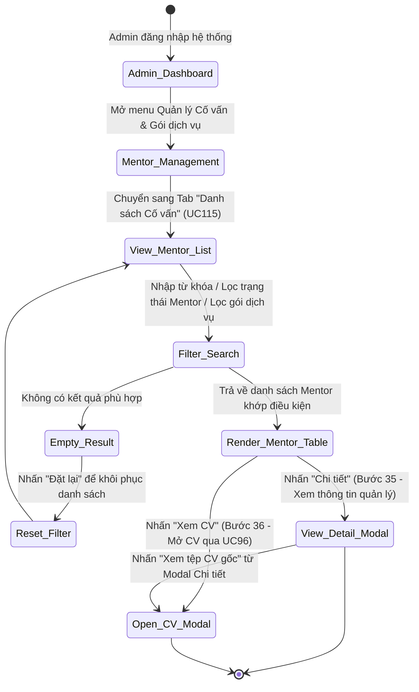
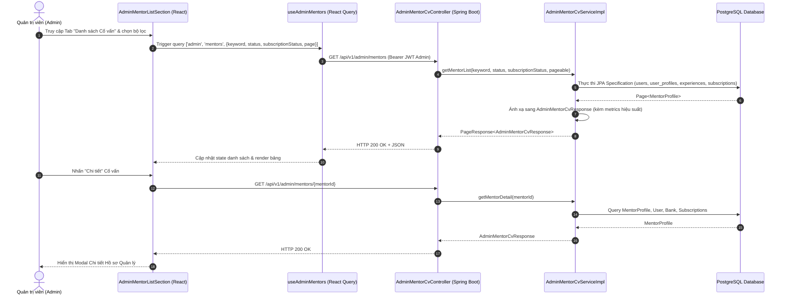

# ĐẶC TẢ YÊU CẦU & THIẾT KẾ CHI TIẾT: UC115 - XEM DANH SÁCH MENTOR

## PHẦN 1: ĐẶC TẢ NGHIỆP VỤ (REPORT 3)

### 2.2.3 Business Workflow (Luồng nghiệp vụ)



#### Mô tả chi tiết luồng xử lý bằng chữ (Business Step Description):
* **Bước 1 - Khởi đầu (Trigger & Tiền điều kiện)**: Quản trị viên (Admin) đăng nhập vào hệ thống AlumNect và truy cập mục **Quản lý Cố vấn & Gói dịch vụ** (`/admin/mentor-packages`). Admin có quyền quản trị chuyên môn phân hệ Mentoring.
* **Bước 2 - Hệ thống hiển thị danh sách Mentor (Bước 33)**: Admin chuyển sang tab **"Danh sách Cố vấn"**. Hệ thống gửi truy vấn lên backend và kết xuất bảng dữ liệu các Mentor trong hệ thống kèm thông tin phân trang chuẩn.
* **Bước 3 - Tìm kiếm & Lọc Mentor đa tiêu chí (Bước 34)**:
  * **Tìm kiếm theo từ khóa (`keyword`)**: Tìm kiếm tức thời trên Họ tên, Email, Vị trí công việc hiện tại hoặc Tên công ty/doanh nghiệp.
  * **Lọc theo trạng thái hồ sơ Mentor (`status`)**: Cho phép chọn lọc giữa:
    - *Tất cả trạng thái*
    - *Đang hoạt động (`ACTIVE`)*
    - *Chờ thanh toán gói (`PAYMENT_PENDING`)*
    - *Chưa hoàn thiện hồ sơ (`INCOMPLETE`)*
    - *Hết hạn (`EXPIRED`)*
  * **Lọc theo trạng thái gói dịch vụ (`subscriptionStatus`)**: Cho phép chọn lọc giữa:
    - *Tất cả gói dịch vụ*
    - *Đang hiệu lực (`ACTIVE`)*
    - *Đã thanh toán (`PAID`)*
    - *Đã hết hạn (`EXPIRED`)*
    - *Chờ thanh toán (`PENDING_PAYMENT`)*
    - *Đã hủy (`CANCELLED`)*
  * **Nút Đặt lại bộ lọc (`Reset`)**: Tự động hiển thị khi có bộ lọc được kích hoạt, cho phép Admin quay về trạng thái mặc định chỉ với 1 cú click.
* **Bước 4 - Xem thông tin quản lý Mentor (Bước 35)**:
  * Admin nhấn nút **"Chi tiết"** trên một hàng hoặc click vào thẻ tóm tắt Mentor.
  * Hệ thống mở modal chi tiết quản trị (`AdminMentorDetailModal`), hiển thị toàn bộ 4 nhóm thông tin:
    1. *Thẻ hồ sơ & Chỉ số hiệu suất*: Ảnh đại diện, Họ tên, Email, Trạng thái hồ sơ, Điểm uy tín (`reputationScore`), Số task hoàn thành (`completedTasks`), Điểm đánh giá (`rating`) và Số lượt review (`reviewCount`).
    2. *Thông tin chuyên môn*: Vị trí hiện tại, Công ty, Hình thức làm việc (`ONLINE` / `OFFLINE` / `BOTH`), Loại hình (`1:1` / `GROUP`), Lời giới thiệu (Bio), Danh sách lĩnh vực hỗ trợ và Các chủ đề cố vấn chuyên sâu.
    3. *Gói dịch vụ & Thời hạn*: Tên gói đăng ký, Trạng thái hiệu lực, Ngày kích hoạt và Ngày hết hạn.
    4. *Tài khoản ngân hàng nhận chi trả*: Tên ngân hàng, Số tài khoản và Tên chủ tài khoản ngân hàng.
* **Bước 5 - Mở xem tệp CV qua UC96 (Bước 36)**:
  * Admin có thể bấm nút **"Xem CV"** trực tiếp trên bảng hoặc nút **"Xem tệp CV gốc"** trong modal chi tiết.
  * Hệ thống mở Modal tài liệu CV chuyên biệt (`AdminMentorCvModal` theo UC96) để duyệt và đối chứng chứng chỉ bằng cấp của Mentor.

---

### 3.2 Module Mentorship (Hướng Dẫn & Cố Vấn)

#### 3.2.1 Chức năng Xem danh sách Mentor (UC115 - Admin View Mentor List)

**Function trigger**:
* **Navigation path**: Trang Quản trị `/admin/mentor-packages` -> Chọn Tab **"Danh sách Cố vấn"**.
* **Timing Frequency**: On-demand (khi Admin cần tra cứu lý lịch, đối soát tài khoản ngân hàng hoặc đánh giá hiệu suất của Cố vấn).

**Function description**:
* **Actors/Roles**: Quản trị viên (Admin - `ROLE_ADMIN`).
* **Purpose**: Cung cấp công cụ tra cứu, quản lý và đối chứng hồ sơ của tất cả Mentor trong hệ thống AlumNect.
* **Interface**:
  * **Control Bar**:
    - Ô tìm kiếm từ khóa với icon Clear nhanh (`X`).
    - Hộp chọn Lọc Trạng thái Mentor (`statusFilter`).
    - Hộp chọn Lọc Trạng thái Gói dịch vụ (`subStatusFilter`).
    - Nút Đặt lại bộ lọc (`Reset`).
    - Chỉ số tổng số lượng Cố vấn (`totalElements`).
  * **Bảng danh sách Cố vấn (Table)**:
    - *Cột Cố vấn*: Ảnh đại diện, Tên hiển thị, Email.
    - *Cột Vị trí & Tổ chức*: Chức danh và công ty hiện tại.
    - *Cột Trạng thái*: Badge màu sắc trực quan (Đang hoạt động, Chờ thanh toán, Chưa hoàn thiện, Hết hạn).
    - *Cột Gói dịch vụ & Hiệu lực*: Tên gói, Huy hiệu trạng thái gói, Thời hạn từ ngày - đến ngày.
    - *Cột Hiệu suất*: Huy hiệu Điểm uy tín (`Award`) và Số task hoàn thành (`CheckCircle2`).
    - *Cột Thao tác*: Nút "Xem CV" và Nút "Chi tiết".
  * **Trạng thái Rỗng (Empty State)**: Thông báo thân thiện khi không tìm thấy kết quả phù hợp với từ khóa/bộ lọc.
  * **Modal Chi tiết Quản lý**: Popup chuẩn hiển thị toàn bộ hồ sơ chuyên môn, ngân hàng, gói dịch vụ và hiệu suất.

**Data processing**:
1. Frontend gửi yêu cầu `GET /api/v1/admin/mentors?keyword=...&status=...&subscriptionStatus=...&page=0&size=10` kèm Admin Bearer JWT Token.
2. Backend xác thực vai trò `ROLE_ADMIN` qua Spring Security (`@PreAuthorize("hasRole('ADMIN')")`). Nếu không phải Admin, từ chối `403 Forbidden`.
3. `AdminMentorCvServiceImpl` áp dụng Spring Data JPA `Specification<MentorProfile>` để lọc động tại tầng Cơ sở dữ liệu:
   - Ghép nối bảng `users`, `user_profiles`, `experiences`, và subquery `mentor_subscriptions`.
   - Phân trang chuẩn xác tại Database Engine, loại bỏ hoàn toàn hiện tượng in-memory filter gây sai lệch `totalElements`.
4. DTO phản hồi `AdminMentorCvResponse` bổ sung 4 chỉ số hiệu suất: `reputationScore`, `completedTasks`, `rating`, `reviewCount`.
5. Khi Admin chọn xem chi tiết một Mentor: Gọi `GET /api/v1/admin/mentors/{mentorId}` trả về `AdminMentorCvResponse` mà không bắt buộc Mentor phải có tệp CV.

---

### 3.3.3 Business Rules (Quy tắc nghiệp vụ)

* **BR115.1 (Quyền hạn truy cập Quản trị)**: Chỉ người dùng mang vai trò `ROLE_ADMIN` mới có quyền truy xuất danh sách và chi tiết quản lý của Mentor qua các endpoint `/api/v1/admin/mentors/**`. Mọi người dùng thuộc vai trò `STUDENT`, `ALUMNI` hoặc chưa đăng nhập đều bị từ chối bằng mã lỗi `403 Forbidden` hoặc `401 Unauthorized`.
* **BR115.2 (Bản chất danh sách Mentor)**: Danh sách này bao gồm toàn bộ hồ sơ Mentor đã được khởi tạo trên hệ thống AlumNect (phân biệt với danh sách đơn chờ duyệt Mentor). Admin có thể theo dõi Mentor ở mọi trạng thái (`ACTIVE`, `PAYMENT_PENDING`, `INCOMPLETE`, `EXPIRED`).
* **BR115.3 (Tính toàn vẹn của tệp CV & Thông tin quản lý)**:
  - Nếu Mentor chưa tải lên tệp CV, Admin vẫn có thể xem đầy đủ thông tin quản lý (kinh nghiệm, kỹ năng, tài khoản ngân hàng, gói dịch vụ) qua API `GET /api/v1/admin/mentors/{mentorId}`.
  - API `GET /api/v1/admin/mentors/{mentorId}/cv` (UC96) sẽ trả về lỗi `404 Not Found` nếu tệp CV chưa từng được nạp lên hệ thống lưu trữ Cloudflare R2.
* **BR115.4 (Đối soát Tài khoản Ngân hàng)**: Thông tin tài khoản ngân hàng (`bankName`, `bankAccountNumber`, `bankAccountHolder`) là dữ liệu nhạy cảm chỉ hiển thị cho chính Mentor và Admin trong màn hình quản trị để phục vụ đối soát chi trả thù lao (Payout).

---

## PHẦN 2: THIẾT KẾ KỸ THUẬT (REPORT 4)

### 2.1 Architecture & Sequence Diagram



---

### 2.2 Class Diagram & Data Models

#### Java Backend DTO: `AdminMentorCvResponse.java`
```java
public class AdminMentorCvResponse {
    private Long mentorProfileId;
    private Long userId;
    private String mentorName;
    private String mentorEmail;
    private String avatarUrl;
    private String currentPosition;
    private String currentCompany;
    private String bio;
    private String cvFileKey;
    private String cvUrl;
    private MentorStatus mentorStatus;
    private String workingMode;
    private String mentoringType;
    private List<String> supportedFields;
    private List<String> topics;
    private String bankName;
    private String bankAccountNumber;
    private String bankAccountHolder;
    private String packageName;
    private String subscriptionStatus;
    private Instant subscriptionStartDate;
    private Instant subscriptionEndDate;
    private Instant updatedAt;

    // UC115 Performance & Tracking Metrics
    private Integer reputationScore;
    private Integer completedTasks;
    private BigDecimal rating;
    private Integer reviewCount;
}
```

#### TypeScript Interface: `adminApi.ts`
```typescript
export interface AdminMentorCvDto {
  mentorProfileId: number;
  userId: number;
  mentorName: string;
  mentorEmail: string;
  avatarUrl?: string;
  currentPosition?: string;
  currentCompany?: string;
  bio?: string;
  cvFileKey?: string;
  cvUrl?: string;
  mentorStatus: string;
  workingMode?: string;
  mentoringType?: string;
  supportedFields?: string[];
  topics?: string[];
  bankName?: string;
  bankAccountNumber?: string;
  bankAccountHolder?: string;
  packageName?: string;
  subscriptionStatus?: string;
  subscriptionStartDate?: string;
  subscriptionEndDate?: string;
  updatedAt: string;
  reputationScore?: number;
  completedTasks?: number;
  rating?: number;
  reviewCount?: number;
}
```

---

### 2.3 API Specification

| Phương thức | Endpoint | Thẩm quyền | Mô tả |
| :--- | :--- | :--- | :--- |
| `GET` | `/api/v1/admin/mentors` | `ROLE_ADMIN` | Lấy danh sách Mentor phân trang hỗ trợ lọc theo `keyword`, `status`, `subscriptionStatus`. |
| `GET` | `/api/v1/admin/mentors/{mentorId}` | `ROLE_ADMIN` | Xem thông tin chi tiết hồ sơ quản lý của Mentor (UC115 Bước 35). |
| `GET` | `/api/v1/admin/mentors/{mentorId}/cv` | `ROLE_ADMIN` | Xem tệp CV gốc và chi tiết chuyên môn của Mentor (UC96 / UC115 Bước 36). |

---

### 2.4 Security & Authorization Matrix

| Actor | Thao tác | Quyền hạn | Kết quả |
| :--- | :--- | :--- | :--- |
| **Admin** | Tra cứu danh sách & xem chi tiết Mentor | Cho phép | 200 OK |
| **Student** | Gọi API `/api/v1/admin/mentors/**` | Bị từ chối | 403 Forbidden |
| **Mentor / Alumni** | Gọi API `/api/v1/admin/mentors/**` | Bị từ chối | 403 Forbidden |
| **Guest (Chưa đăng nhập)** | Gọi API `/api/v1/admin/mentors/**` | Bị từ chối | 401 Unauthorized |

---

### 2.5 Kiểm thử tích hợp thực tế (Integration Verification)

Kịch bản kiểm thử `scratch/test_uc115.mjs` đã thực thi trực tiếp trên hệ thống:
1. **TEST 1**: Admin (`admin@alumnect.edu.vn`) lấy danh sách phân trang -> **200 OK**, trả về đầy đủ hồ sơ, gói đăng ký và chỉ số uy tín (`reputationScore: 60`).
2. **TEST 2**: Admin tìm kiếm theo từ khóa `keyword="huy"` -> **200 OK**, kết quả lọc chính xác.
3. **TEST 3**: Admin lọc theo trạng thái `status=ACTIVE` -> **200 OK**, 100% kết quả khớp điều kiện.
4. **TEST 4**: Admin xem thông tin quản lý chi tiết Mentor ID 1 -> **200 OK**, trả về thông tin chuyên môn, ngân hàng Techcombank và trạng thái hoạt động.
5. **TEST 5**: Security Check với tài khoản Student -> **403 Forbidden**, bảo vệ tuyệt đối dữ liệu quản trị.
* **Kết quả**: Đạt 100% Passed.
