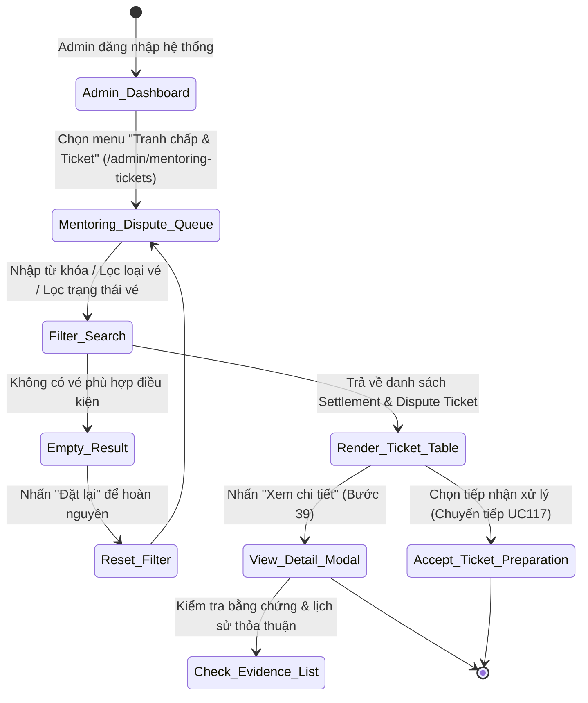
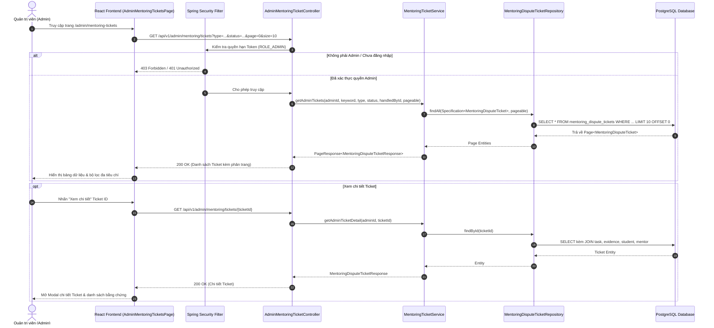

# ĐẶC TẢ YÊU CẦU & THIẾT KẾ CHI TIẾT: UC116 - XEM DANH SÁCH TICKET TRANH CHẤP

## PHẦN 1: ĐẶC TẢ NGHIỆP VỤ (REPORT 3)

### 2.2.3 Business Workflow (Luồng nghiệp vụ)



#### Mô tả chi tiết luồng xử lý bằng chữ (Business Step Description):
* **Bước 1 - Khởi đầu (Trigger & Tiền điều kiện)**: Quản trị viên (Admin) đăng nhập vào hệ thống AlumNect và truy cập mục **Tranh chấp & Ticket** (`/admin/mentoring-tickets`). Admin có quyền can thiệp trọng tài và giải quyết tranh chấp trong phân hệ Mentoring.
* **Bước 2 - Hệ thống hiển thị hàng đợi Ticket cần Admin xử lý (Bước 37)**: 
  * Hệ thống kết xuất bảng dữ liệu các vé tranh chấp và thỏa thuận dừng Task (`Settlement Ticket` theo UC111 và `Dispute Ticket` theo UC112).
  * **Quy tắc quan trọng**: Hệ thống **tách riêng biệt** Ticket Management khỏi Task Management thông thường. Các loại Ticket thỏa thuận nội bộ giữa Student và Mentor trong Chat for Task (như *Deal Ticket* hoặc *Deadline Extension Ticket*) **không xuất hiện** trong hàng đợi này vì không thuộc thẩm quyền phân xử của Admin.
* **Bước 3 - Tìm kiếm & Lọc Ticket đa tiêu chí (Bước 38)**:
  * **Tìm kiếm theo từ khóa (`keyword`)**: Tìm kiếm theo Mã vé (`ticketCode`), Tiêu đề vé (`title`), Mô tả (`description`), Tên Task (`taskTitle`), Email/Tên sinh viên, hoặc Email/Tên cố vấn.
  * **Lọc theo loại vé (`type`)**:
    - *Tất cả loại vé*
    - *Khiếu nại / Tranh chấp (`DISPUTE`)*: Tranh chấp phát sinh khi hai bên mâu thuẫn (UC112).
    - *Thỏa thuận Hòa giải (`SETTLEMENT`)*: Đề nghị dừng Task có thỏa thuận phân chia thù lao (UC111).
  * **Lọc theo trạng thái vé (`status`)**:
    - *Tất cả trạng thái*
    - *Chờ tiếp nhận (`OPEN`)*: Vé mới tạo, chưa có Admin nào nhận xử lý.
    - *Đang xử lý (`IN_REVIEW`)*: Đã có Admin tiếp nhận và đang thẩm tra bằng chứng.
    - *Đã giải quyết (`RESOLVED`)*: Admin đã đưa ra phán quyết hoặc phê duyệt quyết toán.
    - *Bị từ chối (`REJECTED`)*: Yêu cầu bị bác bỏ do không hợp lệ hoặc thiếu căn cứ.
    - *Đã hủy (`CANCELLED`)*: Người tạo đã chủ động rút vé.
  * **Lọc theo người phụ trách (`handledById`)**: Cho phép lọc các vé do một Admin cụ thể thụ lý.
  * **Nút Đặt lại bộ lọc (`Reset`)**: Hiển thị linh hoạt khi có bộ lọc hoạt động, giúp Admin hoàn nguyên nhanh chóng.
* **Bước 4 - Xem chi tiết Ticket và bằng chứng (Bước 39)**:
  * Admin nhấn biểu tượng hoặc nút **"Xem chi tiết"** trên một dòng dữ liệu.
  * Hệ thống mở modal chi tiết quản trị (`Ticket Detail Modal`), hiển thị đầy đủ:
    1. *Thông tin vé*: Mã vé, Loại vé, Trạng thái, Ngày tạo, Ngày cập nhật, Người tạo vé.
    2. *Thông tin Task liên quan*: Tên Task, Deal Price, Deadline, Thông tin Student và Mentor tham gia.
    3. *Phương án phân bổ thù lao*: Số tiền hoàn lại cho Student (`studentRefund`) và thù lao cho Mentor (`mentorAmount`).
    4. *Lý do & Mô tả chi tiết*: Căn cứ khiếu nại hoặc thỏa thuận dừng việc.
    5. *Danh sách Bằng chứng (Evidence)*: Tệp đính kèm, hình ảnh, tài liệu chứng minh được tải lên bởi các bên theo UC113.
    6. *Thông tin tiếp nhận*: Admin thụ lý (`handledBy`) và thời điểm tiếp nhận (`handledAt`).
* **Bước 5 - Chuyển tiếp quy trình**: Từ màn hình này, Admin có thể chuẩn bị thao tác tiếp nhận vé để giải quyết (chuyển sang UC117).

---

### 3.2 Module Mentorship (Hướng Dẫn & Cố Vấn)

#### 3.2.1 Chức năng Xem danh sách Ticket tranh chấp (UC116 - Admin View Dispute Ticket List)

**Function trigger**:
* **Navigation path**: Sidebar Quản trị `/admin` -> Chọn mục **"Tranh chấp & Ticket"** (`/admin/mentoring-tickets`).
* **Timing Frequency**: On-demand (Admin theo dõi định kỳ hàng ngày hoặc ngay khi nhận thông báo có vé tranh chấp mới phát sinh).

**Function description**:
* **Actors/Roles**: Quản trị viên (Admin - `ROLE_ADMIN`).
* **Purpose**: Cung cấp giao diện tập trung để Admin giám sát toàn bộ hàng đợi Ticket cần xử lý trọng tài, tra cứu nhanh chóng và tiếp nhận giải quyết.
* **Interface**:
  * **Header & Thống kê**: Tiêu đề phân hệ, mô tả chức năng, huy hiệu chuyên trách Trọng tài Task.
  * **Control Bar**:
    - Ô tìm kiếm từ khóa với icon Clear nhanh (`X`).
    - Hộp chọn Lọc Loại vé (`typeFilter`: Tất cả / Khiếu nại / Hòa giải).
    - Hộp chọn Lọc Trạng thái vé (`statusFilter`: Tất cả / Chờ tiếp nhận / Đang xử lý / Đã giải quyết / Từ chối / Đã hủy).
    - Nút Đặt lại bộ lọc (`Reset`).
    - Bộ đếm tổng số lượng Ticket trong hàng đợi.
  * **Bảng danh sách Ticket (Table)**:
    - *Cột Mã vé*: Mã định danh duy nhất (dạng `#TKT-...`), Ngày giờ tạo.
    - *Cột Loại vé*: Badge màu sắc phân biệt trực quan (Khiếu nại / Thỏa thuận hòa giải).
    - *Cột Task & Các bên*: Tên Task, thông tin Học viên và Cố vấn liên quan.
    - *Cột Nội dung yêu cầu*: Tiêu đề vé và tóm tắt mô tả.
    - *Cột Phương án đề xuất*: Số tiền hoàn Student và thù lao Mentor.
    - *Cột Trạng thái & Phụ trách*: Badge trạng thái tiến trình và tên Admin đang xử lý (hoặc cảnh báo "Chưa phân công").
    - *Cột Thao tác*: Nút "Xem chi tiết".
  * **Trạng thái Rỗng (Empty State)**: Thông báo trực quan khi không tìm thấy vé nào phù hợp tiêu chí lọc.
  * **Modal Chi tiết Ticket**: Hiển thị chuyên sâu toàn bộ hồ sơ vé, Task liên đới, bằng chứng đính kèm và lịch sử xử lý.

**Data processing**:
1. Frontend gửi yêu cầu `GET /api/v1/admin/mentoring/tickets?keyword=...&type=...&status=...&handledById=...&page=0&size=10` kèm Bearer JWT Token của Admin.
2. Backend bảo mật lớp Controller với `@PreAuthorize("hasRole('ADMIN')")`. Nếu không phải Admin, trả về mã lỗi `403 Forbidden`.
3. `MentoringTicketServiceImpl` xây dựng truy vấn động thông qua `Specification<MentoringDisputeTicket>`:
   - Chỉ lấy các vé có `ticketType IN ('SETTLEMENT', 'DISPUTE')`.
   - Tìm kiếm từ khóa đồng thời trên: `ticketCode`, `title`, `description`, `task.title`, `student.user.email`, `mentor.user.email`.
   - Lọc chính xác theo `ticketType`, `status`, `handledBy.id`.
   - Thực hiện `Pageable` phân trang tối ưu trực tiếp tại tầng cơ sở dữ liệu PostgreSQL.
4. Chuyển đổi Entity sang `MentoringDisputeTicketResponse` giàu thông tin (bổ sung chi tiết User, Task, Evidence).

---

### 3.3.3 Business Rules (Quy tắc nghiệp vụ)

* **BR116.1 (Quyền hạn truy cập độc quyền Quản trị)**: Chỉ người dùng có vai trò `ROLE_ADMIN` mới có quyền truy cập endpoint `/api/v1/admin/mentoring/tickets/**`. Người dùng thông thường (Student, Mentor) không được phép truy cập danh sách toàn cục này.
* **BR116.2 (Phạm vi hàng đợi Trọng tài Admin)**: Chỉ các vé tranh chấp phát sinh từ xung đột (`DISPUTE` - UC112) hoặc đề nghị dừng Task có thỏa thuận hoàn tiền (`SETTLEMENT` - UC111) mới được nạp vào hàng đợi này. Các vé trao đổi nội bộ trong Chat for Task (như thay đổi phạm vi Task, điều chỉnh deadline UC109) không được đưa vào đây.
* **BR116.3 (Độc lập giao diện Quản lý)**: Giao diện quản lý Ticket phải được thiết kế thành một mục riêng biệt trong thanh điều hướng Admin (`/admin/mentoring-tickets`), tách bạch hoàn toàn với giao diện duyệt bài đăng hoặc quản lý Task thông thường.
* **BR116.4 (Tính toàn vẹn dữ liệu Bằng chứng)**: Danh sách và chi tiết Ticket trả về cho Admin phải thể hiện chính xác danh sách các tệp bằng chứng do Student và Mentor đã nộp trong UC113, bao gồm cả người gửi và thời điểm nộp.

---

## PHẦN 2: THIẾT KẾ KỸ THUẬT (TECHNICAL DESIGN)

### 1. Kiến trúc tổng thể luồng UC116



### 2. Thiết kế API & DTO Chi tiết

#### Endpoint 1: Lấy danh sách Ticket dành cho Admin
* **URL**: `GET /api/v1/admin/mentoring/tickets`
* **Authorization**: `Bearer JWT` (Bắt buộc vai trò `ROLE_ADMIN`)
* **Query Parameters**:
  * `keyword` (String, optional): Tìm kiếm từ khóa mã vé, tiêu đề, task, email.
  * `type` (String, optional): `SETTLEMENT` hoặc `DISPUTE`.
  * `status` (String, optional): `OPEN`, `IN_REVIEW`, `RESOLVED`, `REJECTED`, `CANCELLED`.
  * `handledById` (Long, optional): ID của Admin thụ lý.
  * `page` (Integer, mặc định `0`).
  * `size` (Integer, mặc định `10`).
* **Response `200 OK`**:
```json
{
  "content": [
    {
      "id": 1,
      "ticketCode": "TKT-20261014-0001",
      "taskId": 105,
      "taskTitle": "Hướng dẫn xây dựng hệ thống Microservices Spring Cloud",
      "ticketType": "DISPUTE",
      "title": "Mentor không phản hồi sau khi nhận task",
      "description": "Đã 5 ngày kể từ deadline nhưng mentor không nộp kết quả.",
      "studentRefund": 1500000.0,
      "mentorAmount": 0.0,
      "status": "OPEN",
      "createdBy": {
        "id": 12,
        "fullName": "Nguyễn Văn Sinh Viên",
        "email": "student@alumnect.edu.vn"
      },
      "handledBy": null,
      "handledAt": null,
      "createdAt": "2026-10-14T08:00:00Z",
      "updatedAt": "2026-10-14T08:00:00Z"
    }
  ],
  "pageNumber": 0,
  "pageSize": 10,
  "totalElements": 1,
  "totalPages": 1,
  "last": true
}
```

#### Endpoint 2: Lấy chi tiết một Ticket
* **URL**: `GET /api/v1/admin/mentoring/tickets/{ticketId}`
* **Authorization**: `Bearer JWT` (Bắt buộc vai trò `ROLE_ADMIN`)
* **Response `200 OK`**: Trả về `MentoringDisputeTicketResponse` chi tiết kèm mảng `evidenceList`.

---

### 3. Phân quyền & Ma trận Bảo mật (Security Matrix)

| Vai trò người dùng | Truy cập danh sách Ticket Admin (`GET /api/v1/admin/mentoring/tickets`) | Xem chi tiết Ticket Admin (`GET /api/v1/admin/mentoring/tickets/{id}`) |
| :--- | :---: | :---: |
| **ROLE_ADMIN** | **CHO PHÉP (200 OK)** | **CHO PHÉP (200 OK)** |
| **ROLE_STUDENT** | BỊ TỪ CHỐI (403 Forbidden) | BỊ TỪ CHỐI (403 Forbidden) |
| **ROLE_ALUMNI (Mentor)** | BỊ TỪ CHỐI (403 Forbidden) | BỊ TỪ CHỐI (403 Forbidden) |
| **Chưa xác thực** | BỊ TỪ CHỐI (401 Unauthorized) | BỊ TỪ CHỐI (401 Unauthorized) |

---

### 4. Kết quả Kiểm thử Tích hợp Thực tế

Đã thực hiện kịch bản kiểm thử tích hợp tự động qua `scratch/test_uc116.mjs` trên môi trường backend Docker live:
* **Test Case 1**: Admin lấy danh sách Ticket phân trang (`GET /api/v1/admin/mentoring/tickets`) -> **PASSED** (Mã 200 OK, trả về cấu trúc PageResponse chuẩn).
* **Test Case 2**: Lọc theo loại vé `type=DISPUTE` -> **PASSED** (100% bản ghi trả về có `ticketType == 'DISPUTE'`).
* **Test Case 3**: Lọc theo trạng thái `status=OPEN` -> **PASSED** (100% bản ghi trả về có `status == 'OPEN'`).
* **Test Case 4**: Tìm kiếm theo từ khóa `keyword=TKT` -> **PASSED** (Lọc chính xác các vé khớp mã vé).
* **Test Case 5**: Admin xem chi tiết Ticket cụ thể theo ID -> **PASSED** (Trả về đầy đủ thông tin vé, Task, thông tin các bên).
* **Test Case 6**: Security Validation: Tài khoản Student gọi API Admin Ticket -> **PASSED** (Backend chặn đứng và trả về đúng `403 Forbidden`).
