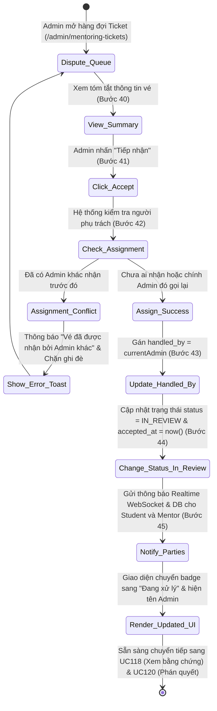
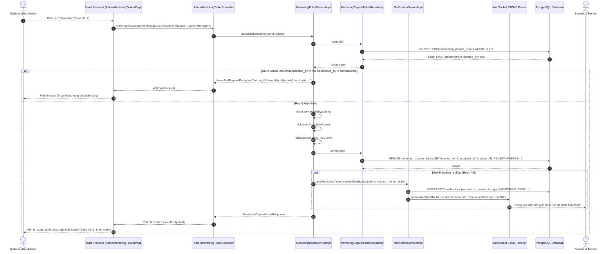

# ĐẶC TẢ YÊU CẦU & THIẾT KẾ CHI TIẾT: UC117 - TIẾP NHẬN TICKET ĐỂ XỬ LÝ

## PHẦN 1: ĐẶC TẢ NGHIỆP VỤ (REPORT 3)

### 2.2.3 Business Workflow (Luồng nghiệp vụ)



#### Mô tả chi tiết luồng xử lý bằng chữ (Business Step Description):
* **Bước 1 - Khởi đầu (Trigger & Tiền điều kiện)**: Quản trị viên (Admin) truy cập trang Quản lý Tranh chấp & Ticket (`/admin/mentoring-tickets`). Vé khiếu nại (Dispute Ticket) hoặc vé thỏa thuận hòa giải (Settlement Ticket) đang ở trạng thái `OPEN` (Chờ tiếp nhận) hoặc chưa có người phụ trách.
* **Bước 2 - Hiển thị tóm tắt thông tin vé (Bước 40 - Ticket Summary)**:
  * Admin xem tóm tắt nội dung vé trực tiếp trên dòng bảng hoặc mở Modal chi tiết: Mã vé, Tên Task liên kết, Học viên, Cố vấn, Số tiền đề xuất hoàn/trả, Tiêu đề và Mô tả yêu cầu.
  * Hệ thống hiển thị huy hiệu cảnh báo màu hổ phách: "Chưa phân công" và "Chờ tiếp nhận".
* **Bước 3 - Admin chọn tiếp nhận vé (Bước 41 - Trigger Action)**:
  * Admin nhấn nút **"Tiếp nhận"** trực tiếp tại cột Thao tác trên bảng dữ liệu, hoặc nhấn nút **"Tiếp nhận xử lý (UC117)"** trong thanh điều khiển dưới chân Modal chi tiết vé.
* **Bước 4 - Hệ thống kiểm tra quyền hạn và xung đột phân công (Bước 42 - Verification)**:
  * Hệ thống xác minh tài khoản thực hiện mang vai trò `ROLE_ADMIN`.
  * Hệ thống kiểm tra trường `handled_by` của vé trong cơ sở dữ liệu:
    - *Trường hợp 1 (Xung đột phân công)*: Nếu vé đã có Admin khác tiếp nhận (`handled_by != null` và `handled_by != currentAdmin`), hệ thống chặn hành động, không cho phép ghi đè và trả về thông báo lỗi: *"Vé này đã được tiếp nhận bởi Quản trị viên <Họ tên Admin>"*.
    - *Trường hợp 2 (Vé đã kết thúc)*: Nếu vé đã ở trạng thái `RESOLVED`, `REJECTED`, hoặc `CANCELLED`, hệ thống từ chối tiếp nhận vì tiến trình đã đóng.
    - *Trường hợp 3 (Hợp lệ)*: Vé chưa có ai nhận (`handled_by == null`) hoặc chính Admin đó thực hiện thao tác lại (đảm bảo tính lũy thừa - idempotency).
* **Bước 5 - Cập nhật dữ liệu phân công (Bước 43 & 44)**:
  * Hệ thống gán tài khoản Admin hiện tại vào trường `handled_by`.
  * Ghi nhận mốc thời gian tiếp nhận: `accepted_at = Instant.now()`.
  * Chuyển trạng thái vé từ `OPEN` sang `IN_REVIEW` (Đang xử lý).
* **Bước 6 - Phát thông báo cho Học viên và Cố vấn (Bước 45 - Realtime Notification)**:
  * Hệ thống tạo thông báo loại `MENTORING_TASK` trong cơ sở dữ liệu và phát sóng qua kênh WebSocket STOMP cá nhân:
    - Người nhận: Cả Học viên (`Student`) và Cố vấn (`Mentor`) của Task.
    - Tiêu đề: *"Vé <Mã vé> đã được tiếp nhận xử lý"*.
    - Nội dung: *"Quản trị viên <Tên Admin> đã tiếp nhận xử lý vé <Mã vé> cho nhiệm vụ \"<Tên Task>\". Vui lòng theo dõi tiến trình."*
* **Bước 7 - Cập nhật giao diện người dùng (Hậu điều kiện)**:
  * Toast hiển thị thành công: *"Đã tiếp nhận xử lý vé <Mã vé> thành công!"*.
  * Huy hiệu trạng thái trên bảng chuyển từ màu xanh nước biển (`Chờ tiếp nhận`) sang màu vàng kim (`Đang xử lý`).
  * Mục Người phụ trách cập nhật hiển thị họ tên của Admin vừa tiếp nhận.
  * Nút "Tiếp nhận" ẩn đi, nhường chỗ cho các thao tác thẩm tra hồ sơ tiếp theo (UC118 - UC120).

---

### 3.2 Module Mentorship (Hướng Dẫn & Cố Vấn)

#### 3.2.1 Chức năng Tiếp nhận Ticket để xử lý (UC117 - Admin Accept/Take Ticket)

**Function trigger**:
* **Navigation path**: Trang `/admin/mentoring-tickets` -> Nhấn nút **"Tiếp nhận"** trên bảng hoặc nút **"Tiếp nhận xử lý (UC117)"** trong Modal chi tiết vé.
* **Timing Frequency**: On-demand (Khi Admin bắt đầu quy trình thụ lý một vụ việc tranh chấp hoặc hòa giải phân bổ tiền).

**Function description**:
* **Actors/Roles**: Quản trị viên (Admin - `ROLE_ADMIN`).
* **Purpose**: Xác lập trách nhiệm pháp lý và hành chính của một Quản trị viên cụ thể đối với Ticket, chuyển tiến trình từ hàng đợi chờ sang giai đoạn thẩm định bằng chứng.
* **Interface**:
  * **Tại bảng danh sách vé**: Nút bấm màu cam nổi bật kèm icon `UserCheck` hiển thị cạnh nút "Chi tiết" đối với các vé chưa có người xử lý (`OPEN` / `handledBy == null`). Khi thao tác, nút hiển thị spinner `Loader2` và vô hiệu hóa để chống click đúp.
  * **Tại Modal Chi tiết vé**: 
    - Banner cảnh báo trực quan: *"Vé này chưa có Quản trị viên phụ trách. Bạn có thể tiếp nhận để chuyển sang trạng thái thẩm tra."*
    - Nút hành động chính: *"Tiếp nhận xử lý (UC117)"*.
* **Data processing**:
  1. Frontend gửi yêu cầu `POST /api/v1/admin/mentoring/tickets/{ticketId}/accept` kèm Bearer JWT Token của Admin.
  2. Backend kiểm tra quyền `ROLE_ADMIN` qua Spring Security.
  3. `MentoringTicketServiceImpl.acceptTicket`:
     - Kiểm tra vé tồn tại trong CSDL.
     - Kiểm tra trạng thái không thuộc nhóm kết thúc (`RESOLVED`, `REJECTED`, `CANCELLED`).
     - Kiểm tra chống ghi đè phân công (`handledBy != null && !handledBy.id.equals(currentAdminId)`).
     - Gán `handled_by = currentAdmin`, `accepted_at = Instant.now()`, `status = IN_REVIEW`.
     - Lưu CSDL PostgreSQL.
     - Gọi `notificationService.sendMentoringTicketAcceptedNotification` để gửi thông báo DB + WebSocket STOMP cho Student và Mentor.
  4. Trả về HTTP 200 OK kèm DTO `MentoringDisputeTicketResponse` đã cập nhật.

---

### 3.3.3 Business Rules (Quy tắc nghiệp vụ)

* **BR117.1 (Bảo mật quyền hạn Quản trị)**: Chỉ tài khoản mang vai trò `ROLE_ADMIN` mới có quyền gọi API tiếp nhận vé (`POST /api/v1/admin/mentoring/tickets/{id}/accept`). Mọi vai trò khác (Student, Mentor) đều bị từ chối bằng mã `403 Forbidden`.
* **BR117.2 (Chống tranh chấp quyền phụ trách - Concurrency Assignment Lock)**: Khi một Admin đã tiếp nhận vé, hệ thống ghi nhận khóa phụ trách. Admin khác không thể ghi đè assignment này. Mọi nỗ lực tiếp nhận vé đã có người phụ trách từ một Admin khác đều bị từ chối bằng mã lỗi `400 Bad Request` kèm thông báo tên Admin đang thụ lý.
* **BR117.3 (Nguyên tắc lũy thừa - Idempotency)**: Nếu chính Admin đang phụ trách vé gửi lại yêu cầu tiếp nhận (do refresh trình duyệt hoặc gọi lại), hệ thống xử lý an toàn và trả về trạng thái hiện tại mà không báo lỗi xung đột.
* **BR117.4 (Audit & Minh bạch tiến trình)**: Mọi thao tác tiếp nhận phải ghi nhận chính xác mốc thời gian `accepted_at` (chuẩn UTC `Instant.now()`), đồng thời kích hoạt thông báo tự động cho cả hai bên liên quan của Task để đảm bảo tính minh bạch.

---

## PHẦN 2: THIẾT KẾ KỸ THUẬT (TECHNICAL DESIGN)

### 1. Kiến trúc tổng thể luồng UC117



### 2. Thiết kế API Chi tiết

#### Endpoint: Tiếp nhận xử lý Ticket
* **URL**: `POST /api/v1/admin/mentoring/tickets/{ticketId}/accept`
* **Authorization**: `Bearer JWT` (Bắt buộc vai trò `ROLE_ADMIN`)
* **Path Parameter**: `ticketId` (Long, bắt buộc): Mã định danh bản ghi vé.
* **HTTP Status Code**:
  * `200 OK`: Tiếp nhận thành công.
  * `400 Bad Request`: Vé đã bị Admin khác nhận, hoặc vé đã ở trạng thái kết thúc (`RESOLVED`, `REJECTED`, `CANCELLED`).
  * `403 Forbidden`: Người dùng không mang vai trò `ROLE_ADMIN`.
  * `404 Not Found`: Không tìm thấy Ticket với ID tương ứng.
* **Response Body `200 OK`**:
```json
{
  "success": true,
  "message": "Tiếp nhận xử lý Ticket thành công",
  "data": {
    "id": 2,
    "ticketCode": "DP-20261013-330760",
    "taskId": 105,
    "taskTitle": "Hướng dẫn xây dựng hệ thống Microservices Spring Cloud",
    "ticketType": "DISPUTE",
    "title": "Mentor không phản hồi sau khi nhận task",
    "description": "Đã 5 ngày kể từ deadline nhưng mentor không nộp kết quả.",
    "studentRefund": 1500000.0,
    "mentorAmount": 0.0,
    "totalAmount": 1500000.0,
    "status": "IN_REVIEW",
    "handledBy": {
      "id": 12,
      "fullName": "Quản trị viên AlumNect",
      "email": "admin@alumnect.edu.vn"
    },
    "acceptedAt": "2026-10-14T01:48:51.345Z",
    "resolvedAt": null,
    "resolutionNote": null,
    "createdAt": "2026-10-13T23:50:00Z",
    "updatedAt": "2026-10-14T01:48:51.345Z"
  }
}
```

---

### 3. Phân quyền & Ma trận Bảo mật (Security Matrix)

| Vai trò người dùng | Quyền gọi API tiếp nhận vé (`POST /admin/mentoring/tickets/{id}/accept`) | Phản hồi máy chủ |
| :--- | :---: | :--- |
| **ROLE_ADMIN** | **CHO PHÉP** | **HTTP 200 OK** (Gán phụ trách thành công) |
| **ROLE_STUDENT** | BỊ TỪ CHỐI | **HTTP 403 Forbidden** |
| **ROLE_ALUMNI (Mentor)** | BỊ TỪ CHỐI | **HTTP 403 Forbidden** |
| **Chưa xác thực** | BỊ TỪ CHỐI | **HTTP 401 Unauthorized** |

---

### 4. Kết quả Kiểm thử Tích hợp Thực tế

Kịch bản kiểm thử tích hợp tự động qua `scratch/test_uc117.mjs` trên Docker backend live (PostgreSQL 18.4):
* **Test Case 1 (Danh sách)**: Admin kiểm tra danh sách Ticket hiện có -> **PASSED** (Tìm thấy 2 tickets, chọn Ticket ID 2 mã `DP-20261013-330760`).
* **Test Case 2 (Tiếp nhận thành công)**: Admin gọi `POST /api/v1/admin/mentoring/tickets/2/accept` -> **PASSED** (HTTP 200 OK, `status` đổi thành `IN_REVIEW`, `handledBy` là Admin ID 12, `acceptedAt` được lưu).
* **Test Case 3 (Idempotency)**: Chính Admin phụ trách gọi lại `POST /{id}/accept` -> **PASSED** (HTTP 200 OK, hệ thống bảo toàn dữ liệu an toàn, không sinh lỗi).
* **Test Case 4 (Security Validation)**: Tài khoản Student gọi `POST /{id}/accept` -> **PASSED** (Spring Security chặn đứng với đúng mã `403 Forbidden`).
* **Test Case 5 (Kiểm tra đối chứng DB)**: Admin kiểm tra lại chi tiết qua `GET /admin/mentoring/tickets/2` -> **PASSED** (Dữ liệu trong Database khớp 100%: trạng thái `IN_REVIEW`, `handledBy` đầy đủ).
