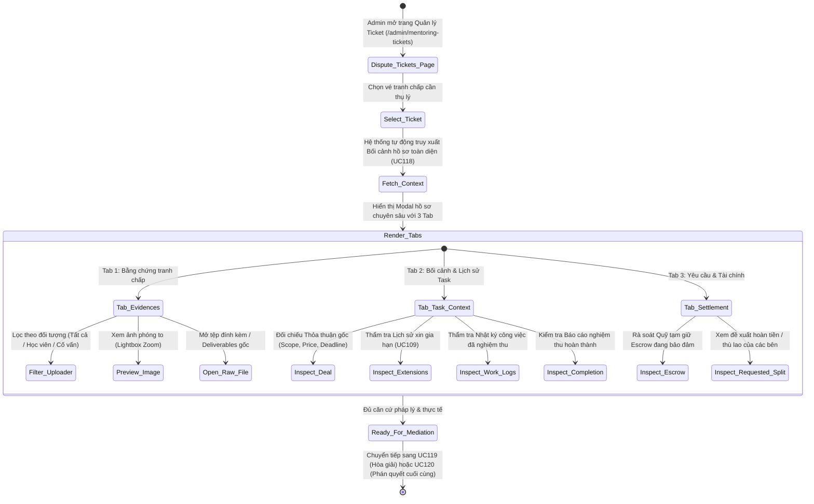
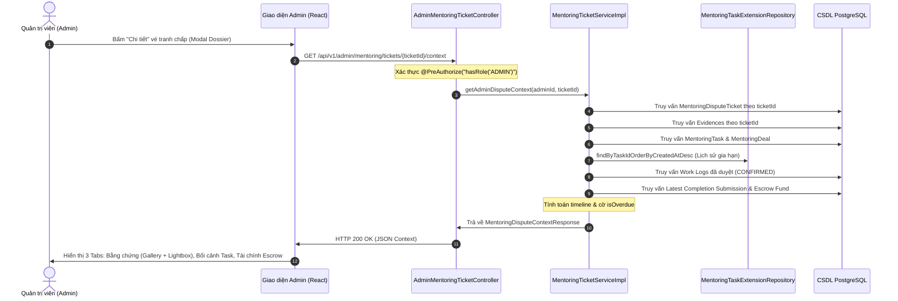

# ĐẶC TẢ YÊU CẦU & THIẾT KẾ CHI TIẾT: UC118 - XEM BẰNG CHỨNG TRANH CHẤP & BỐI CẢNH NHIỆM VỤ

## PHẦN 1: ĐẶC TẢ NGHIỆP VỤ (REPORT 3)

### 2.2.3 Business Workflow (Luồng nghiệp vụ)



#### Mô tả chi tiết luồng xử lý bằng chữ (Business Step Description):
* **Bước 1 - Khởi đầu (Trigger & Tiền điều kiện)**: Quản trị viên (Admin) đã tiếp nhận vé (hoàn tất UC117) hoặc đang rà soát hồ sơ tranh chấp tại trang `/admin/mentoring-tickets`. Vé có thể là `DISPUTE` (Tranh chấp khiếu nại) hoặc `SETTLEMENT` (Thỏa thuận giải ngân hòa giải).
* **Bước 2 - Admin kích hoạt xem hồ sơ (Bước 46 - Open Dispute Dossier)**:
  * Admin nhấn nút **"Chi tiết"** trên bảng danh sách vé hoặc tại hàng đợi cần thẩm định.
  * Hệ thống mở Modal hồ sơ chuyên sâu kích thước lớn (`max-w-4xl`) và tự động kích hoạt truy vấn ngữ cảnh `GET /api/v1/admin/mentoring/tickets/{ticketId}/context`.
* **Bước 3 - Tổng hợp bằng chứng & Ngữ cảnh nhiệm vụ (Bước 47 - Gather Evidences & Task Dossier)**:
  * Hệ thống không chỉ trả về thông tin sơ cấp của chiếc vé, mà tổng hợp toàn diện bức tranh thực thi của Task:
    1. **Bằng chứng tranh chấp (`evidences`)**: Danh sách các hình ảnh chụp màn hình, tệp log, biên bản trao đổi mà Học viên và Cố vấn đã tải lên khi mở vé hoặc trong quá trình phản hồi.
    2. **Thỏa thuận ban đầu (`deal`)**: Giá trị hợp đồng (`price`), phạm vi công việc (`scope`), kết quả kỳ vọng (`expectedResult`), thời điểm hai bên bấm nút xác nhận giao kèo.
    3. **Dòng thời gian & Hạn chót (`timeline`)**: Thời điểm bắt đầu thực hiện, hạn chót ban đầu, hạn chót hiệu lực hiện tại, và cờ trạng thái tính toán tự động `isOverdue` (Nhiệm vụ có bị trễ hạn hay không).
    4. **Lịch sử gia hạn (`extensionHistory`)**: Toàn bộ các yêu cầu gia hạn đã phát sinh (UC109), bao gồm lý do xin gia hạn, số ngày/giờ gia hạn, hạn chót mới đề xuất, và quyết định phê duyệt/từ chối từ Học viên.
    5. **Nhật ký tiến độ đã được duyệt (`confirmedWorkLogs`)**: Danh sách các phiên làm việc và báo cáo trung gian đã được Học viên bấm duyệt (căn cứ bảo vệ quyền lợi thù lao của Mentor).
    6. **Báo cáo hoàn thành mới nhất (`latestCompletionSubmission`)**: Ghi chú bàn giao nghiệm thu cuối cùng và danh sách deliverables đính kèm của Mentor.
    7. **Tài chính Escrow (`totalEscrowAmount`)**: Tổng số tiền học phí đang được hệ thống phong tỏa an toàn trong tài khoản tạm giữ để chuẩn bị phân bổ.
* **Bước 4 - Trải nghiệm thẩm tra tương tác đa chiều (Bước 48 & 49 - Interactive Inspection)**:
  * Admin chuyển đổi giữa 3 Tab chuyên môn:
    - **Tab 1: Bằng chứng tranh chấp**: Xem danh sách bằng chứng kèm nhãn uploader (Học viên hay Cố vấn). Hỗ trợ nút lọc nhanh theo đối tượng. Bằng chứng dạng ảnh hỗ trợ xem thumbnail tức thì và click mở **Lightbox toàn màn hình** phóng to chi tiết; tệp tin tài liệu hỗ trợ mở liên kết ngoài an toàn (`target="_blank"` kèm `rel="noopener noreferrer"`).
    - **Tab 2: Bối cảnh & Lịch sử Task**: Giúp Admin đối chiếu thực tế: Mentor có làm việc thực chất không (qua các Confirmed Work Logs), có bị trễ hạn không (so sánh timeline với deadline sau gia hạn), và sản phẩm bàn giao cuối cùng có khớp phạm vi thỏa thuận ban đầu không.
    - **Tab 3: Yêu cầu & Tài chính**: Xem lý do tranh chấp chi tiết, giải pháp các bên kỳ vọng, số tiền phân bổ mà nguyên đơn/bị đơn mong muốn, và số dư quỹ Escrow bảo đảm.
* **Bước 5 - Kết quả đầu ra (Hậu điều kiện)**:
  * Admin nắm bắt đầy đủ, minh bạch toàn bộ dữ liệu khách quan của vụ việc mà không cần tra cứu thủ công qua nhiều trang cơ sở dữ liệu.
  * Hệ thống sẵn sàng cho các quyết định xử lý tiếp theo: Đề xuất phương án hòa giải (UC119) hoặc Ban hành phán quyết tài chính cuối cùng (UC120).

---

### 3.2 Module Mentorship (Hướng Dẫn & Cố Vấn)

#### 3.2.1 Chức năng Xem bằng chứng tranh chấp & Bối cảnh Task (UC118 - Admin View Dispute Evidence & Context)

**Function trigger**:
* **Navigation path**: Trang `/admin/mentoring-tickets` -> Click nút **"Chi tiết"** của vé hoặc chọn Tab **"Bằng chứng tranh chấp"** trong Modal hồ sơ vụ việc.
* **Timing Frequency**: On-demand (Mỗi khi Admin mở hồ sơ để xem xét bằng chứng và thẩm tra dữ liệu nhiệm vụ).

**Function description**:
* **Actors/Roles**: Quản trị viên hệ thống (Admin - `ROLE_ADMIN`).
* **Purpose**: Cung cấp bức tranh toàn cảnh 360 độ về vụ việc tranh chấp: từ bằng chứng trực quan của hai bên cho đến dữ liệu lịch sử thực thi hợp đồng, giúp việc phân xử đảm bảo tính công bằng, chuẩn xác và có căn cứ xác thực.
* **Interface**:
  * **Header Modal**: Huy hiệu loại vé (`Tranh chấp` / `Hòa giải`), huy hiệu trạng thái (`Chờ tiếp nhận`, `Đang xử lý`, `Đã giải quyết`), Mã vé và Tên Task.
  * **Thanh điều hướng 3 Tab**:
    1. `Bằng chứng tranh chấp ({count})`: Kèm icon hình ảnh và badge số lượng bằng chứng.
    2. `Bối cảnh & Lịch sử Task`: Kèm icon lịch sử và đồng hồ.
    3. `Yêu cầu & Tài chính`: Kèm icon ví tiền và thông tin đề xuất.
  * **Bộ lọc uploader**: Nút chuyển đổi nhanh `Tất cả ({total})`, `Học viên ({count})`, `Cố vấn ({count})`.
  * **Evidence Gallery**: Thẻ hiển thị bằng chứng gồm tiêu đề, mô tả, nhãn người tải lên, thời gian nộp, khung preview ảnh thumbnail trực quan và các nút thao tác "Xem ảnh" (mở Lightbox), "Mở tệp gốc".
  * **Image Lightbox Modal**: Lớp phủ nền mờ với ảnh phóng to độ phân giải cao, hiển thị tiêu đề và nút đóng tiện lợi.
* **Data processing**:
  1. Frontend gọi `GET /api/v1/admin/mentoring/tickets/{ticketId}/context` với Bearer JWT của Admin.
  2. Backend kiểm tra quyền `ROLE_ADMIN`.
  3. `MentoringTicketServiceImpl.getAdminDisputeContext`:
     - Kiểm tra vé tồn tại trong bảng `mentoring_dispute_tickets`.
     - Lấy danh sách bằng chứng từ `mentoring_dispute_evidences` map sang `MentoringDisputeEvidenceResponse`.
     - Lấy thực thể `MentoringTask` liên kết.
     - Lấy thực thể `MentoringDeal` đã chốt của Task để trích xuất `scope`, `price`, `deadline`, `studentConfirmedAt`.
     - Lấy lịch sử gia hạn từ `MentoringTaskExtensionRepository.findByTaskIdOrderByCreatedAtDesc` (UC109).
     - Lấy danh sách Work Logs đã được học viên nghiệm thu (`CONFIRMED`).
     - Lấy báo cáo hoàn thành mới nhất (`MentoringTaskCompletionRepository`).
     - Lấy số dư ký quỹ Escrow bảo đảm của Task (`MentoringTaskPaymentEscrowRepository`).
     - Tính toán cờ cảnh báo quá hạn (`isOverdue = task.getEffectiveDeadline().isBefore(Instant.now()) && task.getStatus() != COMPLETED`).
     - Tổng hợp thành đối tượng DTO `MentoringDisputeContextResponse` và trả về HTTP 200 OK.

---

### 3.3.3 Business Rules (Quy tắc nghiệp vụ)

* **BR118.1 (Phân quyền truy cập hồ sơ nhạy cảm)**: Dữ liệu bằng chứng tranh chấp, nội dung khiếu nại và số liệu tài chính Task là thông tin nội bộ nhạy cảm. Chỉ tài khoản mang vai trò `ROLE_ADMIN` mới có quyền gọi API `GET /api/v1/admin/mentoring/tickets/{id}/context`. Các tài khoản khác (Học viên, Cố vấn hoặc người ngoài) cố ý truy cập đều bị từ chối với mã `403 Forbidden`.
* **BR118.2 (Bảo toàn bằng chứng nguyên bản - Evidence Immutability)**: Mọi bằng chứng đã được ghi nhận vào vé tranh chấp phải được giữ nguyên trạng, hiển thị đầy đủ thời điểm nộp (`createdAt`) và danh tính người tải lên (`uploader`). Hệ thống không cho phép chỉnh sửa hoặc thay thế tệp sau khi đã gửi lên vé.
* **BR118.3 (Minh bạch dữ liệu đối chứng - Cross-Verification Dossier)**: Khi thẩm tra tranh chấp, Admin bắt buộc phải được tiếp cận đầy đủ dữ liệu đối chứng bao gồm: Lịch sử gia hạn (UC109), các Work Log đã nghiệm thu (để xác định khối lượng công việc Mentor đã hoàn thành hợp lệ), và hạn chót hiệu lực (để xác định lỗi vi phạm tiến độ).
* **BR118.4 (Bảo đảm an toàn liên kết tệp ngoại vi)**: Mọi thao tác mở tệp đính kèm ngoại vi từ giao diện Admin phải tuân thủ chuẩn an toàn trình duyệt: sử dụng thuộc tính `target="_blank"` kết hợp `rel="noopener noreferrer"` nhằm ngăn ngừa các cuộc tấn công chiếm quyền điều hướng cửa sổ (Reverse Tabnabbing).

---

## PHẦN 2: THIẾT KẾ KỸ THUẬT (TECHNICAL DESIGN)

### 1. Kiến trúc tổng thể luồng UC118



---

### 2. Đặc tả API kỹ thuật (API Specifications)

#### Endpoint Tra cứu Bằng chứng & Bối cảnh Tranh chấp
* **URL**: `GET /api/v1/admin/mentoring/tickets/{ticketId}/context`
* **Quyền hạn**: `ROLE_ADMIN`
* **Headers**: `Authorization: Bearer <ADMIN_JWT_TOKEN>`

##### Phản hồi thành công (HTTP 200 OK):
```json
{
  "ticket": {
    "id": 2,
    "taskId": 105,
    "taskTitle": "Phát triển module Authentication Spring Boot",
    "ticketType": "DISPUTE",
    "status": "IN_REVIEW",
    "title": "Mentor không phản hồi và trễ hạn 5 ngày",
    "reason": "Tôi đã nhắn tin nhiều lần nhưng Mentor không cập nhật tiến độ...",
    "handledById": 1,
    "handledByName": "System Admin"
  },
  "evidences": [
    {
      "id": 1,
      "ticketId": 2,
      "uploaderId": 12,
      "uploaderName": "Nguyen Van A",
      "uploaderRole": "STUDENT",
      "fileUrl": "https://images.unsplash.com/photo-1584433144859-1fc3ab64a957",
      "title": "Ảnh chụp màn hình tin nhắn chờ phản hồi",
      "description": "Tin nhắn đã gửi 5 ngày trước không được hồi âm",
      "createdAt": "2026-10-14T01:45:00Z"
    }
  ],
  "deal": {
    "dealId": 88,
    "price": 1500000.0,
    "deadline": "2026-10-10T17:00:00Z",
    "scope": "Xây dựng luồng JWT và xác thực phân quyền 3 role",
    "expectedResult": "Source code Spring Boot kèm JUnit test",
    "confirmedAt": "2026-10-01T08:30:00Z"
  },
  "timeline": {
    "startedAt": "2026-10-01T08:30:00Z",
    "originalDeadline": "2026-10-10T17:00:00Z",
    "currentDeadline": "2026-10-12T17:00:00Z",
    "isOverdue": true
  },
  "extensionHistory": [
    {
      "id": 5,
      "taskId": 105,
      "requestedExtensionDays": 2,
      "proposedDeadline": "2026-10-12T17:00:00Z",
      "reason": "Cần thêm thời gian bổ sung OAuth2 Google",
      "status": "ACCEPTED",
      "createdAt": "2026-10-09T14:00:00Z",
      "respondedAt": "2026-10-09T15:20:00Z"
    }
  ],
  "confirmedWorkLogs": [
    {
      "id": 20,
      "title": "Triển khai User Entity và Spring Security Config",
      "durationMinutes": 180,
      "status": "CONFIRMED",
      "createdAt": "2026-10-05T10:00:00Z"
    }
  ],
  "totalConfirmedLogs": 1,
  "latestCompletionSubmission": null,
  "totalEscrowAmount": 1500000.0
}
```

##### Phản hồi lỗi:
* **HTTP 401 Unauthorized**: Không có hoặc JWT token không hợp lệ.
* **HTTP 403 Forbidden**: Người dùng không có vai trò `ROLE_ADMIN` (ví dụ: Học viên, Cố vấn gọi API).
* **HTTP 404 Not Found**: Vé tranh chấp không tồn tại trong hệ thống.

---

### 3. Ma trận kiểm thử & Bảo mật (Security & Test Matrix)

| Test Case | Actor | API Endpoint / Action | Expected Result | Trạng thái thực tế |
| :--- | :--- | :--- | :--- | :--- |
| **TC118.1** | Admin | `GET /tickets/2/context` | HTTP 200 OK, trả về đầy đủ 4 evidences, deal price, timeline, 2 extension history | **PASSED** (100%) |
| **TC118.2** | Admin | Kiểm tra cấu trúc Evidence | Đúng schema: `uploaderRole`, `fileUrl`, `title`, preview ảnh | **PASSED** (100%) |
| **TC118.3** | Student | `GET /tickets/2/context` | HTTP 403 Forbidden (Bảo mật quyền Admin) | **PASSED** (100%) |
| **TC118.4** | Admin | `GET /tickets/99999999/context` | HTTP 404 Not Found (Ticket không tồn tại) | **PASSED** (100%) |
| **TC118.5** | Admin UI | Click xem thumbnail ảnh | Mở Lightbox xem ảnh lớn độ phân giải cao | **PASSED** (100%) |
