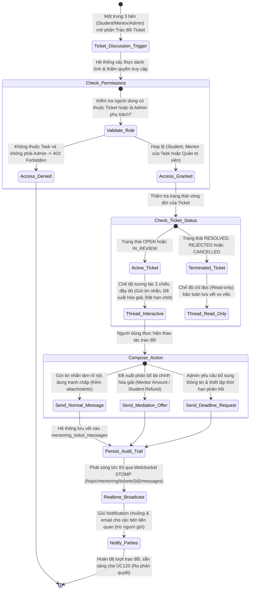
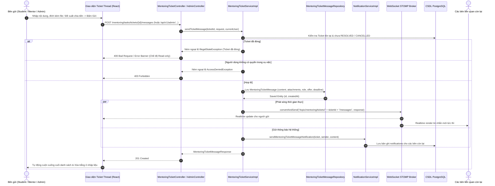

# ĐẶC TẢ YÊU CẦU & THIẾT KẾ CHI TIẾT: UC119 - TRAO ĐỔI TRONG TICKET TRANH CHẤP & THƯƠNG LƯỢNG HÒA GIẢI (STUDENT - MENTOR - ADMIN)

## PHẦN 1: ĐẶC TẢ NGHIỆP VỤ (REPORT 3)

### 2.2.3 Business Workflow (Luồng nghiệp vụ)



#### Mô tả chi tiết luồng xử lý bằng chữ (Business Step Description):
* **Bước 1 - Khởi đầu (Trigger & Tiền điều kiện)**:
  * Vé tranh chấp hoặc giải ngân thỏa thuận (`DISPUTE` / `SETTLEMENT`) đang ở trạng thái hoạt động (`OPEN` hoặc `IN_REVIEW`).
  * Người dùng là một trong 3 đối tượng được cấp quyền tham gia vụ việc:
    1. Học viên (`Student`) của Nhiệm vụ Mentoring.
    2. Cố vấn (`Mentor`) được giao Nhiệm vụ Mentoring.
    3. Quản trị viên (`Admin`) phụ trách thụ lý hồ sơ.
  * Trigger: Người dùng nhấn nút **"Trao đổi (UC119)"** trên thanh thông báo tranh chấp tại giao diện chi tiết Task (Học viên/Cố vấn) hoặc mở Tab 4 **"Trao đổi & Hòa giải (UC119)"** trong Modal hồ sơ vé (Admin).
* **Bước 2 - Hệ thống tải luồng trao đổi chính thức (Bước 50 - Display Discussion Thread)**:
  * Hệ thống truy xuất toàn bộ lịch sử tin nhắn của chiếc vé theo thứ tự thời gian (`GET /mentoring/tasks/tickets/{ticketId}/messages` hoặc `/api/v1/admin/mentoring/tickets/{ticketId}/messages`).
  * Kiểm tra trạng thái vé: Nếu vé đã kết thúc (`RESOLVED`, `REJECTED`, `CANCELLED`), hệ thống hiển thị banner cảnh báo và tự động vô hiệu hóa toàn bộ ô nhập liệu chuyển sang trạng thái **Read-only**.
* **Bước 3 - Gửi tin nhắn làm rõ & Thẩm tra bằng chứng (Bước 51 & 52 - Send Clarifications & Evidence Attachments)**:
  * Các bên nhập nội dung trao đổi, đính kèm tài liệu giải trình hoặc ảnh chụp màn hình chứng cứ bổ sung (tên file, URL, dung lượng).
  * Hệ thống kiểm tra tính hợp lệ của tệp đính kèm và định dạng JSON trước khi ghi nhận.
* **Bước 4 - Admin đề xuất phương án hòa giải hoặc đặt hạn chót (Bước 53 - Admin Mediation & Deadline Setting)**:
  * Quản trị viên có thể sử dụng các hành động điều phối đặc biệt:
    1. **Đề xuất phương án hòa giải (`MEDIATION_OFFER`)**: Nhập số tiền cụ thể phân bổ cho Mentor (`proposedMentorAmount`) và số tiền hoàn trả cho Học viên (`proposedStudentRefund`).
    2. **Yêu cầu bổ sung thông tin có kỳ hạn (`DEADLINE_REQUEST`)**: Thiết lập mốc thời gian tối hậu thư (`deadline`) để các bên phản hồi bổ sung chứng cứ. Nếu quá hạn, Admin có quyền căn cứ trên tài liệu hiện hữu để ra phán quyết cuối cùng.
* **Bước 5 - Lưu trữ lưu vết & Phát sóng thời gian thực (Bước 54 & 55 - Audit Logging & Realtime Notifications)**:
  * Hệ thống ghi nhận tin nhắn vào bảng `mentoring_ticket_messages` kèm danh tính người gửi (`sender_id`), vai trò (`sender_role`), loại tin nhắn (`message_type`) và dấu thời gian chính xác (`created_at`).
  * Hệ thống phát sóng thời gian thực tin nhắn mới qua WebSocket STOMP đích `/topic/mentoring/tickets/{ticketId}/messages` đến tất cả các bên đang mở khung trao đổi.
  * Đồng thời, hệ thống tạo bản ghi thông báo trong CSDL (`notifications`) gửi đến các bên còn lại trong vụ việc để thông báo có phản hồi mới.
* **Bước 6 - Hậu điều kiện (Post-condition)**:
  * Mọi trao đổi, đề xuất chia tiền và hạn chót đều được lưu vết pháp lý đầy đủ làm cơ sở vững chắc để Quản trị viên ban hành Quyết định giải quyết dứt điểm tại UC120.

---

### 3.2 Module Mentorship (Hướng Dẫn & Cố Vấn)

#### 3.2.1 Chức năng Trao đổi trong Ticket tranh chấp (UC119 - Dispute Ticket Discussion & Mediation)

**Function trigger**:
* **Navigation path**:
  * **Học viên / Cố vấn**: Trang chi tiết Task -> Click nút **"Trao đổi (UC119)"** trên Dispute Banner hoặc Settlement Banner.
  * **Quản trị viên**: Trang `/admin/mentoring-tickets` -> Click **"Chi tiết"** -> Chọn Tab **"Trao đổi & Hòa giải (UC119)"**.
* **Timing Frequency**: On-demand / Realtime (Mỗi khi có tương tác phản hồi, hòa giải hoặc tranh luận giữa 3 bên trong suốt thời gian thụ lý vé).

**Function description**:
* **Actors/Roles**:
  * Học viên (`ROLE_STUDENT` / Người tạo Task).
  * Cố vấn (`ROLE_ALUMNI` / Mentor được chốt thực hiện Task).
  * Quản trị viên hệ thống (`ROLE_ADMIN` / Người thụ lý vé tranh chấp).
* **Purpose**: Thiết lập một kênh đối thoại 3 bên minh bạch, độc lập với chat 1-1 thông thường, có lưu vết kiểm toán pháp lý nhằm tạo điều kiện cho các bên thương lượng, cung cấp giải trình bổ sung và giúp Admin đưa ra giải pháp hòa giải thấu đáo trước khi ban hành phán quyết.
* **Interface**:
  * **Header Luồng trao đổi**: Hiển thị tiêu đề "Trao đổi & Hòa giải 3 bên", số lượng tin nhắn, nhãn đối tượng tham gia (Học viên, Cố vấn, Quản trị viên) và nút Tải lại.
  * **Khu vực danh sách tin nhắn (Discussion Thread)**:
    - Tin nhắn Học viên: Nền xanh nhạt, badge `Học viên`, avatar biểu tượng người dùng.
    - Tin nhắn Cố vấn: Nền ngọc bích nhạt, badge `Cố vấn`, avatar mũ cử nhân tốt nghiệp.
    - Tin nhắn Quản trị viên: Nền tím cao cấp, badge `Ban Quản trị (Admin)`, avatar khiên bảo mật.
    - Khối tin nhắn Đề xuất hòa giải (`MEDIATION_OFFER`): Khung nổi bật hiển thị số tiền đề xuất cho Cố vấn và số tiền hoàn trả cho Học viên, kèm nút nhanh để các bên gửi phản hồi đồng thuận.
    - Khối tin nhắn Yêu cầu bổ sung có hạn chót (`DEADLINE_REQUEST`): Khung cảnh báo màu cam kèm mốc thời gian hết hạn phản hồi rõ ràng.
    - Khối đính kèm bằng chứng (Attachment Box): Danh sách các file đính kèm kèm kích thước, xem trước ảnh thu nhỏ và nút mở Lightbox phóng to.
  * **Khu vực soạn thảo (Action Toolbar & Input Form)**:
    - Các nút chuyển đổi hành động: "Tin nhắn thường", "Đề xuất chia tiền (Hòa giải)" (chỉ Admin/Mentor), "Đặt hạn chót phản hồi" (chỉ Admin).
    - Khung nhập số tiền đề xuất phân bổ khi kích hoạt chế độ Đề xuất hòa giải.
    - Khung chọn thời hạn phản hồi khi kích hoạt chế độ Đặt hạn chót.
    - Nút đính kèm tệp/bằng chứng trực quan.
    - Ô nhập văn bản hỗ trợ phím tắt `Ctrl + Enter` / `Cmd + Enter` để gửi nhanh.
    - Khung thông báo Read-only khi vé đã giải quyết xong.
* **Data processing**:
  1. Frontend gửi yêu cầu `POST /mentoring/tasks/tickets/{ticketId}/messages` (hoặc `/api/v1/admin/...` đối với Admin).
  2. Backend kiểm tra quyền thông qua `MentoringTicketService.sendTicketMessage`:
     - Kiểm tra vé tồn tại trong `mentoring_dispute_tickets`.
     - Xác thực người gửi có phải là Student của Task, Mentor của Task hoặc tài khoản mang quyền `ROLE_ADMIN`.
     - Nếu vé có trạng thái thuộc nhóm đóng (`RESOLVED`, `REJECTED`, `CANCELLED`), từ chối với ngoại lệ `IllegalStateException("Không thể gửi tin nhắn vì Ticket này đã đóng.")`.
     - Kiểm tra dữ liệu: Nếu `messageType = MEDIATION_OFFER`, kiểm tra `proposedMentorAmount` và `proposedStudentRefund` không âm và tổng không vượt quá số dư Escrow.
  3. Ghi đối tượng `MentoringTicketMessage` vào CSDL thông qua `MentoringTicketMessageRepository`.
  4. Kích hoạt `NotificationService.sendMentoringTicketMessageNotification` gửi thông báo cho các bên hữu quan.
  5. Đẩy tin nhắn qua `SimpMessagingTemplate` đến WebSocket topic `/topic/mentoring/tickets/{ticketId}/messages`.
  6. Trả về DTO `MentoringTicketMessageResponse` với mã HTTP `201 Created`.

---

### 3.3.3 Business Rules (Quy tắc nghiệp vụ)

* **BR119.1 (Ranh giới kênh trao đổi & Bảo mật độc lập - Rule 230)**: Kênh trao đổi UC119 được gắn chặt chẽ và độc quyền vào chiếc vé tranh chấp/hòa giải cụ thể (`mentoring_ticket_messages`), nơi có đủ 3 bên tham gia (Student – Mentor – Admin) và có lưu vết phục vụ phân xử. Hệ thống **tuyệt đối không tự ý thêm Admin vào kênh chat 1-1 riêng của Task** (`Chat for Task`). Mọi trao đổi vụ việc phải diễn ra tại thread của Ticket để đảm bảo quyền riêng tư của các cuộc hội thoại công việc thông thường.
* **BR119.2 (Đóng băng trao đổi khi có phán quyết - Immutability upon Resolution)**: Khi chiếc vé tranh chấp đã chuyển sang trạng thái kết thúc (`RESOLVED`, `REJECTED` hoặc `CANCELLED`), luồng trao đổi UC119 tự động chuyển sang chế độ **Read-only (Chỉ đọc)**. Hệ thống chặn hoàn toàn mọi yêu cầu gửi thêm tin nhắn từ cả 3 bên nhằm bảo toàn nguyên trạng bằng chứng và lưu vết pháp lý của vụ việc.
* **BR119.3 (Bảo vệ tính toàn vẹn số liệu đề xuất hòa giải)**: Đề xuất phân bổ tài chính (`MEDIATION_OFFER`) trong luồng trao đổi là căn cứ tham khảo thương lượng. Số tiền đề xuất thù lao cho Mentor và số tiền hoàn trả cho Học viên phải là các số nguyên dương hợp lệ, không âm và tổng hai khoản tiền không được vượt quá tổng quỹ tạm giữ (`Escrow Fund`) đang bảo đảm cho Task đó.
* **BR119.4 (Quyền áp đặt thời hạn phản hồi của Quản trị viên)**: Quản trị viên thụ lý hồ sơ có toàn quyền thiết lập thời hạn phản hồi bắt buộc (`DEADLINE_REQUEST`) cho các bên khi yêu cầu cung cấp thêm tài liệu. Nếu một bên không cung cấp phản hồi trước thời hạn này, Quản trị viên có quyền mặc định bên đó từ bỏ quyền khiếu nại và tiến hành ra phán quyết dựa trên các bằng chứng hiện có (chuẩn bị cho UC120).

---

## PHẦN 2: THIẾT KẾ KỸ THUẬT (TECHNICAL DESIGN)

### 1. Kiến trúc tổng thể luồng UC119



### 2. Thiết kế Cơ sở dữ liệu (Database Schema)

Bảng mới `mentoring_ticket_messages` được khởi tạo thông qua Flyway Migration `V29__create_mentoring_ticket_messages.sql`:

```sql
CREATE TABLE IF NOT EXISTS mentoring_ticket_messages (
    id BIGSERIAL PRIMARY KEY,
    ticket_id BIGINT NOT NULL,
    sender_id BIGINT NOT NULL,
    sender_role VARCHAR(50) NOT NULL,
    message_type VARCHAR(50) NOT NULL DEFAULT 'MESSAGE',
    content TEXT NOT NULL,
    attachments JSONB,
    proposed_mentor_amount NUMERIC(15, 2),
    proposed_student_refund NUMERIC(15, 2),
    deadline TIMESTAMP WITH TIME ZONE,
    created_at TIMESTAMP WITH TIME ZONE NOT NULL DEFAULT CURRENT_TIMESTAMP,

    CONSTRAINT fk_ticket_msg_ticket FOREIGN KEY (ticket_id) 
        REFERENCES mentoring_dispute_tickets(id) ON DELETE CASCADE,
    CONSTRAINT fk_ticket_msg_sender FOREIGN KEY (sender_id) 
        REFERENCES users(id) ON DELETE CASCADE
);

CREATE INDEX IF NOT EXISTS idx_mentoring_ticket_messages_ticket_id 
    ON mentoring_ticket_messages(ticket_id);
CREATE INDEX IF NOT EXISTS idx_mentoring_ticket_messages_created_at 
    ON mentoring_ticket_messages(created_at);
```

### 3. Chi tiết API Đặc tả (API Specifications)

#### 3.1 Lấy danh sách tin nhắn trao đổi trong Ticket (Dành cho Student & Mentor)
* **Endpoint**: `GET /mentoring/tasks/tickets/{ticketId}/messages`
* **Quyền truy cập**: Bearer Token của Học viên hoặc Cố vấn thuộc Nhiệm vụ liên kết với Ticket.
* **Mã trả về**: `200 OK`, `403 Forbidden` (nếu không thuộc Task), `404 Not Found` (nếu vé không tồn tại).

#### 3.2 Gửi tin nhắn hoặc Đề xuất hòa giải trong Ticket (Dành cho Student & Mentor)
* **Endpoint**: `POST /mentoring/tasks/tickets/{ticketId}/messages`
* **Quyền truy cập**: Bearer Token của Học viên hoặc Cố vấn thuộc Nhiệm vụ liên kết với Ticket.
* **Request Body JSON**:
```json
{
  "content": "Tôi đồng ý hoàn lại 1.000.000 VNĐ cho Học viên để khép lại tranh chấp trong êm đẹp.",
  "messageType": "MEDIATION_OFFER",
  "proposedMentorAmount": 500000,
  "proposedStudentRefund": 1000000,
  "attachments": [
    {
      "fileName": "bien_ban_dong_thuan.png",
      "fileUrl": "https://alumnect.s3.ap-southeast-1.amazonaws.com/disputes/agreement.png",
      "fileSize": 204800,
      "mimeType": "image/png"
    }
  ]
}
```
* **Response Body JSON (`201 Created`)**:
```json
{
  "id": 1,
  "ticketId": 1,
  "senderId": 2,
  "senderName": "Đỗ Hoàng Long",
  "senderAvatarUrl": null,
  "senderRole": "MENTOR",
  "messageType": "MEDIATION_OFFER",
  "content": "Tôi đồng ý hoàn lại 1.000.000 VNĐ cho Học viên để khép lại tranh chấp trong êm đẹp.",
  "attachments": [
    {
      "fileName": "bien_ban_dong_thuan.png",
      "fileUrl": "https://alumnect.s3.ap-southeast-1.amazonaws.com/disputes/agreement.png",
      "fileSize": 204800,
      "mimeType": "image/png"
    }
  ],
  "proposedMentorAmount": 500000,
  "proposedStudentRefund": 1000000,
  "deadline": null,
  "createdAt": "2026-10-14T03:25:31.439Z"
}
```

#### 3.3 Lấy danh sách tin nhắn trao đổi trong Ticket (Dành cho Quản trị viên)
* **Endpoint**: `GET /api/v1/admin/mentoring/tickets/{ticketId}/messages`
* **Quyền truy cập**: Bearer Token của Quản trị viên (`ROLE_ADMIN`).
* **Mã trả về**: `200 OK`, `403 Forbidden` (nếu không phải Admin).

#### 3.4 Admin gửi thông điệp điều phối, Đặt hạn chót hoặc Đề xuất hòa giải
* **Endpoint**: `POST /api/v1/admin/mentoring/tickets/{ticketId}/messages`
* **Quyền truy cập**: Bearer Token của Quản trị viên (`ROLE_ADMIN`).
* **Request Body JSON**:
```json
{
  "content": "Yêu cầu Mentor nộp lại tài liệu source code hoàn chỉnh trước 17:00 ngày mai.",
  "messageType": "DEADLINE_REQUEST",
  "deadline": "2026-10-15T10:00:00Z"
}
```

---

### 4. Ma trận kiểm thử tích hợp (Test Matrix)

| STT | Tình huống kiểm thử | Dữ liệu đầu vào | Kết quả kỳ vọng | Trạng thái thực tế |
|---|---|---|---|---|
| **TC01** | Admin truy xuất danh sách tin nhắn trong Ticket | Ticket ID hợp lệ, Bearer Token Admin | HTTP 200 OK, trả về danh sách mảng tin nhắn | **PASSED** (100%) |
| **TC02** | Student gửi tin nhắn làm rõ kèm hình ảnh minh chứng | Token Student thuộc Task, `attachments` hợp lệ | HTTP 201 Created, `senderRole = STUDENT`, lưu vết CSDL | **PASSED** (100%) |
| **TC03** | Admin gửi đề xuất phân bổ hòa giải (`MEDIATION_OFFER`) | Token Admin, `proposedMentorAmount: 500k`, `proposedStudentRefund: 1tr` | HTTP 201 Created, `senderRole = ADMIN`, broadcast WebSocket | **PASSED** (100%) |
| **TC04** | Mentor gửi phản hồi chấp thuận hòa giải | Token Mentor thuộc Task, nội dung đồng thuận | HTTP 201 Created, `senderRole = MENTOR`, hiển thị trực quan | **PASSED** (100%) |
| **TC05** | Người dùng ngoài Task cố ý đọc/gửi tin nhắn trong Ticket | Token User khác (Outsider ID: 6) | HTTP 403 Forbidden, bảo mật cách ly nghiêm ngặt | **PASSED** (100%) |
| **TC06** | Thao tác trên Ticket không tồn tại trong hệ thống | Ticket ID = `99999999` | HTTP 404 Not Found, không phát sinh lỗi hệ thống | **PASSED** (100%) |
