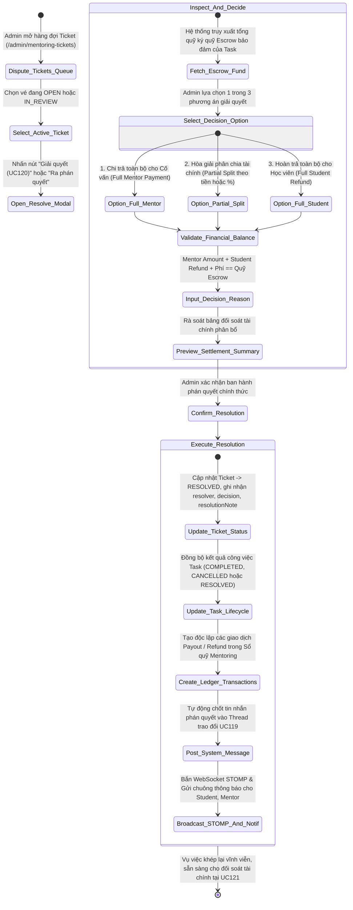
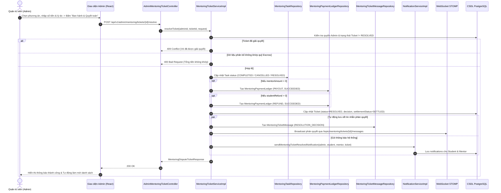

# ĐẶC TẢ YÊU CẦU & THIẾT KẾ CHI TIẾT: UC120 - QUYẾT ĐỊNH PHƯƠNG ÁN GIẢI QUYẾT TICKET (ADMIN TICKET RESOLUTION & ESCROW SETTLEMENT)

## PHẦN 1: ĐẶC TẢ NGHIỆP VỤ (REPORT 3)

### 2.2.3 Business Workflow (Luồng nghiệp vụ)



#### Mô tả chi tiết luồng xử lý bằng chữ (Business Step Description):
* **Bước 1 - Khởi đầu (Trigger & Tiền điều kiện)**:
  * Vé tranh chấp (`DISPUTE`) hoặc vé giải ngân hòa giải (`SETTLEMENT`) đang ở trạng thái hoạt động (`OPEN` hoặc `IN_REVIEW`).
  * Quản trị viên (`Admin`) đã tiếp nhận vụ việc (UC117) và đã xem xét đầy đủ hồ sơ bằng chứng, thỏa thuận Deal, lịch sử gia hạn và các Work Log đã nghiệm thu (UC118, UC119).
  * Trigger: Admin nhấn nút **"Giải quyết"** trên bảng danh sách hoặc nút **"Ra phán quyết (UC120)"** trong modal hồ sơ vụ việc.
* **Bước 2 - Hiển thị tóm tắt vụ việc & Quỹ tạm giữ Escrow (Bước 56 - Ticket Summary & Settlement Context)**:
  * Hệ thống mở modal chuyên biệt `AdminResolveTicketModal`, hiển thị mã định danh vé, tiêu đề Task, thông tin Học viên, Cố vấn và tổng số dư quỹ ký quỹ Escrow bảo đảm đang tạm giữ của Task (`availableFund`).
* **Bước 3 - Admin chọn phương án xử lý (Bước 57 - Select Resolution Option)**:
  * Quản trị viên lựa chọn 1 trong 3 phương án giải quyết cốt lõi:
    1. **Chi trả toàn bộ cho Cố vấn (`FULL_MENTOR_PAYMENT`)**: 100% quỹ ròng chuyển cho Cố vấn, Học viên hoàn 0 VNĐ. Áp dụng khi Mentor đã hoàn thành đầy đủ nghĩa vụ cam kết.
    2. **Hòa giải phân chia tài chính (`PARTIAL_SPLIT`)**: Phân chia một phần thù lao cho Cố vấn và hoàn lại một phần học phí cho Học viên. Áp dụng khi hai bên đồng thuận dừng Task hoặc nghiệm thu một phần sản phẩm.
    3. **Hoàn trả toàn bộ cho Học viên (`FULL_STUDENT_REFUND`)**: 100% quỹ ròng hoàn lại cho Học viên, Cố vấn nhận 0 VNĐ. Áp dụng khi Cố vấn vi phạm tiến độ nghiêm trọng hoặc không bàn giao kết quả hợp lệ.
* **Bước 4 - Xác định phân bổ tài chính & Phí xử lý (Bước 58 & 59 - Financial Allocation & Dispute Fee)**:
  * Admin có thể chọn chia theo **Số tiền cụ thể (VNĐ)** hoặc kéo thanh trượt **Phần trăm (%)**. Hệ thống tự động quy đổi tỷ lệ trên phần tiền sau phí và tính toán số tiền thực nhận của mỗi bên tức thì.
  * Thiết lập phí xử lý tranh chấp (`disputeFee`) theo chính sách công bố nếu có (mặc định 0 VNĐ).
* **Bước 5 - Thẩm tra tính toàn vẹn số liệu (Bước 60 - Financial Validation Check)**:
  * Hệ thống kiểm tra số tiền các khoản không được âm (`>= 0`).
  * Tổng kiểm tra bắt buộc: `mentorAmount + studentRefund + disputeFee == availableFund`. Nếu phát sinh chênh lệch dù chỉ 1 đồng, hệ thống chặn gửi và cảnh báo đỏ ngay trên giao diện.
* **Bước 6 - Nhập lý do phán quyết có căn cứ (Bước 58 - Decision Reason)**:
  * Admin nhập văn bản giải trình lý do đưa ra phán quyết (tối thiểu 10 ký tự). Có thể sử dụng các nút chọn mẫu lý do nhanh (Preset reasons).
* **Bước 7 - Ban hành phán quyết & Khóa vé (Bước 61 & 62 - Confirm & Persist Resolution)**:
  * Admin xác nhận ban hành. Hệ thống lưu `decision`, `resolutionNote`, gán `handledBy`, dấu thời gian `resolvedAt = NOW()` và chuyển trạng thái vé sang **`RESOLVED`**.
  * Đồng thời, hệ thống cập nhật kết quả công việc của Task:
    - Nếu chi toàn bộ cho Mentor: `task.status = COMPLETED`.
    - Nếu hoàn toàn bộ cho Student: `task.status = CANCELLED`.
    - Nếu hòa giải chia đôi/chia tỷ lệ: `task.status = RESOLVED`.
* **Bước 8 - Tạo giao dịch Sổ quỹ & Thông báo tự động (Bước 63 - Independent Payout/Refund & Audit Trail)**:
  * Hệ thống tạo các bản ghi giao dịch độc lập trong Sổ quỹ giao dịch Mentoring (`mentoring_payment_ledgers`):
    - Giao dịch **`PAYOUT`** cho Mentor nếu `mentorAmount > 0` (mã tham chiếu `PAYOUT_TICKET_{code}`).
    - Giao dịch **`REFUND`** cho Student nếu `studentRefund > 0` (mã tham chiếu `REFUND_TICKET_{code}`).
  * Ghi 1 tin nhắn hệ thống loại `RESOLUTION_DECISION` vào luồng trao đổi UC119 để công bố phán quyết.
  * Phát sóng WebSocket STOMP cập nhật thời gian thực giao diện và gửi thông báo Notification tới cả Học viên và Cố vấn.

---

### 3.2 Module Mentorship (Hướng Dẫn & Cố Vấn)

#### 3.2.1 Chức năng Quyết định phương án giải quyết Ticket (UC120 - Admin Decide Ticket Resolution)

**Function trigger**:
* **Navigation path**: Trang `/admin/mentoring-tickets` -> Click nút **"Giải quyết"** trên hàng của vé hoặc nút **"Ra phán quyết (UC120)"** trong modal xem chi tiết.
* **Timing Frequency**: On-demand (Mỗi khi Quản trị viên hoàn tất thẩm định hồ sơ và sẵn sàng ban hành quyết định kết thúc vụ việc tranh chấp / giải ngân thỏa thuận).

**Function description**:
* **Actors/Roles**: Quản trị viên hệ thống (Admin - `ROLE_ADMIN`).
* **Purpose**: Ban hành quyết định trọng tài cuối cùng có tính pháp lý ràng buộc để khép lại vụ việc, phân bổ số tiền ký quỹ Escrow minh bạch, kích hoạt chi trả thù lao/hoàn tiền và cập nhật vòng đời nhiệm vụ Mentoring Task.
* **Interface**:
  * **Header Modal**: Biểu tượng cán cân công lý (`Scale`), mã Ticket, huy hiệu `Phán quyết Admin (UC120)`, tên Task.
  * **Thẻ Quỹ ký quỹ Escrow**: Hiển thị tổng số tiền khả dụng đang được phong tỏa bảo đảm.
  * **Bộ chọn 3 Card Phương án lớn**:
    1. Card "Chi toàn bộ Mentor": Viền xanh lá, icon mũ cử nhân, mô tả ngắn.
    2. Card "Hòa giải chia tỷ lệ": Viền tím, icon cán cân, mô tả phân chia.
    3. Card "Hoàn trả toàn bộ": Viền xanh dương, icon hoàn tiền, mô tả hoàn học viên.
  * **Khung cấu hình hòa giải (khi chọn Partial Split)**:
    - Nút chuyển đổi chế độ "Số tiền" / "Tỷ lệ %".
    - Thanh trượt % trực quan kéo từ 0% đến 100%.
    - Ô nhập số tiền tùy biến cho Mentor và Student.
  * **Khung Phí xử lý tranh chấp**: Cho phép nhập số tiền phí theo chính sách (mặc định 0đ).
  * **Bảng đối soát tài chính phân bổ (Realtime Financial Audit)**: Nền tối sang trọng hiển thị rõ số tiền Mentor thực nhận, Student hoàn trả, phí sàn và cảnh báo cân đối quỹ.
  * **Khung Lý do phán quyết**: Các nút chọn nhanh preset lý do chuẩn mực và ô textarea nhập liệu chi tiết.
  * **Hộp cảnh báo pháp lý**: Lưu ý về tính ràng buộc bất biến của quyết định.
* **Data processing**:
  1. Frontend gửi yêu cầu `POST /api/v1/admin/mentoring/tickets/{ticketId}/resolve` kèm Bearer JWT của Admin.
  2. Backend kiểm tra quyền `ROLE_ADMIN`.
  3. `MentoringTicketServiceImpl.resolveTicket`:
     - Kiểm tra vé tồn tại và chưa ở trạng thái kết thúc (`RESOLVED`, `REJECTED`, `CANCELLED`).
     - Lấy tổng quỹ Escrow của Task từ `mentoring_payment_ledgers` (hoặc `ticket.totalAmount`).
     - Thẩm tra công thức: `mentorAmount + studentRefund + disputeFee == availableFund`.
     - Cập nhật vé: `status = RESOLVED`, `decision`, `resolutionNote`, `mentorAmount`, `studentRefund`, `disputeFee`, `settlementStatus = SETTLED`.
     - Cập nhật trạng thái Task tương ứng (`COMPLETED`, `CANCELLED` hoặc `RESOLVED`).
     - Tạo bản ghi `MentoringPaymentLedger` cho khoản PAYOUT và REFUND độc lập có kiểm tra chống chi trùng.
     - Tạo tin nhắn hệ thống phán quyết trong `mentoring_ticket_messages` và bắn STOMP qua `/topic/mentoring/tickets/{ticketId}/messages`.
     - Gửi thông báo Notification tới Student và Mentor.
     - Trả về `MentoringDisputeTicketResponse` với HTTP 200 OK.

---

### 3.3.3 Business Rules (Quy tắc nghiệp vụ)

* **BR120.1 (Thẩm quyền ra phán quyết độc quyền của Admin)**: Quyền ban hành quyết định giải quyết Ticket là thẩm quyền độc quyền của Quản trị viên (`ROLE_ADMIN`). Mọi yêu cầu gọi API `/resolve` từ người dùng không mang vai trò Admin (kể cả Học viên hay Cố vấn liên quan trực tiếp đến Task) đều bị hệ thống chặn đứng với mã lỗi `403 Forbidden`.
* **BR120.2 (Nguyên tắc bảo toàn cân đối quỹ Escrow & Chống bội chi - Rule 5.9)**: Mọi phương án giải quyết tài chính bắt buộc phải tuân thủ nghiêm ngặt nguyên tắc cân đối dòng tiền: `Mentor Amount + Student Refund + Phí tranh chấp (nếu có) = Tổng quỹ Escrow khả dụng`. Tuyệt đối không cho phép phân bổ vượt quá số tiền ký quỹ đang có hoặc để dư tiền không có lý do.
* **BR120.3 (Độc lập và chống lặp giao dịch Sổ quỹ Payout/Refund - Rule 288)**: Các khoản chi thù lao cho Cố vấn và hoàn tiền cho Học viên được tạo thành các bản ghi giao dịch độc lập trong Sổ quỹ Mentoring (`mentoring_payment_ledgers`) với mã tham chiếu duy nhất. Nếu một bên đã nhận tiền thành công và bên kia gặp lỗi, hệ thống chỉ xử lý lại khoản thất bại, tuyệt đối không chi lặp khoản đã thành công.
* **BR120.4 (Bất biến lưu vết & Đồng bộ trạng thái vòng đời Task - Rule 287 & 289)**: Sau khi Admin xác nhận ban hành phán quyết, chiếc vé chuyển sang trạng thái `RESOLVED` và đóng băng vĩnh viễn (không cho phép sửa đổi hoặc giải quyết lại lần thứ hai - ném `409 Conflict`). Trạng thái vòng đời của Task được cập nhật tương ứng (`COMPLETED`, `CANCELLED` hoặc `RESOLVED`) để khép lại hoàn toàn quy trình Mentoring.

---

## PHẦN 2: THIẾT KẾ KỸ THUẬT (TECHNICAL DESIGN)

### 1. Kiến trúc tổng thể luồng UC120



### 2. Thiết kế Cơ sở dữ liệu (Database Schema)

Cơ sở dữ liệu được mở rộng thông qua Flyway Migration `V30__add_ticket_resolution_fields.sql`:

```sql
-- 1. Bổ sung các cột phán quyết cho mentoring_dispute_tickets
ALTER TABLE mentoring_dispute_tickets
    ADD COLUMN IF NOT EXISTS decision VARCHAR(50),
    ADD COLUMN IF NOT EXISTS dispute_fee NUMERIC(15, 2) NOT NULL DEFAULT 0,
    ADD COLUMN IF NOT EXISTS settlement_status VARCHAR(50) NOT NULL DEFAULT 'PENDING',
    ADD COLUMN IF NOT EXISTS mentor_payout_ledger_id BIGINT,
    ADD COLUMN IF NOT EXISTS student_refund_ledger_id BIGINT;

-- 2. Ràng buộc khóa ngoại tới sổ quỹ giao dịch
ALTER TABLE mentoring_dispute_tickets
    ADD CONSTRAINT fk_dispute_tickets_payout_ledger
    FOREIGN KEY (mentor_payout_ledger_id) REFERENCES mentoring_payment_ledgers(id) ON DELETE SET NULL;

ALTER TABLE mentoring_dispute_tickets
    ADD CONSTRAINT fk_dispute_tickets_refund_ledger
    FOREIGN KEY (student_refund_ledger_id) REFERENCES mentoring_payment_ledgers(id) ON DELETE SET NULL;

-- 3. Mở rộng trạng thái bảng mentoring_tasks để hỗ trợ RESOLVED
ALTER TABLE mentoring_tasks DROP CONSTRAINT IF EXISTS ck_mentoring_tasks_status;
ALTER TABLE mentoring_tasks ADD CONSTRAINT ck_mentoring_tasks_status
    CHECK (status IN ('PREPARATION', 'IN_PROGRESS', 'SUBMITTED', 'COMPLETED', 'CANCELLED', 'DISPUTED', 'RESOLVED'));
```

### 3. Chi tiết API Đặc tả (API Specifications)

#### 3.1 Quản trị viên ra phán quyết giải quyết Ticket
* **Endpoint**: `POST /api/v1/admin/mentoring/tickets/{ticketId}/resolve`
* **Quyền truy cập**: Bearer Token của Quản trị viên (`ROLE_ADMIN`).
* **Request Body JSON**:
```json
{
  "decision": "PARTIAL_SPLIT",
  "decisionReason": "Căn cứ các Work Log đã nghiệm thu (60%), Ban Quản Trị quyết định chi trả 12.000 VNĐ cho Cố vấn và hoàn lại 8.000 VNĐ cho Học viên.",
  "mentorAmount": 12000,
  "studentRefund": 8000,
  "disputeFee": 0,
  "splitMode": "AMOUNT"
}
```
* **Response Body JSON (`200 OK`)**:
```json
{
  "error": 0,
  "message": "Ban hành phán quyết giải quyết Ticket thành công",
  "data": {
    "id": 2,
    "ticketCode": "DP-20261013-330760",
    "ticketType": "DISPUTE",
    "taskId": 1,
    "taskTitle": "Hướng dẫn thực hiện đồ án tốt nghiệp React & Spring Boot",
    "title": "Cố vấn bàn giao thiếu module thanh toán",
    "status": "RESOLVED",
    "decision": "PARTIAL_SPLIT",
    "mentorAmount": 12000,
    "studentRefund": 8000,
    "disputeFee": 0,
    "settlementStatus": "SETTLED",
    "mentorPayoutLedgerId": 2,
    "studentRefundLedgerId": 3,
    "handledBy": {
      "id": 12,
      "fullName": "Quản trị viên AlumNect",
      "email": "admin@alumnect.edu.vn",
      "role": "ADMIN"
    },
    "resolvedAt": "2026-10-14T03:47:51.120Z",
    "resolutionNote": "Căn cứ các Work Log đã nghiệm thu (60%), Ban Quản Trị quyết định chi trả 12.000 VNĐ cho Cố vấn và hoàn lại 8.000 VNĐ cho Học viên.",
    "createdAt": "2026-10-13T16:30:00Z",
    "updatedAt": "2026-10-14T03:47:51.120Z"
  }
}
```

---

### 4. Ma trận kiểm thử tích hợp (Test Matrix)

| STT | Tình huống kiểm thử | Dữ liệu đầu vào | Kết quả kỳ vọng | Trạng thái thực tế |
|---|---|---|---|---|
| **TC01** | Học viên cố ý gọi API phán quyết | Bearer Token Student | HTTP 403 Forbidden | **PASSED** (100%) |
| **TC02** | Admin để trống lý do phán quyết | `decisionReason: ""` | HTTP 400 Bad Request, bắt buộc >= 10 ký tự | **PASSED** (100%) |
| **TC03** | Số tiền chia lệch với tổng quỹ Escrow | `mentor: 5k, student: 5k (tổng 10k != 20k)` | HTTP 400 Bad Request, báo lỗi lệch quỹ | **PASSED** (100%) |
| **TC04** | Admin ban hành phán quyết PARTIAL_SPLIT hợp lệ | `mentor: 12k, student: 8k`, lý do hợp lệ | HTTP 200 OK, `RESOLVED`, tạo 2 ledger, cập nhật Task | **PASSED** (100%) |
| **TC05** | Thử Resolve lại vé đã ở trạng thái RESOLVED | Ticket ID 2 đã RESOLVED | HTTP 409 Conflict, chống xử lý lặp lại | **PASSED** (100%) |
| **TC06** | Kiểm tra tin nhắn phán quyết trong Thread UC119 | Gọi `GET /messages` của Ticket 2 | Tìm thấy tin nhắn loại `RESOLUTION_DECISION` | **PASSED** (100%) |
