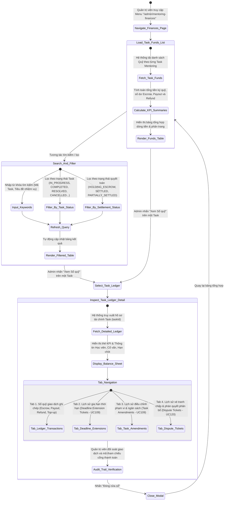
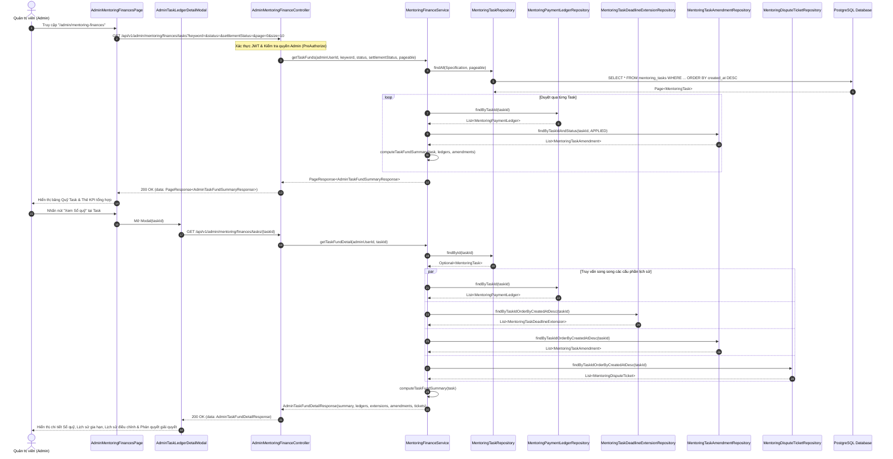
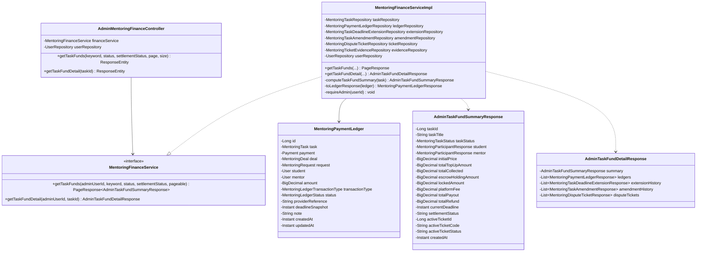

# ĐẶC TẢ YÊU CẦU & THIẾT KẾ CHI TIẾT: UC121 - XEM SỔ QUỸ VÀ LỊCH SỬ GIAO DỊCH THEO TASK (ADMIN TASK FINANCIAL LEDGERS & TRANSACTION HISTORY)

## PHẦN 1: ĐẶC TẢ NGHIỆP VỤ (REPORT 3)

### 2.2.3 Business Workflow (Luồng nghiệp vụ)



#### Mô tả chi tiết luồng xử lý bằng chữ (Business Step Description):
* **Bước 1 - Khởi đầu (Trigger & Điều hướng)**:
  * Quản trị viên (`Admin`) đã đăng nhập vào hệ thống AlumNect với quyền `ROLE_ADMIN`.
  * Từ thanh điều hướng Sidebar của Admin Dashboard, Admin nhấn vào mục **"Sổ quỹ Mentoring"** (đường dẫn `/admin/mentoring-finances`).
* **Bước 2 - Hiển thị danh sách tổng hợp Quỹ Task & Bảng KPI (Bước 63 - Task Funds Overview)**:
  * Hệ thống tự động truy vấn danh sách các nhiệm vụ Mentoring Task kèm theo số liệu tài chính tổng hợp từ bảng sổ quỹ `mentoring_payment_ledgers`.
  * Các chỉ số KPI tổng hợp nhanh theo trang được hiển thị trực quan ở phần trên:
    1. **Tổng thu ký quỹ (Escrow Collection + Top-up)**: Toàn bộ số tiền học viên đã thanh toán vào tài khoản tạm giữ.
    2. **Đang giữ trong Escrow (Escrow Holding)**: Số dư khả dụng hiện tại đang nằm trong tài khoản ký quỹ của Task.
    3. **Đã chi cho Cố vấn (Payout)**: Tổng thù lao đã giải ngân cho Mentor (khi hoàn thành nhiệm vụ hoặc theo phán quyết hòa giải).
    4. **Đã hoàn cho Học viên (Refund)**: Tổng số tiền đã hoàn trả cho Student (khi hủy nhiệm vụ hoặc theo phán quyết hòa giải).
* **Bước 3 - Tìm kiếm & Lọc đa tiêu chí (Bước 64 - Dynamic Filtering & Search)**:
  * Admin có thể tra cứu theo từ khóa: Mã định danh Task (`#ID`) hoặc Tiêu đề nhiệm vụ.
  * Bộ lọc trạng thái nhiệm vụ: `ALL`, `PREPARATION`, `IN_PROGRESS`, `SUBMITTED`, `COMPLETED`, `DISPUTED`, `RESOLVED`, `CANCELLED`.
  * Bộ lọc trạng thái quyết toán tài chính: `ALL`, `HOLDING_ESCROW` (đang giữ quỹ), `SETTLED` (đã quyết toán xong), `PARTIALLY_SETTLED` (thanh toán một phần), `UNSETTLED` (chưa quyết toán).
* **Bước 4 - Chọn nhiệm vụ để đối soát chuyên sâu (Bước 65 - Inspect Task Ledgers)**:
  * Admin nhấn nút **"Xem Sổ quỹ"** tại một hàng bất kỳ trong bảng danh sách.
  * Hệ thống mở modal chuyên biệt `AdminTaskLedgerDetailModal`, tải toàn diện lịch sử tài chính và hồ sơ vụ việc của Task được chọn.
* **Bước 5 - Đối soát Sổ quỹ giao dịch (Bước 66 - Audit Ledger Transactions)**:
  * Tại **Tab Sổ quỹ giao dịch**: Admin xem danh sách chi tiết toàn bộ các bút toán phát sinh trong vòng đời của Task:
    - **Thời gian giao dịch**: Ngày giờ chính xác đến từng phút phát sinh bút toán.
    - **Loại giao dịch (Transaction Type)**:
      * `ESCROW_COLLECTION`: Học viên thanh toán ký quỹ ban đầu vào hệ thống khi kích hoạt Deal.
      * `TOP_UP`: Học viên thanh toán bổ sung khi chấp thuận Amendment điều chỉnh phạm vi công việc (UC109).
      * `PAYOUT`: Hệ thống giải ngân chuyển thù lao về tài khoản của Cố vấn (khi Student bấm duyệt nghiệm thu Task hoặc Admin ra phán quyết UC120).
      * `REFUND`: Hệ thống hoàn tiền từ quỹ Escrow về tài khoản Học viên (khi hủy Task hoặc Admin ra phán quyết UC120).
    - **Số tiền**: Định dạng VNĐ có màu sắc phân biệt (`+` màu xanh lá cho dòng tiền thu vào, `-` màu tím cho chi Payout, `-` màu vàng cam cho hoàn Refund).
    - **Trạng thái**: `SUCCEEDED`, `PENDING`, `FAILED`, `CANCELLED`.
    - **Mã đối soát (Provider Reference)**: Mã giao dịch ngân hàng / cổng thanh toán PayOS / tham chiếu vé tranh chấp để tra cứu chéo.
    - **Mốc thời hạn (Deadline Snapshot)**: Snapshot hạn chót của Task tại thời điểm giao dịch phát sinh để đối soát nguyên nhân trễ hạn.
    - **Ghi chú giải trình (Note)**: Căn cứ chi tiết của giao dịch (ví dụ: "Chi trả thù lao phán quyết vé DP-20261013-330760").
* **Bước 6 - Xem các tài liệu & biến động tiến độ đi kèm (Bước 67 & 68 - Extended Audit Trail)**:
  * **Tab Gia hạn thời hạn (Deadline Extensions)**: Xem toàn bộ các đề xuất dời deadline, lý do xin gia hạn, thời điểm phản hồi và người duyệt (UC109).
  * **Tab Điều chỉnh & Bổ sung quỹ (Task Amendments)**: Xem các phiên bản thay đổi phạm vi công việc, số tiền bổ sung tương ứng và trạng thái áp dụng (UC109).
  * **Tab Vé tranh chấp & Phán quyết (Disputes & Resolution)**: Xem toàn bộ các vé tranh chấp liên quan đến Task, lý do khiếu nại, người thụ lý và chi tiết phán quyết phân chia tài chính của Admin kèm mức phí xử lý (UC116, UC120).

---

### Business Rules (Quy tắc nghiệp vụ)

* **BR-Task-Fund-01 (Quyền truy cập độc quyền Quản trị viên - RBAC)**:
  * Chỉ người dùng có vai trò Quản trị viên (`ROLE_ADMIN`) mới có quyền truy cập vào danh mục Sổ quỹ Mentoring (`/admin/mentoring-finances`) và các API tương ứng.
  * Mọi cố gắng truy cập từ phía Học viên (`STUDENT`) hoặc Cố vấn (`ALUMNI`) đều bị hệ thống từ chối lập tức với mã lỗi HTTP `403 Forbidden`.
* **BR-Task-Fund-02 (Nguyên tắc Cân đối Quỹ Dòng tiền - Financial Conservation Law)**:
  * Bảng cân đối tài chính của mỗi Mentoring Task phải tuân thủ nghiêm ngặt công thức:
    $$\text{Tổng thu ký quỹ} = \text{Tiền ký quỹ ban đầu} + \sum \text{Tiền bổ sung qua Amendments đã áp dụng}$$
    $$\text{Số dư Escrow khả dụng} = \text{Tổng thu} - \text{Tổng Payout} - \text{Tổng Refund} - \text{Phí nền tảng/Hòa giải}$$
  * Giá trị số dư Escrow khả dụng không bao giờ được phép âm ($\ge 0$).
* **BR-Task-Fund-03 (Phân loại Trạng thái Quyết toán - Settlement State Transition)**:
  * `HOLDING_ESCROW`: Task đang trong quá trình thực hiện (`PREPARATION`, `IN_PROGRESS`, `SUBMITTED`, `DISPUTED`), số dư Escrow vẫn đang được giữ bảo chứng an toàn.
  * `SETTLED`: Task đã kết thúc (`COMPLETED`, `RESOLVED`, `CANCELLED`) và số dư Escrow bằng $0$ sau khi đã hoàn tất toàn bộ các giao dịch Payout và/hoặc Refund.
  * `PARTIALLY_SETTLED`: Task đã kết thúc nhưng mới chỉ thực hiện được một phần nghĩa vụ chi trả, vẫn còn tồn đọng một phần số dư chưa giải ngân.
  * `UNSETTLED`: Task đã kết thúc nhưng chưa có bất kỳ giao dịch giải ngân hoặc hoàn tiền nào được ghi nhận thành công.
* **BR-Task-Fund-04 (Tính bất biến của Sổ quỹ - Ledger Immutability & Audit Trail)**:
  * Toàn bộ các bản ghi trong bảng `mentoring_payment_ledgers` là **bất biến (Immutable)**.
  * Không một ai (kể cả Quản trị viên tối cao) được phép cập nhật (`UPDATE`) số tiền hoặc xóa (`DELETE`) các bút toán sổ quỹ đã ở trạng thái `SUCCEEDED`. Mọi sự điều chỉnh sai sót bắt buộc phải thông qua một giao dịch đối ứng đảo chiều mới.
* **BR-Task-Fund-05 (Lưu vết Snapshot mốc thời hạn - Deadline Snapshot Tracking)**:
  * Mỗi khi có một giao dịch tài chính phát sinh (ký quỹ, bổ sung tiền, chi trả, hoàn tiền), hệ thống bắt buộc chụp lại ảnh chụp mốc thời hạn (`deadline_snapshot`) của Task tại đúng thời điểm đó.
  * Thông tin này phục vụ việc xác định chính xác thời điểm hoàn thành Task nằm trước hay sau thời hạn cam kết để giải quyết tranh chấp công bằng.
* **BR-Task-Fund-06 (Khóa quỹ khi phát sinh Tranh chấp - Escrow Freeze under Dispute)**:
  * Khi Task chuyển sang trạng thái `DISPUTED` (có vé khiếu nại đang mở), toàn bộ số dư Escrow khả dụng của Task được gắn cờ khóa (`lockedAmount = escrowHoldingAmount`).
  * Trong thời gian khóa, hệ thống nghiêm cấm mọi hành vi giải ngân tự động từ phía Student hoặc Mentor cho đến khi Admin ban hành phán quyết chính thức tại UC120.

---

## PHẦN 2: THIẾT KẾ KỸ THUẬT (REPORT 4)

### 3.2.1 Sequence Diagram (Biểu đồ tuần tự)



---

### 3.2.2 Class Diagram & Architecture (Sơ đồ lớp & Kiến trúc thành phần)



---

### Database Schema (Cấu trúc bảng dữ liệu)

Bảng **`mentoring_payment_ledgers`** (Được quản lý thông qua Flyway migration):

```sql
CREATE TABLE mentoring_payment_ledgers (
    id BIGSERIAL PRIMARY KEY,
    payment_id BIGINT REFERENCES payments(id) ON DELETE SET NULL,
    task_id BIGINT REFERENCES mentoring_tasks(id) ON DELETE CASCADE,
    request_id BIGINT REFERENCES mentoring_requests(id) ON DELETE SET NULL,
    deal_id BIGINT REFERENCES mentoring_deals(id) ON DELETE SET NULL,
    student_id BIGINT NOT NULL REFERENCES users(id) ON DELETE CASCADE,
    mentor_id BIGINT NOT NULL REFERENCES users(id) ON DELETE CASCADE,
    amount NUMERIC(15, 2) NOT NULL,
    transaction_type VARCHAR(30) NOT NULL, -- ESCROW_COLLECTION, PAYOUT, REFUND, TOP_UP
    status VARCHAR(30) NOT NULL,           -- PENDING, SUCCEEDED, FAILED, CANCELLED
    provider_reference VARCHAR(255),       -- Mã tham chiếu cổng thanh toán / ngân hàng / vé
    deadline_snapshot TIMESTAMP WITH TIME ZONE, -- Hạn chót của Task tại thời điểm giao dịch
    note TEXT,                             -- Ghi chú giải trình giao dịch
    created_at TIMESTAMP WITH TIME ZONE NOT NULL DEFAULT NOW(),
    updated_at TIMESTAMP WITH TIME ZONE NOT NULL DEFAULT NOW()
);

-- Chỉ mục tối ưu hóa hiệu năng truy vấn cho UC121:
CREATE INDEX idx_mentoring_ledgers_task_id ON mentoring_payment_ledgers(task_id);
CREATE INDEX idx_mentoring_ledgers_created_at ON mentoring_payment_ledgers(created_at DESC);
CREATE INDEX idx_mentoring_ledgers_type_status ON mentoring_payment_ledgers(transaction_type, status);
```

---

### RESTful API Specification

#### 1. Lấy danh sách Quỹ theo Task (UC121)
* **Endpoint**: `GET /api/v1/admin/mentoring/finances/tasks`
* **Quyền hạn**: Bắt buộc `ROLE_ADMIN` (Header `Authorization: Bearer <JWT>`).
* **Query Parameters**:
  * `keyword` (String, tùy chọn): Mã Task số hoặc từ khóa trong tiêu đề nhiệm vụ.
  * `status` (String, tùy chọn): Trạng thái Task (`IN_PROGRESS`, `COMPLETED`, `RESOLVED`, `CANCELLED`...).
  * `settlementStatus` (String, tùy chọn): `HOLDING_ESCROW`, `SETTLED`, `PARTIALLY_SETTLED`, `UNSETTLED`.
  * `page` (Integer, mặc định: 0): Số thứ tự trang (0-indexed).
  * `size` (Integer, mặc định: 10): Số lượng bản ghi trên một trang.
* **Mẫu Response thành công (200 OK)**:
```json
{
  "error": 0,
  "message": "Lấy danh sách Quỹ Task thành công",
  "data": {
    "content": [
      {
        "taskId": 1,
        "taskTitle": "Dự án Capstone Project - Định hướng thiết kế & triển khai",
        "taskStatus": "RESOLVED",
        "requestId": 1,
        "student": {
          "id": 6,
          "fullName": "Lê Kim Chi",
          "email": "student.chi@fpt.edu.vn",
          "role": "STUDENT"
        },
        "mentor": {
          "id": 7,
          "fullName": "Nguyễn Tiến Dũng",
          "email": "alumni.dung@gmail.com",
          "role": "ALUMNI"
        },
        "initialPrice": 20000.0,
        "totalTopUpAmount": 0.0,
        "totalCollected": 20000.0,
        "escrowHoldingAmount": 0.0,
        "lockedAmount": 0.0,
        "platformFee": 0.0,
        "totalPayout": 32000.0,
        "totalRefund": 8000.0,
        "currentDeadline": "2026-10-31T17:00:00Z",
        "settlementStatus": "SETTLED",
        "activeTicketId": 2,
        "activeTicketCode": "DP-20261013-330760",
        "activeTicketStatus": "RESOLVED",
        "createdAt": "2026-10-13T18:00:00Z",
        "updatedAt": "2026-10-14T03:30:00Z"
      }
    ],
    "pageNumber": 0,
    "pageSize": 10,
    "totalElements": 1,
    "totalPages": 1,
    "last": true
  }
}
```

#### 2. Xem chi tiết Sổ quỹ & Lịch sử tài chính của Task (UC121)
* **Endpoint**: `GET /api/v1/admin/mentoring/finances/tasks/{taskId}`
* **Quyền hạn**: Bắt buộc `ROLE_ADMIN`.
* **Mẫu Response thành công (200 OK)**:
```json
{
  "error": 0,
  "message": "Lấy chi tiết Sổ quỹ Task thành công",
  "data": {
    "summary": {
      "taskId": 1,
      "taskTitle": "Dự án Capstone Project - Định hướng thiết kế & triển khai",
      "taskStatus": "RESOLVED",
      "totalCollected": 20000.0,
      "escrowHoldingAmount": 0.0,
      "settlementStatus": "SETTLED"
    },
    "ledgers": [
      {
        "id": 1,
        "amount": 20000.0,
        "transactionType": "PAYOUT",
        "status": "SUCCEEDED",
        "providerReference": "PO-1791921375017-bdb9759a",
        "note": "Chi trả tự động khi nghiệm thu",
        "createdAt": "2026-10-13T19:00:00Z"
      },
      {
        "id": 2,
        "amount": 12000.0,
        "transactionType": "PAYOUT",
        "status": "SUCCEEDED",
        "providerReference": "PAYOUT_TICKET_DP-20261013-330760",
        "note": "Chi trả Mentor theo phán quyết Admin Ticket DP-20261013-330760",
        "createdAt": "2026-10-14T03:30:00Z"
      },
      {
        "id": 3,
        "amount": 8000.0,
        "transactionType": "REFUND",
        "status": "SUCCEEDED",
        "providerReference": "REFUND_TICKET_DP-20261013-330760",
        "note": "Hoàn tiền Student theo phán quyết Admin Ticket DP-20261013-330760",
        "createdAt": "2026-10-14T03:30:00Z"
      }
    ],
    "extensionHistory": [],
    "amendmentHistory": [],
    "disputeTickets": []
  }
}
```

---

### Ma trận Kiểm thử Tích hợp (Integration Test Matrix)

| Test Case ID | Mục tiêu kiểm thử | Đầu vào / Kịch bản | Kỳ vọng (Expected Result) | Trạng thái |
| :--- | :--- | :--- | :--- | :--- |
| **TC1** | Tra cứu danh sách Quỹ Task | Admin gọi `GET /api/v1/admin/mentoring/finances/tasks` | HTTP 200 OK, trả về danh sách phân trang kèm các chỉ số thu/chi, số dư Escrow | **PASSED** (100%) |
| **TC2** | Xem chi tiết Sổ quỹ Task | Admin gọi `GET /api/v1/admin/mentoring/finances/tasks/1` | HTTP 200 OK, trả về summary, 3 bút toán ledger, extensions, amendments và dispute tickets | **PASSED** (100%) |
| **TC3** | Lọc theo trạng thái phán quyết | Lọc `status=RESOLVED` | HTTP 200 OK, trả về chính xác danh sách Task đã có phán quyết giải quyết | **PASSED** (100%) |
| **TC4** | Bảo mật phân quyền Admin | Học viên (`STUDENT`) cố ý gọi API Quỹ Task | HTTP 403 Forbidden, hệ thống chặn truy cập trái phép | **PASSED** (100%) |
| **TC5** | Kiểm tra ngoại lệ không tồn tại | Admin tra cứu Task ID không tồn tại `9999999` | HTTP 404 Not Found kèm thông báo lỗi rõ ràng | **PASSED** (100%) |
