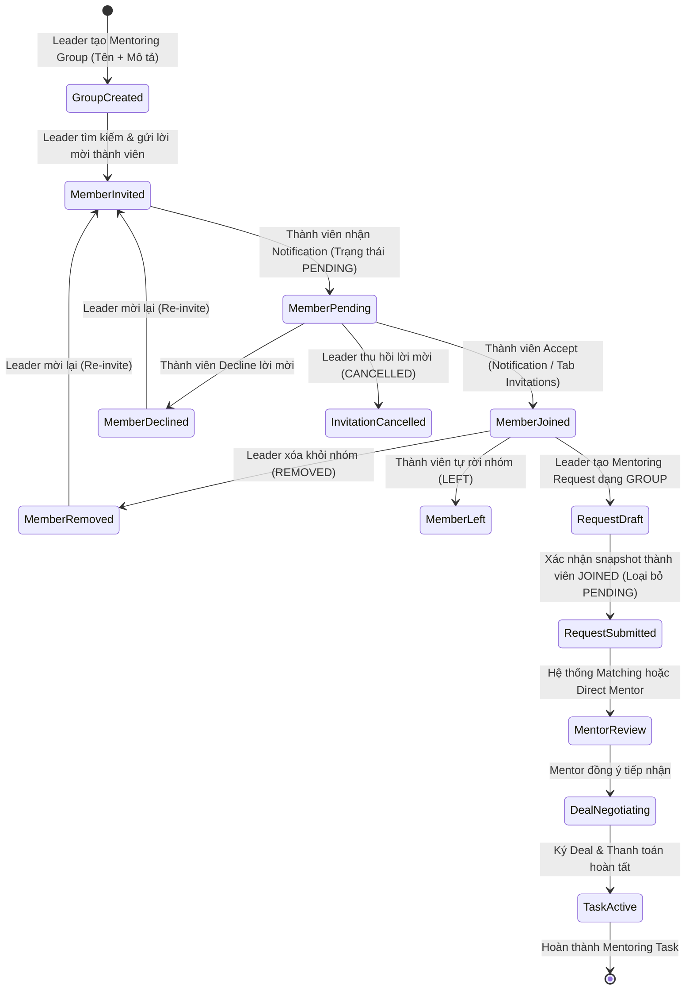
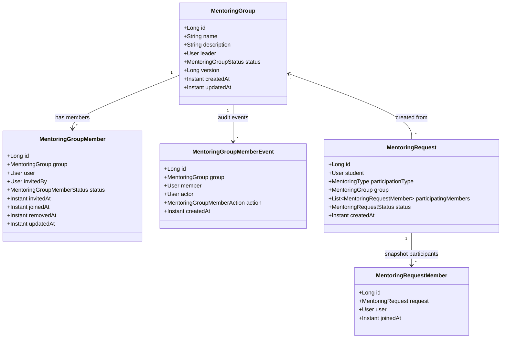
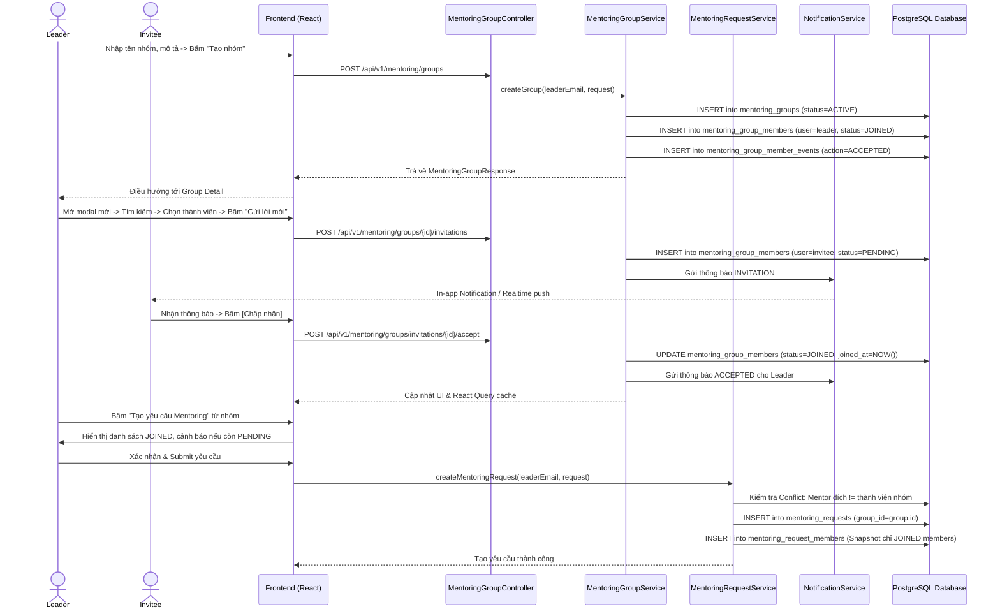

# ĐẶC TẢ YÊU CẦU & THIẾT KẾ CHI TIẾT: UC122 - QUẢN LÝ NHÓM MENTORING THEO MÔ HÌNH GROUP-FIRST

## PHẦN 1: ĐẶC TẢ NGHIỆP VỤ (REPORT 3)

### 2.2.3 Business Workflow (Luồng nghiệp vụ)

Mô hình **GROUP-FIRST** định nghĩa vòng đời của Nhóm Mentoring (`MentoringGroup`) là hoàn toàn độc lập với yêu cầu Mentoring (`MentoringRequest`). Người dùng phải tạo nhóm trước, mời thành viên và xác nhận danh sách thành viên tham gia (`JOINED`) trước khi gửi Mentoring Request dạng nhóm.



#### Mô tả chi tiết luồng xử lý bằng chữ (Business Step Description):

* **Bước 1 - Khởi tạo nhóm Mentoring (Group Creation)**: 
  * Sinh viên hoặc Cựu sinh viên (Student/Alumni) truy cập mục Mentorship -> My Mentoring Groups -> Nhấn `Tạo nhóm mới`.
  * Nhập tên nhóm (bắt buộc) và mô tả mục tiêu định hướng của nhóm (tùy chọn).
  * Hệ thống lưu bản ghi `mentoring_groups` với trạng thái `ACTIVE`. Người tạo tự động trở thành **Group Leader** và được cấp bản ghi `mentoring_group_members` với trạng thái `JOINED` ngay lập tức.
  * Điều hướng trực tiếp đến màn hình Chi tiết nhóm (`Group Detail`) với lời gọi hành động `Mời thành viên`.

* **Bước 2 - Mời thành viên (Member Invitations)**:
  * Trưởng nhóm mở hộp thoại `Mời thành viên` (`InviteMembersModal`), nhập từ khóa tìm kiếm người dùng (theo họ tên, email, chuyên ngành).
  * Hệ thống tìm kiếm và hiển thị danh sách người dùng kèm trạng thái: `Đã tham gia`, `Đang chờ phản hồi`, `Đã từ chối` (hiển thị nút *Mời lại*), `Đã bị xóa` (hiển thị nút *Mời lại*), hoặc nút `Mời`.
  * Trưởng nhóm chọn người dùng và bấm gửi lời mời. Hệ thống kiểm tra: quyền Leader, nhóm đang ACTIVE, không tự mời chính mình, tài khoản mời phải ACTIVE, không gửi trùng khi đang PENDING.
  * Hệ thống tạo bản ghi `mentoring_group_members` ở trạng thái `PENDING`, ghi nhận `invited_by`, `invited_at`, lưu vết audit event `INVITED` và phát sinh In-app/Realtime Notification cho người được mời.

* **Bước 3 - Phản hồi lời mời (Accept / Decline / Cancel)**:
  * Người được mời có thể phản hồi trực tiếp từ 3 vị trí: Dropdown thông báo trên Navbar, Trang Trung tâm thông báo (`NotificationsPage`), hoặc Tab *Lời mời đang chờ* trong trang Quản lý nhóm (`MentoringGroupsPage`).
  * **Chấp nhận (Accept)**: Kiểm tra lời mời thuộc người dùng hiện tại, trạng thái đang `PENDING`, nhóm còn ACTIVE. Cập nhật trạng thái thành `JOINED`, lưu `joined_at`, phát sinh event `ACCEPTED`, gửi thông báo cho Leader, đồng bộ cache React Query trên toàn bộ các vị trí.
  * **Từ chối (Decline)**: Mở hộp thoại xác nhận. Cập nhật trạng thái thành `DECLINED`, lưu event `DECLINED`, gửi thông báo cho Leader.
  * **Hủy lời mời (Cancel)**: Trưởng nhóm có thể thu hồi lời mời đang chờ (`PENDING`). Trạng thái chuyển sang `CANCELLED`, người được mời không thể tiếp tục Accept lời mời cũ.

* **Bước 4 - Quản lý thành viên & Rời nhóm (Remove / Leave)**:
  * **Xóa thành viên (Remove)**: Trưởng nhóm có quyền xóa thành viên đã tham gia (`JOINED`). Trạng thái chuyển sang `REMOVED`, ghi nhận `removed_at`, thông báo cho người bị xóa và thu hồi quyền truy cập nội dung riêng của nhóm.
  * **Rời nhóm (Leave)**: Thành viên thông thường đã `JOINED` có thể tự rời nhóm. Trạng thái chuyển sang `REMOVED`/`LEFT`. Trưởng nhóm không thể tự rời nhóm nếu chưa chuyển giao quyền quản trị hoặc đóng nhóm.

* **Bước 5 - Tạo Mentoring Request từ nhóm & Chốt Snapshot (Request Integration & Snapshot)**:
  * Tại trang Chi tiết nhóm, Trưởng nhóm bấm `Tạo yêu cầu Mentoring`. Form tạo yêu cầu được điền sẵn nhóm nguồn.
  * Hệ thống hiển thị danh sách thành viên sẽ tham gia (chỉ gồm những người đã `JOINED`). Nếu trong nhóm còn lời mời đang `PENDING`, hệ thống hiển thị thanh cảnh báo: *"Một số thành viên được mời vẫn chưa chấp nhận. Chỉ thành viên đã chấp nhận mới được tham gia vào yêu cầu này"* kèm hai lựa chọn: `[Quay lại nhóm]` hoặc `[Tiếp tục]`.
  * Khi Trưởng nhóm gửi yêu cầu: Hệ thống lưu bản ghi `mentoring_requests` liên kết `group_id`, đồng thời chốt danh sách cố định vào bảng snapshot `mentoring_request_members`.
  * Tính độc lập của Snapshot: Bất kỳ thành viên nào `Accept` vào nhóm sau thời điểm Submit sẽ không tự động xuất hiện trong Request này.

* **Bước 6 - Chống xung đột lợi ích Mentor (Mentor Conflict Prevention)**:
  * Nếu một thành viên trong nhóm tham gia Request có tài khoản Mentor ACTIVE:
    * Yêu cầu Direct Request không được phép chỉ định chính thành viên đó làm Mentor đích (Backend chặn và trả mã lỗi `400 BadRequest`).
    * Thuật toán tự động tìm kiếm Mentor (Matching Service) tự động loại bỏ tất cả các thành viên trong nhóm tham gia ra khỏi danh sách ứng viên Mentor được phân phối.
    * Đảm bảo tính độc lập: Tài khoản đó vẫn có thể nhận và hướng dẫn các Mentoring Request khác từ bên ngoài bình thường.

---

### 3.2 Mentoring

#### 3.2.1 Quản lý nhóm Mentoring độc lập (Group Lifecycle & Invitations)

**Function trigger**:
* **Navigation path**: Sidebar -> Mentorship -> `My Mentoring Groups` (`/app/mentoring/groups`) hoặc Chi tiết nhóm (`/app/mentoring/groups/:id`).
* **Timing Frequency**: On demand khi người dùng muốn tạo nhóm, xem danh sách nhóm, mời bạn học, hoặc xử lý lời mời nhận được.

**Function description**:
* **Actors/Roles**: Sinh viên (Student), Cựu sinh viên (Alumni), Quản trị viên (Admin).
* **Purpose**: Cung cấp không gian làm việc nhóm độc lập cho người học để chuẩn bị nhân sự trước khi tìm kiếm Mentor cho đồ án, nghiên cứu hoặc định hướng nghề nghiệp.
* **Interface**:
  * Dashboard nhóm gồm 4 Tab: *Tất cả nhóm*, *Nhóm tôi quản lý*, *Nhóm đã tham gia*, *Lời mời đang chờ*.
  * Group Card hiển thị: Tên nhóm, mô tả ngắn gọn, avatar nhóm, Trưởng nhóm, số thành viên đã tham gia, số lời mời đang chờ (đối với Leader), ngày tạo, trạng thái nhóm.
  * Hộp thoại tạo nhóm: Input Tên nhóm (bắt buộc), Textarea Mô tả (tùy chọn).
  * Hộp thoại mời thành viên: Thanh tìm kiếm debounce, danh sách kết quả kèm nút thao tác theo trạng thái người dùng.

**Data processing**:
* **Tạo nhóm**:
  1. Xác thực người dùng hiện tại qua JWT token.
  2. Kiểm tra tên nhóm không được để trống (sau khi trim).
  3. Lưu bản ghi `mentoring_groups` (`leader_id = currentUserId`, `status = ACTIVE`).
  4. Lưu bản ghi `mentoring_group_members` (`user_id = currentUserId`, `status = JOINED`, `joined_at = NOW()`).
  5. Ghi nhận sự kiện audit `ACCEPTED` vào `mentoring_group_member_events`.
* **Gửi lời mời**:
  1. Kiểm tra quyền sở hữu nhóm: Người gọi phải là `leader_id` của nhóm.
  2. Nhóm phải ở trạng thái `ACTIVE`.
  3. Lọc danh sách `userIds` được mời: Không cho phép tự mời chính mình.
  4. Kiểm tra tài khoản người được mời phải ở trạng thái `AccountStatus.ACTIVE`.
  5. Kiểm tra tổng số thành viên không vượt quá ngưỡng cấu hình (`maxMembers = 10`).
  6. Xử lý re-invite nếu người dùng từng ở trạng thái `DECLINED`, `REMOVED` hoặc `CANCELLED`: Chuyển trạng thái về `PENDING`, cập nhật `invited_at = NOW()`.
  7. Nếu là người dùng mới: Tạo bản ghi `mentoring_group_members` mới với trạng thái `PENDING`.
  8. Gửi in-app Notification và bắn tín hiệu Realtime WebSocket tới người được mời.
* **Chấp nhận / Từ chối lời mời**:
  1. Kiểm tra bản ghi `mentoring_group_members` theo `invitationId` (hoặc `groupId` + `currentUserId`).
  2. Xác thực bản ghi thuộc về chính người dùng đang đăng nhập (chống IDOR).
  3. Kiểm tra trạng thái hiện tại phải là `PENDING`.
  4. Nếu Chấp nhận: Cập nhật `status = JOINED`, `joined_at = NOW()`, phát sinh thông báo cho Leader.
  5. Nếu Từ chối: Cập nhật `status = DECLINED`, phát sinh thông báo cho Leader.
  6. Vô hiệu hóa nút thao tác tại tất cả các giao diện (Dropdown, Center, Groups Page) thông qua React Query invalidation.

**Function details**:
* **Data**: `MentoringGroup` (id, name, description, leader_id, status, version, created_at, updated_at), `MentoringGroupMember` (id, group_id, user_id, invited_by, status, invited_at, joined_at, removed_at, updated_at).
* **Validation**:
  * Tên nhóm từ 3 đến 100 ký tự, không chứa ký tự độc hại.
  * Mô tả tối đa 1000 ký tự.
  * Tối đa 10 thành viên (bao gồm cả Leader) trong một nhóm.
  * Không gửi lời mời trùng lặp khi trạng thái đang là `PENDING`.
* **Business rules**:
  * GM-BR-01: Người tạo nhóm tự động là Leader và luôn có trạng thái `JOINED`.
  * GM-BR-02: Nhóm Mentoring có vòng đời độc lập, không tự động sinh Mentoring Request khi tạo nhóm.
  * GM-BR-03: Một nhóm có thể được tái sử dụng để tạo nhiều Mentoring Request khác nhau.
  * GM-BR-04: Trưởng nhóm không thể tự rời nhóm nếu chưa đóng nhóm hoặc bàn giao quyền.
* **Error Handling**:
  * 400 Bad Request: Tên nhóm trống, tự mời chính mình, vượt quá số lượng tối đa.
  * 403 Forbidden: Người dùng không phải Leader cố tình mời/xóa thành viên, hoặc chấp nhận lời mời của người khác.
  * 404 Not Found: Nhóm hoặc lời mời không tồn tại.
  * 409 Conflict: Người dùng đã tham gia nhóm hoặc đang có lời mời chờ phản hồi.
* **Normal case**: Tạo nhóm thành công -> Gửi lời mời -> Thành viên nhận thông báo -> Bấm Accept -> Trở thành thành viên chính thức.
* **Abnormal case**: Lời mời đã bị Leader hủy trước khi thành viên bấm Accept -> Hệ thống hiển thị thông báo lỗi rõ ràng *"Lời mời không còn hiệu lực"* và cập nhật lại giao diện.

---

#### 3.2.2 Tích hợp Mentoring Request theo nhóm & Request Membership Snapshot

**Function trigger**:
* **Navigation path**: Chi tiết nhóm -> Nhấn `Tạo yêu cầu Mentoring` -> `/app/mentoring/requests/create?groupId=:id`.

**Function description**:
* **Actors/Roles**: Group Leader (người tạo yêu cầu).
* **Purpose**: Cho phép nhóm gửi yêu cầu Mentoring chung hoặc trực tiếp tới Mentor, đồng thời chốt cứng danh sách thành viên tham gia tại thời điểm gửi để đảm bảo quyền lợi và trách nhiệm pháp lý/tài chính.

**Data processing**:
1. Xác thực tài khoản Leader: Phải là `leader_id` của nhóm được chọn.
2. Kiểm tra nhóm phải đang `ACTIVE`.
3. Truy vấn danh sách thành viên có trạng thái `JOINED` hoặc `ACTIVE` trong nhóm.
4. Kiểm tra cảnh báo PENDING: Nếu nhóm còn thành viên PENDING, chỉ ghi nhận thành viên JOINED vào danh sách tham gia.
5. Kiểm tra xung đột lợi ích Mentor:
   * Nếu là Direct Request (`mentorId != null`): Tra cứu tài khoản User của Mentor đích. Nếu `targetMentor.getUser().getId()` nằm trong danh sách thành viên tham gia Request -> Chặn lại với lỗi `400 BadRequest`.
   * Nếu là General Request: Truyền danh sách `excludedUserIds = participantUserIds` vào `MentorMatchingService` để loại bỏ các Mentor này khỏi kết quả phân phối tự động.
6. Lưu `MentoringRequest` với khóa ngoại `group_id = mentoringGroup.getId()`.
7. Lưu danh sách snapshot vào bảng `mentoring_request_members` (`request_id`, `user_id`, `joined_at = NOW()`).
8. Gửi thông báo `REQUEST_CREATED` tới tất cả các thành viên tham gia trong nhóm.

---

### 5. Requirement Appendix (Phụ lục Yêu cầu)

#### 5.1 Business Rules (Quy tắc Nghiệp vụ)

| ID | Định nghĩa Quy tắc (Rule Definition) |
| :--- | :--- |
| GM-BR-01 | Nhóm Mentoring phải được tạo trước khi tạo Mentoring Request dạng nhóm (Mô hình Group-First). |
| GM-BR-02 | Người tạo nhóm tự động là Trưởng nhóm (Leader) và có trạng thái thành viên `JOINED` ngay khi nhóm được tạo. |
| GM-BR-03 | Lời mời thành viên phải được gửi riêng biệt; người được mời có quyền Chấp nhận (`JOINED`) hoặc Từ chối (`DECLINED`). |
| GM-BR-04 | Chỉ thành viên có trạng thái `JOINED` tại thời điểm tạo Request mới được đưa vào danh sách tham gia của Mentoring Request. |
| GM-BR-05 | Danh sách người tham gia Mentoring Request được lưu snapshot độc lập trong bảng `mentoring_request_members`. Các thay đổi thành viên của nhóm sau đó không làm thay đổi snapshot của Request đã gửi. |
| GM-BR-06 | Lời mời đang ở trạng thái `PENDING` có thể được Trưởng nhóm thu hồi (`CANCELLED`). Lời mời đã thu hồi không thể được Accept. |
| GM-BR-07 | Thành viên đã từng `DECLINED`, `REMOVED` hoặc `CANCELLED` có thể được Trưởng nhóm mời lại (`Re-invite`). |
| GM-BR-08 | Trưởng nhóm không thể tự rời khỏi nhóm (`Leave Group`) khi chưa chuyển giao quyền hoặc đóng nhóm. |
| GM-BR-09 | Một Mentor có tài khoản trong nhóm tham gia không được phép tự nhận Mentoring Request đó dưới tư cách Mentor (Chống xung đột lợi ích). |
| GM-BR-10 | Một tài khoản có thể đồng thời là Mentee trong nhóm này và là Mentor cung cấp dịch vụ cho các cá nhân/nhóm khác ngoài hệ thống. |
| GM-BR-11 | Thao tác Accept/Decline lời mời phải được hỗ trợ đồng nhất từ Dropdown thông báo, Trung tâm thông báo, và Trang chi tiết nhóm. |
| GM-BR-12 | Nhóm Mentoring có vòng đời độc lập và có thể được tái sử dụng để tạo nhiều Mentoring Request khác nhau theo thời gian. |

#### 5.2 Common Requirements (Yêu cầu Chung)

* **Phân biệt ranh giới nghiệp vụ**: Tuyệt đối phân biệt `Mentoring Group` (nhóm học tập hướng dẫn) với `Community Group` (nhóm cộng đồng mạng xã hội) và `Group Chat` (nhắn tin trao đổi chung). Không dùng chung bảng dữ liệu hoặc quyền quản trị.
* **Idempotency & Concurrency**: Thao tác Accept đồng thời hoặc lặp lại không tạo ra bản ghi trùng lặp (Unique constraint trên `(group_id, user_id)` và `(request_id, user_id)`).
* **Data Preservation**: Tuyệt đối không hard-delete dữ liệu thành viên hoặc lịch sử lời mời; sử dụng chuyển trạng thái (`PENDING -> JOINED / DECLINED / REMOVED / CANCELLED`) để bảo toàn audit trail.
* **Deep-linking**: Tất cả thông báo liên quan đến nhóm Mentoring đều chứa metadata (`groupId`, `invitationId`) để deep-link chính xác tới màn hình chi tiết nhóm hoặc kích hoạt hành động phản hồi trực tiếp.

#### 5.3 Application Messages List (Danh sách Thông điệp Ứng dụng)

| # | Mã thông điệp | Loại thông điệp | Ngữ cảnh | Nội dung hiển thị |
| :--- | :--- | :--- | :--- | :--- |
| 1 | GM-MSG01 | In-line Error | Tạo nhóm để trống tên | Tên nhóm không được để trống |
| 2 | GM-MSG02 | Toast Success | Tạo nhóm thành công | Nhóm Mentoring đã được tạo thành công |
| 3 | GM-MSG03 | Toast Success | Gửi lời mời thành công | Đã gửi lời mời tham gia nhóm thành công |
| 4 | GM-MSG04 | Toast Error | Tự mời chính mình | Không thể mời trưởng nhóm |
| 5 | GM-MSG05 | Toast Error | Mời người đang PENDING | Người dùng đã có lời mời đang chờ phản hồi |
| 6 | GM-MSG06 | Toast Error | Mời người đã JOINED | Người dùng đã là thành viên của nhóm |
| 7 | GM-MSG07 | Toast Success | Chấp nhận lời mời | Bạn đã chấp nhận lời mời tham gia nhóm |
| 8 | GM-MSG08 | Toast Success | Từ chối lời mời | Bạn đã từ chối lời mời tham gia nhóm |
| 9 | GM-MSG09 | Toast Success | Hủy lời mời thành công | Đã hủy lời mời tham gia nhóm |
| 10 | GM-MSG10 | Toast Success | Xóa thành viên thành công | Đã xóa thành viên khỏi nhóm |
| 11 | GM-MSG11 | Toast Success | Rời nhóm thành công | Bạn đã rời khỏi nhóm Mentoring |
| 12 | GM-MSG12 | Warning Banner | Tạo Request khi còn PENDING | Một số thành viên được mời chưa tham gia. Chỉ thành viên đã chấp nhận mới được tham gia vào yêu cầu này. |
| 13 | GM-MSG13 | Toast Error | Chọn Mentor là thành viên | Mentor không thể là thành viên trong yêu cầu Mentoring của chính mình |
| 14 | GM-MSG14 | Notification | Nhận lời mời nhóm | {leaderName} đã mời bạn tham gia nhóm "{groupName}". |
| 15 | GM-MSG15 | Notification | Thành viên chấp nhận | {memberName} đã chấp nhận lời mời tham gia nhóm "{groupName}". |
| 16 | GM-MSG16 | Notification | Thành viên từ chối | {memberName} đã từ chối lời mời tham gia nhóm "{groupName}". |

---

## PHẦN 2: THIẾT KẾ CHI TIẾT (REPORT 4)

### 3. Detail Design

#### 3.1 Class Diagram & Data Model



#### 3.2 Sequence Diagram: Toàn bộ vòng đời Group-First



#### 3.3 Database Design (Migration V33)

Bản migration `V33__refactor_group_mentorship_group_first.sql` thực hiện các thay đổi cốt lõi:

1. **Cho phép một nhóm tái sử dụng cho nhiều Request**:
   * Xóa ràng buộc Unique `uq_mentoring_requests_group_id` trên `mentoring_requests(group_id)`.
   * Tạo non-unique index `idx_mentoring_requests_group_id` tối ưu truy vấn lịch sử request theo nhóm.
2. **Chuẩn hóa trạng thái thành viên nhóm**:
   * Bổ sung CHECK constraint trên `mentoring_group_members(status)`:
     `status IN ('PENDING', 'JOINED', 'DECLINED', 'REMOVED', 'CANCELLED', 'INVITED', 'ACTIVE')`
3. **Bảng Snapshot thành viên tham gia Request**:
   ```sql
   CREATE TABLE IF NOT EXISTS mentoring_request_members (
       id BIGINT GENERATED ALWAYS AS IDENTITY PRIMARY KEY,
       request_id BIGINT NOT NULL REFERENCES mentoring_requests(id) ON DELETE CASCADE,
       user_id BIGINT NOT NULL REFERENCES users(id) ON DELETE RESTRICT,
       joined_at TIMESTAMPTZ NOT NULL DEFAULT CURRENT_TIMESTAMP,
       CONSTRAINT uq_mentoring_request_member UNIQUE (request_id, user_id)
   );
   CREATE INDEX IF NOT EXISTS idx_mentoring_request_members_request_id ON mentoring_request_members(request_id);
   CREATE INDEX IF NOT EXISTS idx_mentoring_request_members_user_id ON mentoring_request_members(user_id);
   ```
4. **Bảo toàn dữ liệu lịch sử**:
   * Tự động backfill dữ liệu người tham gia từ các request nhóm lịch sử vào `mentoring_request_members`.

#### 3.4 API Specifications

| Method | Endpoint | Quyền hạn | Mô tả | Request Body | Response Body |
| :--- | :--- | :--- | :--- | :--- | :--- |
| `POST` | `/api/v1/mentoring/groups` | Authenticated | Tạo nhóm Mentoring độc lập | `CreateMentoringGroupRequest` (name, description) | `MentoringGroupResponse` |
| `GET` | `/api/v1/mentoring/groups` | Authenticated | Lấy danh sách nhóm (có filter: ALL, MANAGED, JOINED) | N/A | `List<MentoringGroupResponse>` |
| `GET` | `/api/v1/mentoring/groups/{id}` | Member / Leader | Xem chi tiết thông tin và thành viên nhóm | N/A | `MentoringGroupResponse` |
| `PATCH` | `/api/v1/mentoring/groups/{id}` | Group Leader | Cập nhật thông tin hoặc trạng thái nhóm | `UpdateMentoringGroupRequest` (name, description, status) | `MentoringGroupResponse` |
| `POST` | `/api/v1/mentoring/groups/{id}/invitations` | Group Leader | Mời thêm thành viên vào nhóm | `InviteMentoringGroupMembersRequest` (userIds) | `MentoringGroupResponse` |
| `GET` | `/api/v1/mentoring/groups/my-invitations` | Authenticated | Lấy danh sách các lời mời đang chờ phản hồi | N/A | `List<MentoringGroupResponse>` |
| `POST` | `/api/v1/mentoring/groups/invitations/{id}/accept` | Invitee | Chấp nhận lời mời tham gia nhóm | N/A | `MentoringGroupResponse` |
| `POST` | `/api/v1/mentoring/groups/invitations/{id}/decline` | Invitee | Từ chối lời mời tham gia nhóm | N/A | `MentoringGroupResponse` |
| `POST` | `/api/v1/mentoring/groups/{id}/invitations/{invitationId}/cancel` | Group Leader | Thu hồi lời mời đang chờ phản hồi | N/A | `MentoringGroupResponse` |
| `DELETE` | `/api/v1/mentoring/groups/{id}/members/{userId}` | Group Leader | Loại bỏ thành viên khỏi nhóm | N/A | `MentoringGroupResponse` |
| `POST` | `/api/v1/mentoring/groups/{id}/leave` | Joined Member | Thành viên tự rời khỏi nhóm | N/A | `MentoringGroupResponse` |
| `GET` | `/api/v1/mentoring/groups/{id}/requests` | Member / Leader | Lấy danh sách các Mentoring Request liên kết nhóm | N/A | `List<MentoringGroupRequestSummaryResponse>` |
