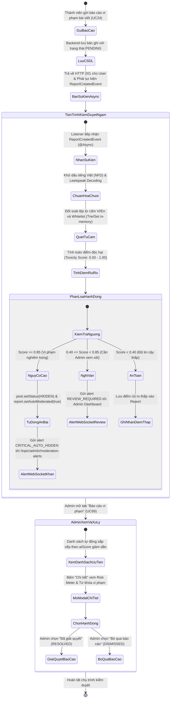
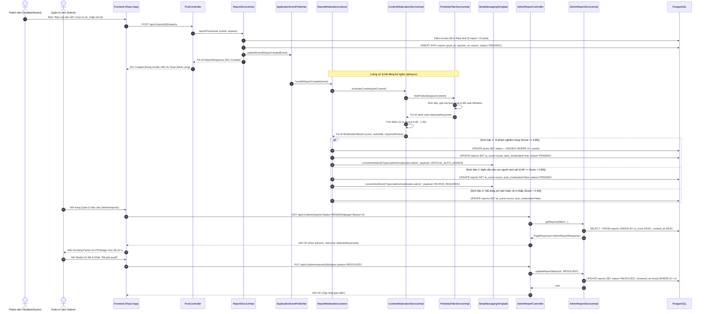
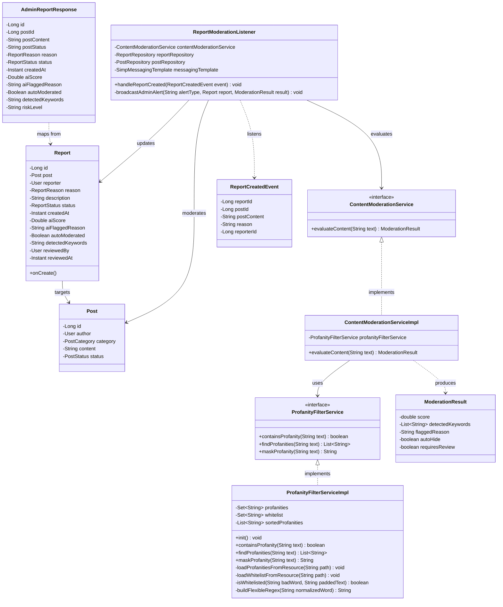

# ĐẶC TẢ YÊU CẦU & THIẾT KẾ CHI TIẾT: UC123 - KIỂM DUYỆT NỘI DUNG TỰ ĐỘNG & BỘ LỌC TỪ CẤM ĐA NGÔN NGỮ (AUTOMATED CONTENT MODERATION PIPELINE)

## PHẦN 1: ĐẶC TẢ NGHIỆP VỤ (REPORT 3)

### 2.2.3 Business Workflow (Luồng nghiệp vụ)

#### Mô tả chi tiết luồng xử lý bằng chữ (Business Step Description):
* **Bước 1 - Khởi đầu**: Khi thành viên (Student hoặc Alumni) phát hiện bài viết có dấu hiệu vi phạm chuẩn mực đạo đức, người dùng bấm nút "Báo cáo" trên thẻ bài viết và chọn lý do (UC24).
* **Bước 2 - Ghi nhận tức thì (Zero-Latency Guarantee)**: API `POST /api/v1/posts/{id}/reports` tiếp nhận request, kiểm tra rate limit (tối đa 5 report trong 10 phút), lưu bản ghi vào bảng `reports` với trạng thái ban đầu `PENDING`. Sau đó, hệ thống trả về HTTP 201 Created ngay lập tức cho người dùng và phát sự kiện `ReportCreatedEvent`.
* **Bước 3 - Kiểm duyệt bất đồng bộ ngầm (Asynchronous Pipeline)**: Lớp `ReportModerationListener` nhận sự kiện chạy trên thread pool riêng biệt:
  1. *Khử dấu & Chuẩn hóa chuỗi*: Sử dụng `ProfanityUtils` kết hợp `VietnameseStringUtils` để đưa văn bản về dạng không dấu, giải mã các biến thể leetspeak (thay số thành chữ) và loại bỏ ký tự phân cách cố ý lách luật (d.m, d-m).
  2. *Quét từ cấm đa ngôn ngữ*: Nạp sẵn 2.673 từ cấm tiếng Việt (`profanity_vi.txt`) và tiếng Anh (`profanity_en.txt`) vào bộ nhớ RAM. Đối soát với danh sách an toàn `profanity_whitelist.txt` (loại bỏ bắt nhầm cho các đại từ số nhiều như "các bạn", "các sinh viên" hoặc tên trường "FPT University").
  3. *Loại bỏ trùng lặp từ con (Sub-word Deduplication)*: Nếu đã bắt cụm từ dài (như "vãi lồn") thì không tính thêm từ con "lồn".
  4. *Phân tầng điểm rủi ro (Toxicity Score)*:
     - **Score >= 0.85 (Vi phạm nghiêm trọng)**: Tự động đổi trạng thái bài viết thành `PostStatus.HIDDEN`, đánh dấu `autoModerated = true`, và phát sóng cảnh báo khẩn cấp (Emergency Alert) tới Admin qua WebSocket channel `/topic/admin/moderation-alerts`.
     - **0.40 <= Score < 0.85 (Nghi vấn cần con người xem xét)**: Bài viết giữ nguyên trạng thái `ACTIVE`, đưa báo cáo lên hàng đầu danh sách ưu tiên của Admin và gửi WebSocket thông báo cần duyệt.
     - **Score < 0.40 (An toàn / Báo cáo không căn cứ)**: Cập nhật điểm số vào bản ghi báo cáo để phục vụ thống kê.
* **Bước 4 - Quản trị viên xử lý trên Dashboard (UC69-71)**:
  - Admin truy cập trang Quản lý báo cáo (`/admin/reports`). Bảng danh sách hiển thị cột "Đánh giá AI" với các pill badge màu đỏ pastel (Nguy cơ cao), vàng pastel (Nghi vấn) hoặc xanh pastel (An toàn).
  - Khi mở Modal chi tiết, Admin nhìn thấy thanh đo Risk Meter và toàn bộ danh sách từ khóa vi phạm bị phát hiện (`detectedKeywords`).
  - Admin bấm "Đã giải quyết" (`RESOLVED`) hoặc "Bỏ qua" (`DISMISSED`) để hoàn tất việc xử lý.

---

### 3.2 Admin Dashboard & System (Module 6)

#### 3.2.1 Kiểm duyệt nội dung tự động và quản lý báo cáo vi phạm (UC123)

**Function trigger**:
*   **Navigation path**: Dashboard Admin -> Menu trái chọn "Báo cáo vi phạm" -> Route `/admin/reports`
*   **Timing Frequency**: On demand khi Admin truy cập, hoặc nhận tín hiệu real-time từ WebSocket `/topic/admin/moderation-alerts`.

**Function description**:
*   **Actors/Roles**: Quản trị viên (`ADMIN`), Người dùng hệ thống (`STUDENT`, `ALUMNI`).
*   **Purpose**: Tự động phát hiện, ngăn chặn và loại bỏ nội dung xúc phạm, kích động bạo lực, từ ngữ thô tục mà không làm suy giảm tốc độ phản hồi của hệ thống.
*   **Interface**:
    *   Cột "Đánh giá AI" trên bảng danh sách báo cáo vi phạm với nhãn phần trăm điểm rủi ro và cờ "Tự động ẩn".
    *   Khối "Phân tích Kiểm duyệt Tự động" trong Modal chi tiết với thanh Risk Meter động và thẻ Pill Tag liệt kê từ cấm.
    *   Các nút thao tác nghiệp vụ: "Đã giải quyết", "Bỏ qua báo cáo", "Ẩn / Hủy ẩn bài viết".

**Data processing**:
*   Tự động lưu `ai_score`, `ai_flagged_reason`, `auto_moderated`, `detected_keywords` vào bảng `reports`.
*   Truy vấn danh sách thông qua `ReportSpecification` sắp xếp mặc định theo `ai_score DESC, created_at DESC`.
*   Cập nhật `reviewed_by` và `reviewed_at` khi Admin xác nhận giải quyết báo cáo.

---

### 5. Phụ lục Yêu cầu (Requirement Appendix)

#### 5.1 Business Rules (Quy tắc Nghiệp vụ)

| ID | Định nghĩa Quy tắc (Rule Definition) |
| :--- | :--- |
| **BR-123.01** | Khi người dùng gửi báo cáo vi phạm bài viết (UC24), API bắt buộc phải phản hồi HTTP 201 ngay lập tức. Toàn bộ logic chấm điểm AI và quét từ cấm phải thực thi bất đồng bộ (`@Async`). |
| **BR-123.02** | Toàn bộ từ điển từ cấm đa ngôn ngữ (Vi/En) và whitelist phải được nạp sẵn vào bộ nhớ RAM khi ứng dụng khởi động (`@PostConstruct`), không được phép đọc file I/O đĩa ở mỗi request. |
| **BR-123.03** | Nếu bài viết có điểm độc hại $Score \ge 0.85$, hệ thống bắt buộc phải tự động chuyển trạng thái bài viết sang `PostStatus.HIDDEN` và đánh dấu `auto_moderated = TRUE`. |
| **BR-123.04** | Nếu bài viết có điểm độc hại $0.40 \le Score < 0.85$, bài viết vẫn giữ nguyên trạng thái `ACTIVE` để tránh bắt nhầm (False Positive), đồng thời xếp ưu tiên lên đầu danh sách chờ Admin duyệt. |
| **BR-123.05** | Khi bài viết đã phát hiện cụm từ cấm dài (ví dụ: "vãi lồn"), hệ thống bắt buộc phải thực hiện khử trùng lặp từ con (Sub-word deduplication), không được đếm thêm từ đơn "lồn". |
| **BR-123.06** | Các đại từ số nhiều và thuật ngữ thông dụng có trong `profanity_whitelist.txt` (như "các bạn", "các sinh viên", "FPT University") phải được bỏ qua hoàn toàn, không tính vào điểm vi phạm. |
| **BR-123.07** | Bảng danh sách báo cáo vi phạm của Quản trị viên phải luôn ưu tiên sắp xếp theo điểm rủi ro AI giảm dần (`ai_score DESC`) trước, sau đó mới đến thời gian tạo (`created_at DESC`). |

---

## PHẦN 2: THIẾT KẾ KỸ THUẬT (TECHNICAL DESIGN)

### 2.1 Sơ đồ tuần tự hợp nhất (Unified Sequence Diagram)

#### Mô tả chi tiết sơ đồ tuần tự:
* **Các bước 1 - 7**: Thành viên thực hiện gửi báo cáo bài viết. Backend kiểm tra tính hợp lệ, lưu bản ghi vào PostgreSQL và trả về HTTP 201 ngay lập tức. Sau đó phát sự kiện nội bộ `ReportCreatedEvent` qua `ApplicationEventPublisher`.
* **Các bước 8 - 14**: Listener bất đồng bộ tiếp nhận sự kiện, chuyển tiếp nội dung bài viết sang `ContentModerationServiceImpl`. Lớp `ProfanityFilterServiceImpl` thực hiện chuẩn hóa, khử leetspeak, quét từ cấm và loại trừ từ ngữ an toàn theo whitelist.
* **Các bước 15 - 20 (Rẽ nhánh theo ngưỡng điểm rủi ro)**:
  - Nếu điểm rủi ro $\ge 0.85$: Hệ thống cập nhật bảng `posts` sang `HIDDEN`, cập nhật `reports.auto_moderated = true` và bắn WebSocket alert tới Admin.
  - Nếu $0.40 \le Score < 0.85$: Bài viết giữ nguyên trạng thái công khai, cập nhật điểm số và phát tín hiệu xem xét tới Admin.
  - Nếu $Score < 0.40$: Cập nhật điểm rủi ro thấp vào bản ghi báo cáo.
* **Các bước 21 - 31**: Admin truy cập hệ thống, danh sách báo cáo được sắp xếp tự động ưu tiên theo `ai_score DESC`. Admin xem chi tiết từ khóa vi phạm trên Modal và tiến hành xác nhận giải quyết báo cáo.

---

### 2.2 Biểu đồ lớp chi tiết (Detailed Class Diagram)

