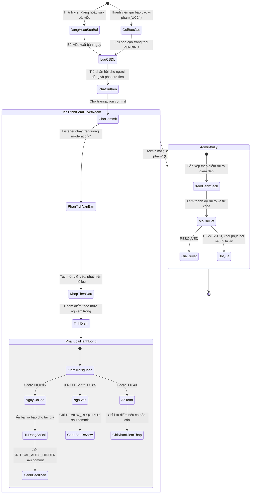
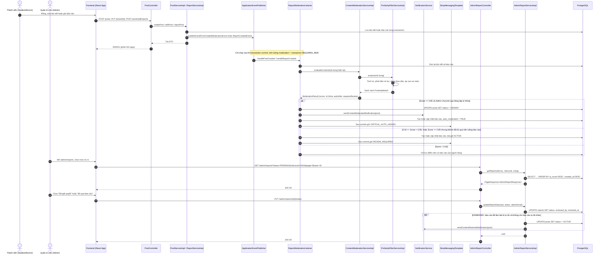
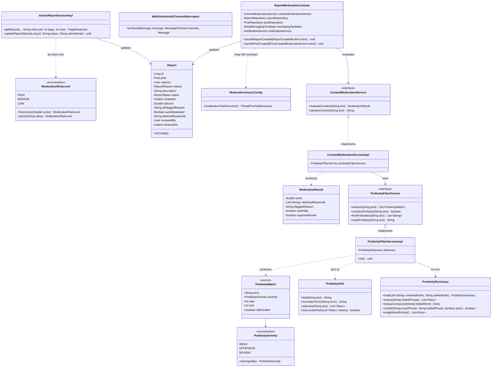

# ĐẶC TẢ YÊU CẦU & THIẾT KẾ CHI TIẾT: UC123 - KIỂM DUYỆT NỘI DUNG TỰ ĐỘNG & BỘ LỌC TỪ CẤM ĐA NGÔN NGỮ (AUTOMATED CONTENT MODERATION PIPELINE)

> **Phạm vi kỹ thuật**: Đây là bộ lọc dựa trên từ điển và luật, không dùng mô hình học máy. Các trường `aiScore`, `aiFlaggedReason` giữ tên lịch sử trong cơ sở dữ liệu và API; giao diện hiển thị là "điểm rủi ro".

## PHẦN 1: ĐẶC TẢ NGHIỆP VỤ (REPORT 3)

### 2.2.3 Business Workflow (Luồng nghiệp vụ)

#### Mô tả chi tiết luồng xử lý bằng chữ (Business Step Description):
* **Bước 1 - Khởi đầu**: Có hai nguồn kích hoạt. Thành viên đăng hoặc sửa bài viết trên bảng tin; hoặc thành viên bấm "Báo cáo" trên bài viết và chọn lý do (UC24).
* **Bước 2 - Ghi nhận tức thì**: Bài viết được xuất bản ngay (Post-First, Moderate-Later). Với báo cáo, API `POST /api/v1/posts/{id}/reports` kiểm tra giới hạn tối đa 5 báo cáo trong 10 phút, lưu bản ghi trạng thái `PENDING` và trả HTTP 201. Service phát sự kiện `PostCreatedModerationEvent` hoặc `ReportCreatedEvent`.
* **Bước 3 - Kiểm duyệt nền sau khi commit**: `ReportModerationListener` chỉ chạy sau khi transaction gốc commit (`AFTER_COMMIT`), trên luồng riêng `moderation-*`, trong transaction mới (`REQUIRES_NEW`). Listener đọc lại nội dung hiện tại từ cơ sở dữ liệu.
  1. *Tách từ*: `ProfanityUtils` tách văn bản thành từ, giữ vị trí gốc và giữ dấu tiếng Việt, bỏ qua liên kết, email và tên miền.
  2. *Phát hiện né lọc*: Nhận diện leetspeak (`l0n`, `c@c`), từ tự che (`f*ck`), chữ bị tách (`l.o.n`, `đ-m`, `c ặ c`), ký tự vô hình, ký tự Kirin giả dạng và ký tự Unicode biến thể.
  3. *Khớp theo dấu*: `ProfanityFilterServiceImpl` so từng từ với từ điển. Từ có dấu phải khớp đúng dấu, nên "lớn", "các", "buổi" không khớp "lồn", "cặc", "buồi". Từ đơn gõ không dấu trùng từ thường bị bỏ qua. Cụm dễ trùng khi bỏ dấu ("như các", "từ từ đi") chỉ là tín hiệu yếu trong văn bản không dấu.
  4. *Cụm an toàn theo vị trí*: `profanity_whitelist.txt` chỉ bảo vệ đúng đoạn văn của cụm đó, không bảo vệ cả bài.
  5. *Chấm điểm*: Mức nghiêm trọng gồm `SEVERE`, `OFFENSIVE`, `WEAK`. Một từ `SEVERE` được 0.65, chỉ có `OFFENSIVE` được 0.50; mỗi từ khác nhau thêm 0.20; lặp từ 3 lần trở lên thêm 0.20; có dấu hiệu né lọc thêm 0.10; tối đa 0.99. Chỉ có tín hiệu yếu thì tối đa 0.35; không có gì thì 0.05.
  6. *Hành động theo ngưỡng*:
     - **Score >= 0.85**: Chuyển bài sang `PostStatus.HIDDEN`, đánh dấu `autoModerated = true`, gửi thông báo `CONTENT_MODERATED` cho tác giả và cảnh báo `CRITICAL_AUTO_HIDDEN` tới Admin.
     - **0.40 <= Score < 0.85**: Bài giữ `ACTIVE`, tạo hoặc cập nhật báo cáo hệ thống và gửi cảnh báo `REVIEW_REQUIRED`.
     - **Score < 0.40**: Không hành động. Nếu có báo cáo của người dùng thì lưu điểm để thống kê.
  7. *Tôn trọng quyết định của Admin*: Nếu Admin đã bỏ qua báo cáo với đúng tập từ khóa này, hệ thống không tự ẩn lại. Bài sửa sang từ cấm khác vẫn bị ẩn.
* **Bước 4 - Che từ cấm khi ghi**: Bình luận bài viết, bài và bình luận trong nhóm, câu hỏi và câu trả lời diễn đàn, tin nhắn chat nhóm không có hàng chờ duyệt, nên từ mức `OFFENSIVE` trở lên được thay bằng `***` trước khi lưu. Phần còn lại của nội dung giữ nguyên. Tin nhắn 1-1 và Chat for Task là trao đổi riêng tư nên hệ thống không quét.
* **Bước 5 - Quản trị viên xử lý (UC69-71)**: Admin mở `/admin/reports`, xem cột "Đánh giá rủi ro", lọc theo mức rủi ro (lọc phía server) và mở chi tiết để xem thanh đo rủi ro cùng từ khóa. Báo cáo do hệ thống tạo hiển thị người gửi là "Hệ thống kiểm duyệt". Admin chọn "Đã giải quyết" (`RESOLVED`) hoặc "Bỏ qua báo cáo" (`DISMISSED`). Hệ thống lưu `reviewed_by`, `reviewed_at`. Khi bỏ qua báo cáo đã làm bài bị tự ẩn, bài được khôi phục và tác giả nhận thông báo, trừ khi bài còn báo cáo tự ẩn khác chưa bị bỏ qua.

---

### 3.2 Admin Dashboard & System (Module 6)

#### 3.2.1 Kiểm duyệt nội dung tự động và quản lý báo cáo vi phạm (UC123)

**Function trigger**:
*   **Navigation path**: Dashboard Admin -> Menu trái chọn "Báo cáo vi phạm" -> Route `/admin/reports`
*   **Timing Frequency**: Tự động mỗi khi bài viết được đăng, sửa hoặc bị báo cáo; On demand khi Admin truy cập; real-time qua WebSocket `/topic/admin/moderation-alerts`.

**Function description**:
*   **Actors/Roles**: Quản trị viên (`ADMIN`), Người dùng hệ thống (`STUDENT`, `ALUMNI`).
*   **Purpose**: Tự động phát hiện và ngăn chặn nội dung tục tĩu, xúc phạm, đe dọa mà không làm chậm phản hồi của hệ thống và không bắt nhầm tiếng Việt thông thường.
*   **Interface**:
    *   Cột "Đánh giá rủi ro" trên bảng báo cáo với nhãn phần trăm và cờ "Tự động ẩn".
    *   Bộ lọc "Mức rủi ro" gồm Tất cả, Nguy cơ cao, Nghi vấn, An toàn.
    *   Khối "Phân tích Kiểm duyệt Tự động" trong Modal chi tiết với thanh đo rủi ro và thẻ từ khóa.
    *   Các nút "Đã giải quyết", "Bỏ qua báo cáo", "Ẩn / Hủy ẩn bài viết".

**Data processing**:
*   Lưu `ai_score`, `ai_flagged_reason`, `auto_moderated`, `detected_keywords` vào bảng `reports`.
*   Báo cáo hệ thống có `reporter_id = NULL` (migration V43).
*   Truy vấn qua `ReportSpecification`, sắp xếp `ai_score DESC, created_at DESC`, lọc `riskLevel` ngay trong truy vấn để phân trang đúng.
*   Cập nhật `reviewed_by` và `reviewed_at` khi Admin xử lý báo cáo.

---

### 5. Phụ lục Yêu cầu (Requirement Appendix)

#### 5.1 Business Rules (Quy tắc Nghiệp vụ)

| ID | Định nghĩa Quy tắc (Rule Definition) |
| :--- | :--- |
| **BR-123.01** | API đăng bài, sửa bài và báo cáo phải phản hồi ngay. Việc chấm điểm chạy bất đồng bộ và chỉ bắt đầu sau khi transaction gốc đã commit. |
| **BR-123.02** | Từ điển phải nạp vào bộ nhớ khi khởi động (`@PostConstruct`). Thiếu tệp từ điển là lỗi khởi động, không được chạy với bộ lọc rỗng. |
| **BR-123.03** | Nếu điểm >= 0.85 và Admin chưa bỏ qua đúng tập từ khóa đó, bài viết phải chuyển sang `HIDDEN`, đánh dấu `auto_moderated = TRUE` và tác giả phải nhận thông báo `CONTENT_MODERATED`. |
| **BR-123.04** | Nếu 0.40 <= điểm < 0.85, bài viết giữ `ACTIVE` và được đưa vào hàng chờ Admin. |
| **BR-123.05** | Từ cấm nằm trong cụm dài đã khớp không được tính thêm. Ví dụ "vãi lồn" chỉ tính một lần, không đếm thêm "lồn". |
| **BR-123.06** | Từ có dấu chỉ khớp mục từ điển đúng dấu. Cụm an toàn chỉ bảo vệ đúng đoạn văn của nó và phải khớp đúng dấu nếu người viết gõ có dấu. |
| **BR-123.07** | Danh sách báo cáo của Admin sắp xếp theo `ai_score DESC`, sau đó `created_at DESC`. |
| **BR-123.08** | Báo cáo do hệ thống tạo có `reporter_id = NULL`, không tính vào giới hạn báo cáo của tác giả. Mỗi bài có tối đa một báo cáo hệ thống đang `PENDING`; lần quét sau cập nhật báo cáo đó. |
| **BR-123.09** | Bài sửa nội dung phải được quét lại như bài mới đăng. |
| **BR-123.10** | Bình luận, nội dung nhóm, diễn đàn và chat nhóm được che từ mức `OFFENSIVE` trở lên khi lưu. Tin nhắn 1-1 và Chat for Task không bị quét. |
| **BR-123.11** | Khi Admin bỏ qua báo cáo đã làm bài bị tự ẩn, bài được khôi phục và tác giả được thông báo, trừ khi còn báo cáo tự ẩn khác chưa bị bỏ qua. |
| **BR-123.12** | Chỉ tài khoản `ADMIN` được `SUBSCRIBE` hoặc `SEND` tới các kênh `/topic/admin/**`. |
| **BR-123.13** | Viết tắt `cc`, `cl`, `dm`, `ml` không tính khi viết hoa giữa câu thường, khi đứng sau số ("150 cc", "500 ml") hoặc khi là mã ("ml-10"). |

#### 5.2 Application Messages List (Danh sách thông điệp)

| Mã | Ngữ cảnh | Thông điệp | HTTP |
| :--- | :--- | :--- | :--- |
| MSG-123.01 | Lấy danh sách báo cáo thành công | Lấy danh sách báo cáo vi phạm thành công | 200 |
| MSG-123.02 | Bỏ qua báo cáo | Đã bỏ qua báo cáo vi phạm | 200 |
| MSG-123.03 | Giải quyết báo cáo | Đã giải quyết báo cáo vi phạm | 200 |
| MSG-123.04 | Không tìm thấy báo cáo | Không tìm thấy báo cáo vi phạm với ID: {id} | 404 |
| MSG-123.05 | Không tìm thấy Admin | Không tìm thấy tài khoản quản trị viên | 404 |
| MSG-123.06 | Quay lại PENDING | Không thể cập nhật báo cáo quay lại trạng thái PENDING. | 400 |
| MSG-123.07 | Trạng thái sai | Trạng thái báo cáo không hợp lệ: {status} | 400 |
| MSG-123.08 | Tài khoản thường truy cập kênh quản trị | Bạn không có quyền truy cập kênh quản trị | STOMP ERROR |
| MSG-123.09 | Thông báo bài bị tự ẩn | Bài viết của bạn đã tạm ẩn vì có thể vi phạm tiêu chuẩn cộng đồng. Quản trị viên sẽ xem xét và phản hồi. | Thông báo |
| MSG-123.10 | Thông báo bài được khôi phục | Quản trị viên đã xem xét và xác nhận bài viết của bạn không vi phạm tiêu chuẩn cộng đồng. | Thông báo |

#### 5.3 Giới hạn đã biết

*   Bộ lọc dựa trên từ khóa nên không nhận ra lời thù ghét không dùng từ cấm, mỉa mai hoặc ẩn ý.
*   Tiếng Việt gõ không dấu khó phân biệt nên hệ thống ưu tiên không bắt nhầm; một số lời chửi không dấu chỉ là tín hiệu yếu.
*   Sự kiện kiểm duyệt nằm trong bộ nhớ. Nếu ứng dụng dừng đột ngột ngay sau khi commit, bài vừa đăng có thể chưa được quét.

#### 5.4 Kết quả đo chất lượng bộ lọc

Đo bằng bộ dữ liệu ViHSD (tập test 6.680 bình luận, không dùng khi xây dựng từ điển) và tập câu sạch gồm phản hồi sinh viên UIT-VSFC cùng tài liệu dự án. Dữ liệu chỉ dùng để đo, không nằm trong kho mã nguồn.

| Chỉ số | Bản đầu tiên | Bản hiện tại |
| :--- | :--- | :--- |
| ViHSD test, độ chính xác khi gắn cờ | 46,8% | 76,7% |
| ViHSD test, độ phủ khi gắn cờ | 47,3% | 40,1% |
| ViHSD test, tỷ lệ bắt nhầm | 10,98% | 2,49% |
| ViHSD test, bài tự ẩn sai trên số bài bị ẩn | 54/172 | 0/46 |
| Phản hồi sinh viên, câu sạch bị gắn cờ | 13,4% | 0,02% |
| Phản hồi sinh viên, câu sạch bị tự ẩn | 1,45% | 0% |

---

## PHẦN 2: THIẾT KẾ KỸ THUẬT (TECHNICAL DESIGN)

### 2.1 Sơ đồ tuần tự hợp nhất (Unified Sequence Diagram)

#### Mô tả chi tiết sơ đồ tuần tự:
* **Các bước 1 - 7**: Người dùng đăng, sửa bài hoặc gửi báo cáo. Service lưu dữ liệu trong transaction, phát sự kiện và trả phản hồi ngay.
* **Các bước 8 - 14**: Sau khi transaction commit, listener chạy trên luồng riêng, đọc lại dữ liệu và gọi `ContentModerationServiceImpl`. `ProfanityFilterServiceImpl` phân tích văn bản theo từng từ và trả về các vị trí vi phạm.
* **Các bước 15 - 21 (Rẽ nhánh theo ngưỡng)**: Vi phạm nghiêm trọng thì ẩn bài, báo tác giả, tạo hoặc cập nhật báo cáo. Vi phạm vừa thì giữ bài và đưa vào hàng chờ. Điểm thấp thì chỉ lưu điểm nếu có báo cáo của người dùng. Bài do người dùng đăng hoặc sửa mà Admin đã bỏ qua đúng tập từ khóa thì không tạo báo cáo mới. Cảnh báo WebSocket chỉ gửi sau khi dữ liệu đã lưu.
* **Các bước 22 - 34**: Admin xem danh sách đã sắp xếp theo điểm rủi ro, lọc theo mức rủi ro và xử lý báo cáo. Bỏ qua báo cáo đã làm bài bị tự ẩn thì bài được khôi phục và tác giả nhận thông báo.

---

### 2.2 Biểu đồ lớp chi tiết (Detailed Class Diagram)

#### Vai trò của từng lớp
* **ProfanityUtils**: Tách từ, giữ vị trí gốc và dấu, nhận diện dấu hiệu né lọc.
* **ProfanityDictionary**: Nạp từ điển phân mức và cụm an toàn, sinh tổ hợp từ cú pháp `{a|b}`.
* **ProfanityFilterServiceImpl**: Quy tắc khớp theo dấu, cụm an toàn theo vị trí, che từ cấm theo vị trí.
* **ContentModerationServiceImpl**: Chấm điểm rủi ro và cung cấp `sanitizeContent` cho các nội dung không qua hàng chờ duyệt.
* **ReportModerationListener**: Thực thi hành động sau commit, gồm ẩn bài, cập nhật báo cáo, gửi thông báo và cảnh báo.
* **ModerationAsyncConfig**: Luồng nền có giới hạn cho kiểm duyệt; hàng đợi đầy thì luồng gửi tự xử lý, không làm mất lượt quét.
* **ModerationRiskLevel**: Nguồn duy nhất của các ngưỡng điểm cho hiển thị và lọc.
* **WebSocketAuthChannelInterceptor**: Xác thực JWT khi kết nối và chặn tài khoản không phải Admin truy cập `/topic/admin/**`.
* **AdminReportServiceImpl**: Lọc và xử lý báo cáo, ghi nhận người xử lý, khôi phục bài bị tự ẩn nhầm.
